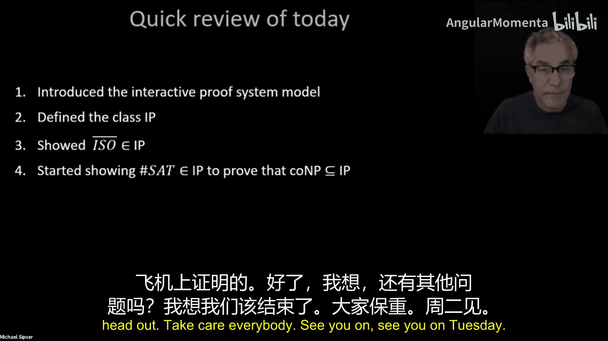

# 024：交互式证明系统，IP

在本节课中，我们将要学习交互式证明系统（Interactive Proof Systems）及其对应的复杂性类 **IP**。这是一个结合了概率计算和交互通信的模型，可以看作是 **NP** 概念的概率版本。我们将通过图非同构问题的例子来理解这个模型，并探讨 **IP** 与 **NP**、**BPP**、**PSPACE** 等复杂性类之间的关系。

---

## 图同构问题与 **NP**

上一节我们介绍了交互式证明系统的概念。本节中，我们来看看一个具体的例子：图同构问题。

图同构问题（ISO）是指判断两个图是否同构。两个图同构意味着它们本质上是同一个图，只是节点的标签或排列顺序不同。判断两个图是否同构的问题属于 **NP** 类，因为我们可以提供一个同构映射作为证书，验证者可以在多项式时间内检查这个映射是否正确。

然而，判断两个图是否不同构（即非 ISO 问题）是否也属于 **NP** 类，目前尚不清楚。也就是说，我们可能无法提供一个简短的证书来证明两个图不同构。

---

## 交互式证明模型

尽管非 ISO 问题可能不属于 **NP**，但我们可以通过交互式证明系统，让一个拥有无限计算能力的证明者（Prover）说服一个只有多项式时间计算能力的验证者（Verifier）相信两个图确实不同构。

以下是交互式证明系统的基本模型：
*   **验证者（Verifier）**：计算能力有限，只能在多项式时间内运行，并且可以是概率性的（即可以使用随机数）。
*   **证明者（Prover）**：计算能力无限，可以解决任何计算问题。
*   **交互过程**：双方可以交换多项式数量的信息。
*   **目标**：对于属于某个语言的输入字符串，存在一个诚实的证明者能以高概率说服验证者接受。对于不属于该语言的输入字符串，任何（即使是恶意的）证明者都只能以低概率让验证者接受。

---

## 图非同构的交互式证明协议

现在，我们来看一个具体的协议，它能让证明者说服验证者两个图 **G** 和 **H** 是不同构的。

协议的核心思想是，验证者通过随机挑战来测试证明者是否真的能区分两个图。

以下是协议步骤：
1.  验证者随机选择图 **G** 或图 **H**（例如，抛硬币决定）。
2.  验证者随机打乱所选图的节点顺序，得到一个新图 **K**，然后将 **K** 发送给证明者。
3.  验证者询问证明者：“**K** 是由 **G** 还是由 **H** 打乱得到的？”
4.  证明者利用其无限的计算能力，检查 **K** 与 **G** 和 **H** 哪个同构，并给出答案（“G”或“H”）。
5.  验证者检查证明者的答案是否正确。
6.  重复上述步骤多次（例如，100次）。

**协议分析**：
*   如果 **G** 和 **H** 确实**不同构**，那么 **K** 只可能与 **G** 或 **H** 中的一个同构。诚实的证明者每次都能给出正确答案，因此验证者最终会以概率1接受。
*   如果 **G** 和 **H** 实际上**同构**，那么 **K** 既可能与 **G** 同构，也可能与 **H** 同构。证明者无法区分，最多只能随机猜测。假设重复 **n** 次，证明者猜对所有 **n** 次的概率仅为 **(1/2)^n**，这是一个极低的概率。因此，任何证明者都无法以高概率欺骗验证者接受。

通过这个协议，我们展示了非 ISO 问题属于 **IP** 类。

---

## **IP** 与其他复杂性类的关系

了解了 **IP** 的基本定义和例子后，我们来看看它与其他复杂性类的关系。

以下是几个重要的包含关系：
*   **NP ⊆ IP**：任何 **NP** 问题都可以转化为一个交互式证明，其中证明者直接发送证书，验证者确定性验证。
*   **BPP ⊆ IP**：**BPP** 类中的问题可以由概率多项式时间的验证者自行解决，无需与证明者交互（或让证明者保持沉默）。
*   **IP ⊆ PSPACE**：任何交互式证明系统都可以在多项式空间内通过遍历所有可能的交互历史和随机选择来模拟。
*   **PSPACE ⊆ IP**：这是一个非常重要的结果（**IP = PSPACE**），表明 **IP** 类的能力非常强大，包含了所有多项式空间可解的问题。我们将在后续课程中证明一个稍弱但核心思想相同的结果：**coNP ⊆ IP**。

---

## 迈向 **coNP ⊆ IP**：#SAT 问题

为了证明 **coNP ⊆ IP**，我们将聚焦于一个 **coNP** 难的问题：#SAT 问题（或称 Number SAT）。

**#SAT** 问题的定义如下：
给定一个布尔公式 **φ** 和一个数字 **k**，判断公式 **φ** 的满足赋值（satisfying assignments）的**确切数量**是否等于 **k**。我们用 **#φ** 表示公式 **φ** 的满足赋值数量。

**#SAT** 是 **coNP** 难的，因为 **coNP** 完全问题（如公式不可满足性）可以多项式时间归约到它：一个公式 **φ** 不可满足当且仅当 **#φ = 0**。

因此，如果我们能证明 **#SAT ∈ IP**，就意味着 **coNP ⊆ IP**。

---

## 一个低效但直观的交互协议思路

我们首先描述一个直观但计算上不可行的协议思路，以理解证明的核心挑战。

假设公式 **φ** 有 **m** 个变量 **x₁, …, x_m**。协议过程如下：
1.  证明者声称 **#φ = k**（与输入一致）。
2.  为了证明这个声称，证明者进一步声称当 **x₁ = 0** 时的满足赋值数 **A₀** 和当 **x₁ = 1** 时的满足赋值数 **A₁**，并且满足 **A₀ + A₁ = k**。
3.  验证者检查 **A₀ + A₁** 是否等于 **k**。
4.  接着，证明者对 **A₀** 和 **A₁** 分别进行同样的展开（例如，对于 **A₀**，进一步声称 **x₁=0, x₂=0** 和 **x₁=0, x₂=1** 时的数量），并逐层递进。
5.  最终，在最后一层（预设了所有 **m** 个变量的值），证明者给出了 **2^m** 个值，每个值（0或1）表示对应完全赋值是否满足公式。
6.  验证者做两件事：
    *   检查每一层中，兄弟节点的值之和是否等于父节点的值。
    *   在最后一层，直接计算每个完全赋值是否满足 **φ**，并与证明者提供的值比对。

**问题**：
这个协议需要证明者在最后一层发送 **2^m** 个值，这是指数级的，违反了多项式时间交互的要求。因此，这不是一个有效的 **IP** 协议。

**关键洞察**：
这个思路的缺陷在于“分支爆炸”。我们需要一种方法，使得验证者只需检查一个或少数几个子节点，就能高置信度地推断父节点的正确性，同时又能防止恶意证明者通过精心构造的单一错误路径进行欺骗。下一节课，我们将通过引入“算术化”技术，在更大的域（而非仅布尔值）上进行计算，来解决这个问题，从而构造出一个真正高效的协议。

---

## 总结

本节课中我们一起学习了：
1.  **交互式证明系统（IP）** 的基本模型，包括能力有限的概率验证者和能力无限的证明者。
2.  通过**图非同构问题**，我们看到了一个具体的 **IP** 协议，它解决了可能不属于 **NP** 的问题。
3.  探讨了 **IP** 与 **NP**、**BPP**、**PSPACE** 等复杂性类之间的关系，特别是 **IP = PSPACE** 这一深刻结论。
4.  为了证明 **coNP ⊆ IP**，我们引入了 **#SAT** 问题，并分析了一个直观但低效的协议思路，指出了其中的核心困难在于避免指数级信息交换。

下一节课，我们将完成 **#SAT ∈ IP** 的证明，从而最终建立 **coNP ⊆ IP** 这一重要结果。