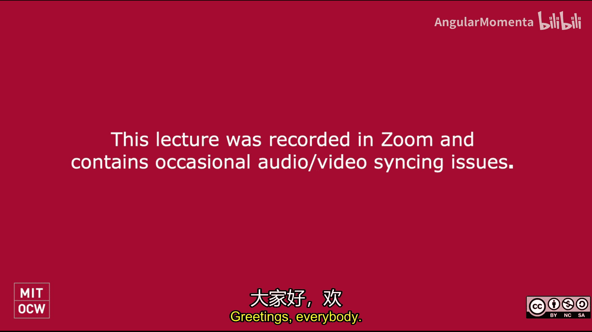
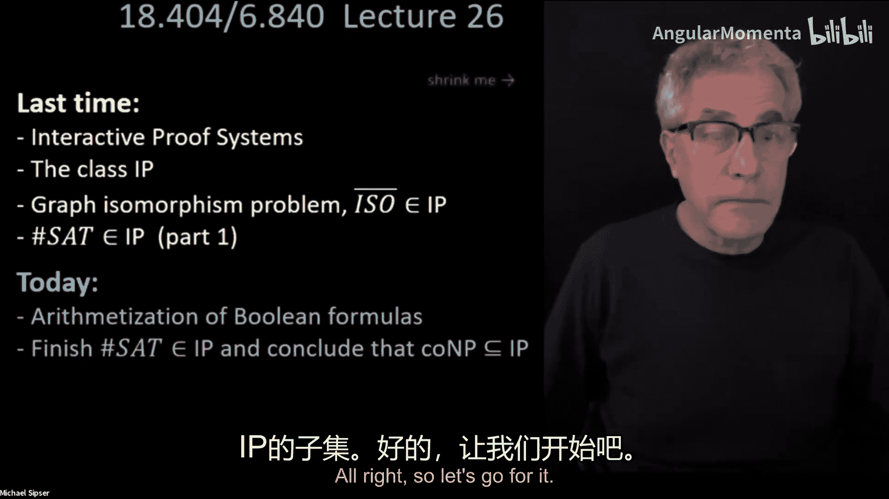
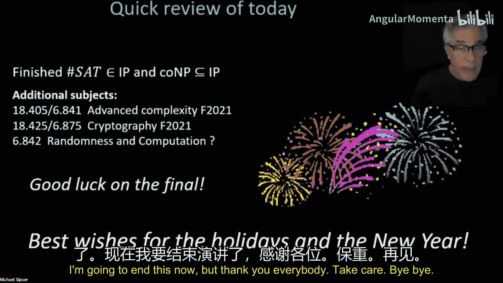

# 025：coNP是IP的子集 👨‍🏫

在本节课中，我们将要学习交互式证明系统（IP）的最后一个重要结论：**coNP是IP的子集**。我们将通过分析一个具体问题——#SAT（计数可满足性问题）——来展示这一点。首先，我们会回顾交互式证明系统的定义和基本设置，然后介绍一个指数级的、有缺陷的验证协议。接着，我们将通过**算术化**技术，将这个指数级协议改进为一个多项式级的、有效的交互式证明协议。本节课的核心在于理解如何利用算术化和随机性来高效地验证一个公式的不可满足性（即属于coNP的问题）。

---

## 交互式证明系统回顾 🔄

上一节我们介绍了交互式证明系统的基本概念。本节中我们来看看其正式定义和关键思想。

交互式证明系统涉及两个参与方：
*   **证明者（Prover）**：拥有无限的计算能力，目标是说服验证者接受某个陈述。
*   **验证者（Verifier）**：计算能力受限（通常是多项式时间），负责与证明者交互并最终决定是否接受输入。

两者都看到输入，并交换多项式数量的消息。最终，验证者以一定的概率接受或拒绝输入。对于一个语言L，要求：
*   **完备性**：如果输入x在L中，那么存在一个诚实的证明者，能使验证者以**高概率**（例如 ≥ 2/3）接受。
*   **可靠性**：如果输入x不在L中，那么**对于任何**（即使是恶意的）证明者，验证者都只能以**低概率**（例如 ≤ 1/3）接受。

这个概率间隙允许我们使用**概率放大引理**，使得接受概率在“是”实例中趋近于1，在“否”实例中趋近于0。

一个令人惊奇的定理是 **IP = PSPACE**。本节课我们将证明一个稍弱但核心思想相同的结论：**coNP ⊆ IP**。

---

## 从#SAT问题入手 🔢

为了证明coNP ⊆ IP，我们聚焦于一个coNP难的问题：#SAT（计数可满足性问题）。

**#SAT问题的定义**：
*   **输入**：一个布尔公式φ（在变量x₁, ..., xₘ上）和一个数字k。
*   **问题**：判断公式φ的**可满足赋值**的数量是否**恰好等于**k。

特别地，如果φ是**不可满足的**，那么它的可满足赋值数就是0。因此，将不可满足性问题归约到#SAT是容易的，而不可满足性问题是coNP完全的。所以，如果我们能证明#SAT ∈ IP，就能推出coNP ⊆ IP。

---

## 预设变量与计数恒等式 📝

在深入协议之前，我们需要建立一些符号和关键恒等式。

给定公式φ，我们可以**预设**其前i个变量的值（设为a₁, ..., aᵢ，每个aⱼ ∈ {0,1}）。记作：
*   **φ|a₁...aᵢ**：将x₁, ..., xᵢ分别设为a₁, ..., aᵢ后得到的新公式。
*   **#φ|a₁...aᵢ**：新公式φ|a₁...aᵢ的可满足赋值数量（即对剩余m-i个变量的所有2^(m-i)种赋值进行计数）。

基于此，我们有两个核心**计数恒等式**：
1.  **加法恒等式**：对于i < m，有 `#φ|a₁...aᵢ = #φ|a₁...aᵢ0 + #φ|a₁...aᵢ1`。这表示，在预设前i位后，总可满足数等于将下一位设为0和设为1两种情况的可满足数之和。
2.  **终结恒等式**：当所有变量都被预设（i = m）时，`#φ|a₁...aₘ`的值要么是0（该赋值不满足φ），要么是1（该赋值满足φ）。即 `#φ|a₁...aₘ = φ(a₁, ..., aₘ)`。

---

## 一个指数级的朴素协议（及其缺陷） 🐌

基于上述恒等式，我们可以构思一个直观的交互协议：

**协议流程（指数级）**：
1.  证明者发送声称的总可满足赋值数 `#φ`。
2.  验证者检查收到的值是否等于输入中的k。若不等于，则拒绝。
3.  为了证明 `#φ` 正确，证明者必须证明它等于 `#φ|0 + #φ|1`。因此，证明者发送这两个数。
4.  验证者检查 `#φ` 是否等于收到的两个数之和。若不等于，则拒绝。
5.  验证者现在需要确信 `#φ|0` 和 `#φ|1` 的正确性。协议递归进行：为了证明 `#φ|a₁`，证明者需要发送 `#φ|a₁0` 和 `#φ|a₁1`，验证者检查它们的和，如此往复。
6.  最终，在递归了m层之后，证明者需要为所有2^m种完整的变量赋值（即 `φ|a₁...aₘ` 对于所有a₁...aₘ）发送一个值（0或1）。
7.  验证者最后检查：对于每一种完整赋值，收到的值（0或1）是否等于直接计算 `φ(a₁, ..., aₘ)` 得到的结果（也是0或1）。同时，它也要检查最后一层的加法恒等式是否成立。

**协议分析**：
*   **如果输入正确（k = #φ）且证明者诚实**：验证者所有检查都会通过，最终以概率1接受。
*   **如果输入错误（k ≠ #φ）**：诚实的证明者会发送正确的 `#φ`，导致第一步检查失败，验证者拒绝。那么，一个恶意的证明者如果想欺骗验证者接受，就必须在第一步说谎，发送一个错误的 `#φ'`（令 `#φ' = k`）。然而，根据加法恒等式，一个错误的上层值必然导致至少一个下层值也是错误的（因为两个正确的下层值之和不可能等于一个错误的上层值）。这个“谎言”会沿着递归树向下传播，直到最后层。验证者最终会在检查某个终结值（0或1）或某层加法时发现不一致，从而拒绝。
*   **致命缺陷**：这个协议中，证明者在每一层都需要发送**指数级数量**（2^(m-i)）的值。整个协议的消息长度是指数级的，违反了交互式证明系统对**多项式时间验证者**的要求（验证者必须能在多项式时间内处理消息）。

因此，我们需要一个更高效的协议。

---

## 算术化：从布尔值到多项式 🧮

上一节我们看到了朴素协议的指数级缺陷。本节中我们来看看如何通过**算术化**技术来克服它。

算术化的目标是将布尔公式φ转换成一个**多项式** `p_φ`，使得对于任何**布尔赋值**（变量取0或1），多项式的值等于原布尔公式的值（0或1）。转换规则如下：
*   **布尔变量 x**：映射为多项式变量 `x`。
*   **逻辑非 (¬x)**：映射为 `(1 - x)`。
*   **逻辑与 (x ∧ y)**：映射为 `x * y`。
*   **逻辑或 (x ∨ y)**：映射为 `x + y - x*y`。

通过递归应用这些规则，任何布尔公式φ都可以被算术化为一个多元多项式 `p_φ(x₁, ..., xₘ)`。关键性质是：对于所有 `(a₁, ..., aₘ) ∈ {0,1}^m`，有 `p_φ(a₁, ..., aₘ) = φ(a₁, ..., aₘ)`。此外，`p_φ` 的**次数**最多是公式φ的长度。

现在，我们扩展“可满足赋值计数”的概念。对于预设值 `a₁, ..., aᵢ`（现在允许 `aⱼ` 取自一个足够大的有限域 `F`，而不仅仅是{0,1}），我们定义：
*   **#φ|a₁...aᵢ** = Σ_{(bᵢ₊₁, ..., bₘ) ∈ {0,1}^(m-i)} p_φ(a₁, ..., aᵢ, bᵢ₊₁, ..., bₘ)

注意，即使预设值 `aⱼ` 不是0或1，我们仍然只对剩余变量进行布尔赋值（0或1）并求和。当所有预设值 `aⱼ` 都是布尔值时，这个定义与原始的计数定义一致。我们之前的两条计数恒等式在这个扩展定义下依然成立。

---

## 多项式级IP协议：核心思想 🚀

算术化如何帮助我们？关键在于一个深刻的观察：对于固定的 `a₁, ..., aᵢ`，将 `#φ|a₁...aᵢ` 视为第 `i+1` 个预设值（记作变量 `z`）的函数时，它是一个**单变量多项式** `hᵢ(z)`！这是因为求和是在剩余变量上进行的，而 `p_φ` 本身是多项式。

**核心协议思想（多项式级）**：
1.  证明者不再像指数协议那样，为下一层所有可能的布尔预设发送两个数字（如 `#φ|...0` 和 `#φ|...1`），而是发送**整个多项式** `hᵢ(z)`（通过发送其系数）。
2.  验证者收到这个多项式 `hᵢ(z)` 后，可以做两件事：
    *   **检查加法恒等式**：计算 `hᵢ(0) + hᵢ(1)`，并验证其是否等于上一轮声称的值。
    *   **随机抽查**：为了相信 `hᵢ(z)` 是正确的多项式（而不是证明者伪造的），验证者随机从域 `F` 中选取一个点 `r`，然后要求证明者证明 `hᵢ(r)` 的值是正确的。
3.  如何证明 `hᵢ(r)` 正确呢？这恰好变成了一个形式相同但“深度”增加了1的子问题：我们需要验证 `#φ|a₁...aᵢ, r`。于是，协议可以递归地进行。
4.  递归到最后，当所有变量都被预设时（即需要验证 `#φ|a₁...aₘ`），验证者可以直接计算 `p_φ(a₁, ..., aₘ)` 来检查证明者声称的值是否正确。

**为什么随机抽查有效？**
如果证明者是诚实的，他发送的就是正确的多项式 `hᵢ(z)`，那么无论验证者选哪个点 `r`，检查都会通过。
如果证明者是恶意的，他发送了一个错误的多项式 `hᵢ'(z)`。由于两个不同的低次多项式在域 `F` 中相同的点很少（至多 `deg` 个），而 `F` 很大（我们选择其大小远大于多项式次数），因此验证者随机选择的 `r` 恰好撞上这两个多项式值相等的概率**极低**。如果 `hᵢ'(r) ≠ hᵢ(r)`，那么在后续递归验证 `hᵢ'(r)` 的过程中，这个谎言最终会被发现（因为最后一层验证者可以独立计算）。

---

## 完整的多项式级IP协议 📜

以下是#SAT问题的多项式级交互式证明协议详细步骤：

**协议步骤**：
1.  **第0轮**：
    *   证明者P发送数值 `C₀ = #φ`（声称的总可满足数）。
    *   验证者V检查 `C₀ == k`。若不成立，则拒绝。
2.  **第i轮 (i = 1 到 m)**：
    *   P发送一个单变量多项式 `gᵢ(z)`，并声称 `gᵢ(z) = #φ|r₁, r₂, ..., r_{i-1}, z`，其中 `r₁, ..., r_{i-1}` 是前几轮V选择的随机数。
    *   V进行两项检查：
        *   **和检查**：验证 `gᵢ(0) + gᵢ(1) == C_{i-1}`。这里 `C_{i-1}` 是上一轮确定要验证的值（初始 `C₀`，后续为 `g_{i-1}(r_{i-1})`）。
        *   若检查失败，则拒绝。
    *   V从域 `F` 中随机选取 `rᵢ`。
    *   V计算 `Cᵢ = gᵢ(rᵢ)`，作为下一轮需要验证的值。
3.  **最终轮 (i = m+1)**：
    *   此时，所有m个变量都已被预设值 `(r₁, ..., rₘ)` 指定。
    *   V独立计算 `value = p_φ(r₁, ..., rₘ)`（使用算术化公式直接计算多项式值）。
    *   V检查 `value == Cₘ`（即最后一轮证明者声称的值）。
    *   若相等，则接受；否则拒绝。

**协议分析**：
*   **完备性**：如果 `k = #φ` 且证明者诚实（始终发送正确的多项式），那么所有检查都会通过，验证者以概率1接受。
*   **可靠性**：如果 `k ≠ #φ`，那么任何证明者要想让V接受，必须在第一轮说谎 `C₀' = k`。为了通过第一轮的和检查，他必须发送一个错误的多项式 `g₁'(z)`。根据Schwartz-Zippel引理，V随机选择的 `r₁` 使得 `g₁'(r₁) = g₁(r₁)`（正确值）的概率至多为 `d/|F|`（d是多项式次数）。如果侥幸通过，谎言延续到下一轮。最终，证明者需要在整个链条上都侥幸逃过随机检查，其总概率上界约为 `m * d / |F|`。通过选择足够大的域 `F`，我们可以使这个错误概率小于1/3。
*   **效率**：证明者每轮发送一个低次多项式（系数个数为多项式级）。验证者每轮只进行多项式次数的计算（求值、加法）和一个随机选取。因此，验证者在多项式时间内运行。

由于我们为#SAT问题构造了一个多项式轮的交互式证明协议，因此 **#SAT ∈ IP**。又因为#SAT是coNP难的，所以 **coNP ⊆ IP**。

---

## 总结 🎓

本节课中我们一起学习了如何证明 **coNP是IP的子集** 这一重要结论。我们首先定义了#SAT问题，并展示了其与coNP的联系。然后，我们构思了一个基于计数恒等式的指数级验证协议，并指出了其效率缺陷。接着，我们引入了**算术化**技术，将布尔公式转化为多项式，从而将“计数”概念扩展到有限域上。利用“扩展的计数函数是低次多项式”这一关键性质，我们将指数级协议改进为**多项式级**的交互式证明协议。该协议的核心是证明者发送整个多项式，而验证者通过**随机抽查**一点的值来高效地检验整个多项式的正确性。最终，我们严格描述了协议步骤，并分析了其完备性和可靠性。这个协议精巧地结合了代数、概率和计算复杂性理论的思想，是理解IP = PSPACE定理的重要阶梯。