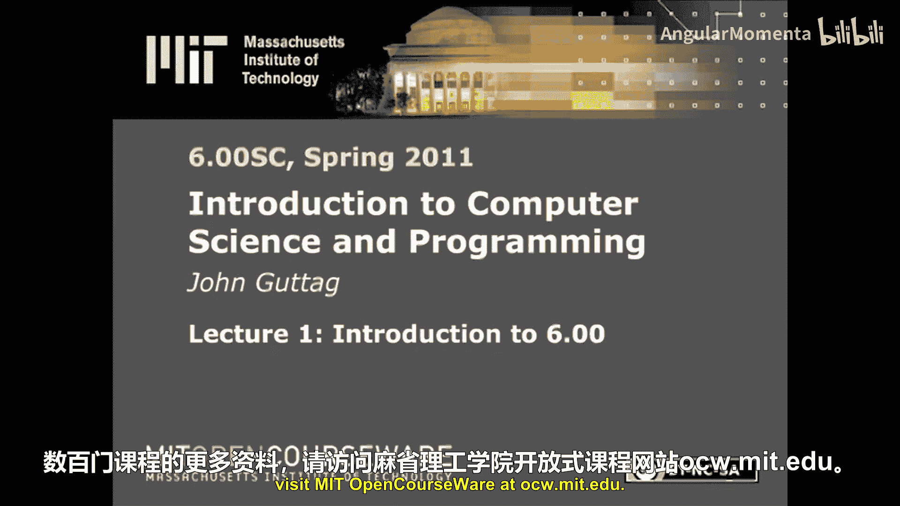
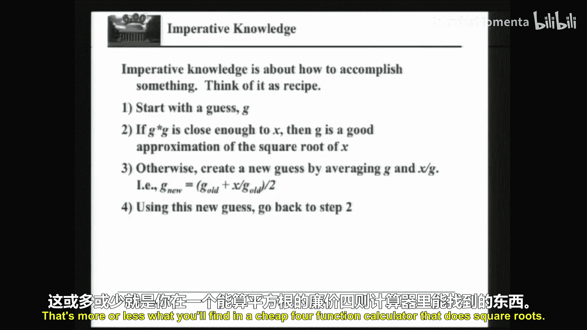
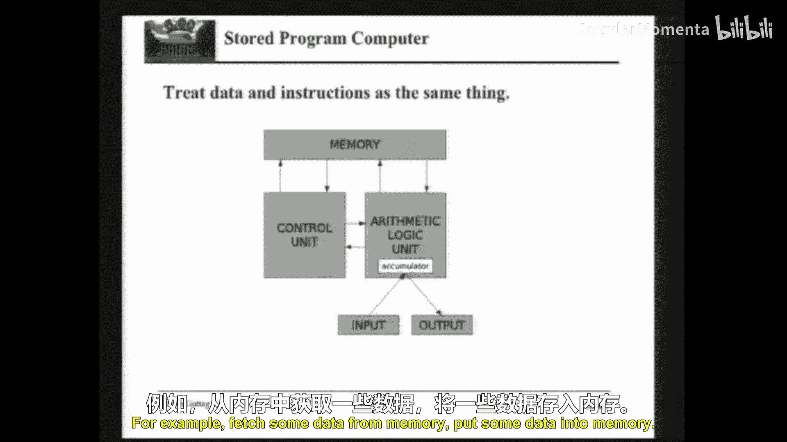
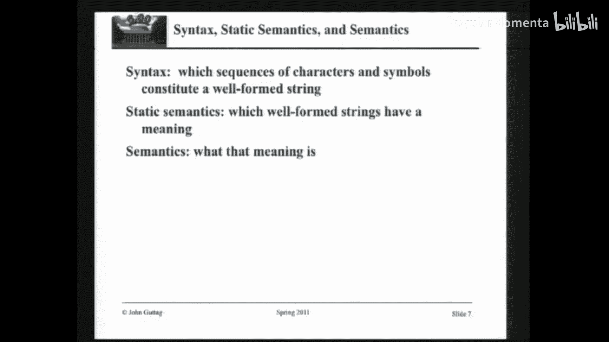
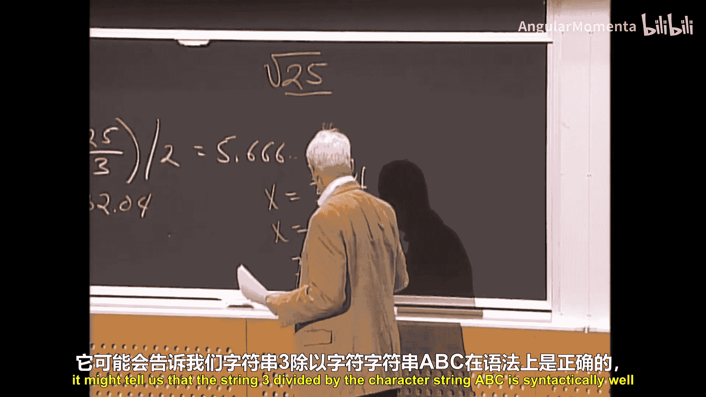
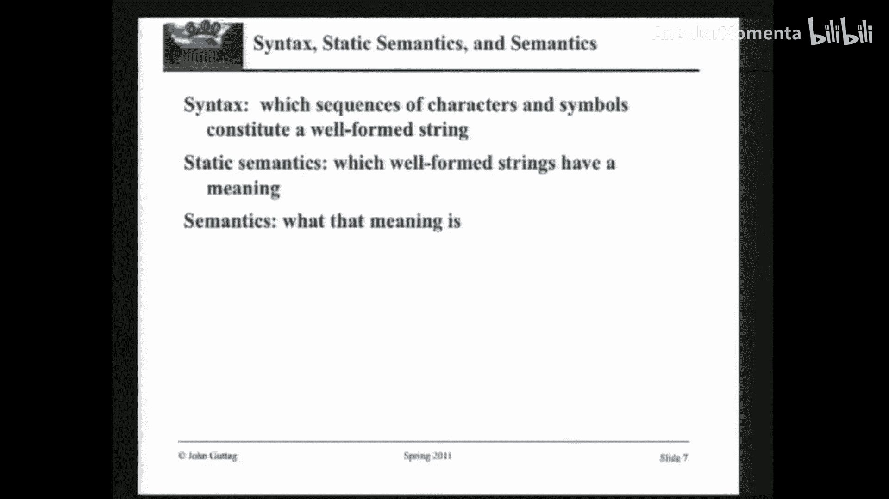
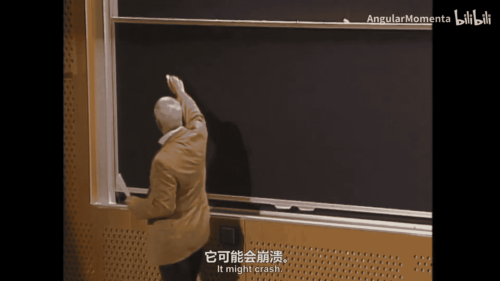
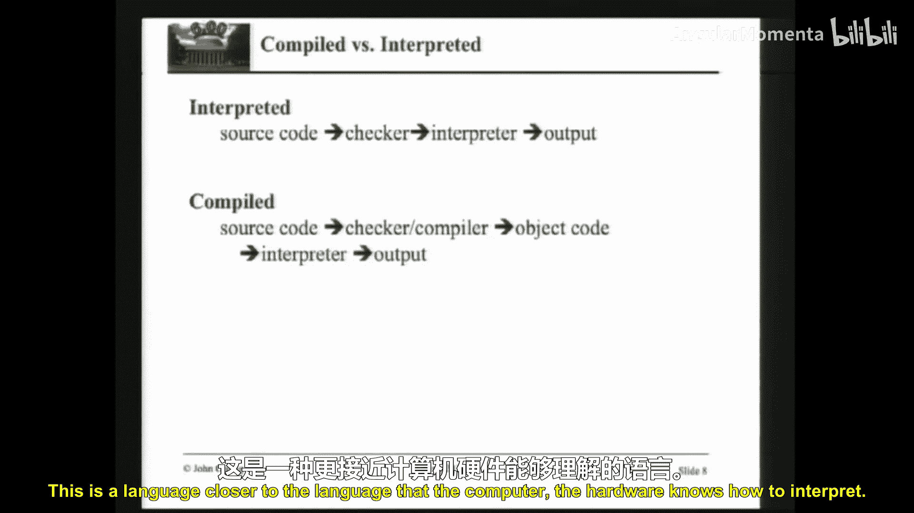

# 001：课程介绍与计算基础 🎓

在本节课中，我们将学习课程的基本信息、计算的核心概念以及编程语言的基础知识。课程旨在帮助初学者理解如何将问题转化为计算框架，并掌握编写程序的基本技能。

---

## 课程概述与目标

本课程是麻省理工学院6.00SC《计算机科学与编程导论》的第一讲。课程旨在为编程经验较少的学生提供一个温和的入门，帮助他们为后续的计算机科学课程做好准备。

课程的战略目标是帮助学生建立编写中小型程序的合理自信。课程的核心主题是学习如何将问题映射到计算框架中，尤其侧重于科学问题，但也会涉及一些非科学问题。

课程的所有习题集都涉及使用Python编程。第一个习题集主要是安装Python。请注意，前两个习题集看似简单，但课程难度会迅速提升。

---

## 课程政策与资源

以下是关于课程协作、教材和笔记的重要信息：

*   **协作政策**：本课程的协作政策非常宽松。学生可以在任何习题集上与任何人合作（不包括测验）。目标是促进学习，而非防止作弊。在习题集上不存在“作弊”的概念。
*   **教材与阅读材料**：没有指定教材。课程网站上会发布阅读材料，主要是网站链接，偶尔会有自编材料。虽然可以购买Python教材用于测验时快速查阅，但许多学生不买教材也能学得很好。
*   **课堂笔记**：为了遵循更好的教学法，促进学生主动学习，课程不会定期分发详细的课堂讲义。但会提供包含代码的讲义，这些材料需结合课堂讲解来理解。

本课程的主要目的是帮助你熟练掌握让计算机执行你所需任务的能力。一旦掌握这项技能，面对许多任务时，你的第一反应将是编写程序来完成它。编程本身也充满乐趣。

---

## 什么是计算？🧮

上一节我们介绍了课程目标，本节中我们来看看计算的核心概念。

知识主要分为两种：陈述性知识和命令性知识。

*   **陈述性知识**：由事实陈述组成。例如，“一个好的医疗保健计划能在节省资金的同时提高医疗质量”。它陈述了目标，但没有说明如何实现。在数学上，`y` 是 `x` 的平方根当且仅当 `y * y = x`。这个陈述定义了平方根，但没有说明如何找到它。
*   **命令性知识**：告诉你如何解决问题或完成某事，就像食谱一样。它是一系列可执行的步骤。

许多问题无法精确求解，但可以找到满足实际需求的近似解，这称为近似算法。

---

## 算法示例：求平方根

以下是一个古老的求平方根近似值的算法（例如求25的平方根）：

1.  从一个猜测值 `g` 开始（例如 `g = 3`）。
2.  检查 `g * g` 是否足够接近目标值 `x`（这里是25）。如果是，停止。
3.  如果不是，通过公式 `g_new = (g_old + x / g_old) / 2` 生成一个新的猜测值 `g_new`。
4.  使用新的 `g_new` 返回步骤2。

让我们快速演算一下：
*   初始猜测 `g = 3`，`3*3=9`，不接近25。
*   新猜测 `g = (3 + 25/3) / 2 ≈ 5.6666`。
*   `5.6666 * 5.6666 ≈ 32.04`，仍不接近25。
*   再次计算新猜测 `g ≈ 5.04`。
*   `5.04 * 5.04 ≈ 25.4`，足够接近25，算法停止（收敛）。

这个例子包含了算法的关键要素：**可执行的指令集**、**控制流**（执行顺序，包括循环）和**终止条件**。

---

## 从固定程序到存储程序计算机 💻

如何将算法“食谱”转化为机械过程？一种方法是设计专门执行该算法的机器，即**固定程序计算机**。早期的计算机就是如此，它们只能执行特定任务（如解线性方程、破译密码）。

重大的突破是**存储程序计算机**的发明。其核心思想是：**指令与数据没有区别**。程序（算法步骤）和数据（如输入值25）都存储在相同的内存中。这使得机器变得无限灵活，程序可以随时更改，甚至程序可以生成其他程序。

在这种范式下，计算机本身可以被视为一种特殊的程序——**解释器**。解释器是一个可以执行任何合法指令集的程序，因此可以用来描述和完成计算机能做的任何事情。

一台存储程序计算机大致包含：**内存**、**控制单元**、**算术逻辑单元（ALU）** 以及**输入/输出设备**。关键在于只有一种内存，不区分程序内存和数据内存。

给定一小套基本指令（通常只有几十条），通过巧妙组合，可以完成任意复杂的任务。图灵曾证明，仅用6条对单个比特进行操作的基本指令，就能实现计算机所能完成的一切。

---

## 编程语言与Python 🐍

上一节我们了解了计算机的通用性，本节中我们来看看如何与计算机沟通——即编程语言。

编程语言提供了一套**基本指令**和**控制结构**（控制指令执行顺序的机制）。不同语言的区别在于这些指令、控制结构以及组合机制是什么。

编程最显著的特点是：**计算机会完全按照你的指令执行**。这既赋予了你强大的能力，也意味着如果程序出错，责任在于你自己。

本课程使用的编程语言是**Python**。需要强调的是，本课程的重点是**计算方法**，Python只是一个教学工具。一旦学会用Python编程，将技能转移到其他语言会很容易。

任何编程语言都由以下部分定义：

*   **语法**：规定哪些字符和符号序列构成**格式良好的字符串**。例如，`x = 3 + 4` 语法正确；`x = 3 4` 则不正确。这类似于英语中判断句子结构是否完整。
*   **静态语义**：规定哪些格式良好的字符串具有**意义**。例如，在Python中，`3 / "abc"` 语法上看似是“值 运算符 值”，但静态语义上无意义（数字除以字符串），会报错。这类似于英语中“I are big”结构正确但语义错误。
*   **语义**：为那些既语法正确又静态语义正确的字符串赋予确切的**含义**。与自然语言不同，设计良好的编程语言没有歧义，每个合法程序都有唯一确定的含义。

---

## 程序可能出错的情况 🐛

当我们编写的程序不按预期运行时，可能会出现以下情况：

*   **崩溃**：程序停止运行，并给出明显的错误指示。在良好设计的系统中，单个程序的崩溃不应损害整个系统。
*   **永不停止（无限循环）**：程序一直运行，无法正常结束。编写程序时，应对其运行时间有预期，以便识别这种情况。
*   **产生错误答案**：程序运行完毕，但输出结果是错误的。这是最糟糕的情况，因为难以察觉，可能导致严重后果（如医疗或工程事故）。

本课程将花时间探讨如何避免编写出有上述问题的程序，包括如何测试和编写更可靠的代码。

---

## 为什么选择Python？

既然Python在静态语义检查方面并非最强（介于Java和C语言之间），为何本课程还要使用它？它有以下优点：

*   **易于学习**：比Java等语言更简单，学习曲线更陡峭，能更快上手。
*   **应用广泛**：在科学领域，特别是生命科学中非常流行，已成为生物学等领域最常用的语言。
*   **易于调试**：Python是**解释型语言**。解释器直接读取并执行你编写的**源代码**。如果出错，它能用源代码的语境给出错误描述，便于理解。
*   相比之下，**编译型语言**（如C）先将源代码翻译成**目标代码**，再由硬件执行。如果出错，错误信息可能指向晦涩的目标代码，难以调试。编译型语言的优点是运行效率通常更高。Python也可以编译以获得高效版本，但其设计初衷是便于解释执行。

---

本节课中我们一起学习了课程的基本框架、计算与算法的核心概念、计算机从固定程序到存储程序的发展，以及编程语言（特别是Python）的基础知识。理解这些概念是后续深入学习计算问题解决方法的基石。