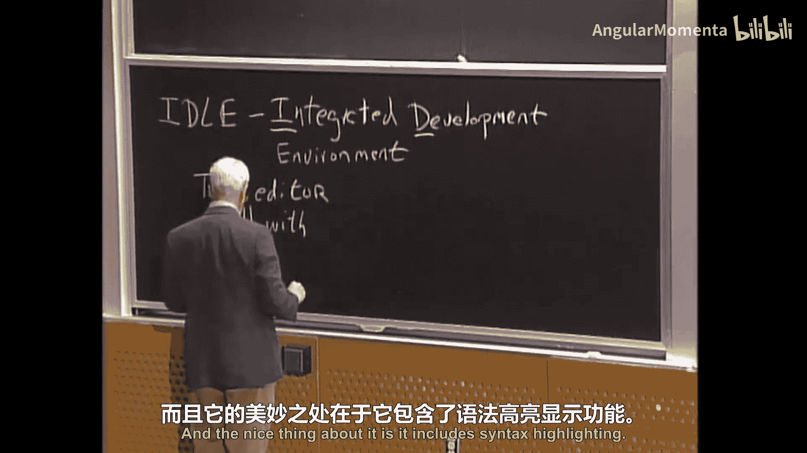
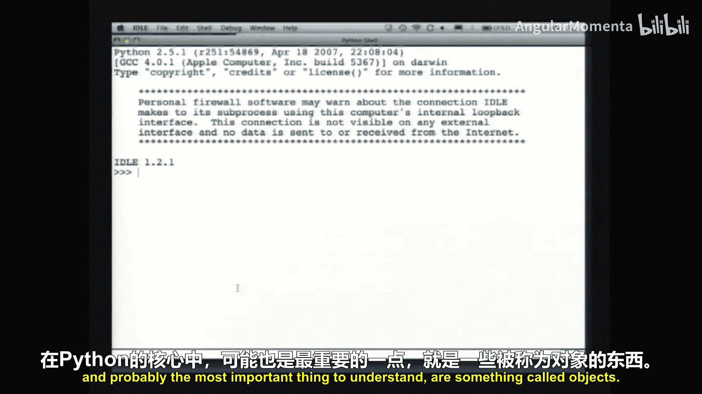
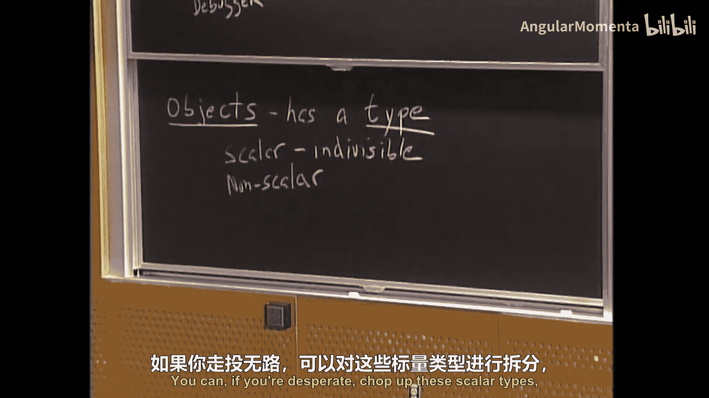
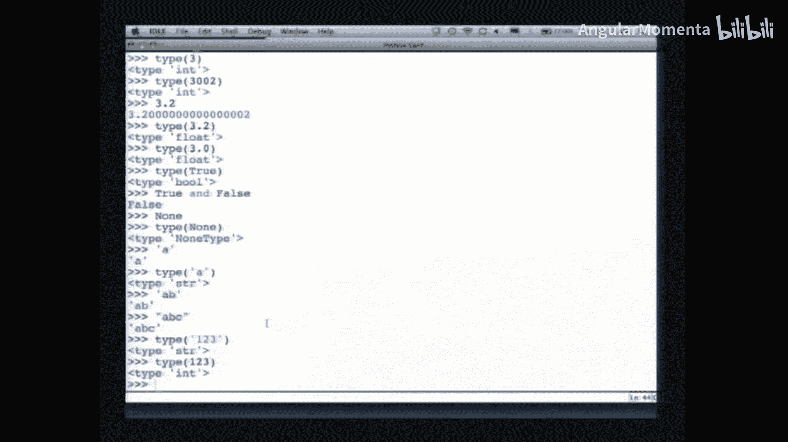
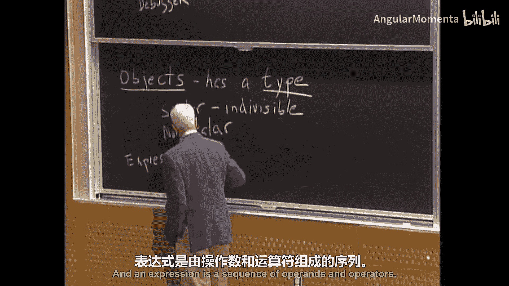
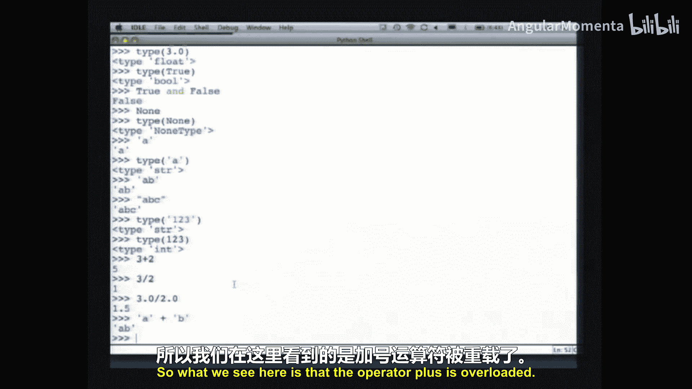
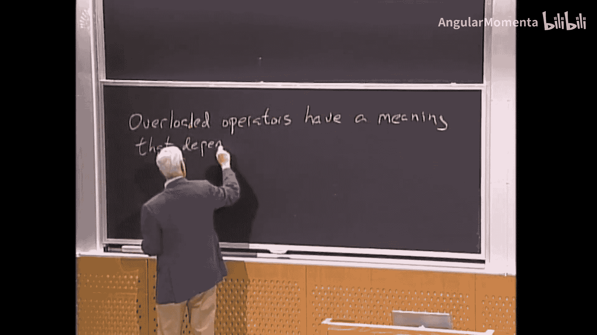
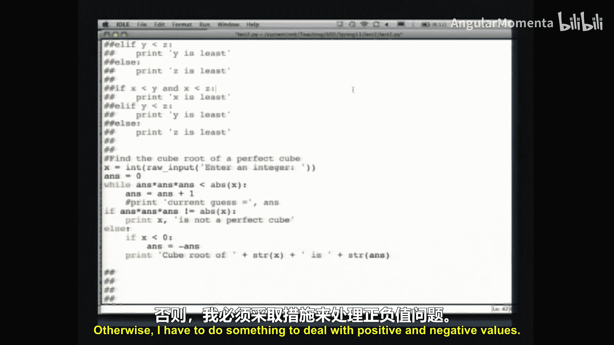

# 002：Python基础概念与编程结构 🐍


在本节课中，我们将学习Python编程语言的基础元素，包括对象、类型、表达式、变量、条件语句和循环。这些概念是几乎所有编程语言的核心，理解它们对于后续学习至关重要。



## 概述



本节课将介绍Python编程的基本构件。我们将从理解Python中的“对象”这一核心概念开始，然后探讨不同的数据类型、如何通过表达式进行计算、如何使用变量存储信息，以及如何通过条件分支和循环来控制程序的执行流程。

## 对象与类型



在Python中，一切皆为**对象**。每个对象都有一个**类型**，它定义了该对象的种类以及我们可以对其执行的操作。Python提供了一个内置函数 `type()` 来查看对象的类型。

```python
type(3)  # 输出: <class 'int'>
```

Python的类型主要分为两大类：**标量类型**和**非标量类型**。标量类型是“不可分割”的，可以看作是编程语言中的原子。

以下是Python的核心标量类型：

*   **整数 (`int`)**: 用于表示整数，例如 `3`。
*   **浮点数 (`float`)**: 用于表示实数（近似值），例如 `3.2` 或 `3.0`。注意，`3` 是 `int`，而 `3.0` 是 `float`。
*   **布尔值 (`bool`)**: 只有两个值：`True` 和 `False`。
*   **空值 (`NoneType`)**: 只有一个值 `None`，通常用作占位符。

值得注意的是，Python没有单独的“字符”类型。单个字符用长度为1的**字符串 (`str`)** 表示。字符串字面量可以用单引号或双引号定义。





```python
type('a')   # 输出: <class 'str'>
type("a")   # 输出: <class 'str'>
type('123') # 输出: <class 'str'> (这是一个字符串)
type(123)   # 输出: <class 'int'> (这是一个整数)
```

## 表达式与运算符





**表达式**是操作数和运算符的组合，用于计算一个值。在交互式环境中输入表达式时，Python会直接计算并输出结果。

```python
3 + 2    # 输出: 5
3 / 2    # 输出: 1 (在Python 2.x中，整数相除得到整数商)
3.0 / 2.0 # 输出: 1.5
```

Python中的运算符通常是**重载**的，这意味着同一个运算符（如 `+`）根据操作数的类型执行不同的操作。

```python
3 + 2     # 输出: 5 (整数加法)
‘a’ + ‘b’ # 输出: ‘ab’ (字符串拼接)
‘a’ + 3   # 报错: TypeError (不能拼接字符串和整数)
```

我们可以使用类型名作为转换函数，在不同类型之间进行转换。

```python
str(3)    # 将整数3转换为字符串 ‘3’
int(‘3’)  # 将字符串 ‘3’ 转换为整数 3
int(3.0)  # 将浮点数3.0转换为整数 3 (截断)
int(‘3.0’)# 报错: ValueError (无法转换)
```

## 编写脚本与基本命令

上一节我们介绍了在交互式环境中直接输入代码。本节中我们来看看如何编写可重复执行的脚本程序。

在脚本中，一行代码如果以 `#` 开头，则表示**注释**，不会被解释器执行。注释用于解释代码的逻辑和算法，而不是解释Python语法本身。

与交互式环境不同，在脚本中直接写一个表达式不会自动打印结果。需要使用 `print` 命令来输出内容。

```python
# 这是一个注释
print(type(3)) # 这会打印出 <class ‘int’>
```

一个脚本程序由一系列**命令**组成。一个关键的命令是**赋值语句**，它用于将名称（变量）绑定到对象上。

```python
x = 3      # 将变量 x 绑定到整数对象 3
x = x * x  # 计算表达式 x*x 的值 (9)，然后将 x 重新绑定到这个新值
print(x)   # 输出: 9
```

在Python中，变量是对象的名称。赋值 (`=`) 就是建立或改变这种绑定关系。

要从用户那里获取输入，可以使用 `raw_input` 函数（在Python 3中是 `input`）。它总是将用户的输入作为字符串返回。

```python
y = raw_input(‘Enter a number: ‘) # y 是一个字符串
y = float(raw_input(‘Enter a number: ‘)) # 将输入转换为浮点数
```

## 条件分支

到目前为止，我们看到的程序都是**直线程序**，即所有命令按顺序执行且只执行一次。为了编写更有用的程序，我们需要引入决策能力，即**条件语句**。

条件语句使用 `if`、`elif` (else if) 和 `else` 关键字。它根据测试表达式的结果是 `True` 还是 `False` 来决定执行哪一块代码。

```python
x = int(raw_input(‘Enter an integer: ‘))
if x % 2 == 0:          # % 是求余运算符，== 用于比较相等性
    print(‘Even‘)
else:
    print(‘Odd‘)
```

**缩进在Python中至关重要**。它定义了代码块的结构。`if` 或 `else` 后面缩进的代码属于相应的分支。这种强制缩进保证了代码的视觉结构与逻辑结构一致，是一种优秀的设计。

```python
if x % 2 == 0:
    print(‘Even‘)
    print(‘This is still inside the if block‘)
print(‘This is outside and always runs‘)
```

## 循环迭代

直线程序和分支程序的运行时间都受限于程序本身的长度。但对于处理大量数据的问题（如计算所有学生的平均分），我们希望程序的运行时间能与**输入数据的规模**成正比。这就需要**循环**（或称**迭代**）结构。

循环允许我们重复执行一段代码。结合条件判断，我们可以实现复杂的控制流。拥有循环结构的编程语言被称为**图灵完备**的，理论上可以计算任何可计算的问题。

下面是一个使用 `while` 循环查找完全立方数立方根的例子：

```python
# 寻找完全立方数的立方根
x = int(raw_input(‘Enter an integer: ‘))
ans = 0
while ans**3 < abs(x):
    ans = ans + 1
    # print(‘Current guess:‘, ans) # 调试语句
if ans**3 != abs(x):
    print(x, ‘is not a perfect cube‘)
else:
    if x < 0:
        ans = -ans
    print(‘Cube root of‘, x, ‘is‘, ans)
```

`while` 循环会反复检查条件 (`ans**3 < abs(x)`)，只要条件为 `True`，就执行其缩进块内的代码。这允许 `ans` 的值不断递增，直到找到满足条件的值或超过目标。

## 总结



本节课中我们一起学习了Python编程的基础核心概念。我们从**对象**和**类型**出发，理解了Python如何看待数据。接着，我们学习了通过**表达式**和**运算符**进行计算，并使用**变量**通过赋值语句来存储和操作数据。为了超越简单的直线程序，我们引入了**条件分支** (`if/else`) 来让程序做决策，最后通过**循环** (`while`) 赋予了程序重复执行和应对任意规模数据的能力。掌握这些基础是后续学习更复杂编程概念的关键。下节课的辅导课将详细讲解这些概念，特别是循环的工作原理。