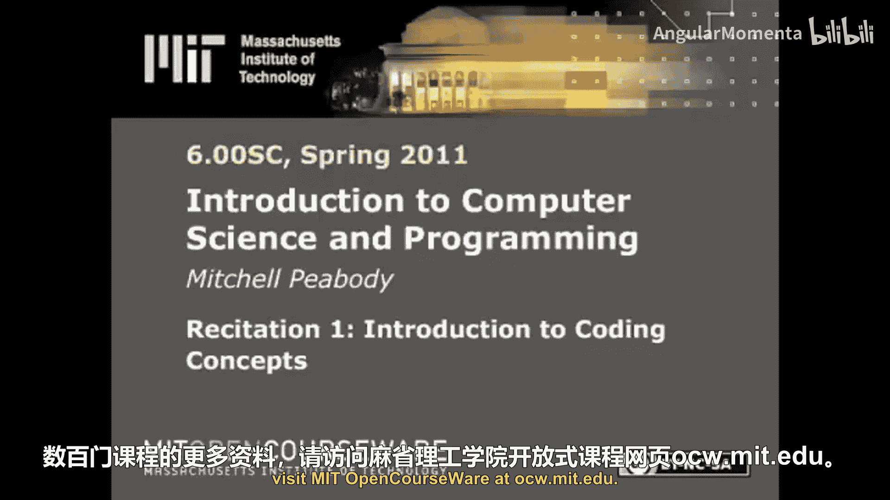
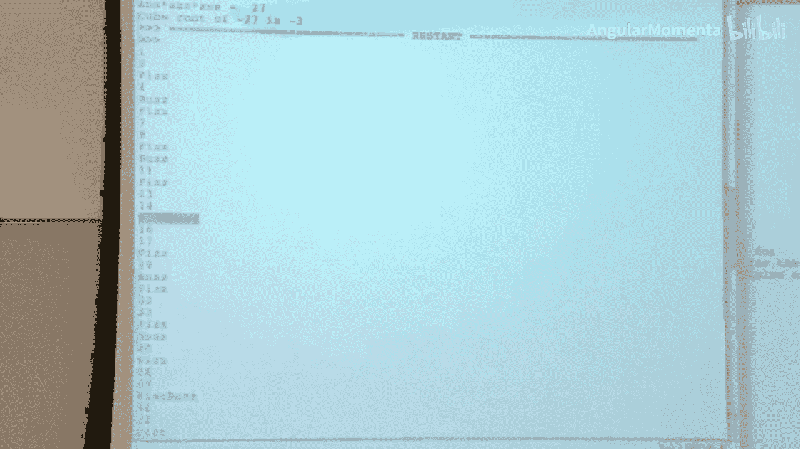
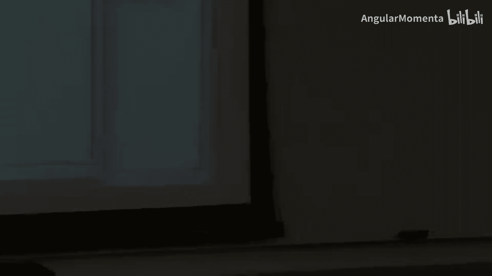

# 003：Python编程基础入门 🐍



在本节课中，我们将学习编程的核心概念，特别是Python语言的基础知识。我们将从计算机如何执行程序开始，逐步深入到Python的语法、数据类型、运算符以及控制流结构。

## 计算机与程序模型 💻

上一节我们介绍了课程的目标，本节中我们来看看计算机执行程序的基本模型。

计算机是一个非常简单的模型，它由**CPU**和**内存**组成，可能还有一些输入和输出设备。


程序是一系列加载到计算机内存中的指令。内存可以被划分为许多小单元。当CPU开始运行程序时，它会查看内存位置中的内容，并将其视为可以处理的指令，然后执行它。例如，一条指令可能是将两个数字相加并产生结果。

问题是，虽然计算机可以完美地理解这些指令，但对我们来说，这看起来像是乱码。因此，我们需要编程语言。

## 编程语言的作用 📝

编程语言允许我们在更高的抽象层次上与计算机交流。我们可以使用类似 `x = 1` 或 `(x + 5) * 2` 的语句，这比机器指令更容易理解。Python就是这样一种语言，它让我们能够以人类可读的方式表达计算逻辑。

## 语法与语义

当我们使用编程语言时，代码必须按照特定的方式组织。

### 语法
语法指的是语言各部分的组合方式。例如，`变量 + 变量` 在Python中是有效的语法。而 `变量 变量 +` 则是无效的语法。

### 静态语义
静态语义指的是语法上有效且有意义的语句。例如，如果 `a = 5` 且 `b = 2`，那么 `a / b` 是有效的。但如果 `c` 是数字，`d` 是字符串，那么 `c / d` 就没有意义，因为数字除以字符串是未定义的。

语法和静态语义是编译器和解释器可以明确检查的规则。

### 语义
语义关注的是程序作为一个整体是否能正确工作。即使每个语句的语法和静态语义都正确，整个程序也可能出错。例如，`a = 6; c = 0; a / c` 会导致除以零的错误。

程序是非常明确的，它会严格地执行你告诉它的事情，不多也不少。因此，当程序行为不符合预期时，你需要学会阅读代码，并在脑海中逐步推演其执行过程。

## Python语言基础

现在，我们进入Python的具体内容，这些知识将在接下来的课程中至关重要。

Python是一种通用编程语言，用于Web开发、小型设备开发、桌面程序等。它是一种**解释型语言**，这意味着你可以直接运行代码并立即看到结果，无需额外的编译步骤。Python语法简单，应用广泛。

### 表达式与操作
Python程序由表达式序列组成。表达式由**操作数**和**运算符**（或函数）构成。

*   **操作数**：是语言中的“事物”，例如字面量（如 `5`）和变量（如 `x`）。
*   **运算符**：是对操作数进行操作的符号。例如，赋值运算符 `=` 表示将右侧的值赋予左侧的变量名。

### 数据类型
在Python中，一切都是对象，每个对象都有类型。以下是几种基本数据类型：

*   **整数**：例如 `10`、`7`、`0`、`-1`。
*   **浮点数**：带小数点的数字，例如 `3.14`、`-0.5`。
*   **字符串**：字符序列，例如 `"hello"`。可以用单引号或双引号定义。
*   **布尔值**：只有两个值：`True` 或 `False`。
*   **None类型**：表示“空”或“无”，类似于占位符。

**注意**：当你在代码中写下 `0` 时，Python会推断其类型为整数。写下 `0.0` 时，类型则为浮点数。在处理数学运算时，了解操作数的类型非常重要。例如，在Python中，两个整数相除 `5 / 2` 的结果是 `2`（整数除法会截断小数部分），而 `5.0 / 2` 的结果是 `2.5`（浮点数）。

### 运算符
以下是不同数据类型支持的运算符：

**数字类型（整数和浮点数）**：
*   加法 `+`、减法 `-`、乘法 `*`、除法 `/`
*   整数特有：指数运算 `**`、取模 `%`
*   浮点数没有取模运算。

**字符串**：
*   拼接 `+`：将两个字符串连接起来。

**比较运算符**（返回布尔值）：
*   小于 `<`、大于 `>`、等于 `==`、不等于 `!=`、小于等于 `<=`、大于等于 `>=`

**布尔运算符**：
*   与 `and`：仅当两个操作数都为 `True` 时返回 `True`。
*   或 `or`：只要有一个操作数为 `True` 就返回 `True`。
*   非 `not`：反转布尔值。

这些运算符可以组合成复杂的表达式，例如 `(d < e) and (e < f)` 可以用来检查数字是否按顺序排列。

## 控制程序流程

到目前为止，我们只能编写按顺序逐行执行的**直线程序**。为了实现更复杂的功能，我们需要控制程序的流程。

### 分支（if语句）
`if` 语句允许程序根据条件执行不同的代码块。

```python
if 条件1:
    # 如果条件1为真，执行这里的代码块
elif 条件2:
    # 如果条件1为假且条件2为真，执行这里的代码块
else:
    # 如果以上条件都为假，执行这里的代码块
```

在Python中，代码块通过**缩进**来表示。`if`、`elif`、`else` 后面的缩进代码属于相应的分支。

### 循环
循环允许我们重复执行一段代码。

**for循环**：用于遍历一个有限的元素集合（例如一个数字范围）。
```python
for i in range(1, 10): # range(1,10) 生成数字 1 到 9
    print(i) # 这个代码块会执行9次，i的值依次为1,2,...,9
```

**while循环**：只要条件为真，就会一直执行。
```python
while 条件:
    # 只要条件为真，就重复执行这里的代码块
```
`while` 循环适用于你不知道需要循环多少次，但知道在某个条件满足时需要持续执行的情况。

## 代码示例解析

让我们通过两个例子来巩固所学知识。

### 示例1：寻找立方根
这个程序要求用户输入一个整数，然后判断它是否是一个完全立方数，并找出其立方根。

```python
# 获取用户输入，输入的内容是字符串类型
x = int(raw_input('Enter an integer: '))
ans = 0

# 使用while循环进行猜测
while abs(ans**3) < abs(x):
    ans = ans + 1

# 循环结束后，检查是否找到了完美的立方根
if ans**3 != abs(x):
    print(str(x) + ' is not a perfect cube')
else:
    if x < 0:
        ans = -ans
    print('Cube root of ' + str(x) + ' is ' + str(ans))
```

**关键点**：
1.  `raw_input` 返回字符串，需要用 `int()` 转换为整数。
2.  使用 `while` 循环递增猜测值 `ans`，直到其立方不小于 `x` 的绝对值。
3.  `abs()` 函数用于处理负数输入。
4.  循环结束后，通过 `if` 语句判断是否找到了精确的立方根，并处理正负数情况。

### 示例2：FizzBuzz游戏
这是一个经典编程问题：打印1到100的数字，但遇到3的倍数打印“Fizz”，5的倍数打印“Buzz”，同时是3和5的倍数则打印“FizzBuzz”。

```python
for i in range(1, 101): # 遍历1到100
    output = '' # 初始化输出字符串
    if i % 3 == 0: # 检查是否能被3整除
        output += 'Fizz'
    if i % 5 == 0: # 检查是否能被5整除
        output += 'Buzz'
    if output == '': # 如果既不是3也不是5的倍数
        output = str(i) # 输出数字本身
    print(output)
```

**关键点**：
1.  使用 `for` 循环遍历固定范围。
2.  `%` 是取模运算符，`i % 3 == 0` 用来判断 `i` 是否能被3整除。
3.  通过字符串拼接 `+=` 来构建输出。
4.  使用 `str()` 函数将数字转换为字符串。

## 总结 🎯





本节课中我们一起学习了编程的核心基础。我们从计算机执行指令的底层模型开始，理解了为何需要高级编程语言。我们重点探讨了Python语言的语法、静态语义和动态语义。接着，我们深入学习了Python的基本构建块：包括整数、浮点数、字符串、布尔值和None在内的数据类型，以及作用于它们的各种运算符。最后，我们掌握了控制程序流程的关键结构——使用 `if/elif/else` 进行条件分支，以及使用 `for` 和 `while` 循环进行重复操作。通过分析“寻找立方根”和“FizzBuzz”两个实例，我们看到了如何将这些概念组合起来解决实际问题。记住，编程是一项实践技能，多读代码、多写代码是进步的关键。