# 004：循环、算法与函数入门

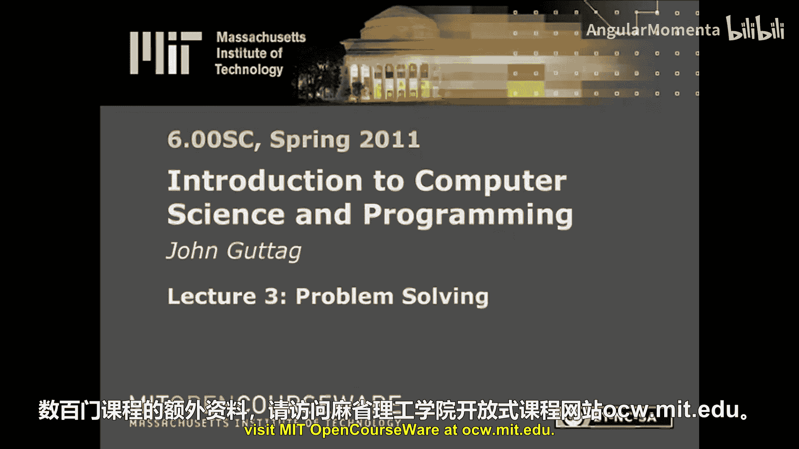

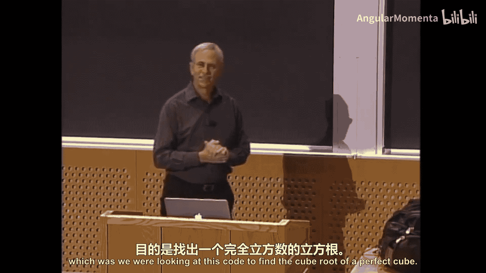

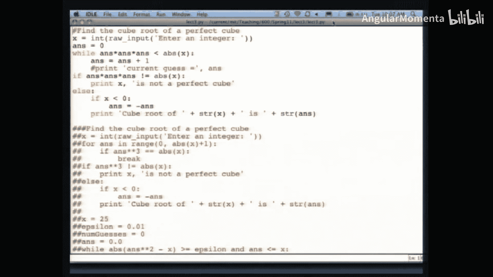

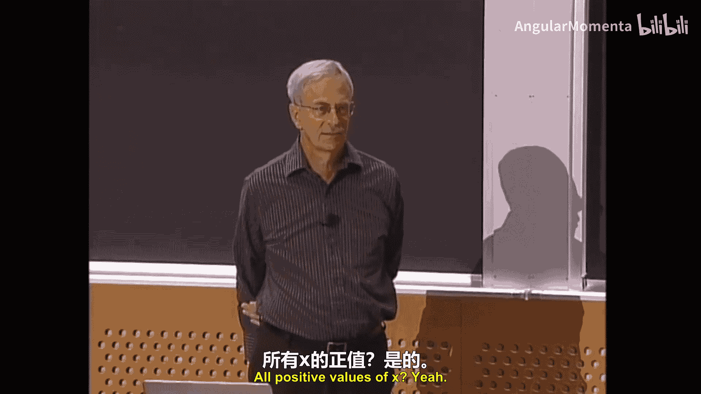

在本节课中，我们将学习循环结构的工作原理、如何分析算法效率，并初步了解函数的概念。我们将通过寻找立方根和平方根的具体例子，探讨“穷举枚举”和“二分查找”这两种核心算法思想。

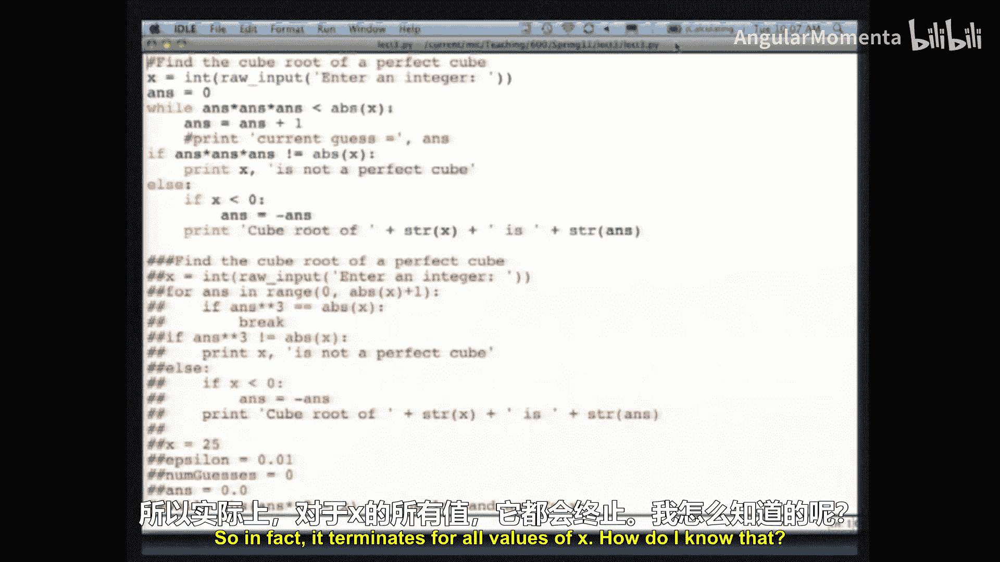

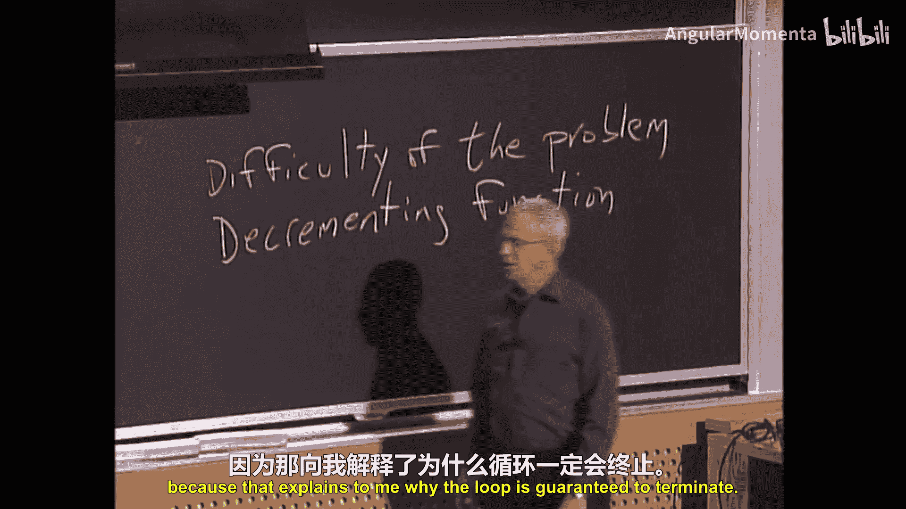

---

## 循环终止与递减函数

上一节我们介绍了寻找完全立方数立方根的代码。现在，我们来看看如何判断一个循环是否会终止。

对于任何循环，我们可以通过思考一个“递减函数”来理解其终止性。递减函数需要满足以下四个属性：

1.  它将程序中的某些变量映射到一个整数。
2.  在首次进入循环或首次遇到循环测试时，其值为非负数。
3.  当其值小于或等于0时，循环终止。
4.  每次执行循环体时，其值都会减小。

如果存在这样的函数，那么循环就保证会终止。对于寻找立方根的程序，其递减函数是 `abs(x) - ans**3`。这个值从 `abs(x)` 开始（非负），每次循环因 `ans` 增加而减小，最终会变为0或负数，从而终止循环。

---

## 算法策略：穷举枚举

我们刚刚分析的立方根查找算法是一种“猜测与检查”策略，具体称为**穷举枚举**。

以下是穷举枚举的特点：
*   它系统地遍历所有可能的答案（猜测）。
*   检查每个猜测是否满足条件。
*   如果遍历完整个可能的答案空间仍未找到解，则说明解不存在。

这种方法虽然简单，但得益于计算机极高的运算速度（现代计算机每秒可执行数亿条指令），对于许多问题而言，它通常是可行且有效的解决方案，我们常称之为“暴力破解”法。

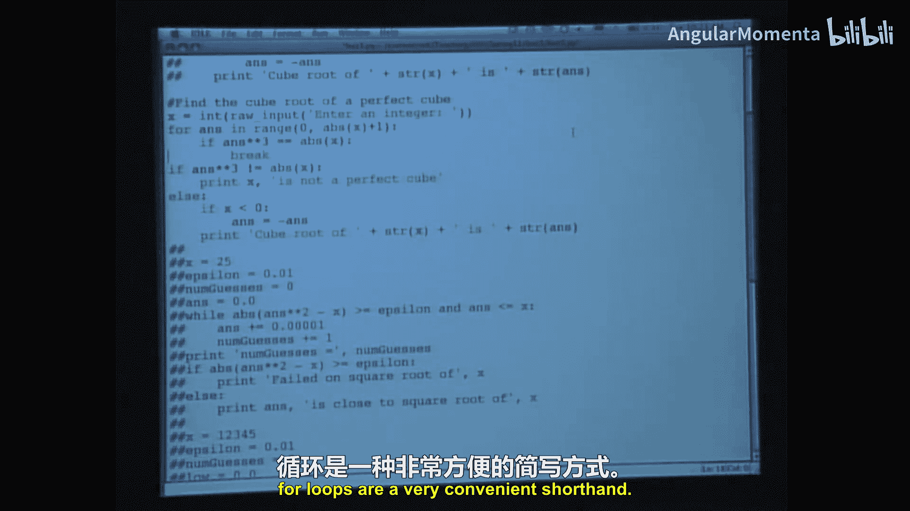

---

## 循环结构：`for` 循环

`while` 循环功能强大，但在遍历一系列值（如整数序列）时，`for` 循环提供了更简洁的写法。

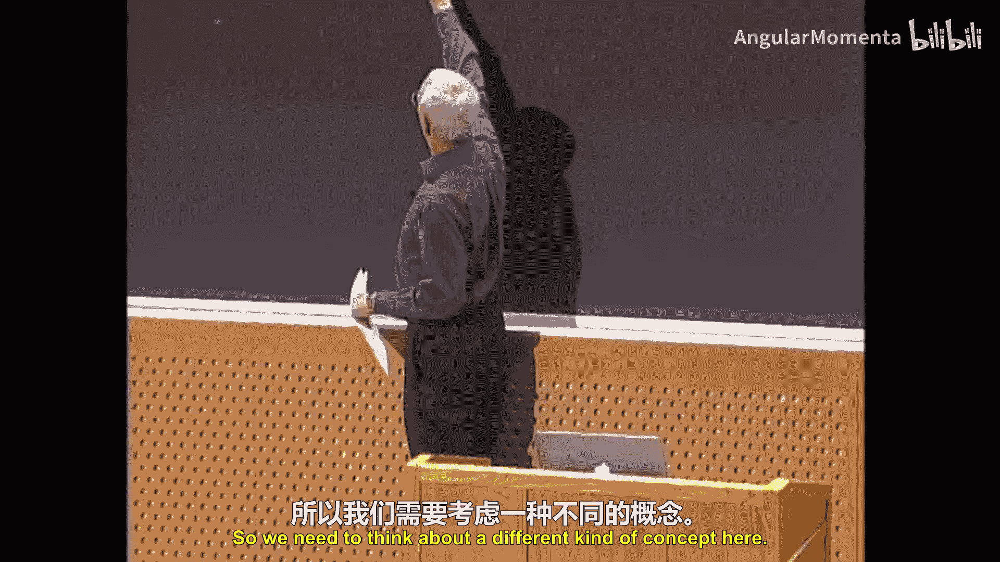

以下是 `for` 循环的关键点：
*   `range(start, stop)` 函数生成一个从 `start` 到 `stop-1` 的整数序列。
*   `for` 循环会为序列中的每个值执行一次循环体。
*   可以使用 `break` 语句提前退出循环。
*   循环可以嵌套，`break` 会退出其所在的最内层循环。

在遍历整数或其它序列时，`for` 循环比 `while` 循环更方便，在编程中也会更频繁地使用。

---

## 近似解与算法效率

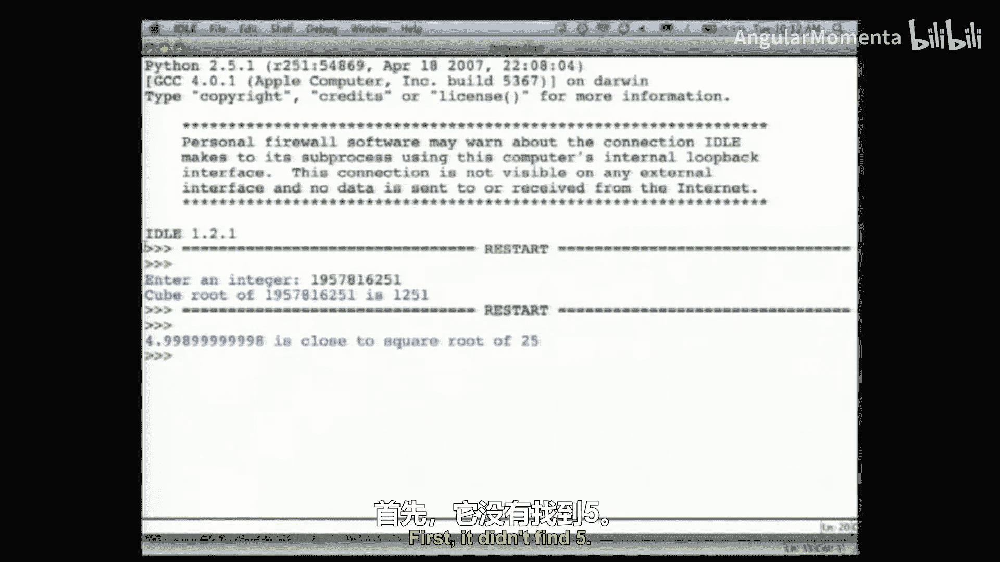

在实际问题中，我们常常无法或不需要找到精确解，而是寻找一个满足精度要求的近似解。例如，求平方根时，我们可以定义误差范围 `epsilon`，目标是找到一个 `y`，使得 `y*y` 与 `x` 的差在 `epsilon` 之内。

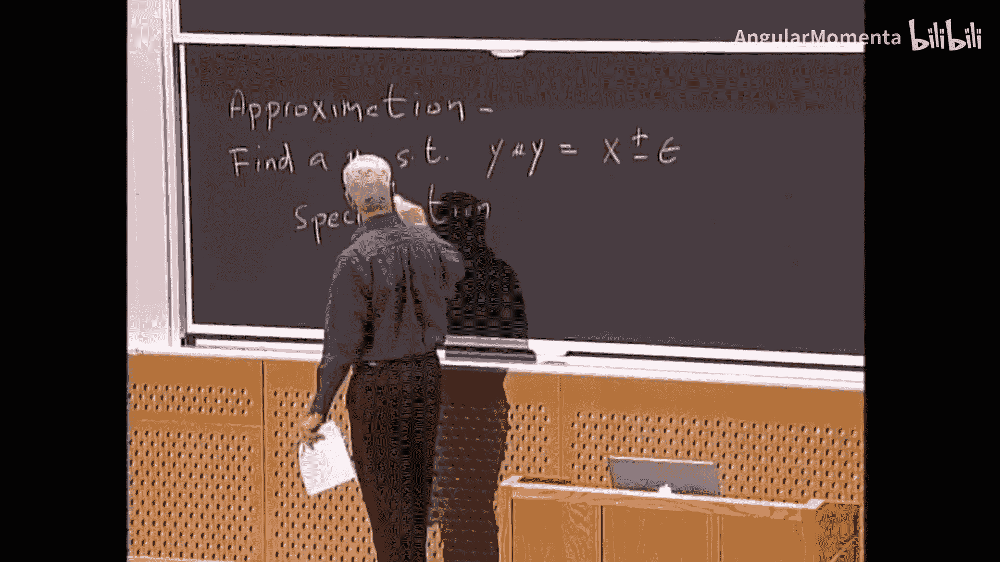

我们首先尝试用穷举枚举来寻找平方根的近似解。程序会从0开始，以很小的步长（如0.001）增加猜测值，直到找到一个满足精度要求的 `y`。

然而，这种方法的运行时间取决于几个因素：
1.  实际平方根与起始点的距离。
2.  要求的精度 `epsilon` 的大小。
3.  每次迭代的步长增量。

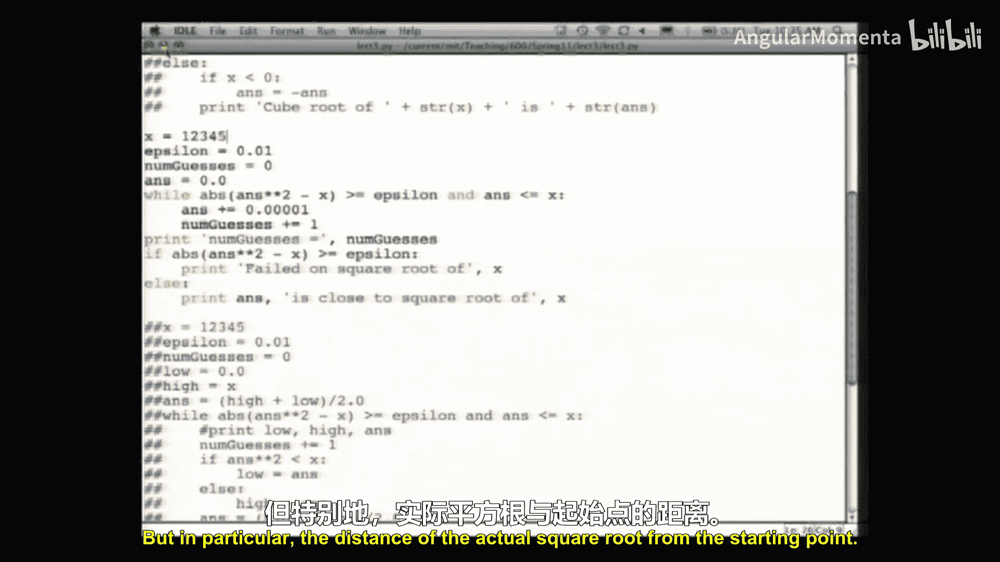

当 `x` 很大或 `epsilon` 很小时，由于步长很小，可能需要数十万甚至上百万次猜测，虽然计算机很快，但效率依然低下。这引出了对更优算法的需求。

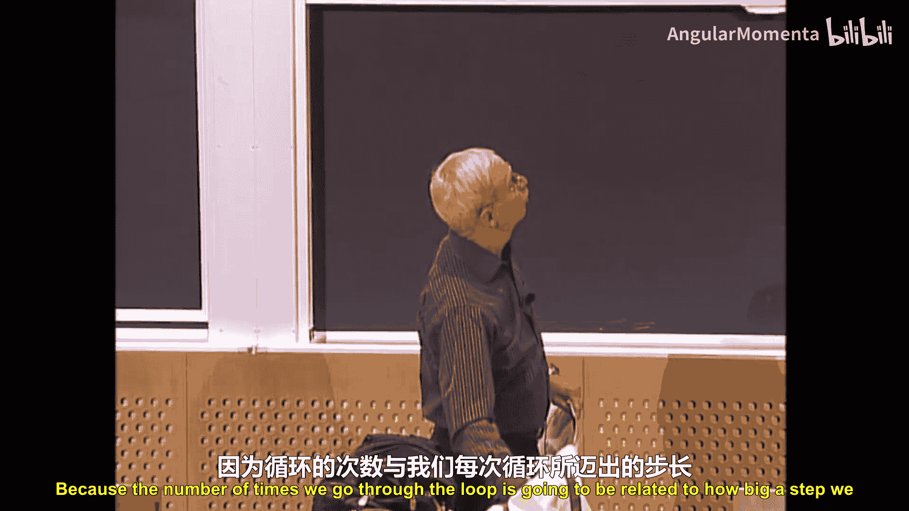

---

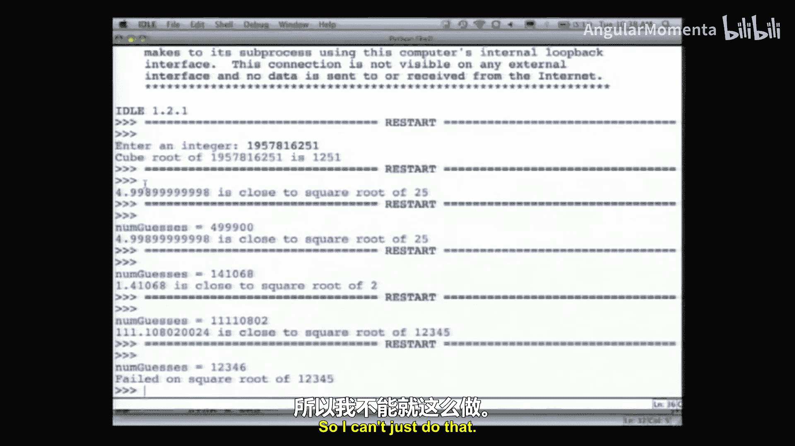

## 更优算法：二分查找

二分查找是一种通过每次将搜索空间减半来快速定位答案的算法。

以下是二分查找的基本思想：
1.  确定搜索范围的下限 `low` 和上限 `high`。
2.  猜测值为中点 `guess = (high + low) / 2`。
3.  检查 `guess**2` 与 `x` 的关系：
    *   如果 `guess**2 > x`，说明猜测值太大，将 `high` 设为 `guess`。
    *   如果 `guess**2 < x`，说明猜测值太小，将 `low` 设为 `guess`。
4.  重复步骤2-3，直到 `guess**2` 与 `x` 的差小于 `epsilon`。

与线性穷举相比，二分查找的效率有质的飞跃。如果初始搜索空间有 `N` 种可能，线性搜索最坏需要 `N` 步，而二分查找最坏仅需 `log₂(N)` 步。例如，在之前的例子中，二分查找仅用26次猜测就完成了任务。

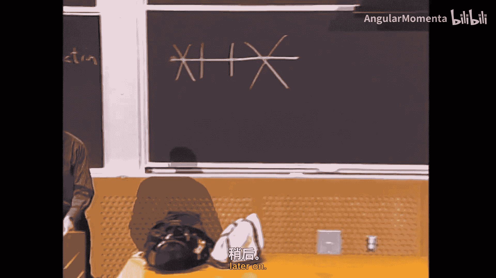

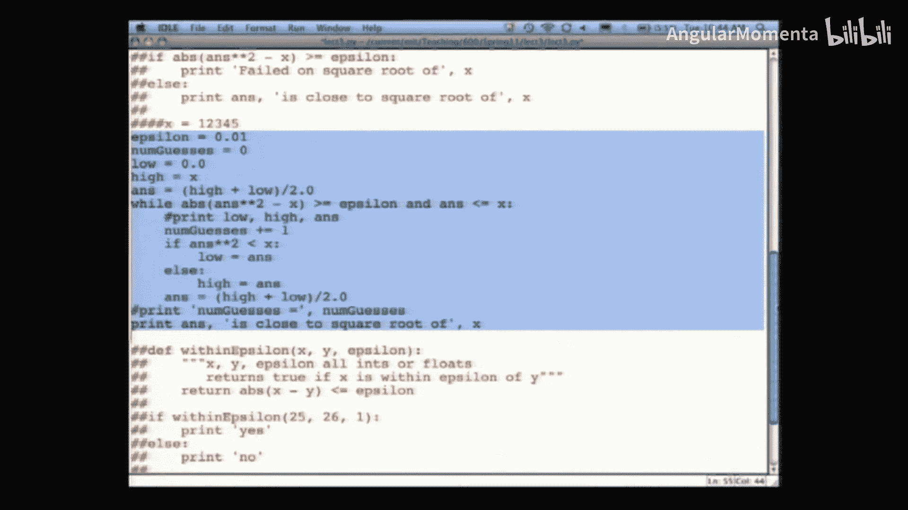

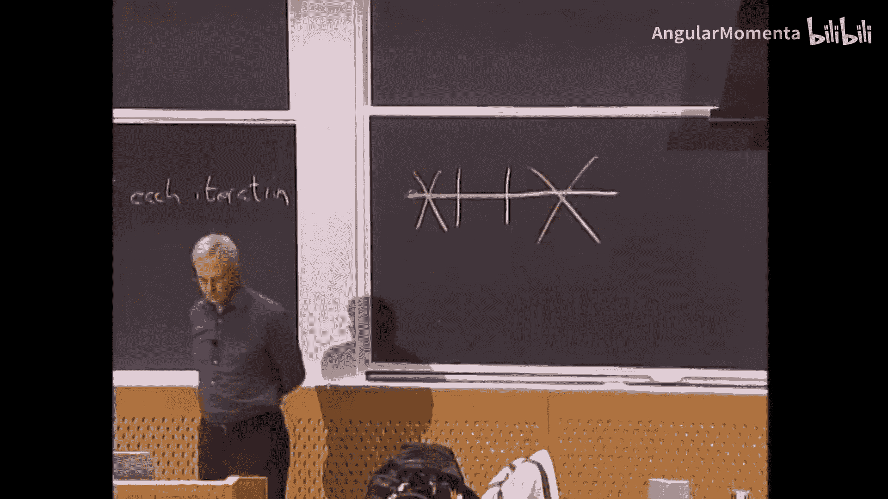

通过算法分析，我们可以预测程序的运行时间，从而决定是满足于当前算法，还是需要寻找更优的方案。

---

## 代码复用与函数引入

当前的二分查找代码专门用于求平方根。如果想要求立方根，我们需要修改代码中的两处指数（将2改为3）。但如果想要求四次方根、五次方根……每次都复制修改代码会非常繁琐。

这引出了下一个重要的编程概念：**函数**。函数允许我们将一段完成特定任务的代码块封装起来，通过输入不同的参数（如求根的次数 `n`）来重复使用，而无需重写代码。这将是下节课的核心内容。

---

## 总结

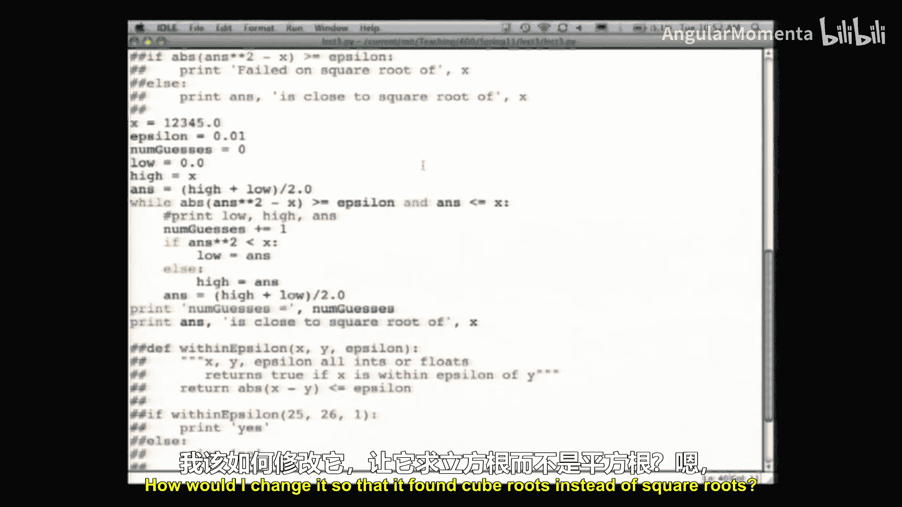

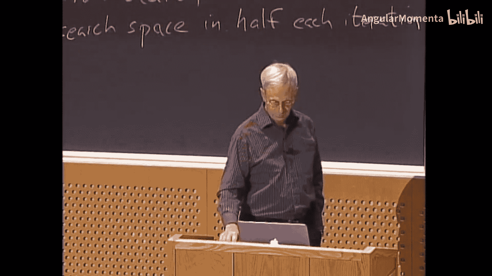

本节课我们一起学习了：
1.  **循环终止性**：通过“递减函数”的概念理解并保证循环会结束。
2.  **算法策略**：认识了简单直接的“穷举枚举”法和更高效的“二分查找”法。
3.  **近似解**：理解了在计算机中求解问题往往意味着找到满足精度要求的近似答案。
4.  **算法效率**：分析了算法运行时间依赖的因素，并看到二分查找如何指数级提升效率。
5.  **抽象的必要**：为了代码复用和解决更通用的问题（如求任意次方根），我们需要引入“函数”这一工具。

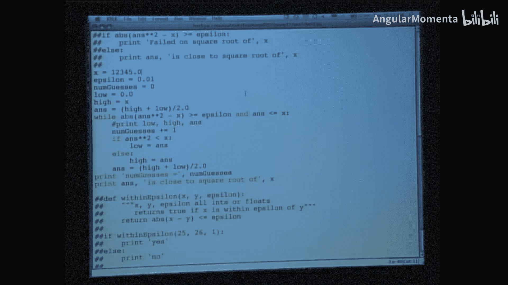

在下一讲中，我们将深入探讨函数的概念、定义与使用。