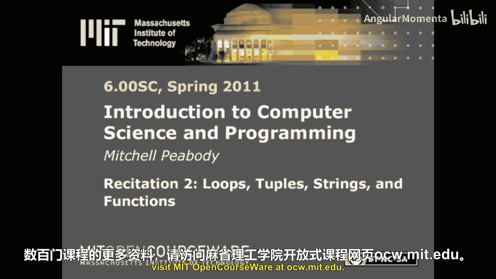

# 006：循环、元组、字符串与函数 🧑‍💻



在本节课中，我们将学习Python编程中的几个核心概念：循环结构、元组、字符串以及函数的定义与使用。我们将通过具体的代码示例来理解这些概念，并掌握它们在实际编程中的应用。

---

## 循环结构 🔁

上一节我们介绍了编程的基本概念，本节中我们来看看两种主要的循环结构：`while`循环和`for`循环。

### While循环

`while`循环的语法结构如下：
```python
while 条件:
    # 代码块
```
这里的“条件”是一个布尔表达式。只要条件为真，循环就会持续执行其内部的代码块。

以下是一个`while`循环的示例，它打印出2到10之间的偶数：
```python
a = 2
while a <= 10:
    print(a)
    a += 2
```
这段代码的递减函数是 `a += 2`，它使变量`a`的值不断增大，最终满足退出条件 `a > 10`。变量名`a`不是一个好的选择，更好的命名是`even_number`，这样能清晰地表达其用途。

### For循环与range函数

`for`循环用于遍历可迭代对象。其基本语法是：
```python
for 变量 in 可迭代对象:
    # 代码块
```
例如，遍历一个元组：
```python
for i in (2, 4, 6, 8, 10):
    print(i)
```
为了更方便地生成数字序列，Python提供了`range()`函数。它返回一个整数列表。
*   `range(stop)`: 生成从0到`stop-1`的整数。
*   `range(start, stop)`: 生成从`start`到`stop-1`的整数。
*   `range(start, stop, step)`: 以`step`为步长，生成从`start`到`stop-1`的整数。

因此，上面的循环可以改写为：
```python
for i in range(2, 11, 2):
    print(i)
```
`range()`函数只接受整数参数。如果传入浮点数，它会被截断为整数。

---

## 元组 📦

在学习了循环之后，我们来看一种重要的数据结构：元组。

元组是一种不可变的、非标量的数据类型，可以存储多个元素。它使用圆括号`()`定义，元素之间用逗号分隔。

### 创建与访问

以下是创建元组的示例：
```python
tuple_of_numbers = (3.14159, 2, -100, 0, 1, 7)
tuple_of_strings = (‘MIT’, ‘is’, ‘name’, ‘my’)
```
元组可以包含不同类型的数据，甚至是其他元组：
```python
mixed_tuple = (3.14, ‘hello’, ‘world’)
tuple_of_tuples = ((‘stuff’, ‘just’), (‘got’,), (‘real’,))
```
访问元组元素使用索引，索引从0开始：
```python
print(tuple_of_numbers[0]) # 输出: 3.14159
print(tuple_of_strings[-1]) # 输出: ‘my’ (负索引表示从末尾开始)
```
尝试访问不存在的索引会导致`IndexError`。可以使用`len()`函数获取元组长度以避免此错误。

### 切片操作

元组支持切片操作，用于获取子序列：
```python
print(tuple_of_numbers[1:3]) # 输出: (2, -100)
print(tuple_of_numbers[:3])  # 输出: (3.14159, 2, -100)
print(tuple_of_numbers[1:])  # 输出: (2, -100, 0, 1, 7)
```
切片语法为 `[start:stop]`，包含`start`索引，不包含`stop`索引。

### 不可变性与迭代

元组是不可变的，意味着创建后不能修改其元素。尝试修改会引发`TypeError`。
```python
# tuple_of_numbers[0] = 2.71 # 这行代码会报错
```
但是，可以通过创建新元组来实现“修改”：
```python
tuple_of_numbers = tuple_of_numbers + (8, 9) # 创建了一个新元组并重新赋值
```
元组是可迭代的，因此可以在`for`循环中使用：
```python
for number in tuple_of_numbers:
    print(number)
```
**注意**：创建只包含一个元素的元组时，必须在元素后加一个逗号，否则Python会将其解释为括号内的普通表达式。
```python
single_element_tuple = (50,) # 这是一个元组
not_a_tuple = (50) # 这是一个整数 50
```

---

## 字符串 📝

字符串在很多方面与元组相似：它们也是不可变的、非标量的，并且支持索引、切片和迭代。

### 基本操作

```python
name = ‘MIT’
print(name[0]) # 输出: ‘M’
# name[0] = ‘P’ # 不可变，会报错

for char in name:
    print(char) # 逐行输出: M, I, T
```
字符串也支持切片：
```python
print(name[1:3]) # 输出: ‘IT’
```

### 字符串方法

字符串对象有许多有用的内置方法：
```python
print(name.upper()) # 输出: ‘MIT’
print(name.lower()) # 输出: ‘mit’
print(name.find(‘I’)) # 输出: 1 (返回子串的索引)
print(name.find(‘TECH’)) # 输出: -1 (未找到)
```
`replace`方法用于替换子串，它会返回一个新的字符串，原字符串不变：
```python
new_name = name.replace(‘M’, ‘P’)
print(new_name) # 输出: ‘PIT’
```
要获取字符串对象所有可用方法的列表，可以在交互式环境中使用`dir(str)`或`help(str)`命令。

---

## 循环控制：break语句 ⏹️

在深入函数之前，我们先了解一个循环控制语句：`break`。

`break`语句用于立即终止当前所在的最内层循环，并跳出该循环体继续执行后续代码。

以下是一个寻找完美立方数立方根的函数，使用`break`重写：
```python
def cube_root_break(x):
    for ans in range(0, abs(x)+1):
        if ans**3 >= abs(x):
            break
    if ans**3 != abs(x):
        print(x, ‘is not a perfect cube’)
        return None
    else:
        if x < 0:
            ans = -ans
        return ans
```
在这个例子中，当`ans`的三次方大于或等于`x`的绝对值时，`break`会立刻停止`for`循环。

---

## 函数 🏗️

函数是编程中组织和复用代码的核心工具。它是一段命名的代码块，接受输入（参数），执行特定操作，并返回一个结果。

### 定义与调用

在Python中，使用`def`关键字定义函数：
```python
def cube(number):
    “”“返回一个数字的立方。”“”
    return number ** 3
```
函数定义包含：
1.  `def`关键字。
2.  函数名（应具有描述性）。
3.  括号内的参数列表。
4.  可选的文档字符串（用于说明函数功能）。
5.  函数体（通过缩进标识）。
6.  `return`语句（用于返回结果）。

调用函数时，使用函数名和括号，并传入参数：
```python
result = cube(3)
print(result) # 输出: 27
```

### 返回值

函数必须使用`return`语句来返回一个值。如果没有`return`语句，函数默认返回`None`。
```python
def double_bad(number):
    answer = number * 2
    # 没有return，返回None

def double_good(number):
    answer = number * 2
    return answer
```

### 变量作用域

函数内部定义的变量具有局部作用域，只在函数内有效。函数外部定义的变量具有全局作用域。
```python
all_hope = ‘global variable‘

def illustrate_scope(param):
    my_variable = ‘local variable‘
    print(param) # 可以访问参数
    print(all_hope) # 可以访问全局变量
    print(my_variable) # 可以访问局部变量

# print(my_variable) # 错误！在函数外无法访问局部变量
```
函数参数传递的是值的副本（对于不可变对象）或引用（对于可变对象，后续课程会讲到）。在函数内修改不可变类型的参数（如数字、字符串、元组）不会影响函数外的原始变量。

### 常见注意事项

1.  **`print`不是`return`**：`print()`函数只是在屏幕上输出内容，它不返回值。在函数中打印结果与返回结果是两回事。
2.  **函数是对象**：在Python中，函数名本身是一个对象引用。要调用函数，必须在函数名后加括号`()`。如果只写函数名而不加括号，Python不会报错，但不会执行函数。

---

## 总结 📚

本节课中我们一起学习了Python的四个关键部分：
1.  **循环**：掌握了使用`while`和`for`（配合`range`）进行迭代的方法，以及使用`break`控制循环流程。
2.  **元组**：理解了这种不可变序列的创建、访问、切片和迭代操作，并注意到了单元素元组的特殊语法。
3.  **字符串**：学习了字符串的不可变性、类元组操作以及一些实用的内置方法，如`upper()`, `find()`, `replace()`。
4.  **函数**：掌握了如何定义和调用函数，理解了参数传递、返回值的重要性以及变量作用域的概念，并识别了函数使用中的一些常见陷阱。


这些概念是构建更复杂程序的基础，熟练掌握它们对后续的学习至关重要。