# 007：Python数据结构详解 📚

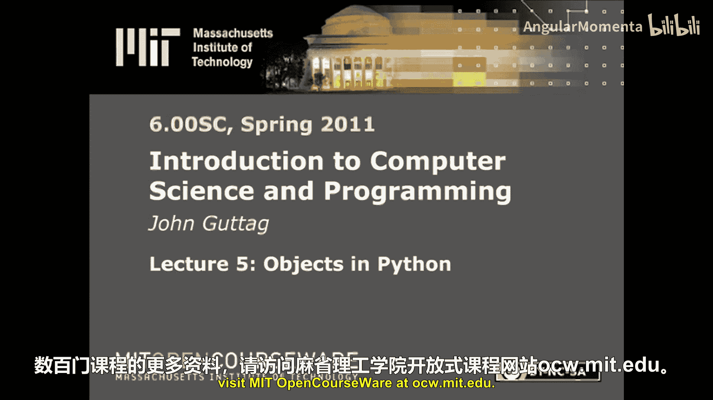

在本节课中，我们将要学习Python中用于收集数据的三种核心数据结构：元组、列表和字典。我们将了解它们的特点、区别以及如何在实际编程中使用它们。

---

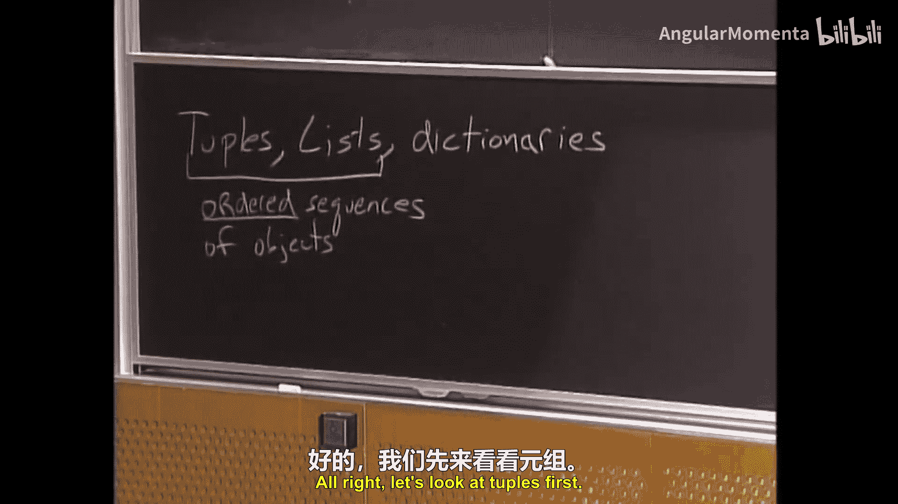

## 元组：有序且不可变的序列 📦

元组是最简单的数据结构之一。它是一个**有序**的、**不可变**的对象序列。这意味着一旦创建了一个元组，你就不能修改它的内容。

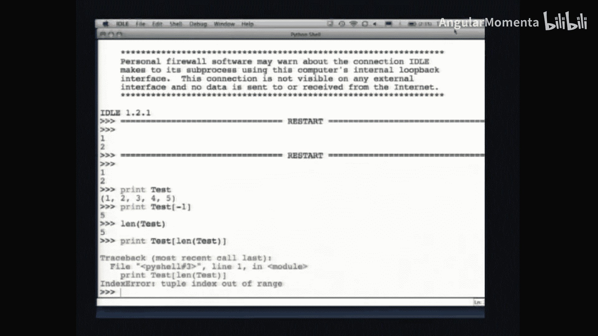


### 创建与访问元组

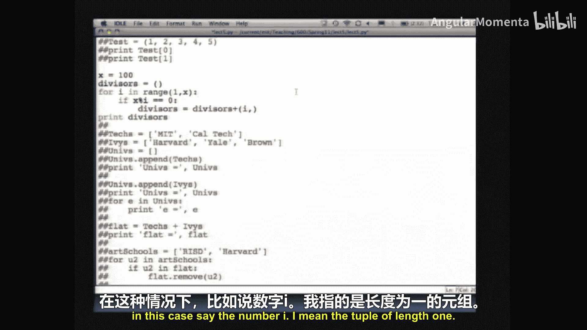

以下是创建和访问元组的基本方法：

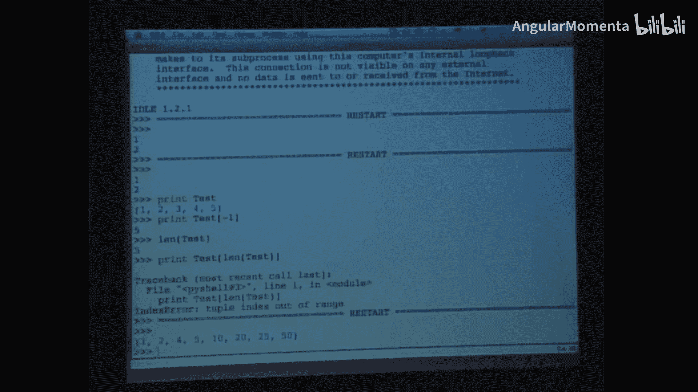

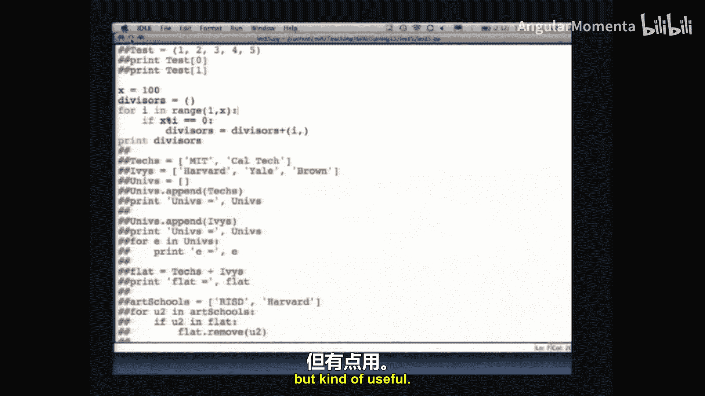

```python
test = (1, 2, 3, 4, 5)
print(test[0])  # 输出第一个元素：1
print(test[-1]) # 输出最后一个元素：5
print(len(test))# 输出元组长度：5
```


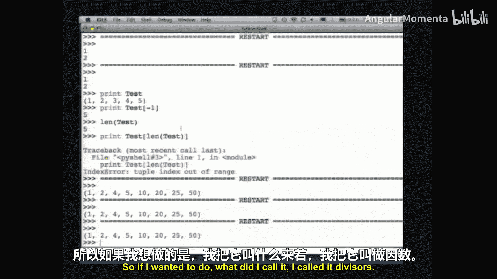

### 使用元组收集数据


我们可以使用元组来收集数据，例如，找出一个数的所有除数：

```python
divisors = ()
for i in range(1, 101):
    if 100 % i == 0:
        divisors = divisors + (i,)  # 注意单元素元组的语法
print(divisors)
```

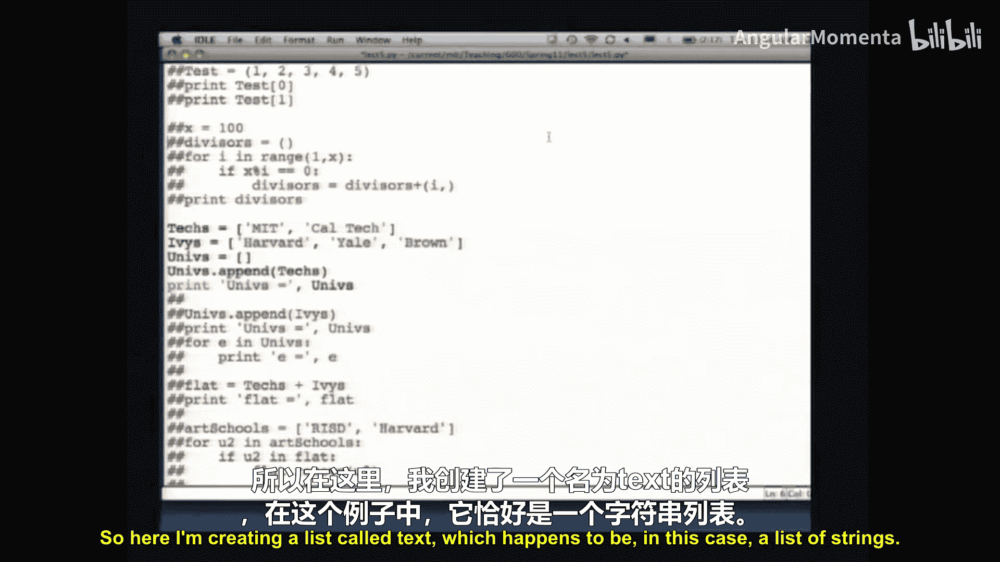

### 元组切片

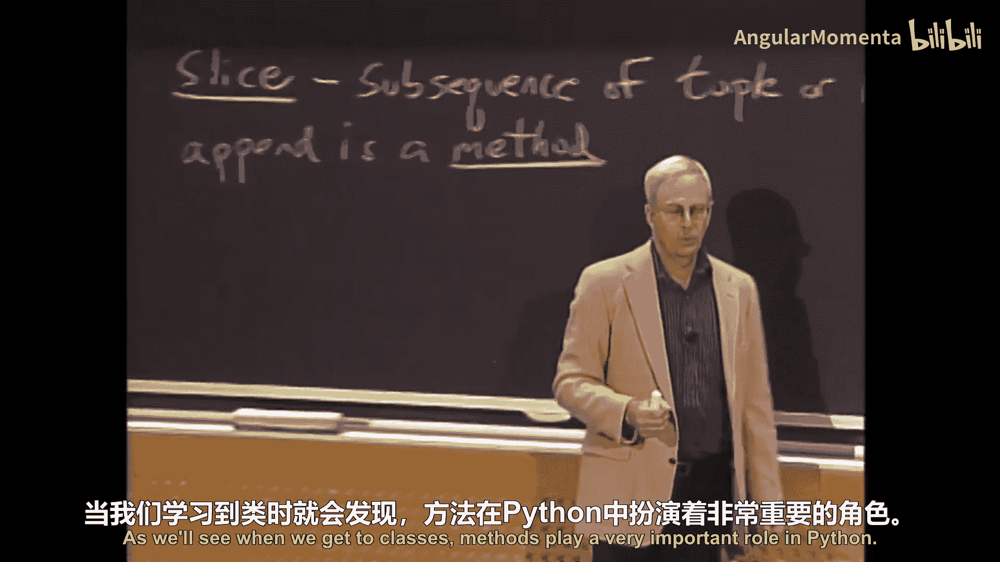

你可以获取元组的一部分，这称为切片：

```python
divisors = (1, 2, 4, 5, 10, 20, 25, 50, 100)
print(divisors[1:3])  # 输出索引1到2的元素：(2, 4)
```

---

上一节我们介绍了有序且不可变的元组，本节中我们来看看功能更强大的列表。

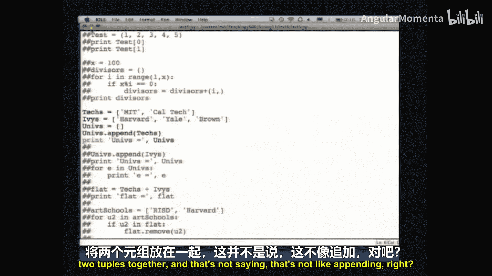

## 列表：有序且可变的序列 🔄

列表与元组类似，也是**有序**的序列。但最关键的区别在于，列表是**可变**的。这意味着你可以在创建列表后修改其内容。


### 创建与修改列表

以下是列表的基本操作：

```python
text = ['MIT', 'Caltech']
ivys = []
unis = []
unis.append(text)  # 将整个列表作为一个元素添加
print(unis)        # 输出：[['MIT', 'Caltech']]
```

**注意**：`append` 是一个**方法**，它会直接修改原列表（产生**副作用**），而不是返回一个新列表。

### 列表的别名与副作用

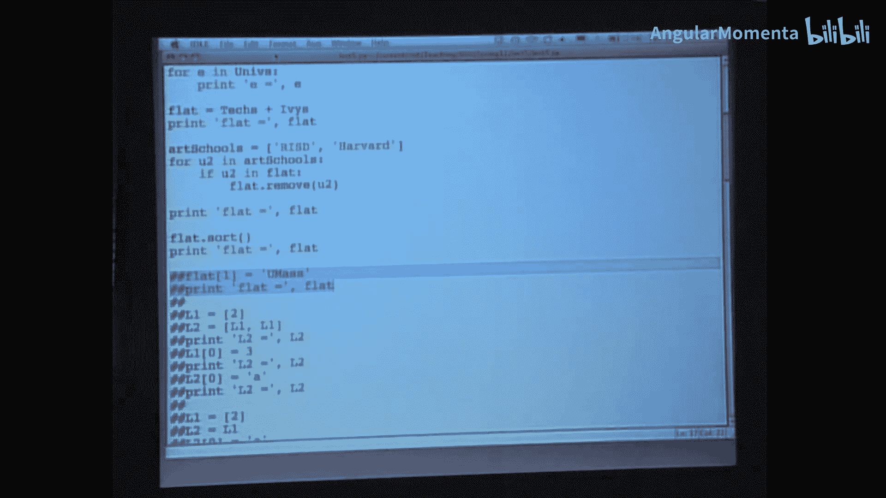

由于列表是可变的，当多个变量指向同一个列表对象时，通过一个变量修改列表会影响所有变量：

```python
L1 = [2]
L2 = [L1, L1]
print(L2)  # 输出：[[2], [2]]
L1[0] = 3
print(L2)  # 输出：[[3], [3]]，L2也改变了
```

这是一个需要特别注意的地方，因为它可能导致难以调试的错误。

### 列表的其他操作

列表支持多种操作，例如连接、排序和删除元素：

```python
flat = text + ['Harvard']  # 连接列表
art_schools = ['RISD', 'Harvard']
for school in art_schools:
    if school in flat:
        flat.remove(school)  # 删除元素
flat.sort()  # 排序列表
print(flat)
```


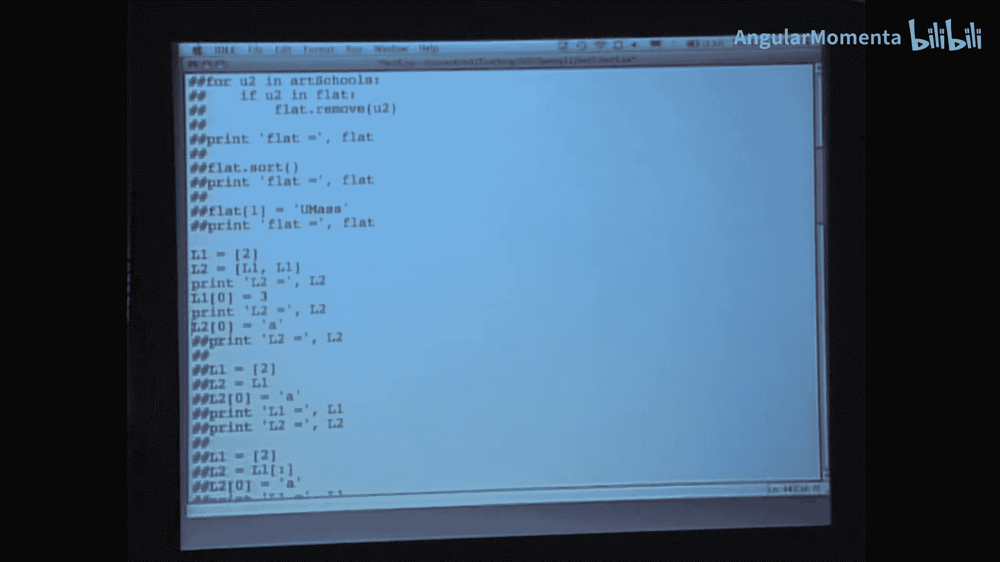

---

上一节我们探讨了有序的序列（元组和列表），本节中我们来看看一种不同的、基于键值对的数据结构。

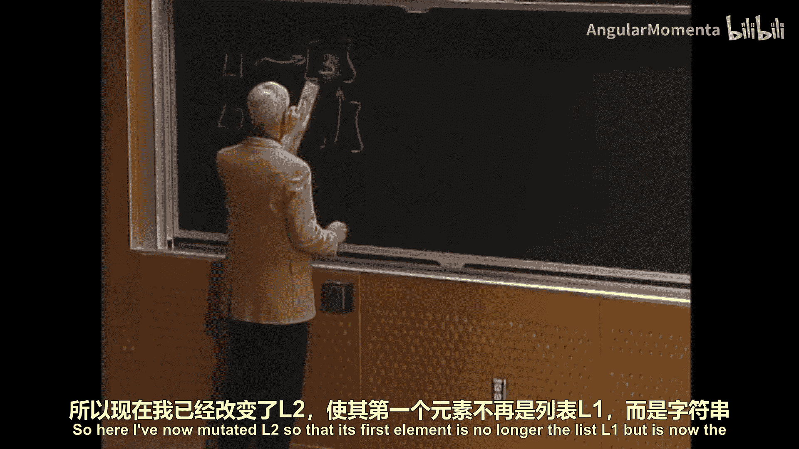

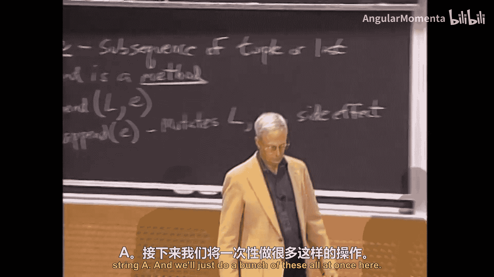

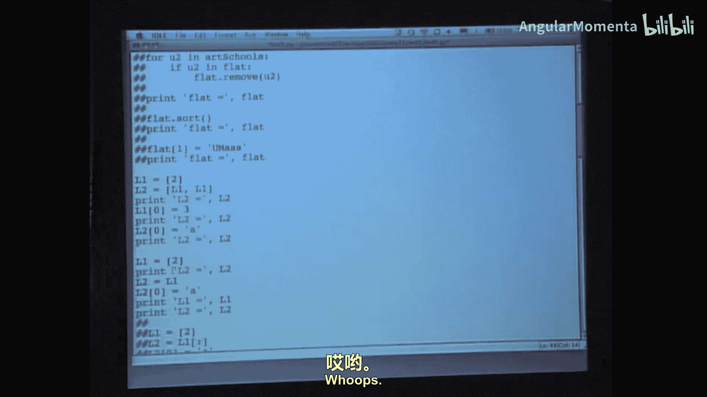

## 字典：无序的键值对集合 🗂️

字典与列表和元组有两大根本区别：
1.  元素是**无序**的。
2.  索引（称为**键**）可以是任何**不可变**类型（如整数、字符串、元组），而不仅仅是整数。

### 创建与访问字典

字典使用花括号 `{}` 创建，键值对用冒号 `:` 分隔：

```python
D = {1: 'one', 'two': 2, 'pi': 3.14159}
print(D['pi'])  # 输出键'pi'对应的值：3.14159
```

### 字典的键必须是不可变的

字典的键必须是不可变类型，这是为了支持其底层高效的“哈希”实现。

### 字典的常用操作

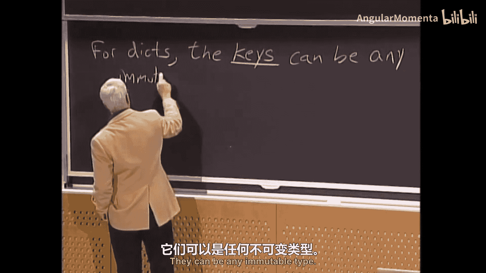

你可以遍历字典的键，并访问或修改对应的值：

```python
EtoF = {'one': 'un', 'soccer': 'football', 'never': 'jamais'}
for key in EtoF.keys():
    print(key, '->', EtoF[key])

del EtoF['one']  # 删除键值对
```

### 字典的应用示例：简单翻译

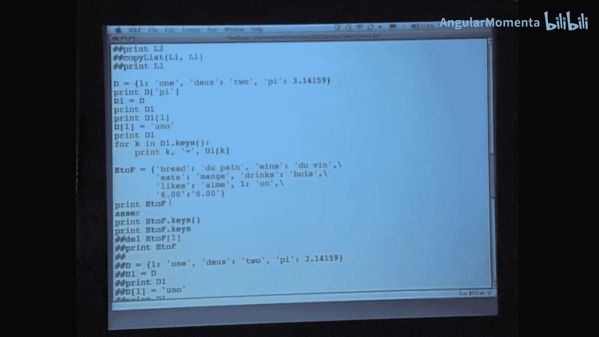

字典非常适合用于映射关系，例如构建一个简单的单词翻译器：

```python
def translate_word(word, dictionary):
    if word in dictionary:
        return dictionary[word]
    else:
        return word

def translate_sentence(sentence, dictionary):
    translation = ''
    word = ''
    for c in sentence:
        if c != ' ':
            word = word + c
        else:
            translation = translation + ' ' + translate_word(word, dictionary)
            word = ''
    return translation[1:] + ' ' + translate_word(word, dictionary)

print(translate_sentence('I never play soccer', EtoF))
```

---

## 总结 📝

本节课中我们一起学习了Python中三种核心的数据结构：
*   **元组**：有序、不可变的序列，适用于存储不应更改的数据集合。
*   **列表**：有序、可变的序列，功能强大但需要注意由可变性带来的别名和副作用问题。
*   **字典**：无序的键值对集合，通过键（必须是不可变类型）来高效访问值，非常适合表示映射关系。


理解这些数据结构的特性和区别，是编写高效、正确Python程序的基础。在接下来的问题集中，你将有机会实践这些概念。