# 008：递归与分治法 🧩


在本节课中，我们将要学习一种强大的问题解决策略——分治法，并重点介绍其核心实现技术之一：递归。我们将通过多个实例，理解如何将复杂问题分解为更小的同类问题，并组合其解决方案。

---

## 字典回顾与效率思考

上一节我们介绍了字典这一强大的数据结构。它允许我们将键与几乎任何类型的值关联起来。

一个自然的问题是：如果 Python 没有内置字典，我们能否实现类似的功能？答案是肯定的。我们可以用列表来模拟。

以下是一个用列表实现简单键值查找的示例：

```python
def keySearch(L, k):
    for elem in L:
        if elem[0] == k:
            return elem[1]
    return None
```

这个函数遍历列表，检查每个元素的第一个部分是否等于目标键 `k`，如果找到则返回对应的值。

然而，这种方法存在效率问题。要判断一个键是否在“字典”中，平均需要检查一半的列表元素，最坏情况下需要检查整个列表。如果列表很长，效率会很低。

相比之下，Python 内置字典的查找操作是**常数时间**的，即查找时间与字典大小无关。这凸显了不同数据结构具有不同的效率特性，而字典在实现关联查找方面非常高效。

---

## 一个翻译示例

上一讲末尾，Guttag 教授展示了一个简单的翻译函数示例。它使用字典将英文单词映射为法文单词。

让我们深入分析这个例子。首先，我们有一个将单个单词翻译成法文的函数：

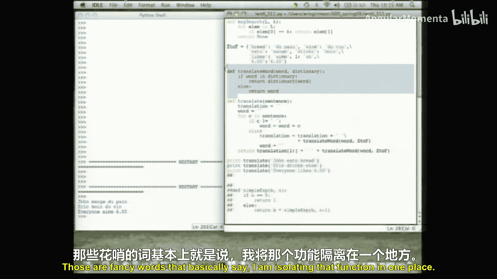

```python
def translateWord(word, dictionary):
    if word in dictionary:
        return dictionary[word]
    else:
        return word
```

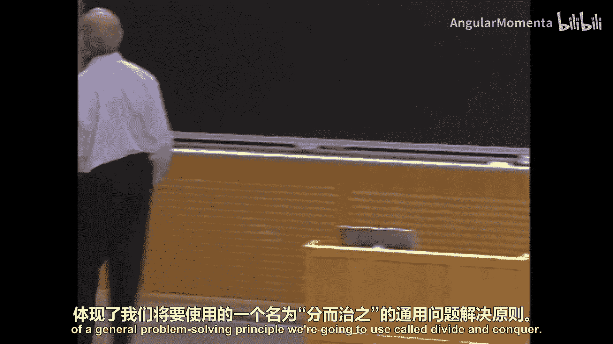

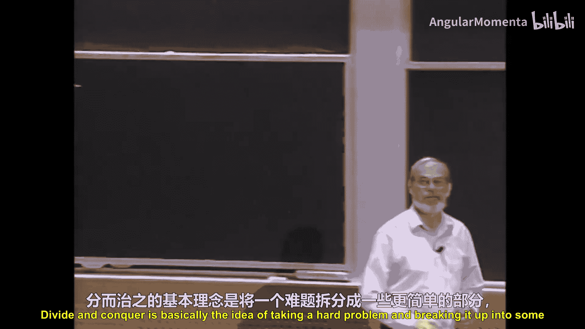

这个函数检查单词是否在字典中，如果在则返回翻译，否则返回原单词。

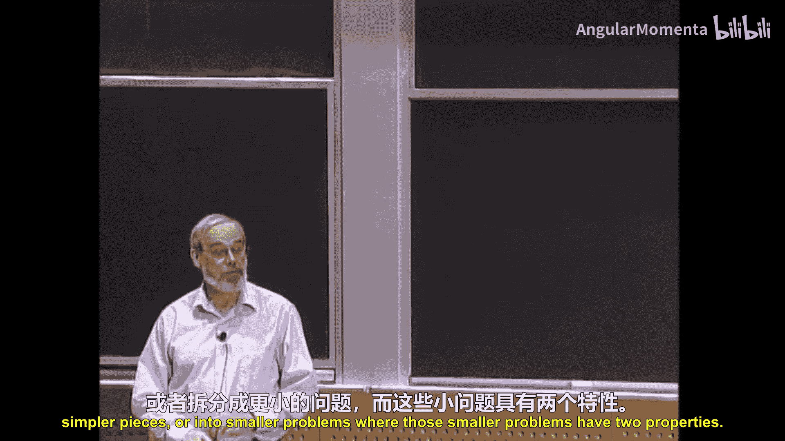

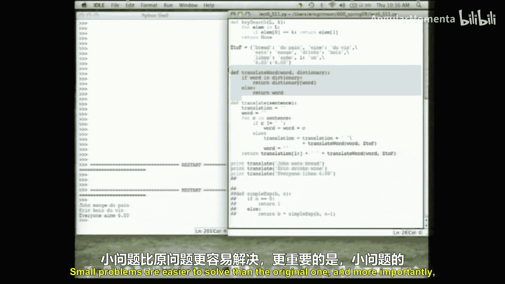

接下来是翻译整个句子的核心函数：

```python
def translate(sentence):
    translation = ''
    word = ''
    for c in sentence:
        if c != ' ':
            word = word + c
        else:
            translation = translation + ' ' + translateWord(word, dictionary)
            word = ''
    return translation[1:] + ' ' + translateWord(word, dictionary)
```

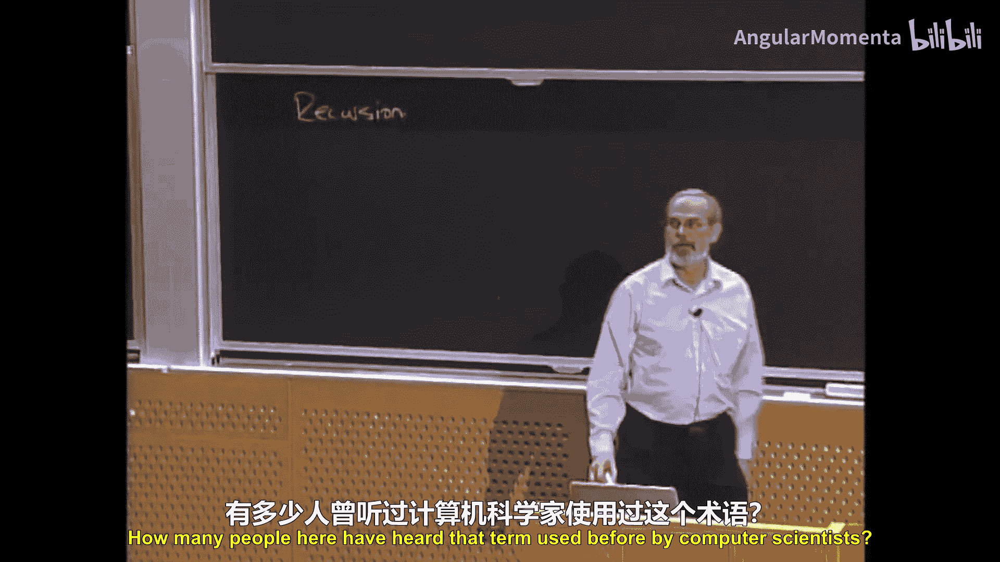

这个函数遍历句子中的每个字符。当字符不是空格时，它累积字符以形成单词。当遇到空格时，它认为一个单词结束，调用 `translateWord` 进行翻译，并将结果添加到 `translation` 字符串中。循环结束后，还需要处理最后一个单词（因为句子末尾通常没有空格）。

这个例子引出了两个重要的编程概念：
1.  **代码复用**：将 `translateWord` 分离为独立函数，避免了代码重复，便于调试。
2.  **模块化抽象**：将特定功能（单词翻译）隔离在一个地方。如果需要修改翻译逻辑，只需修改这一个函数，而不必搜索整个代码库。这体现了“分治法”的思想。

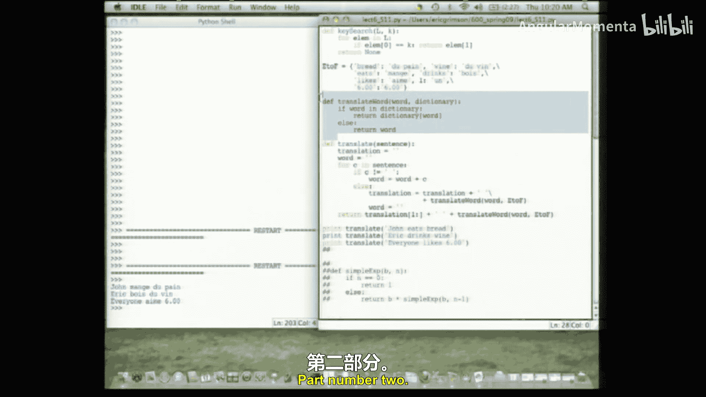

---

## 分治法：化繁为简的哲学 🧱

分治法的核心思想是：将一个困难的问题分解成若干个更简单的子问题。

这些子问题需要具备两个关键属性：
1.  子问题比原问题更容易解决。
2.  子问题的解决方案能够**容易地**组合起来，以解决原问题。


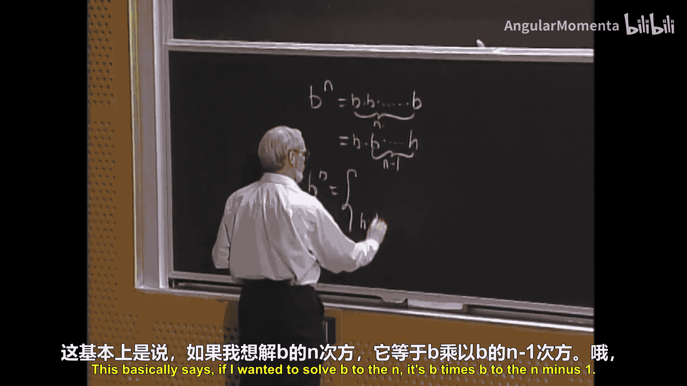

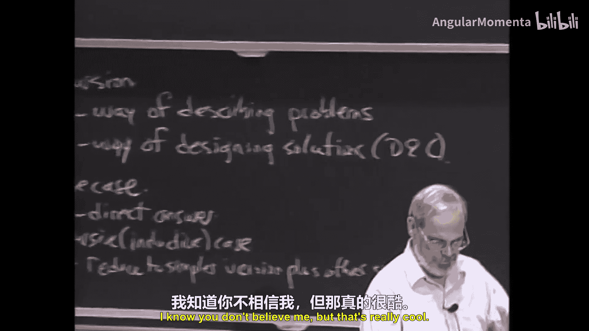

这是一个古老而强大的思想。从凯撒大帝的“分而治之”到美国《宪法》对“本土出生公民”的递归定义，都体现了这种思维模式。

在《宪法》定义中：
*   **基础情况**：在美国境内出生的人，是本土出生公民。
*   **递归情况**：在美国境外出生的人，如果其父母都是美国公民，且至少一方在美国居住过，那么他也是本土出生公民。（而判断其父母是否为公民，可能又需要追溯其祖父母的情况，如此递归下去。）

这正是递归定义的典型结构：
*   **基础情况**：直接给出最简单情况的答案。
*   **递归（归纳）情况**：将问题简化为一个或多个更小版本的同一问题，再结合一些简单操作得到答案。

---

## 递归实例解析

下面我们通过几个例子，具体看看如何用递归解决问题。

### 实例一：幂运算

计算 `b` 的 `n` 次方（仅使用乘法）。

**递归思路**：
*   **基础情况**：当 `n == 0` 时，`b**0 = 1`。
*   **递归情况**：当 `n > 0` 时，`b**n = b * (b**(n-1))`。

```python
def simple_exp(b, n):
    if n == 0:
        return 1
    else:
        return b * simple_exp(b, n-1)
```

### 实例二：汉诺塔问题

汉诺塔问题要求将一叠盘子从一根柱子移动到另一根柱子，每次只能移动一个盘子，且大盘子不能放在小盘子上。

**递归思路**（移动 n 个盘子从 `from` 柱到 `to` 柱，借助 `spare` 柱）：
*   **基础情况**：如果只有一个盘子（n==1），直接将其从 `from` 移到 `to`。
*   **递归情况**：
    1.  将上面的 n-1 个盘子从 `from` 移到 `spare`（借助 `to`）。
    2.  将最大的第 n 个盘子从 `from` 移到 `to`。
    3.  将 n-1 个盘子从 `spare` 移到 `to`（借助 `from`）。

```python
def hanoi(n, from_stack, to_stack, spare_stack):
    if n == 1:
        print('Move from', from_stack, 'to', to_stack)
    else:
        hanoi(n-1, from_stack, spare_stack, to_stack)
        hanoi(1, from_stack, to_stack, spare_stack)
        hanoi(n-1, spare_stack, to_stack, from_stack)
```

### 实例三：判断回文串

回文串是正读反读都一样的字符串。

**递归思路**：
*   **基础情况**：如果字符串长度为 0 或 1，那么它是回文串。
*   **递归情况**：检查字符串的首尾字符。
    *   如果首尾字符不同，则不是回文串。
    *   如果首尾字符相同，则问题转化为判断“去掉首尾字符后的子串”是否是回文串。

首先，我们需要一个辅助函数来预处理字符串（忽略空格和大小写）：

```python
def toChars(s):
    import string
    s = s.lower()
    ans = ''
    for c in s:
        if c in string.ascii_lowercase:
            ans = ans + c
    return ans
```

然后是核心的递归判断函数：

```python
def isPal(s):
    if len(s) <= 1:
        return True
    else:
        return s[0] == s[-1] and isPal(s[1:-1])
```

最后，组合两个函数：

```python
def isPalindrome(s):
    return isPal(toChars(s))
```

为了更直观地展示递归过程，我们可以为 `isPal` 函数添加打印语句，观察其如何层层深入（递归调用）和层层返回（组合结果）。

### 实例四：斐波那契数列

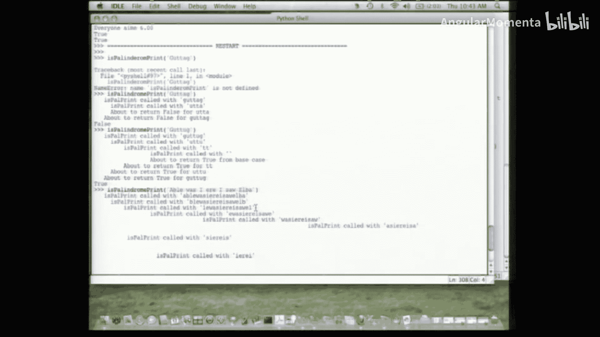

斐波那契数列描述了一种理想化的兔子繁殖模型，其定义如下：

**递归定义**：
*   **基础情况**：`fib(0) = 1`, `fib(1) = 1`。
*   **递归情况**：`fib(n) = fib(n-1) + fib(n-2)` （当 n > 1 时）。

这个定义意味着，第 n 个月的兔子数量等于前两个月兔子数量之和。

```python
def fib(x):
    if x == 0 or x == 1:
        return 1
    else:
        return fib(x-1) + fib(x-2)
```

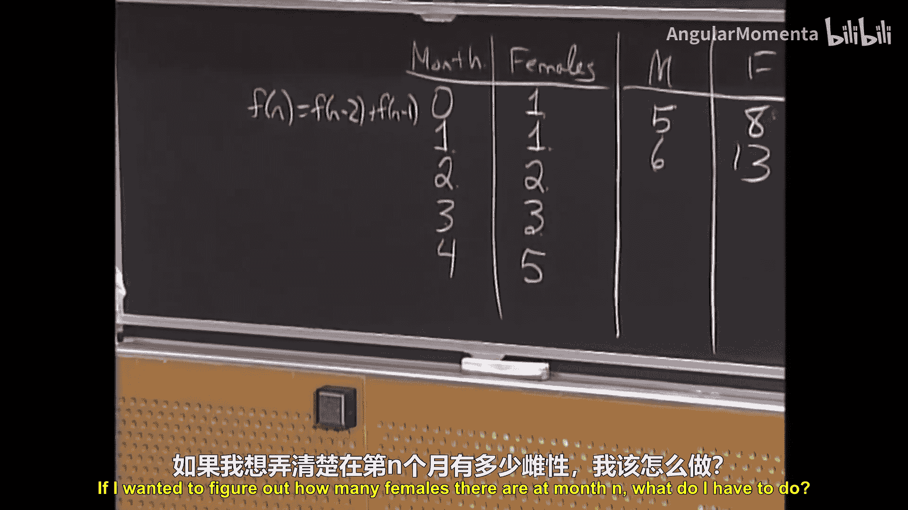

注意，这个递归解法包含了**多个递归调用**（`fib(n-1)` 和 `fib(n-2)`），并且有**多个基础情况**（`n==0` 和 `n==1`）。虽然这个直接递归实现的效率不高（存在大量重复计算），但它清晰地展示了如何将问题分解为更小的同类问题。

斐波那契数列在自然界中广泛存在，例如许多花朵的花瓣数目是斐波那契数。当 n 趋向无穷大时，相邻两项的比值 `fib(n)/fib(n-1)` 会趋近于黄金比例 `(1+√5)/2`。

---

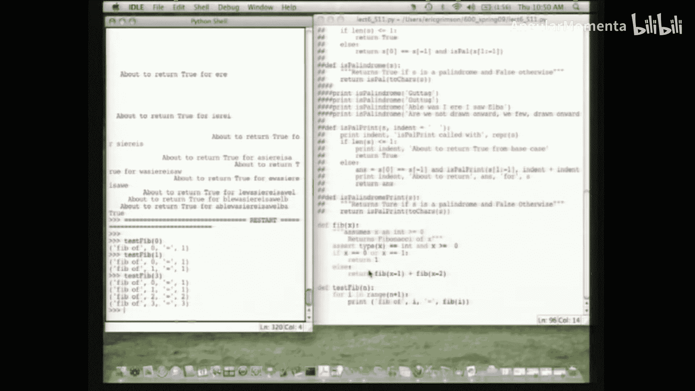

## 总结

本节课我们一起学习了分治法与递归这一核心问题解决策略。

我们了解到：
*   **分治法**的精髓在于将大问题分解为更易解决的小问题，并能将小问题的解轻松组合。
*   **递归**是实现分治法的自然工具，它通过“自我调用”来解决问题，包含**基础情况**和**递归情况**两个关键部分。
*   通过**幂运算**、**汉诺塔**、**回文判断**和**斐波那契数列**等多个实例，我们看到了递归如何让复杂问题的代码变得清晰、简洁。
*   递归不仅是一种编程技巧，更是一种描述和定义问题的思维方式。


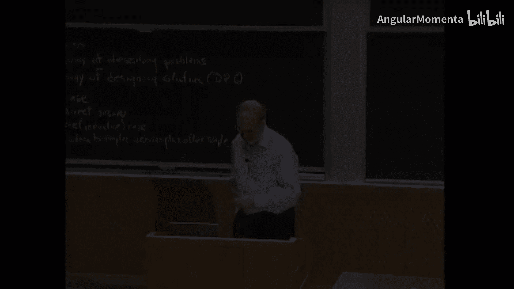

掌握递归思维，你将拥有一个强大的工具，用于分解和解决许多复杂的计算问题。