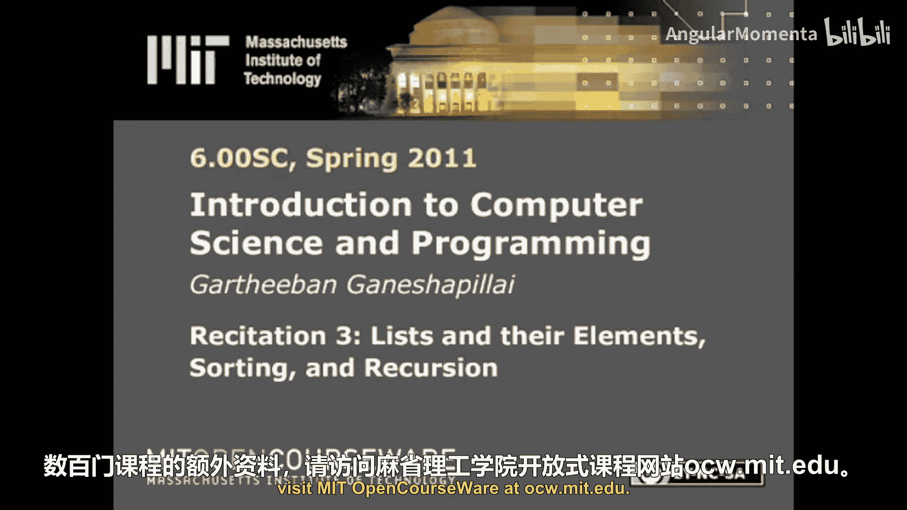

# 009：数据结构与递归



在本节课中，我们将学习Python中的三种核心数据结构：元组、列表和字典，并探讨递归的基本概念。我们将通过具体的例子来理解它们的特点、用法以及在实际编程中的应用。

## 元组

元组是一种不可变的有序序列。这意味着一旦创建，其内容就不能被修改。元组可以包含不同类型的元素，甚至可以包含列表。

### 访问元组元素

我们可以通过索引来访问元组中的元素。索引从0开始。

```python
tuple_a = (1, 2, 3)
print(tuple_a[0])  # 输出第一个元素：1
print(tuple_a[-1]) # 输出最后一个元素：3
```

### 元组切片

切片操作允许我们获取元组的一部分。

```python
tuple_a = (1, 2, 3)
print(tuple_a[0:1]) # 输出 (1,)
print(tuple_a[0:2]) # 输出 (1, 2)
```

### 遍历元组

我们可以使用 `for` 循环来遍历元组中的每个元素。

```python
tuple_a = (1, 2, 3)
for item in tuple_a:
    print(item)
```

## 列表

列表是一种可变的有序序列。与元组不同，列表创建后可以修改其内容。列表提供了许多方法来操作其中的元素。

### 列表的基本操作

以下是列表的一些基本操作：

*   **添加元素**：使用 `append()` 方法在列表末尾添加元素。
*   **移除元素**：使用 `pop()` 方法移除并返回列表的最后一个元素，或使用 `remove()` 方法移除第一个匹配的指定值。
*   **扩展列表**：使用 `extend()` 方法将另一个列表的所有元素添加到当前列表末尾。

```python
my_list = [1, 2]
my_list.append(3)      # my_list 变为 [1, 2, 3]
my_list.pop()          # 返回 3，my_list 变为 [1, 2]
my_list.remove(1)      # my_list 变为 [2]
my_list.extend([4, 5]) # my_list 变为 [2, 4, 5]
```

### 创建多维列表

列表可以用来创建矩阵等复杂数据结构。

```python
matrix = [[1, 2], [3, 4]] # 一个2x2的矩阵
print(matrix[0][1])       # 访问第一行第二列的元素：2
```

### 列表的别名与复制

由于列表是可变对象，直接赋值只会创建对同一列表的引用（别名），而不是复制。修改一个别名会影响所有引用该列表的变量。

```python
list_x = [1, 2, 3]
list_y = list_x          # list_y 是 list_x 的别名
list_x[0] = 99
print(list_y)            # 输出 [99, 2, 3]
```

要创建列表的独立副本，可以使用切片操作 `[:]`。

```python
list_z = list_x[:]       # list_z 是 list_x 的完整副本
list_x[0] = 100
print(list_z)            # 输出 [99, 2, 3]，不受影响
```

### 类型转换

元组和列表之间可以相互转换。

```python
my_tuple = (1, 2, 3)
my_list = list(my_tuple)   # 元组转列表
new_tuple = tuple(my_list) # 列表转元组
```

## 字典

字典是一种可变的无序集合，用于存储键值对。键必须是不可变对象（如字符串、数字、元组），而值可以是任何类型的对象。

### 字典的基本操作

以下是字典的一些基本操作：

*   **访问与修改**：通过键来访问或修改对应的值。
*   **添加新项**：为新的键赋值即可添加新项。
*   **检查键是否存在**：使用 `in` 关键字。
*   **获取所有键**：使用 `keys()` 方法。
*   **获取所有键值对**：使用 `items()` 方法。

```python
my_dict = {'name': 'Alice', 'age': 25}
print(my_dict['name'])          # 访问：'Alice'
my_dict['age'] = 26             # 修改
my_dict['city'] = 'New York'    # 添加
print('name' in my_dict)        # 检查键：True
print(my_dict.keys())           # 获取所有键
print(my_dict.items())          # 获取所有键值对
```

### 遍历字典

我们可以遍历字典的键、值或键值对。

```python
# 遍历键
for key in my_dict:
    print(key, my_dict[key])

# 遍历键值对（推荐）
for key, value in my_dict.items():
    print(key, value)
```

## 递归

递归是一种编程技巧，函数通过调用自身来解决问题。递归的核心思想是将一个复杂问题分解为一个或多个相同类型的、但规模更小的子问题。

### 递归的两个关键部分

1.  **基线条件**：这是递归的终止条件，防止函数无限调用自身。它通常对应问题的最小、最简单的情况。
2.  **递归条件**：这是函数调用自身的部分，它将问题规模缩小，逐步向基线条件靠近。

### 递归示例：阶乘

计算阶乘 `n!` 的递归定义是：`n! = n * (n-1)!`，且 `0! = 1`。

```python
def factorial(n):
    if n == 0:          # 基线条件
        return 1
    else:               # 递归条件
        return n * factorial(n - 1)
```

### 递归示例：汉诺塔

汉诺塔问题是一个经典的递归问题。目标是将所有盘子从源柱移动到目标柱，期间可以借助缓冲柱，且任何时候大盘子都不能放在小盘子上面。

解决思路是：
1.  将 `n-1` 个盘子从源柱移动到缓冲柱（借助目标柱）。
2.  将第 `n` 个（最大的）盘子从源柱直接移动到目标柱。
3.  将 `n-1` 个盘子从缓冲柱移动到目标柱（借助源柱）。

```python
def hanoi(n, source, target, buffer):
    if n > 0:
        # 将 n-1 个盘子从 source 移动到 buffer，以 target 作为缓冲
        hanoi(n-1, source, buffer, target)
        # 将第 n 个盘子从 source 移动到 target
        print(f"Move disk from {source} to {target}")
        # 将 n-1 个盘子从 buffer 移动到 target，以 source 作为缓冲
        hanoi(n-1, buffer, target, source)

# 调用函数，移动3个盘子
hanoi(3, 'A', 'C', 'B')
```

## 总结


本节课我们一起学习了Python中三种重要的数据结构：**元组**（不可变序列）、**列表**（可变序列）和**字典**（键值对集合）。我们了解了它们各自的特点、操作方法以及在实际编程中的注意事项，例如列表的别名问题。最后，我们探讨了**递归**的核心思想，并通过阶乘和汉诺塔的例子，学习了如何设计递归函数来优雅地解决复杂问题。理解这些概念是进行更高级编程的基础。