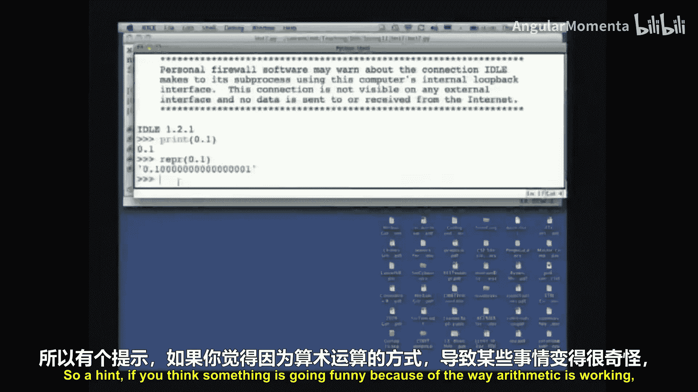
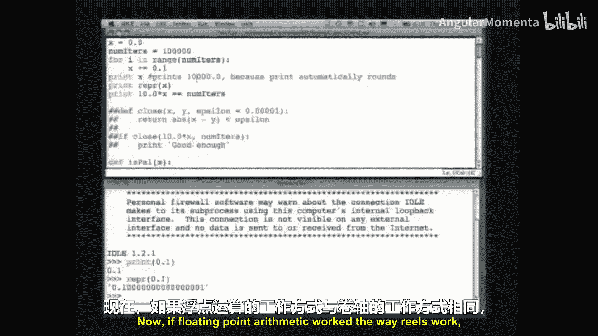
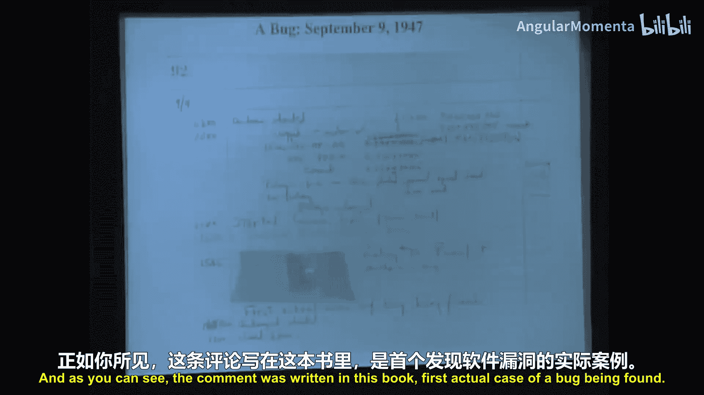
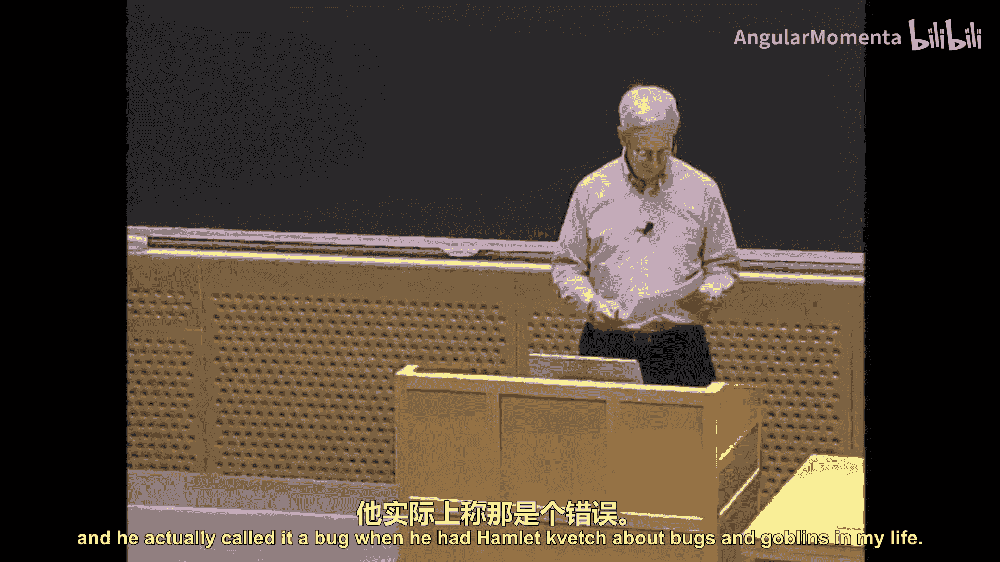
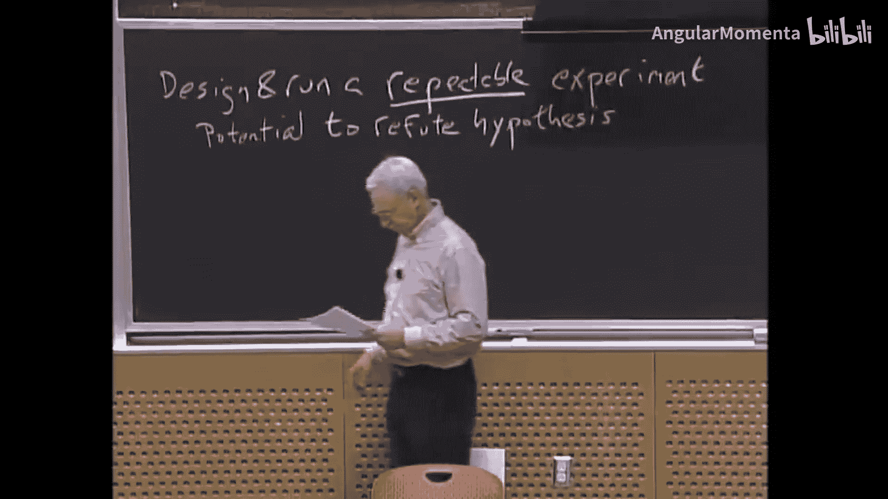
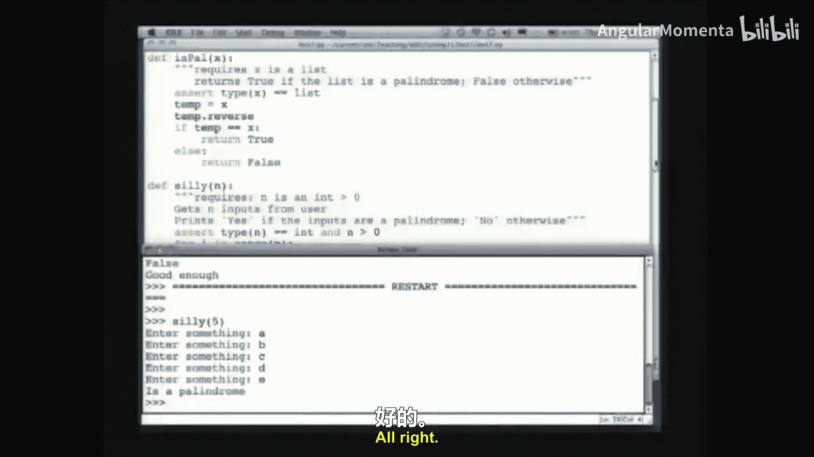
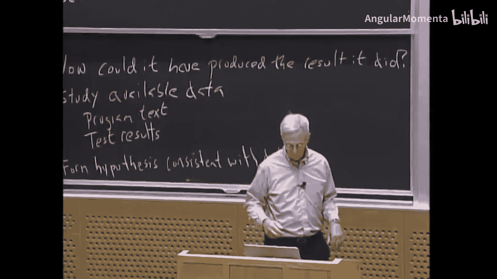
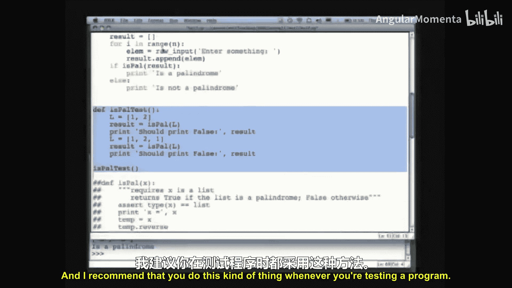
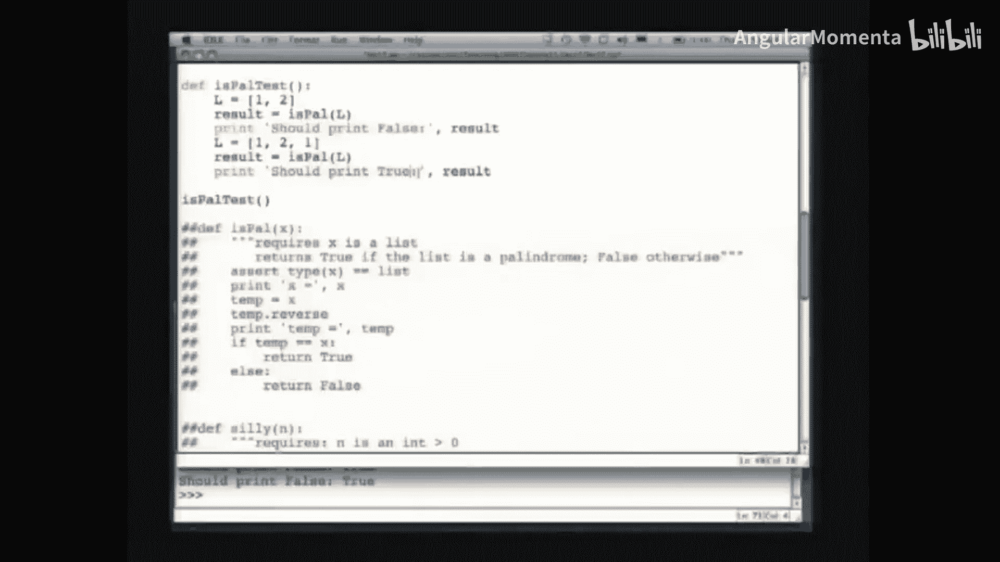

# 010：浮点数与调试

在本节课中，我们将学习两个核心主题：浮点数在计算机中的表示方式及其可能带来的问题，以及系统化调试程序的方法。理解这些概念对于编写正确、健壮的代码至关重要。

## 浮点数：二进制与十进制的差异

上一节我们介绍了课程安排。本节中，我们来看看计算机如何处理数字，特别是浮点数。

计算机内部使用二进制（基数为2）表示所有数据，而人类习惯于使用十进制（基数为10）。对于整数，这种差异通常不会造成问题。然而，对于小数（浮点数），二进制无法精确表示某些十进制分数，这会导致微小的精度误差。

### 二进制数字基础

要理解浮点数，首先需要理解二进制数字。


*   在十进制中，数字由0-9的数码表示。最右边的位是10⁰位，接着是10¹位，依此类推。
    *   例如，数字302表示：`3 * 100 + 0 * 10 + 2 * 1`
*   在二进制中，数字仅由0和1两个数码表示。最右边的位是2⁰位，接着是2¹位，依此类推。
    *   例如，二进制数101表示：`1 * 4 + 0 * 2 + 1 * 1 = 5`


一个重要的区别是，表示相同的数值，二进制通常需要比十进制更多的位数。


### 为什么浮点数会出问题？



问题根源在于，某些简单的十进制小数在二进制中是无限循环小数。


*   十进制数 `0.125`（即1/8）可以精确转换为二进制：`0.001`。
*   然而，十进制数 `0.1`（即1/10）在二进制中是一个无限循环小数：`0.0001100110011...`




计算机内存有限，因此只能存储这个无限小数的有限位近似值。这就导致了精度误差。

在Python中，你可以通过 `repr()` 函数查看变量内部存储的真实近似值，而 `print()` 函数会自动进行舍入，可能隐藏问题。

```python
x = 0.1
print(x)          # 输出: 0.1 (经过舍入)
print(repr(x))    # 输出: 0.1000000000000000055511151231257827021181583404541015625
```


### 误差累积与比较陷阱

当进行大量运算时，微小的误差可能会累积，导致明显错误。


考虑以下代码，它将0.1累加10,000次：

```python
x = 0.0
for i in range(10000):
    x = x + 0.1
print(x) # 打印结果看似是1000.0
print(x == 1000.0) # 但比较结果却是 False
print(repr(x)) # 查看内部表示，发现并非精确的1000.0
```



**核心教训：永远不要直接使用 `==` 来比较两个浮点数是否相等。**



正确的做法是检查两个数的差值是否小于一个可接受的微小误差范围（epsilon）。


```python
def close_enough(x, y, epsilon=0.0000001):
    return abs(x - y) < epsilon

# 使用方式
result = close_enough(x, 1000.0)
```

## 系统化调试：从“除虫”传说讲起

上一节我们探讨了浮点数的特性。本节中，我们将转向另一个关键技能：如何高效地查找和修复程序中的错误，即“调试”。

关于“调试”（Debugging）一词有个著名的传说：1947年，Grace Hopper在哈佛Mark II计算机的继电器里发现了一只飞蛾（bug），导致程序故障，移除飞蛾后程序恢复运行，这被认为是“调试”的起源。虽然这个词的实际使用更早，但这故事生动地描述了排除故障的过程。

### 调试的核心思想

首先，需要摒弃两个误区：
1.  错误不是自己“爬”进程式的，而是程序员引入的。
2.  错误不会在程序中“繁殖”，多个错误意味着程序员犯了多个错误。

调试的目标不是“快速消灭一个错误”，而是**系统性地向一个无错误的程序迈进**。调试是一项可以通过学习掌握的技能，其方法论可以应用于解决许多其他领域的问题。

### 调试工具：print语句与科学方法



最强大、最常用的调试工具是 `print` 语句。通过在有疑问的地方打印变量的值，可以观察程序的实际执行路径。

高效的调试遵循类似于**科学方法**的步骤：
1.  **收集数据**：程序代码、产生错误输出的测试用例。
2.  **提出假设**：基于现有数据，对错误原因形成一个可验证的猜想。
3.  **设计并运行可重复的实验**：通过添加 `print` 语句或编写测试代码来验证假设。实验必须有可能**证伪**你的假设。
4.  **分析结果，修正假设或代码**：根据实验结果，要么修正代码，要么提出新的假设并重复过程。



### 调试策略：二分查找法



在程序中寻找错误点，可以借鉴**二分查找**的策略。
1.  首先，尝试找到能触发错误的最简单、最小的输入。这减少了测试的复杂性。
2.  在程序中选取一个中间点，插入 `print` 语句。
3.  检查此时程序的状态是否符合预期。
    *   如果符合，则错误在**后半部分**。
    *   如果不符合，则错误在**前半部分**或就是这个点本身。
4.  在包含错误的那一半程序中，重复步骤2和3，不断缩小范围，直到定位错误。

### 实践示例：调试一个回文判断程序

让我们通过一个故意包含错误的程序来实践上述方法。程序 `silly` 要求用户输入n个字符串，然后判断这些字符串组成的列表是否为回文。

```python
def is_pal(x):
    temp = x
    temp.reverse
    if temp == x:
        return True
    else:
        return False

def silly(n):
    result = []
    for i in range(n):
        elem = input('Enter element: ')
        result.append(elem)
    if is_pal(result):
        print('Yes')
    else:
        print('No')
```




运行 `silly(2)` 并输入 `A`, `B`，程序错误地输出 `Yes`。

**调试过程：**
1.  **简化输入**：已使用最小错误用例 `silly(2)`。
2.  **二分查找，定位模块**：在 `silly` 函数中，`is_pal` 调用前打印 `result`，发现列表正确为 `[‘A‘, ‘B‘]`。错误很可能在 `is_pal` 函数内部。
3.  **深入 `is_pal`**：
    *   首先发现 `temp.reverse` 缺少括号 `()`，这导致反转操作并未执行。
    *   修复后，发现反转操作同时改变了原始列表 `x`，这是因为 `temp = x` 使得两个变量指向同一个列表对象（别名）。
4.  **最终修复**：需要创建列表的副本再进行反转。
    ```python
    def is_pal(x):
        temp = x[:] # 创建列表x的副本
        temp.reverse()
        return temp == x
    ```




**重要提示**：在调试时，`print` 语句中应同时输出你**期望的值**和实际值，便于快速比对。此外，编写独立的**测试代码**来调用被调试函数，可以避免反复进行手动输入，提高效率。

## 总结


本节课中我们一起学习了两个重要主题。
首先，我们探讨了**浮点数**在计算机中的二进制表示方式，理解了为何 `0.1` 这样的十进制小数无法被精确存储，以及由此带来的精度误差。我们掌握了核心原则：**不要直接比较浮点数是否相等**，而应检查它们是否足够接近。
其次，我们深入学习了系统化的**调试**方法。我们了解了调试的目标和科学方法般的步骤，重点实践了使用 `print` 语句和**二分查找策略**来定位程序错误。记住，调试的关键在于提出可验证的假设，并通过可重复的实验来缩小错误范围。掌握这些技能将极大地提升你解决问题的能力。