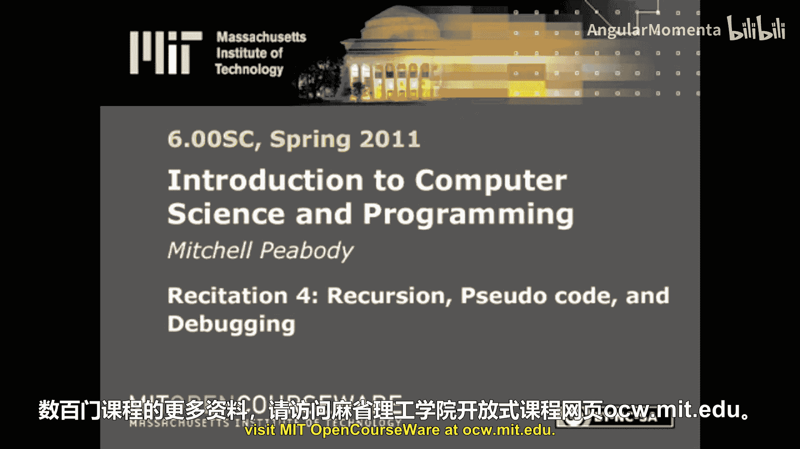
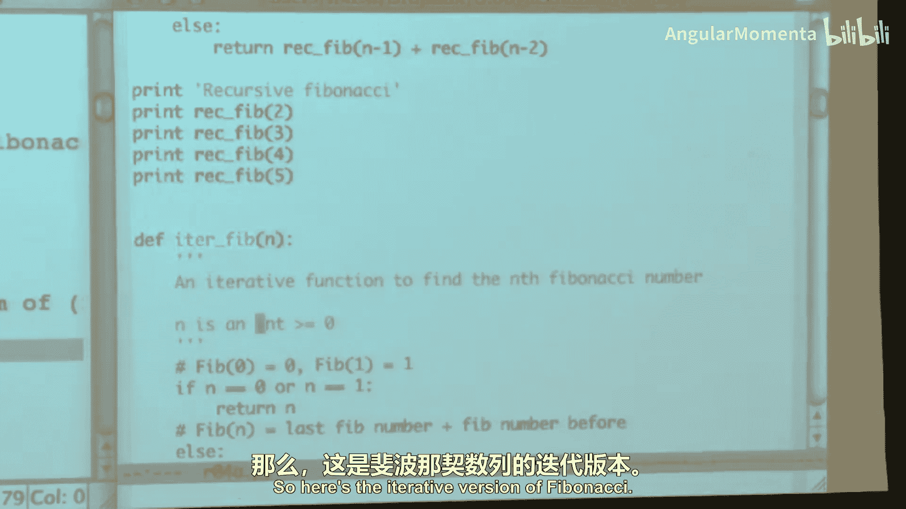
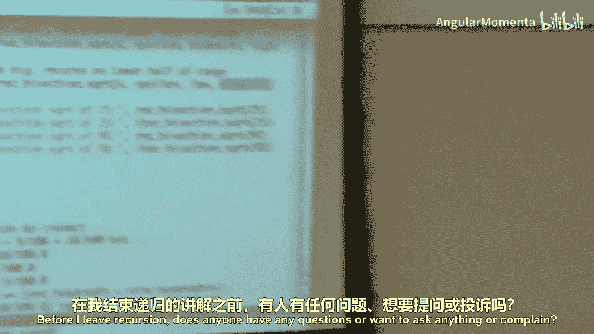
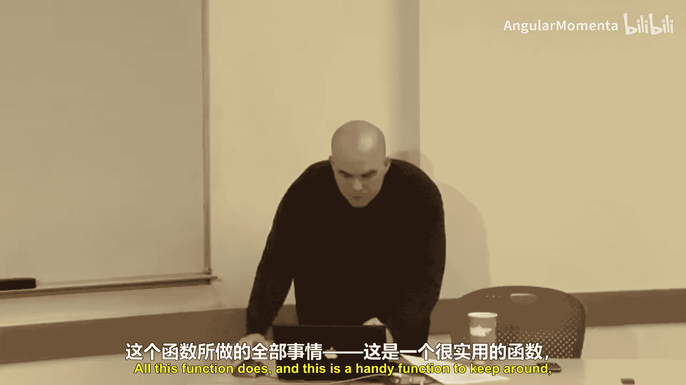
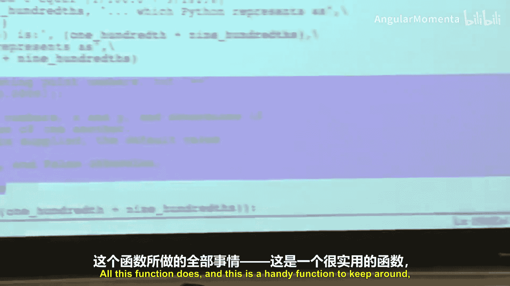
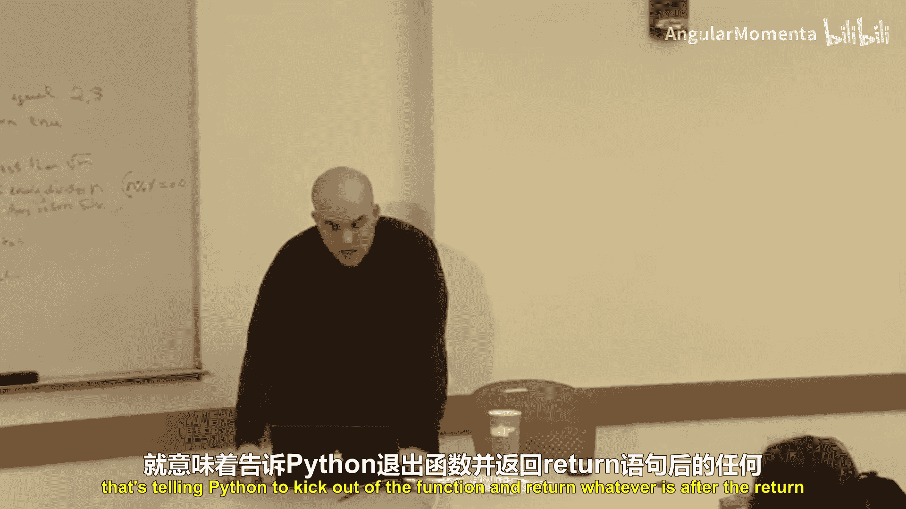
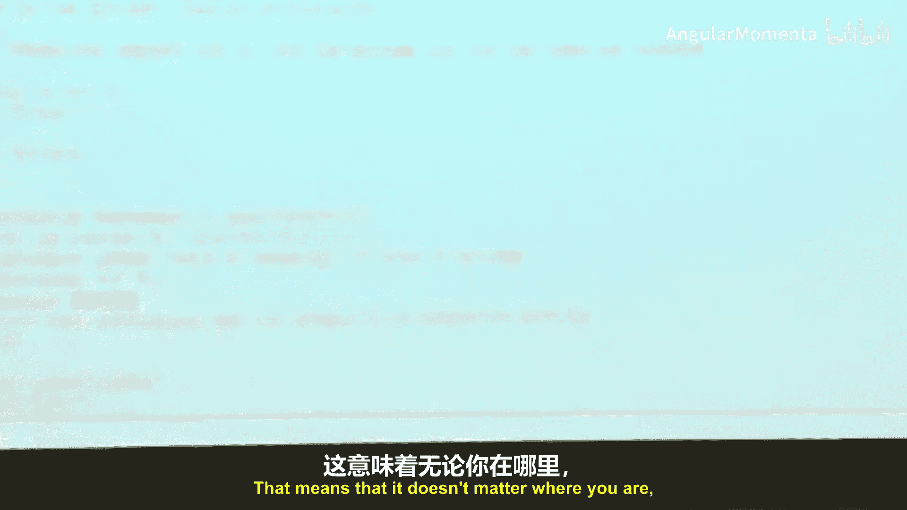
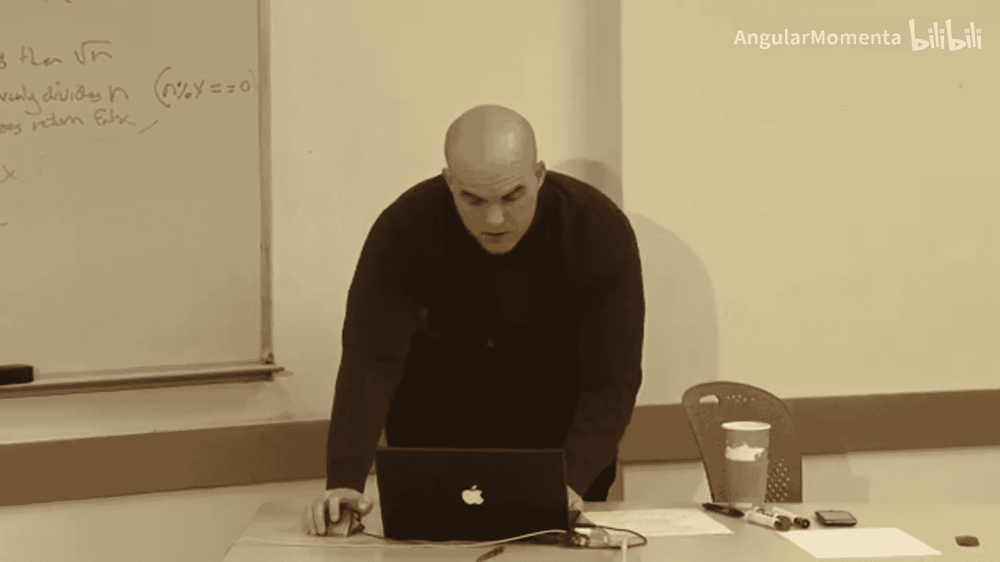
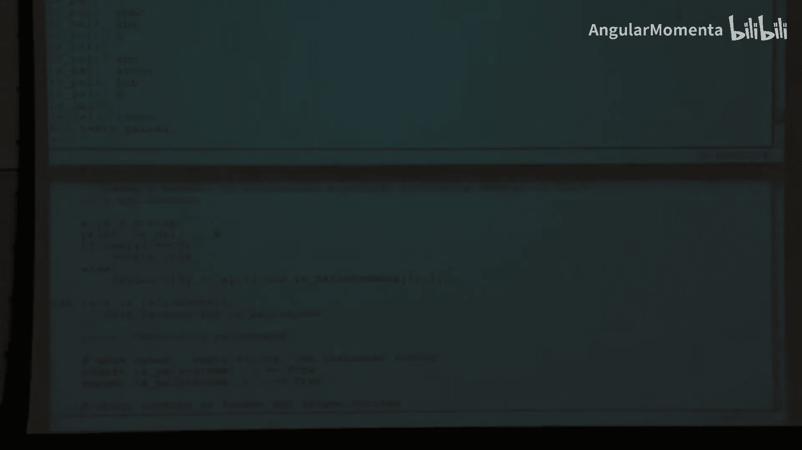

# 011：递归、浮点数与调试



在本节课中，我们将要学习递归、浮点数精度以及程序调试的核心概念。我们将通过对比递归与迭代的实现方式，理解浮点数的特性，并掌握使用伪代码和测试框架来设计和验证程序的方法。

## 递归与迭代的对比

上一节我们介绍了递归的基本概念。本节中我们来看看如何将递归函数改写为迭代形式，并比较两者的优劣。




递归是一种通过函数调用自身来解决问题的分治技术。它包含一个**基础情况**（最小的子问题）和一个**递归情况**（将问题分解为更小的子问题）。

例如，一个递归的乘法函数可以这样定义：
```python
def recursive_multiply(m, n):
    if n == 0:
        return 0
    elif n > 0:
        return m + recursive_multiply(m, n-1)
    else:
        return -m + recursive_multiply(m, n+1)
```

以下是该函数的迭代版本：
```python
def iterative_multiply(m, n):
    if n == 0 or m == 0:
        return 0
    result = 0
    if n > 0:
        while n > 0:
            result += m
            n -= 1
    else:
        while n < 0:
            result -= m
            n += 1
    return result
```
对于乘法问题，迭代版本通常更直观易懂。

然而，对于某些问题，递归版本则更加清晰。以斐波那契数列为例：
```python
def recursive_fibonacci(n):
    if n == 0 or n == 1:
        return n
    else:
        return recursive_fibonacci(n-1) + recursive_fibonacci(n-2)
```



其迭代版本需要更多的“簿记”工作来跟踪状态：
```python
def iterative_fibonacci(n):
    if n == 0 or n == 1:
        return n
    prev, curr = 0, 1
    for i in range(2, n+1):
        prev, curr = curr, prev + curr
    return curr
```
在这个例子中，递归版本更直接地反映了数学定义，可能更容易理解。

选择递归还是迭代，往往取决于问题的性质以及代码的可读性。有时为了效率，我们可能需要将直观的递归算法改写为迭代形式。

## 浮点数的精度问题

理解了代码结构的选择后，我们需要关注计算机进行数值计算时的内在限制，即浮点数的精度问题。





浮点数在计算机中的表示是不精确的。这意味着你不应该直接比较两个浮点数是否完全相等。

例如，在数学上，`0.1 + 0.9` 应该等于 `1.0`。但在计算机中：
```python
tenth = 1.0/10.0
thousandths = 1.0/1000.0
nine_hundredths = 9.0/100.0
print(tenth == thousandths + nine_hundredths)  # 输出：False
```
这是因为 `0.1` 在二进制中无法被精确表示。


解决方案是定义一个误差容忍度 **epsilon**，并比较两个数的差值是否小于这个 epsilon：
```python
def close_enough(x, y, epsilon=0.0001):
    return abs(x - y) < epsilon

print(close_enough(tenth, thousandths + nine_hundredths))  # 输出：True
```
如何选择 epsilon 的值取决于具体的应用场景和对精度的要求。

尽管浮点数不精确，但其运算是**一致的**。这意味着如果你用同一个不精确的值进行运算，结果在计算机内部是可靠的：
```python
temp = nine_hundredths + thousandths
print(close_enough(nine_hundredths, temp - thousandths))  # 输出：True
```

## 使用伪代码设计算法

在深入编码之前，用人类语言描述算法步骤是很好的实践，这被称为**伪代码**。它帮助我们在思考逻辑时，不被具体的编程语法所束缚。

以下是设计一个“猜词游戏”（Hangman）的伪代码步骤：
1.  选择一个随机单词。
2.  告诉玩家单词的字母数量。
3.  显示单词的掩码形式（如 `_ _ _ _`）。
4.  当还有剩余猜测次数 **且** 单词未被猜出时，重复以下步骤：
    *   请玩家猜一个字母。
    *   检查字母是否在单词中。
        *   如果在，更新显示的掩码单词。
        *   如果不在，减少剩余猜测次数并告知玩家。

伪代码既可用于个人理清思路，也便于向他人解释算法逻辑。

## 系统化调试与测试

最后，当程序出现错误（bug）时，系统化的调试方法至关重要。调试时，目标不是快速尝试，而是理解代码为何产生当前输出。





一个有效的方法是构建一个**测试框架**。为你的函数设计一系列测试用例，包括：
*   **边界情况**：输入的最小、最大或特殊值。
*   **典型情况**：预期的正常输入。

例如，测试一个判断回文串的函数：


```python
def is_palindrome(s):
    # 函数实现...
    pass

# 测试框架
test_cases = [
    ("", True),        # 空字符串
    ("a", True),       # 单字符
    ("ab", False),     # 非回文
    ("aba", True),     # 奇数长度回文
    ("abba", True),    # 偶数长度回文
]
all_passed = True
for input_str, expected in test_cases:
    result = is_palindrome(input_str)
    if result != expected:
        print(f"测试失败: 输入 '{input_str}', 期望 {expected}, 得到 {result}")
        all_passed = False

if all_passed:
    print("所有测试通过！")
```
每次修改代码后都运行测试框架，可以快速发现引入的新错误。调试时，一次只做最小改动，并利用 `print` 语句或调试器观察程序状态。

## 总结






本节课中我们一起学习了几个核心编程概念。我们对比了递归与迭代的实现方式，认识到根据问题选择合适方法的重要性。我们探讨了浮点数的不精确性，并学会了使用 **epsilon** 进行“足够接近”的比较。我们介绍了使用**伪代码**在编码前设计算法逻辑的技巧。最后，我们掌握了通过构建**测试框架**来系统化调试和验证程序正确性的方法。这些技能将帮助你更清晰、更稳健地构建和修复复杂的程序。