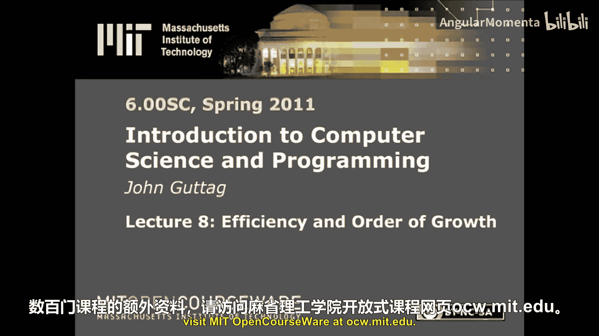
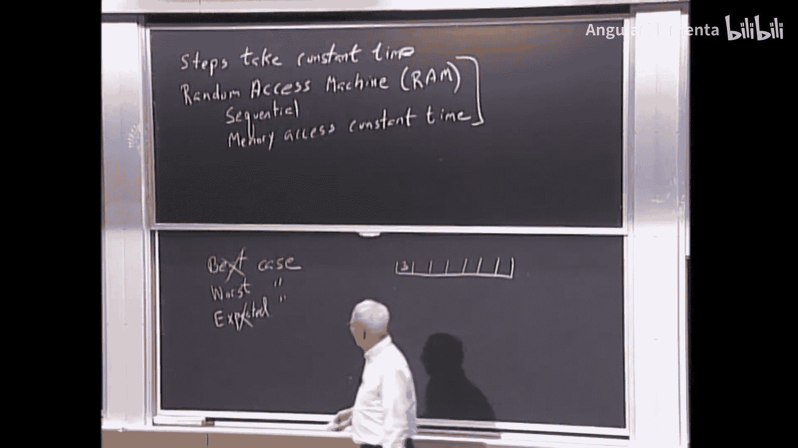
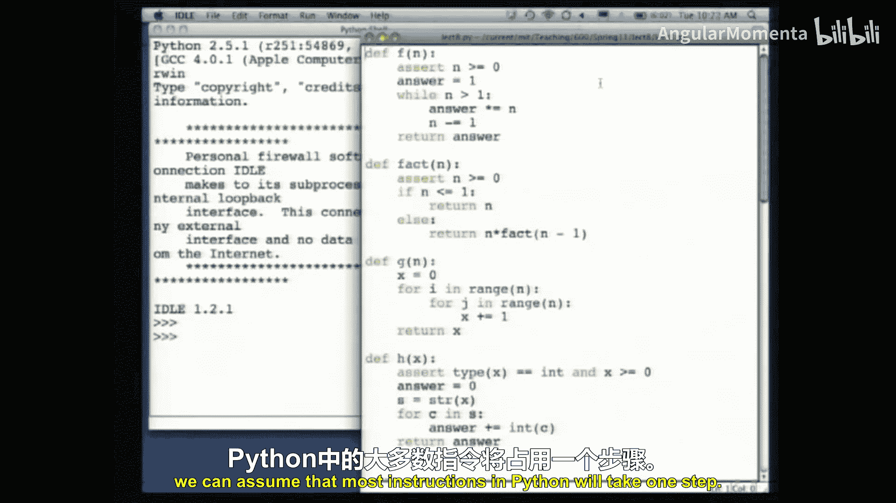
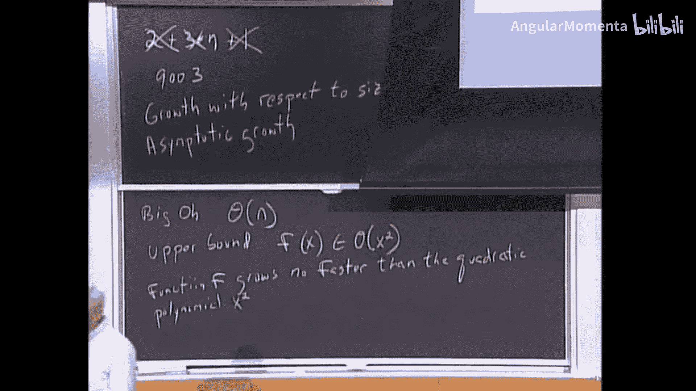
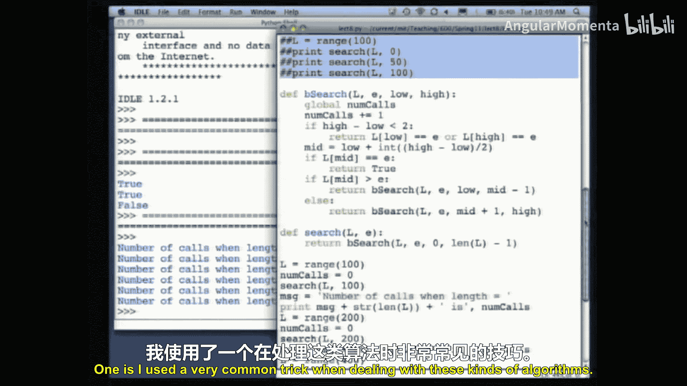
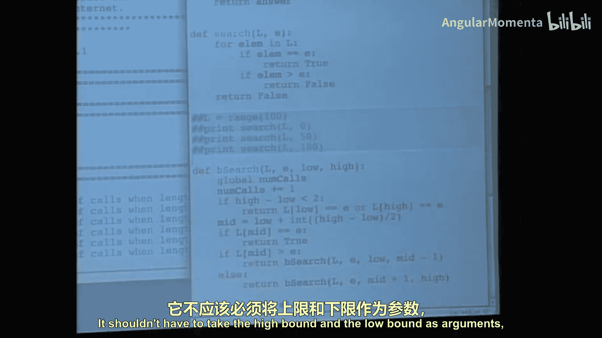
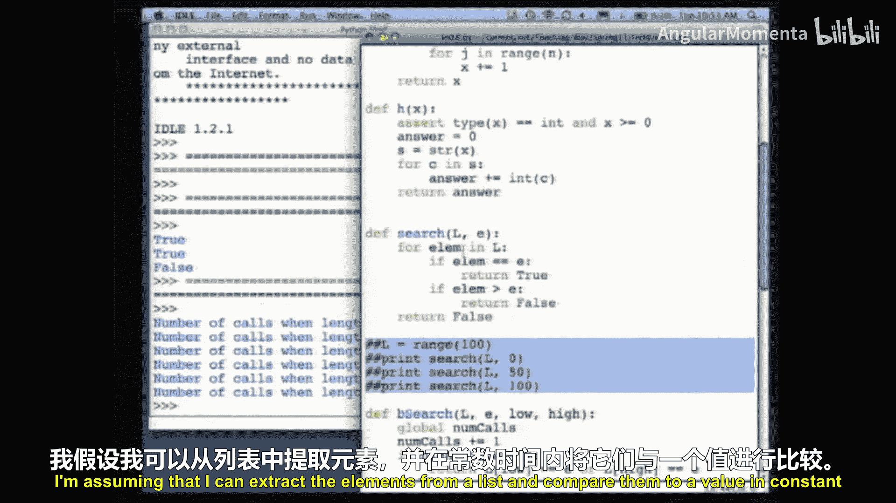

# 012：算法效率分析 🚀



在本节课中，我们将要学习算法效率分析。我们将探讨为什么效率很重要，如何衡量算法的运行时间，以及如何使用大O符号来描述算法的复杂度。我们还将通过具体例子来理解不同复杂度类别的实际意义。

---

## 为什么效率很重要？🤔

此前，我们主要关注如何让程序正确运行。从今天开始，我们将讨论如何让程序运行得足够快，以满足实际需求。在实际编程中，效率通常是设计程序时一个非常重要的考量因素。

我们的目标不是让你成为这方面的专家，而是希望你建立起关于算法效率的直觉，理解为什么有些程序运行得比另一些慢得多，以及如何编写能在合理时间内完成的程序。

效率之所以重要，是因为我们面临的计算问题规模可能非常巨大。例如，在我的研究小组中，我们有一个包含大约15亿次心跳的数据库，常规计算需要运行两周。如果不是因为我们对效率非常小心，这些计算可能需要运行两年。随着问题规模的扩大，效率问题变得越来越重要。

需要记住的关键点是：效率通常关乎算法选择，而非编码细节。聪明的算法很难发明，一个成功的计算机科学家在其整个职业生涯中可能也只发明一个重要的算法。因此，我们更依赖于**问题归约**：当遇到一个新问题时，我们思考如何将其转化为一个已有解决方案的问题。

---

## 如何思考效率？⏱️

当我们思考效率时，通常从两个维度考虑：**空间**和**时间**。在本课程接下来的几讲中，我们将主要关注**时间**复杂度，因为这是当前处理复杂度问题时人们最关心的方面。

那么，如何回答“某个算法需要运行多长时间”这个问题呢？一个糟糕的方法是直接在特定计算机上运行并计时，因为：
1.  它受机器速度影响。
2.  它受Python具体实现的影响。
3.  最重要的是，它依赖于具体的输入数据。

因此，我们需要一种更抽象的方式来讨论效率。

---

## 计算模型与基本步骤 📊

我们通过计算**基本步骤**的数量来分析效率。我们定义一个函数，例如 `time(n)`，其中参数 `n` 代表输入规模的大小，函数结果是对该规模输入进行计算所需的步骤数。

一个**步骤**是指耗时恒定的操作，例如赋值、比较、访问列表元素等。

在本课程中，我们使用**随机存取机**模型。在这个模型中：
*   指令是顺序执行的。
*   我们假设访问内存中任何对象所需的时间是恒定的。
虽然现代计算机有内存层次结构，但如果我们深入这些细节，往往会“只见树木，不见森林”。因此，几乎所有人分析算法时都使用这个模型，它对于理解算法已经足够好。

---



## 最好、最坏与平均情况 📈

当我们分析算法运行时间时，可以从几个不同角度看待：
*   **最好情况**：在所有可能输入中运行时间的最小值。
*   **最坏情况**：在给定规模的所有可能输入中运行时间的最大值。
*   **平均情况**：算法在典型情况下的期望运行时间。

**复杂度分析几乎总是关注最坏情况。** 原因如下：
1.  最坏情况提供了一个**上界**，保证了不会有更糟的情况发生。
2.  平均情况通常很难分析，因为它需要知道输入数据的详细分布模型。
3.  最坏情况往往经常发生。

例如，对于线性搜索，最坏情况（元素不在列表中）会导致检查列表中的每一个元素。



---

## 渐近分析与大O符号 📐

我们并不关心运行时间函数中的具体常数项，而是关注随着输入规模增长，运行时间是如何**增长**的。我们使用**大O符号**来描述算法的渐近复杂度。

例如，如果一个算法的运行时间函数是 `T(n) = 2 + 3n + 1`，我们会忽略常数项和低阶项，称其复杂度为 **O(n)**，即线性复杂度。

大O符号给出了函数增长率的**上界**。形式化地说，如果 `f(x)` 是 `O(g(x))`，意味着 `f(x)` 的增长速度不快于 `g(x)`。

以下是常见的复杂度类别：
*   **O(1)**：常数时间。
*   **O(log n)**：对数时间。
*   **O(n)**：线性时间。
*   **O(n log n)**：线性对数时间。
*   **O(n^c)**：多项式时间（例如 `O(n^2)` 是平方时间）。
*   **O(c^n)**：指数时间。



为了直观理解这些类别的差异，我们来看一些对比图。可以看到，对数算法比线性算法增长慢得多，而线性算法又比平方算法快得多。指数算法则增长得如此之快，对于稍大的输入就变得完全不实用。

**经验法则**：尽可能避免使用比线性对数更差的算法。

---

## 复杂度分析实例 🔍

上一节我们介绍了大O符号和常见复杂度类别，本节中我们来看看如何具体分析代码的复杂度。

### 示例1：迭代阶乘

```python
def factorial_iter(n):
    assert n >= 0
    answer = 1
    while n > 1:
        answer *= n
        n -= 1
    return answer
```
分析：
*   忽略常数操作（断言、初始化、返回）。
*   循环体执行3个操作（测试、乘法、减法）。
*   循环执行 `n` 次。
*   总复杂度为 **O(n)**。

### 示例2：递归阶乘

```python
def factorial_recur(n):
    assert n >= 0
    if n <= 1:
        return 1
    else:
        return n * factorial_recur(n-1)
```
分析：
*   递归调用次数为 `n` 次。
*   每次调用执行常数操作。
*   总复杂度同样为 **O(n)**。

递归和迭代版本具有相同的渐近复杂度。选择哪种方式取决于编码便利性，而非效率。

### 示例3：嵌套循环

```python
def g(n):
    x = 0
    for i in range(n):
        for j in range(n):
            x += 1
    return x
```
分析：
*   内层循环执行 `n` 次操作。
*   外层循环执行 `n` 次，每次启动一次内层循环。
*   总复杂度为 **O(n * n) = O(n^2)**。

**分析嵌套结构时，通常从最内层开始，向外逐层分析。**

### 示例4：数字求和

```python
def h(x):
    s = str(x)
    answer = 0
    for c in s:
        answer += int(c)
    return answer
```
分析：
*   循环次数取决于整数 `x` 的十进制位数。
*   十进制位数等于 `log10(x)`。
*   因此，复杂度是 **O(log x)**，而不是 `O(x)` 或 `O(len(s))`。

**关键点**：必须仔细定义复杂度表达式中的变量含义，并且要用算法的**输入参数**来表示复杂度。

---

## 搜索算法复杂度对比 🔎

上一节我们分析了几个简单函数的复杂度，本节中我们来看看两个经典搜索算法的复杂度。

### 线性搜索

```python
def linear_search(L, e):
    for i in range(len(L)):
        if L[i] == e:
            return True
    return False
```
*   最坏情况下需要检查列表中的每一个元素。
*   复杂度为 **O(len(L))**。

### 二分搜索

```python
def binary_search(L, e):
    def bsearch(L, e, low, high):
        if high == low:
            return L[low] == e
        mid = (low + high) // 2
        if L[mid] == e:
            return True
        elif L[mid] > e:
            if low == mid:
                return False
            else:
                return bsearch(L, e, low, mid - 1)
        else:
            return bsearch(L, e, mid + 1, high)

    if len(L) == 0:
        return False
    else:
        return bsearch(L, e, 0, len(L) - 1)
```
*   每次递归调用都将搜索范围减半。
*   复杂度为 **O(log len(L))**。

二分搜索的效率优势非常明显：当列表规模翻倍时，只需要增加一步比较。这是一种对数增长的算法。



**关于代码结构的说明**：
*   我们通常将 `binary_search` 包装在 `search` 接口内，以保持调用方式的一致性（只接收列表和元素参数）。
*   示例中使用 `global` 关键字来声明全局变量 `num_calls` 以计数递归调用次数，但这在通常实践中应谨慎使用。

**一个重要假设**：上述复杂度分析基于一个前提，即从列表中通过索引获取元素（如 `L[i]`）以及比较操作（如 `==`, `>`）都能够在**常数时间**内完成。在后续课程中，我们将更深入地探讨这个前提。



---

## 总结 📝

本节课中我们一起学习了算法效率分析的基础知识。

我们了解到效率在解决大规模问题时至关重要，并且效率提升的关键在于选择正确的算法，而非微小的编码优化。我们引入了使用**基本步骤计数**和**随机存取机模型**来分析算法运行时间的方法，并强调应关注**最坏情况**复杂度。



我们学习了使用**大O符号**来描述算法的渐近复杂度，认识了从常数时间 `O(1)` 到指数时间 `O(c^n)` 的不同复杂度类别，并通过图表直观感受了它们增长率的巨大差异。

最后，我们通过多个代码示例实践了复杂度分析，包括迭代与递归阶乘、嵌套循环、数字求和以及线性搜索与二分搜索。我们特别强调了在表达复杂度时必须明确变量的含义，并且要基于算法的输入参数进行分析。

记住，目标是编写出不仅正确，而且能在可接受时间内完成计算的程序。在接下来的课程中，我们将继续应用这些概念来设计和分析更复杂的算法。