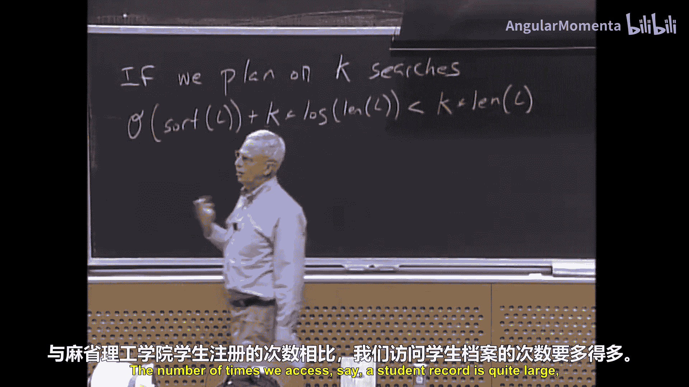
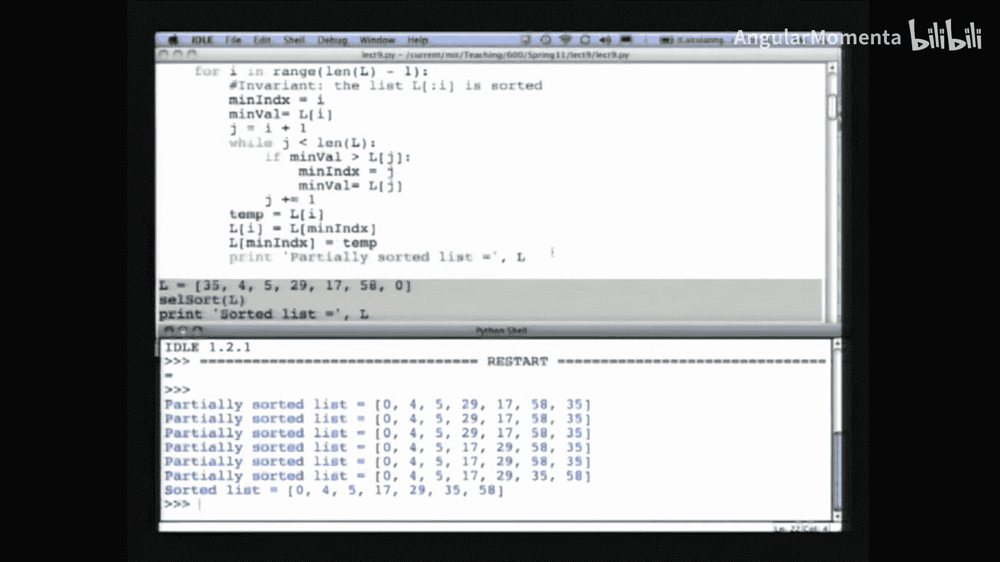
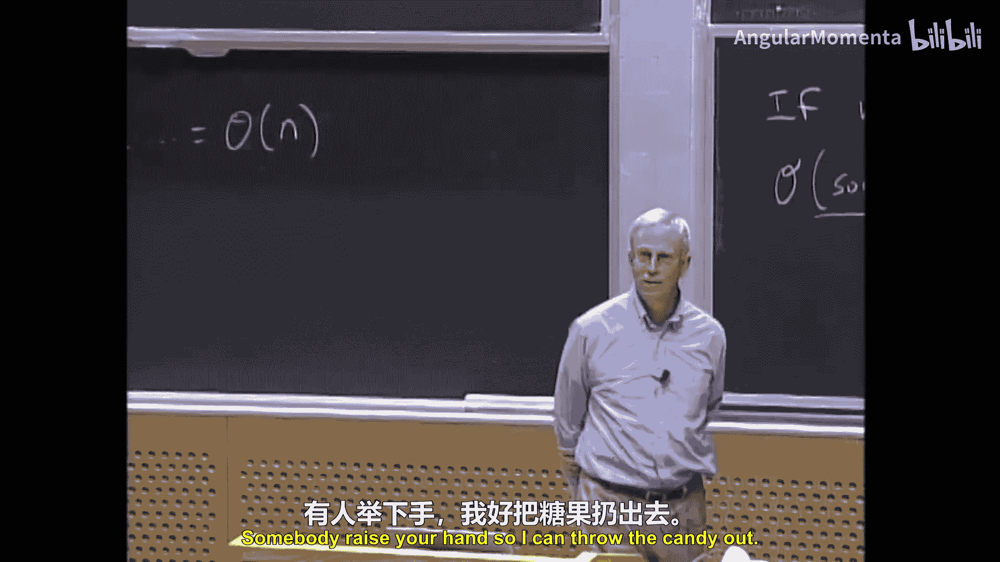
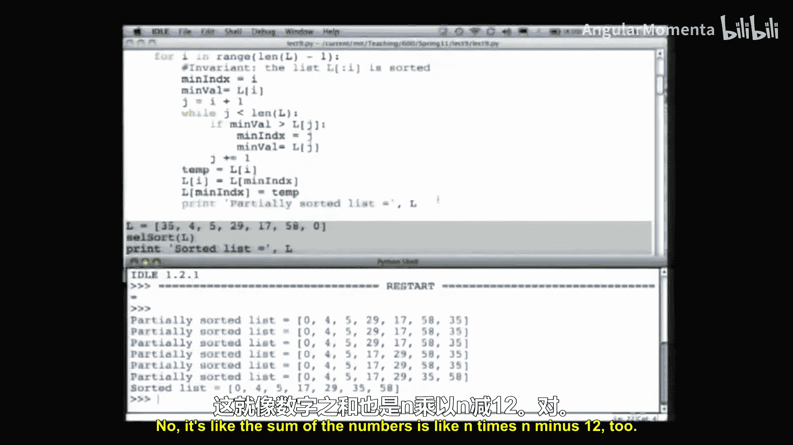
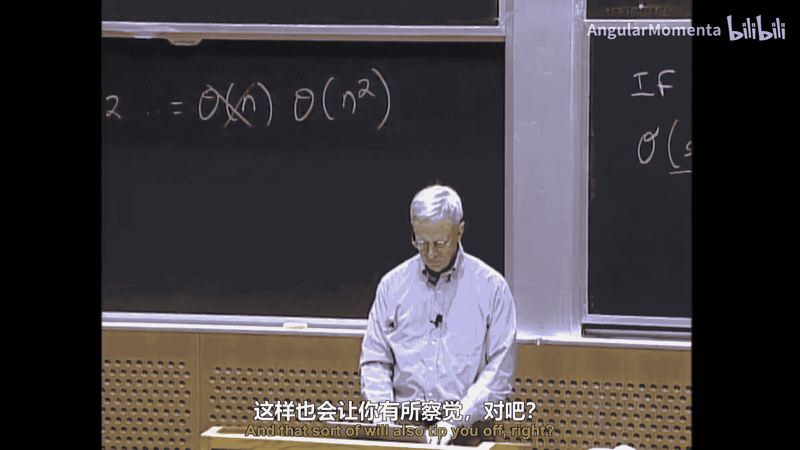
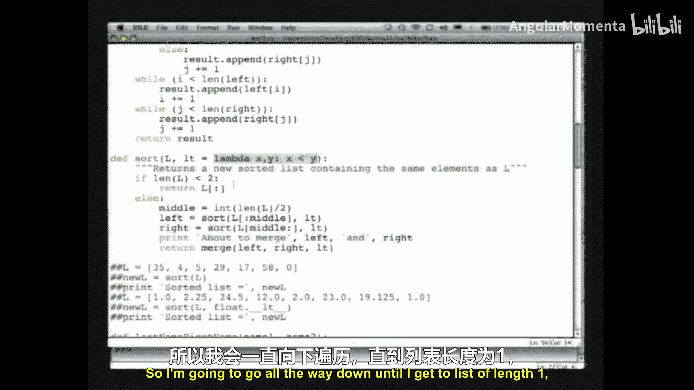
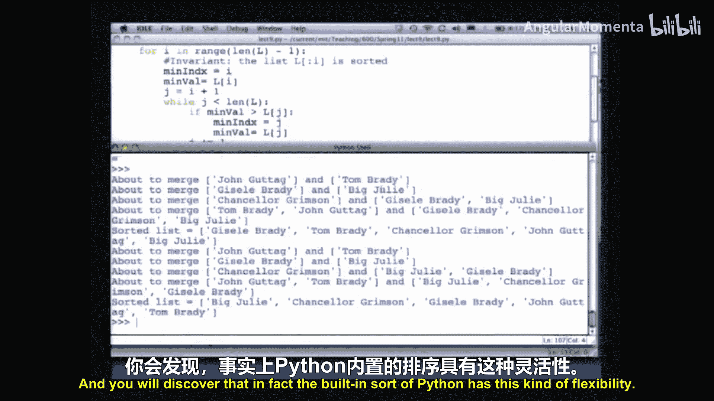

# 013：列表、搜索与排序

在本节课中，我们将要学习列表在计算机内存中的实现原理，理解二分搜索高效性的基础，并探讨如何对列表进行排序。我们将从列表的底层存储机制开始，逐步深入到排序算法的复杂度分析。

## 列表的内存实现

上一节我们介绍了二分搜索算法，其高效性依赖于能够快速访问列表中的任意元素。本节中我们来看看列表在内存中是如何组织的，以实现这种快速访问。

一个整数列表很容易在恒定时间内访问任何元素。因为一个整数总是占用相同大小的内存空间。例如，假设一个整数占用4个单位的内存。要访问列表 `L` 中的第 `i` 个元素（`L[i]`），如果我们知道列表的起始内存地址（由标识符 `L` 指向），那么该元素的位置就是：

**公式：`位置 = 起始地址 + 4 * i`**

这种方法要求列表中的每个元素大小相同。对于整数、浮点数等固定大小的数据类型，这种方法很有效。

然而，Python 列表可以包含不同类型和大小的元素，如整数、字符串、列表等。因此，Python 不能使用上述简单的连续内存块模型。一种古老的解决方案是**链表**。

以下是链表的工作原理：

*   每个列表元素都是一个包含两部分的结构：一个指向下一个元素的指针，以及元素的实际值。
*   要访问第 `i` 个元素，必须从第一个元素开始，沿着指针逐个访问，直到第 `i` 个。这需要 `i` 步操作，时间复杂度为 **O(i)**，对于搜索来说效率太低。

Python 采用了一种更巧妙的方法，称为**间接寻址**。其核心思想是将指针与值分开存储。

*   Python 列表本身在内存中是一个连续的、大小固定的对象数组。
*   数组中的每个对象都是一个指针，指向列表中某个元素的实际值所在的内存位置。
*   由于指针大小固定（例如4个字节），我们可以用之前的公式快速找到第 `i` 个指针：`起始地址 + 4 * i`。
*   找到指针后，只需一步操作（跟随指针）即可访问到实际值，无论该值有多大。

因此，即使在 Python 这种元素大小不固定的列表中，我们也能在**恒定时间**内访问任何元素。间接寻址是面向对象编程语言中一项非常强大且常用的技术。

## 二分搜索的前提与排序的必要性

我们已确信二分搜索的时间复杂度是 **O(log n)**，这非常高效。但它有一个关键前提：**列表必须是有序的**。



这就引出了一个问题：如果列表未排序，我们是否应该先排序再使用二分搜索？这取决于效率。

*   如果列表未排序，我们总是可以使用线性搜索，其复杂度为 **O(n)**。
*   如果先排序再二分搜索，总复杂度为：`排序复杂度 + O(log n)`。

只有当 `排序复杂度 + O(log n) < O(n)` 时，先排序才有意义。然而，任何排序算法都至少需要查看一次列表中的每个元素，因此排序的**下界**是 **Ω(n)**。这意味着 `Ω(n) + O(log n)` 的复杂度仍然是 **O(n)**，并不比线性搜索更好。

那么，我们为什么还要关心二分搜索和排序呢？原因在于**摊还复杂度**。

如果我们只对列表排序一次，然后进行多次（`K` 次）搜索，那么单次排序的成本可以分摊到多次搜索中。总成本对比为：

*   **不排序**：进行 `K` 次线性搜索，成本为 `K * O(n)`。
*   **先排序**：成本为 `排序复杂度 + K * O(log n)`。

当搜索次数 `K` 非常大时（例如，学生信息被频繁查询），即使排序成本较高，先排序再使用高效的二分搜索总体上也更划算。这是一种常见的实践模式。

## 排序算法简介



既然排序如此重要，本节我们来看看如何实现排序。首先，我们看一个简单但低效的算法。

### 选择排序





选择排序是一种直观但效率不高的排序算法。它基于一个**不变式**来工作：将列表分为已排序的前缀和未排序的后缀。




算法步骤如下：

1.  初始时，前缀为空，后缀为整个列表。
2.  在未排序的后缀中找到最小（或最大）的元素。
3.  将该元素与后缀中的第一个元素交换位置。此时，该元素被纳入前缀，前缀长度增加1，且保持有序。
4.  重复步骤2和3，直到后缀为空，前缀包含所有已排序的元素。

以下是选择排序的核心逻辑（伪代码）：

```python
def selection_sort(L):
    for i in range(len(L)):
        # 找到后缀中最小元素的索引
        min_index = i
        for j in range(i+1, len(L)):
            if L[j] < L[min_index]:
                min_index = j
        # 将最小元素交换到当前位置 i
        L[i], L[min_index] = L[min_index], L[i]
```

**复杂度分析**：在每次迭代 `i` 中，我们需要比较后缀中的 `n - i` 个元素以找到最小值。总的比较次数约为 `n + (n-1) + ... + 1 = n(n-1)/2`。因此，选择排序的时间复杂度是 **O(n²)**。

### 归并排序

我们能做得比 O(n²) 更好吗？答案是肯定的。归并排序是一种采用**分治**策略的高效排序算法，由约翰·冯·诺依曼在20世纪40年代提出。


分治策略的一般步骤是：

1.  **选择阈值**：确定最小问题规模 `n0`，当问题规模小于 `n0` 时直接解决。
2.  **分解**：将大问题分解为若干个更小的子问题。
3.  **合并**：设计算法将子问题的解合并为原问题的解。

归并排序正是如此：

1.  **分解**：递归地将列表分成两半，直到每个子列表只剩下一个元素（一个元素的列表自然是有序的）。
2.  **合并**：将两个已排序的子列表合并成一个新的有序列表。合并操作是线性的，即 **O(n)**，其中 `n` 是两个子列表的长度之和。

合并两个有序列表 `A` 和 `B` 的过程很简单：
*   比较 `A` 和 `B` 的第一个元素。
*   将较小的元素取出，放入结果列表。
*   重复上述步骤，直到其中一个列表为空，然后将另一个列表的剩余部分全部追加到结果列表。




由于列表每次被分成两半，递归的深度是 **O(log n)**。在每一层递归中，我们需要合并所有该层的子列表，而每一层的总合并工作量是 **O(n)**。因此，归并排序的总时间复杂度是 **O(n log n)**。

归并排序的另一个优点是**稳定性**（相等元素的相对顺序不变）和适用于大数据集（外部排序）。Python 内置的 `sorted()` 函数和列表的 `.sort()` 方法使用的是一种名为 Timsort 的混合算法，它结合了归并排序和插入排序的思想，在实践中非常高效。

## 总结

本节课中我们一起学习了：
1.  **列表的内存模型**：了解了固定大小元素的连续存储、链表以及 Python 使用的间接寻址模型，后者使得在列表中随机访问元素成为常数时间操作。
2.  **二分搜索的效率前提**：认识到二分搜索要求列表有序，并分析了在多次搜索场景下，通过摊还成本，先排序再使用二分搜索是值得的。
3.  **排序算法**：
    *   介绍了**选择排序**，其时间复杂度为 O(n²)，实现简单但效率较低。
    *   重点学习了**归并排序**，这是一种采用分治策略的 O(n log n) 算法，通过递归分解和线性合并操作实现高效排序。




理解这些底层原理和算法复杂度，有助于我们编写出更高效的程序，并明智地选择合适的数据结构和算法来解决实际问题。