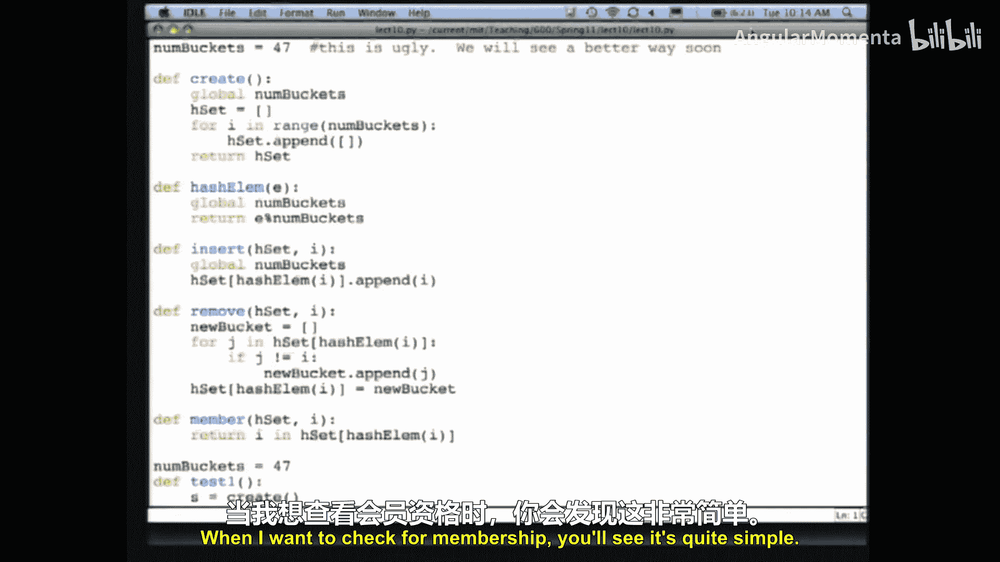
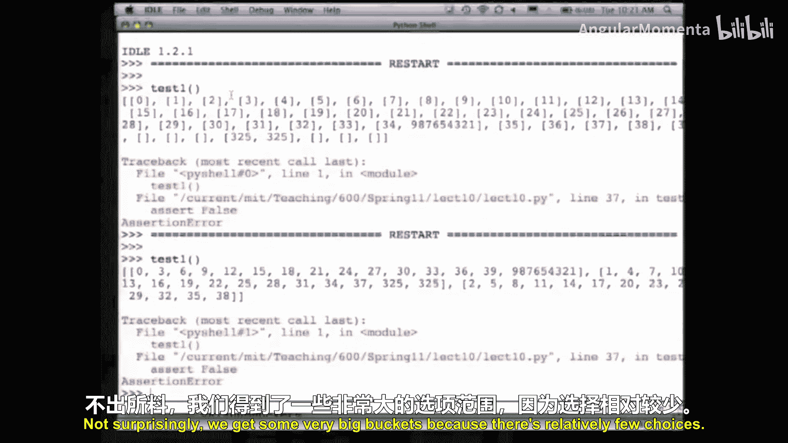
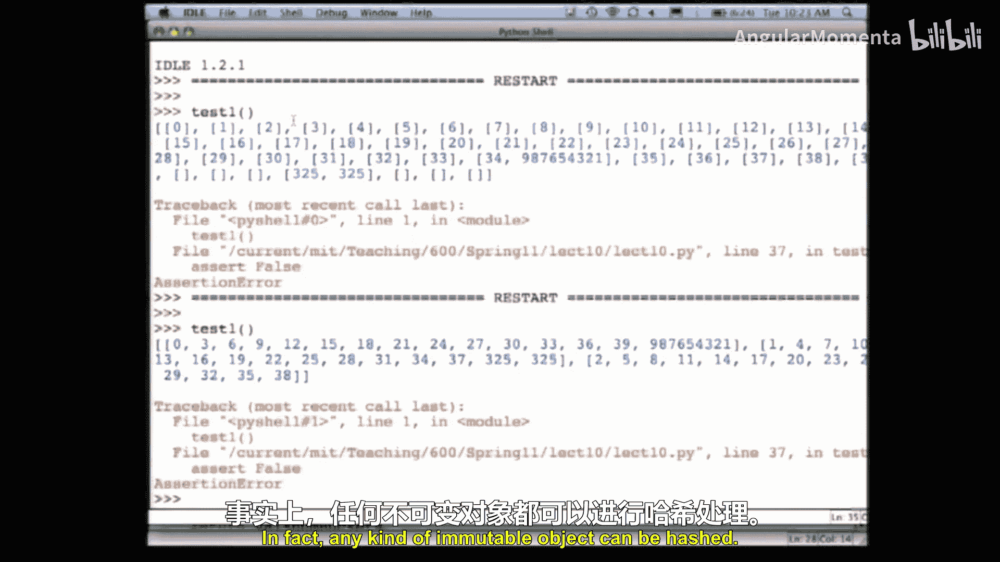
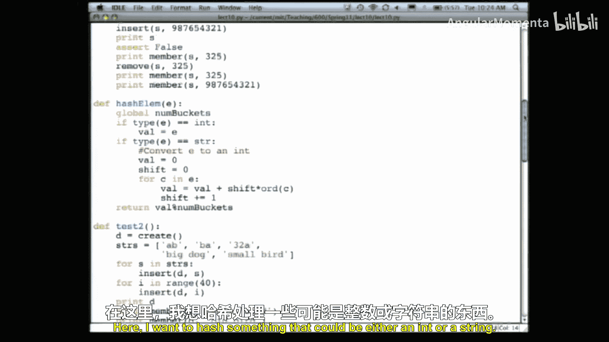
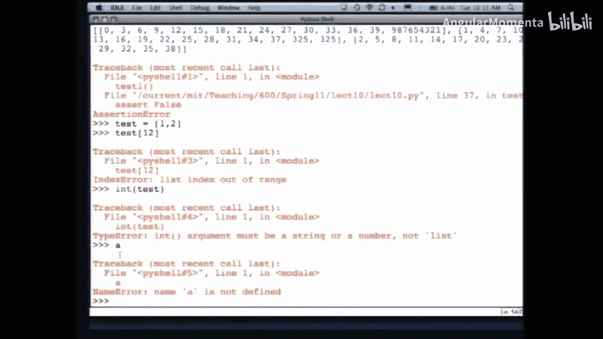
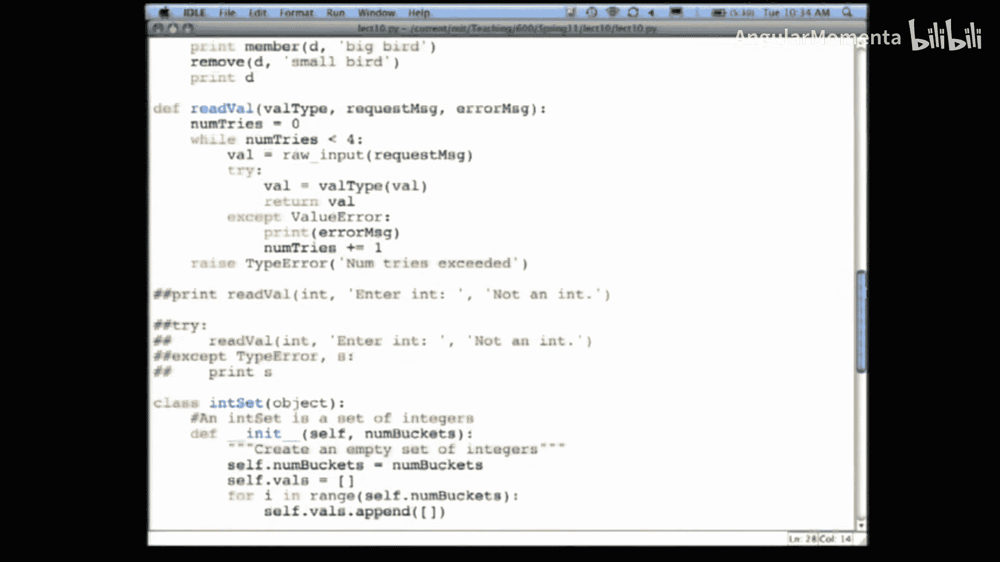
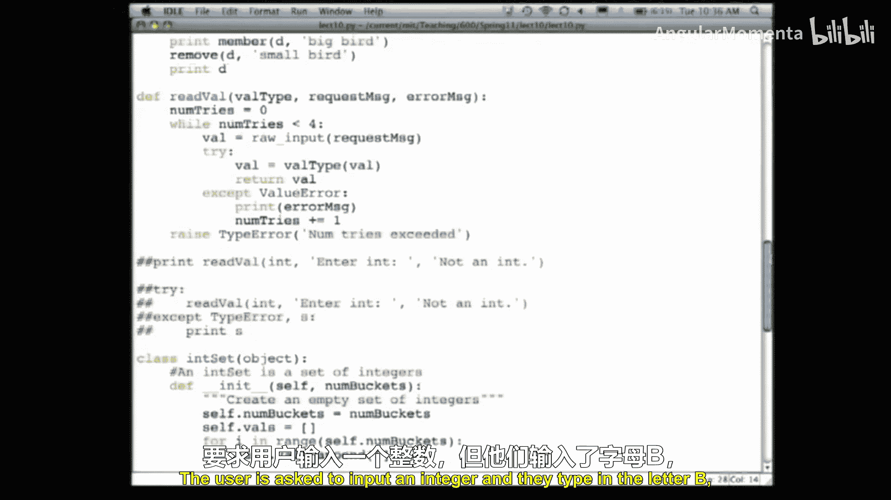
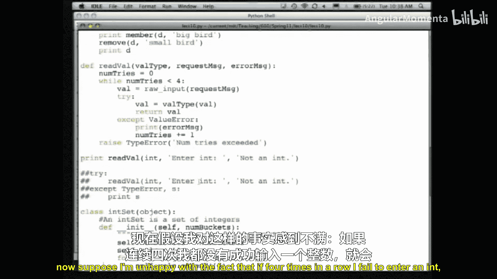
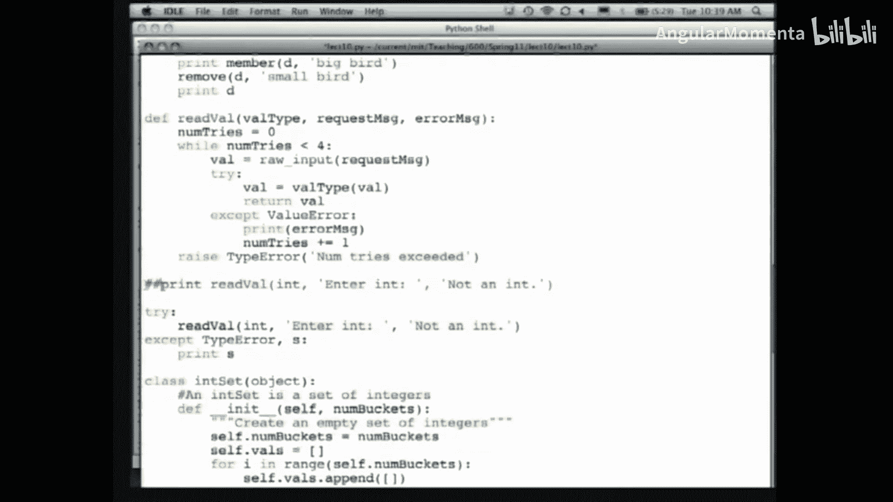
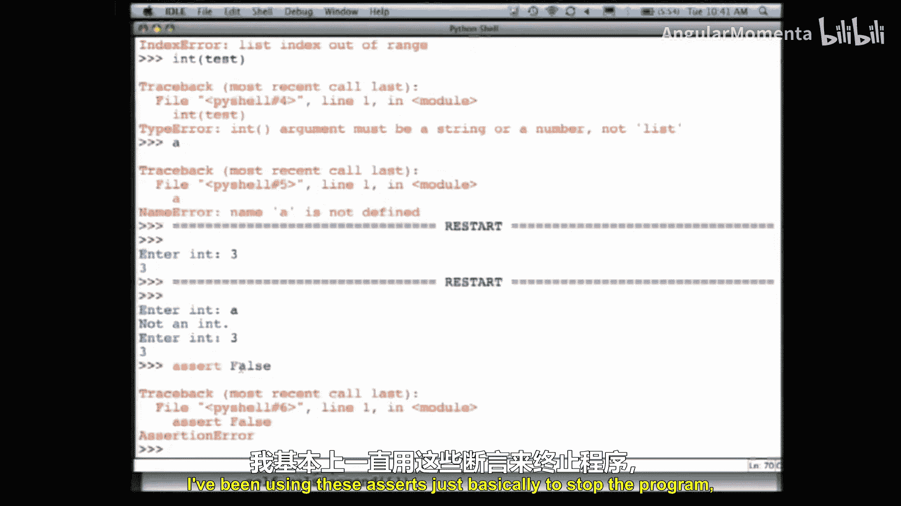

# 014：哈希与异常处理 🚀

在本节课中，我们将要学习两个重要的编程概念：**哈希**和**异常处理**。哈希是一种高效的数据存储与查找技术，而异常处理则帮助我们编写更健壮、不易崩溃的程序。我们将从哈希的基本原理开始，了解它如何实现快速的查找，然后探讨Python中如何通过异常处理机制来优雅地处理程序运行时的错误。

## 哈希：用空间换取时间 ⚡


上一节我们介绍了搜索和排序算法，本节中我们来看看**哈希**。哈希是Python中字典实现的基础，它能在大多数情况下提供非常高效的搜索，但这是以消耗更多存储空间为代价的。这是一个典型的“用空间换取时间”的例子。

### 哈希的基本思想



哈希的基本思想是：我们取一个整数 `I`，通过一个**哈希函数**将其转换为另一个整数，这个整数通常在一个固定的范围内，例如 `0` 到 `K`。然后，我们使用这个转换后的整数作为索引，去访问一个**列表的列表**（即哈希表）。这个列表中的每个子列表被称为一个**桶**。

**核心公式**：`hash(I) = I % num_buckets`，其中 `%` 是取模运算符。

当我们想查询某个整数是否在集合中时，我们先哈希它，直接定位到对应的桶，然后在该桶的列表中搜索。如果每个桶的列表足够短，这个操作就会非常高效。

### 哈希的实现代码


以下是实现一个简单整数集合哈希表的代码框架：







```python
num_buckets = 47  # 全局变量，定义桶的数量

def create():
    """创建一个哈希表（一个列表，包含num_buckets个空列表）"""
    global num_buckets
    hash_table = []
    for i in range(num_buckets):
        hash_table.append([])
    return hash_table
def hash_elem(e):
    """哈希函数：计算元素e应放入哪个桶"""
    global num_buckets
    return e % num_buckets

def insert(hash_table, i):
    """向哈希表中插入元素i"""
    bucket = hash_elem(i)
    hash_table[bucket].append(i)  # 可能存在重复元素
def member(hash_table, i):
    """检查元素i是否在哈希表中"""
    bucket = hash_elem(i)
    return i in hash_table[bucket]
```


### 哈希冲突与性能



哈希函数的一个关键特性是**多对一**。由于桶的数量有限（例如47个），而可能的整数是无限的，因此许多不同的整数会哈希到同一个桶中。当两个不同的元素哈希到同一个桶时，就发生了**冲突**。

处理冲突的方法有很多，上面代码中使用的是最简单的一种，称为**链地址法**（或线性再哈希），即每个桶本身就是一个列表，冲突的元素被追加到列表末尾。

查找的复杂度大致取决于目标桶中列表的长度。这又取决于桶的数量与插入元素数量的比例关系：

*   如果桶的数量远大于元素数量，每个桶的列表会很短，查找近似于常数时间 `O(1)`。
*   如果桶的数量很少（极端情况是1个桶），那么查找就退化为线性搜索 `O(n)`。

因此，在使用哈希表时，通常会分配足够大的空间（足够多的桶），使得查找操作在绝大多数情况下是常数时间的。Python的字典正是这样实现的：它哈希键，并选择一个足够大的表，使得查找几乎是常数时间。如果后续发现表太小（因为插入了太多元素），它会自动重新调整大小（再哈希）到一个更大的表。


### 哈希更复杂的对象

哈希不仅限于整数。实际上，任何**不可变**的对象都可以被哈希。这就是为什么Python字典的键必须是不可变的——因为哈希值需要在对象的生命周期内保持不变。如果使用可变对象（如列表）作为键，哈希后对象发生改变，其哈希值也会变，导致无法再次找到它。



要将字符串等对象哈希为整数，常见的做法是将其内部表示（比特位）转换为一个整数。以下是一个可以处理整数和字符串的哈希函数示例：

```python
def hash_string(s):
    """一个简单的字符串哈希函数示例"""
    h = 0
    for c in s:
        # 结合字符的ASCII码（或Unicode码点）
        h = (h * 31 + ord(c)) % num_buckets  # 31是一个常用的质数
    return h
```

**总结**：哈希是一种极其强大且常用的技术。一个好的哈希函数应能将输入值广泛地分散到不同的桶中。虽然存在多种哈希函数和冲突解决策略，但对于大多数应用，使用取模运算等简单方法已经足够。




---


## 异常处理：让程序更健壮 🛡️



现在，让我们从算法转向Python语言本身，探讨最后一个重要的语言概念：**异常**。我们其实已经见过很多异常了。


### 什么是异常？




异常是程序运行时发生的错误事件。例如：



*   **索引错误**：访问列表不存在的索引 `list[12]`。
*   **类型错误**：尝试将不兼容的类型进行转换 `int('abc')`。
*   **名称错误**：访问未定义的变量。

任何以 `Error` 结尾的标识符都是Python内置的一种异常类型。当这些异常未被处理时，会导致程序崩溃（停止运行），这被称为**未处理异常**。


### 捕获和处理异常：try-except



然而，在程序调试完成后，我们不应让未处理异常发生。Python提供了 `try-except` 块来**捕获**并**处理**异常，这是一种有效的控制流机制。

其工作原理如下：
1.  程序尝试执行 `try` 块中的代码。
2.  如果成功执行完毕，则跳过 `except` 块，继续执行后面的代码。
3.  如果在 `try` 块中发生了异常，则立即停止执行 `try` 块中的剩余代码，并跳转到匹配的 `except` 块开始执行。
4.  执行完 `except` 块后，继续执行后面的代码。

以下是一个使用异常处理来构建健壮输入函数的例子：

```python
def read_val(val_type, request_msg, error_msg):
    """一个健壮的输入函数，要求用户输入指定类型的值"""
    num_tries = 0
    while num_tries < 4:
        val = input(request_msg)
        try:
            # 尝试将输入转换为目标类型
            val = val_type(val)
            return val  # 转换成功，返回值
        except ValueError:  # 捕获转换失败引发的ValueError
            print(error_msg)
            num_tries += 1
    # 如果尝试次数过多，主动抛出一个异常
    raise TypeError(f"超过最大尝试次数 {num_tries}")

# 使用该函数，并捕获它可能抛出的异常
try:
    user_int = read_val(int, "请输入一个整数：", "输入无效，请重试。")
    print(f"你输入的是：{user_int}")
except TypeError as e:  # 捕获read_val抛出的TypeError
    print(f"程序因以下原因停止：{e}")
```

### 异常的更多用途

*   **关联信息**：当使用 `raise` 抛出异常时，可以附带一个消息字符串（或其他参数），以便在捕获时提供更详细的错误信息。
*   **捕获所有异常**：可以使用不指定异常类型的 `except:` 来捕获所有异常，但这通常不是好习惯，因为它可能掩盖未预料到的错误。
*   **流程控制**：异常不仅用于错误处理。例如，`assert` 语句实际上在条件为假时会抛出 `AssertionError`。我们可以捕获这个异常并执行备用逻辑，而不是让程序直接崩溃。
*   **常见场景**：异常处理在需要与用户或外部系统交互的程序中非常有用，例如：
    *   尝试打开一个不存在的文件（引发 `FileNotFoundError`）。
    *   尝试写入一个已存在的文件（可以捕获异常并询问用户是否覆盖）。

**总结**：异常处理是一个简单但强大的机制。它允许我们将错误处理代码与主业务逻辑分离，使程序结构更清晰，并能更优雅地从错误中恢复或向用户提供有意义的反馈。

---

## 课程预告：类与面向对象编程 🎯

本节课中我们一起学习了哈希表如何实现高效查找，以及如何使用异常处理来增强程序的鲁棒性。在接下来的课程中，我们将深入探讨Python中**最核心的概念之一：类**。


类将**数据**和操作这些数据的**函数**（称为**方法**）绑定在一起，形成一个新的**类型**。这被称为**面向对象编程**。通过类，我们可以扩展Python语言，创建像内置的 `list`、`dict` 一样易用但功能自定义的新数据类型。我们将从理解“对象”、“方法”、“属性”这些概念开始，逐步学习如何定义和使用自己的类。