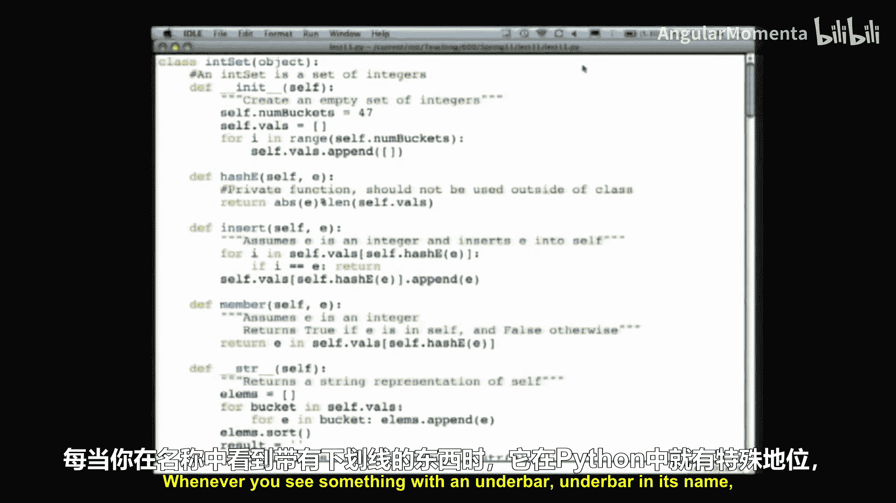
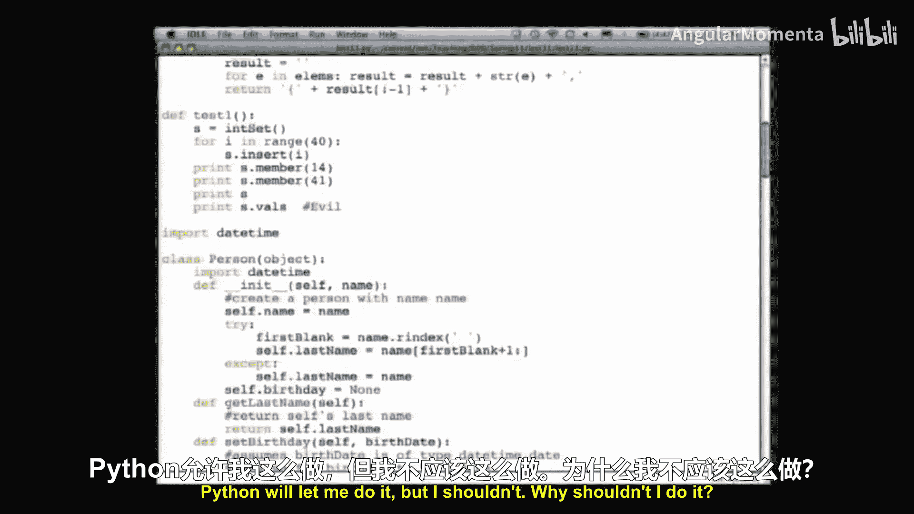
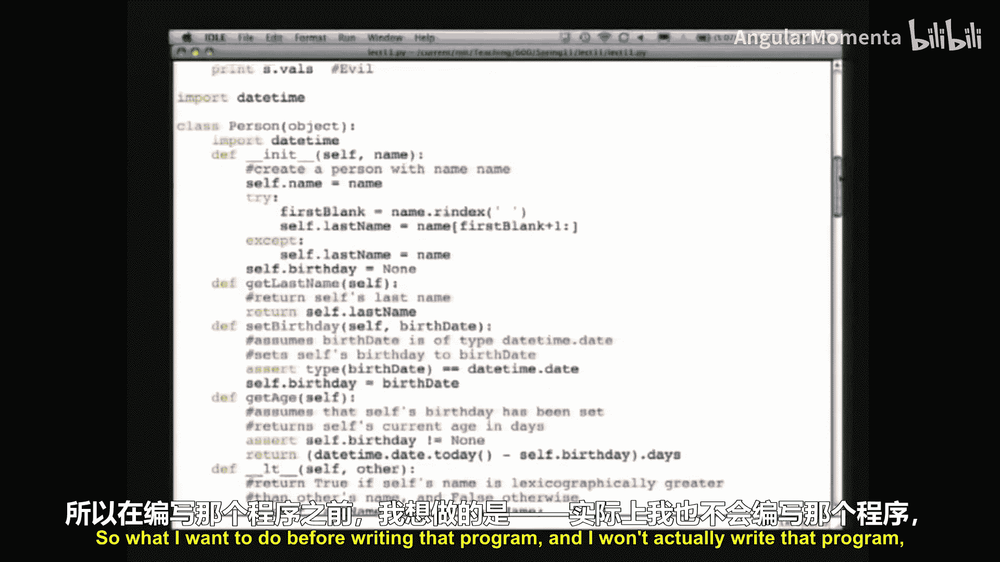
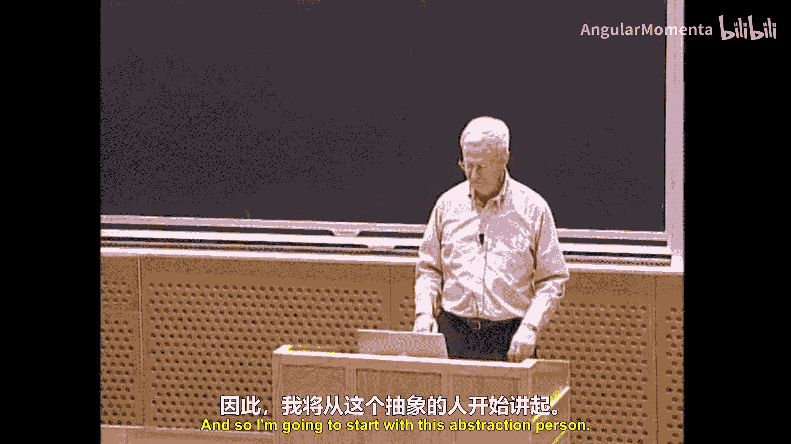
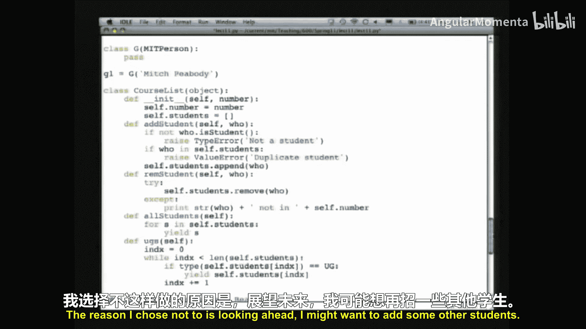

# 015：抽象数据类型与面向对象编程

在本节课中，我们将学习抽象数据类型和面向对象编程的核心概念，特别是类在其中扮演的角色。我们将通过具体的代码示例，理解如何定义和使用类，以及如何利用继承来构建层次化的数据结构。

---

## 抽象数据类型与面向对象编程

很多人认为面向对象编程是一个新概念。事实上，它已经存在了至少35年，甚至更久。但直到大约15年前，它才被广泛实践。这个概念始于20世纪70年代中期，当时人们开始撰写文章解释这种编程方法的优势。大约在同一时期，施乐帕克研究中心开发了Smalltalk语言，麻省理工学院开发了CLU语言。它们是首批以优雅方式为这种编程风格提供语言支持的语言。

然而，直到Java语言的引入，面向对象编程才真正在公众中流行起来。Java是第一个支持面向对象编程的流行语言。之后，C++也以并非非常优雅但可用的方式支持了它。如今，Python可能是支持面向对象编程增长最快的语言，这也是我们在此教授它的原因之一。

### 核心概念：抽象数据类型

这一切最根本的概念是**抽象数据类型**。其核心思想是，我们可以通过添加用户定义的类型来扩展我们的编程语言，并且这些类型可以像任何内置类型一样轻松使用。

我们之所以称它们为“抽象”数据类型，是因为我们本质上要为每种类型定义一个**接口**。这个接口的作用是解释**方法做什么**。这里的“做什么”指的是在用户层面的功能，而不是“如何实现”。这正是内置类型的工作方式。在你理解Python如何实现字典之前，你只知道可以放入键值对并进行关联查找。这之所以可能，是因为Python的设计者提供了一个接口供你使用。我们将为抽象数据类型做同样的事情。

这里的关键思想是**规范**。规范是类型、函数或方法的说明，它告诉我们该事物做什么。从现在到学期结束，我们将努力在规范和实现之间保持非常清晰的区分。


---

## 示例：整数集合

让我们看一个熟悉的例子。在之前的课程中，我们探讨了如何使用哈希来实现一组整数。当时我们使用了一个全局变量，实现方式并不优雅。现在，我们将看到一个更优雅的方法。

我将定义一个新的抽象类型，名为 `intset`。



```python
class intset(object):
    """整数集合"""
    def __init__(self):
        self.num_buckets = 47
        self.vals = []
        for i in range(self.num_buckets):
            self.vals.append([])
```

我通过写关键字 `class`，后跟类名来定义它。`(object)` 表示它是 `object` 的子类。目前可以忽略这一点，我们稍后会讨论。从根本上说，它表示 `intset` 的每个实例都是一个对象。这在Python中并不特别，因为Python中的一切都是对象。


### 特殊方法：`__init__`

现在让我们看看方法。首先，我写了一个注释说明这是一个整数集合。然后，我看到了这个特殊的方法 `__init__`。在Python中，任何名称中包含双下划线的方法都有特殊地位。`__init__` 方法允许我们进行优雅的语法操作。

每次我创建一个 `intset` 类型的新对象时，该对象的 `__init__` 方法（或类的函数）将被执行。在这个例子中，它引入了对象的两个属性：`num_buckets`（现在替代了我们上次看到的全局变量，我任意选择了47）和 `vals`（这将是包含值的哈希表本身）。然后，就像我们上次做的那样，我将初始化 `vals`，使这个列表的每个元素现在都是一个空列表。

### 理解 `self`

让我们看看这个奇怪的 `self` 概念。看一个例子：

```python
s = intset()
```

这将创建一个新的 `intset` 对象并执行 `__init__`。例如，如果我打印 `self.num_buckets`，会出错，因为 `self` 在这个环境中没有定义。`self` 是 `__init__` 的局部变量，实际上是形式参数。但我可以写 `s.num_buckets`，我会看到它是47。`num_buckets` 和 `vals` 现在是实例 `s` 的属性。

看起来 `__init__` 有一个形式参数，但我没有提供对应的实际参数。这就是语法的魔力：它会自动、隐式地传入一个对象，或者创建一个。`__init__` 中的 `self` 用于引用正在创建的对象。我们稍后会更全面地讨论 `self` 的概念及其用法。

### 私有函数与接口

接下来我们看到 `hash_e`。这是我们之前看过的私有函数，我不打算在类外部使用它。所以，如果我们考虑这里的规范，即类的接口，它不包括 `hash_e`。这就是“私有”在这里的含义。这是一种约定，不是语言强制执行的。不幸的是，很多有用的东西都不是语言强制执行的。但尽管如此，优秀的程序员会遵循这些约定，我们也希望你们这样做。

`insert` 方法更有趣。它显然接受两个参数，形式参数名为 `self` 和 `e`，并将 `e` 插入 `self.vals`。然而，如果我们查看使用它的代码，例如在 `test1` 中，你会注意到我说 `s.insert(i)`。看起来我只用一个参数调用 `insert`。但正如我们上次讨论的，点号前的 `s` 实际上是方法 `insert` 的第一个参数。所以它实际上得到了两个参数。按照约定，这个隐式的第一个参数在Python中总是被称为 `self`。这不是强制性的，你可以叫它 `George` 或 `Alice`，但如果你这样做，会让任何阅读你代码的人（包括寻求帮助的助教）感到非常困惑。所以请使用 `self`。它只是一个名字，与哲学家、心理学家或伦理学家可能想到的“自我”这个崇高概念无关。

### 特殊方法：`__str__`

我可以插入一堆东西，然后打印 `s`。这很有趣。`__str__` 是另一个特殊名称。代码很简单，它只是返回集合的字符串表示形式。我可以选择任何我想要的表示方式，我选择了一种表示集合的常规方式。有趣的是，它会被 `print` 自动调用。所以当我在 `test1` 中写命令 `print(s)` 时，Python解释器足够聪明，知道最好将 `s` 转换为字符串然后打印。它如何知道将其转换为字符串？它会自动调用 `__str__` 方法。

另一个操作是 `member`，同样是我们之前看过的。但你会注意到，在使用 `intset` 的代码中，我没有直接引用类的数据属性。或者，我不应该。你会注意到我在 `s.vals` 旁边写了“邪恶”。Python会让我这样做，但我不应该。为什么我不应该这样做？



### 数据隐藏的重要性

为什么我说这是邪恶的？如果你收到一条消息说“Ile已更改，请下载新版本”，而新版本恰好有列表或字典的不同实现，导致你所有的程序停止工作，你会很不高兴。为什么这不会发生？因为你的程序不以任何方式依赖于人们选择实现这些内置类型的方式。因为你根据类型的规范编程，而不是根据实现。`intset` 的规范没有提到 `vals` 或 `num_buckets`。因此，作为该类的实现者，我有权回去更改它。我可能根本不用哈希表，而是用红黑树或其他花哨的实现。我允许这样做。如果我做了这个更改，`vals` 和 `num_buckets` 消失了，只要我仍然满足规范，你的程序应该继续工作。

一旦你直接访问类的变量（那些属性），你就使用了规范中没有出现的东西。如果我更改了实现，你的程序可能会崩溃。所以你不应该这样做。这对每个人都有意义吗？这是一个非常重要的概念，被称为**数据隐藏**。这确实是使抽象数据类型有用、使它们具有与内置类型相同地位的最重要发展。一旦你选择忽略这一点，你将自担风险。

一些编程语言如Java提供了强制数据隐藏的机制。Python的设计者出于我不理解的原因选择不这样做。我认为这是语言的一个缺陷。

### 实例变量与类变量

我们隐藏的是**实例变量**，即与类的每个实例相关联的变量。我们还应该隐藏**类变量**。我们还没有看到这些，稍后会看到。实例变量每次创建类的新实例（本例中为新的 `intset`）时都会获得一个新副本。类变量与类本身相关联，你只获得它们的一个副本。稍后，我们将看到一个类变量有用的例子。


让我们运行一下以确保它正常工作。它做了我们期望的事情：`True`，`False`，然后你会看到这个漂亮的集合字符串表示。然后，只是为了展示当你做邪恶的事情时会发生什么，我打印了实际产生的列表。

---

## 更复杂的例子：设计程序

现在让我们看一个更有趣的例子。我想传达的想法是我们如何使用类和抽象数据类型来设计程序。

想象一下，你正在编写一个程序来跟踪麻省理工学院的所有学生、教职员工。当然，不使用任何类也可以编写该程序。对于每个学生，你可能会给他们一个姓氏、名字、家庭地址、年份、成绩等。你可以使用列表和字典的复杂组合来做到这一点，但这不会很优雅。



因此，在编写该程序之前（我实际上不会编写那个程序，只会编写一些我们可以使用的类），我想退一步思考哪些抽象会有用。这种围绕抽象数据类型组织程序的编程风格说：在我们详细编写代码之前，我们先思考哪些类型会使编写代码变得容易。

例如，如果你是金融专业的学生，想编写一些处理市场的代码，你可能想要有政府债券的抽象、股票的抽象、看涨期权的抽象等。你会说，我想在那个抽象层次上思考，我不想考虑列表、字典和浮点数，我只想考虑具有执行价格和日期等属性的期权。

同样，当我为麻省理工学院处理这个数据库时，我想思考学生、教职员工的抽象。我还将使用所谓的**继承**来建立这些的层次结构。我这样做的原因是我希望能够共享代码。我知道学生和教职员工之间会有某些相似之处，当然也有不同之处。但我想首先说，什么是不不同的？什么是相似的？什么是相同的，这样我只需要实现一次并可以重用。

所以，如果我退一步说，是否存在一个涵盖学生、教职员工共享属性的抽象？我可能会说它是“人”。他们都是人。暂且假设每位教职员工都是人类。

### 定义 `Person` 类

我将从这个抽象“人”开始。



```python
import datetime

class Person(object):
    def __init__(self, name):
        self.name = name
        try:
            last_blank = name.rindex(' ')
            self.last_name = name[last_blank+1:]
        except:
            self.last_name = name
        self.birthday = None

    def get_last_name(self):
        return self.last_name

    def set_birthday(self, birthdate):
        self.birthday = birthdate

    def get_age(self):
        if self.birthday == None:
            raise ValueError
        return (datetime.date.today() - self.birthday).days

    def __lt__(self, other):
        if self.last_name == other.last_name:
            return self.name < other.name
        return self.last_name < other.last_name

    def __str__(self):
        return self.name
```

我导入了 `datetime`。就像我们之前导入 `math` 一样，这是别人编写的一个类，以相当合理的方式处理日期和时间。

`__init__` 方法将用名字创建一个 `Person`。我在这里做的是引入一个额外的属性 `last_name`。这是因为我想让生活更轻松，我想我经常需要找到姓氏，所以一劳永逸地获取它并放入某个东西中。我将 `birthday` 初始化为 `None`。

下一个方法是 `get_last_name`。我在这里有这个方法，因为我不希望这个抽象的用户甚至知道我有一个属性 `self.last_name`。这是实现的一部分。所以我用这个方法来获取它。

当你构建类时，你会经常看到名为 `get` 的东西，这些通常是返回类实例某些信息的方法。你还经常会有 `set` 方法，例如 `set_birthday`，它给类的实例赋值。

更有趣的是，我有 `get_age`，它方便地使用了 `datetime` 的一些内置操作，允许我减去一个日期与另一个日期，得到天数。这将允许我返回某人的年龄（以天为单位）。

然后，我有另一个我们还没见过的 `__lt__` 方法。`LT` 代表“小于”，这并不奇怪。我将用它来排序名字或排序人。为什么我使用特殊运算符而不是直接放入方法 `less_than`？因为我希望能够在我的代码中写像 `p1 < p2` 这样的东西。Python会将其转换为 `__lt__`。更好的是，如果我有一个人的列表，我可以使用内置的 `sort` 运算符对该列表进行排序，它会足够聪明地知道在比较两个人进行排序时使用 `__lt__`。这是非常方便的事情。

### 使用 `Person` 类

让我们看一些代码。我将设置 `me` 为 John Guttag，`him` 为 Barack Hussein Obama，`her` 为 Madonna，并打印一些东西。我可以设置一些生日。让我们看看这一行：`him.birthday = '8/4/61'`。我们稍后会讨论，但我想让你思考一下。我们看到他们的年龄，实际上，我们看到Madonna更老。她看起来真的很老吗？你看看那个天数，也许她是。

现在这里会发生什么？我搞砸了。我搞砸是因为我直接访问了实例变量并分配了我认为是出生日期的合理表示。但我不应该这样做，因为那甚至不是适当的类型。它是一个字符串，而不是来自 `datetime` 的东西。所以，我们再次看到了我违反抽象边界、直接访问实例变量的影响。

我们可以做一些比较，我们看到我不小于Madonna，我想这没问题。我可以制作这些对象的列表并打印列表。它相当好地调用了 `__str__` 运算符。你会注意到，将 `Person` 类型的对象放入列表与放入整数、浮点数或任何内置类型一样没有问题。一切都运行良好。然后我可以排序并打印，现在列表以不同的顺序出现，因为它使用 `__lt__` 运算符对元素进行排序。

所有这些只是为了向你展示使用数据抽象编写代码是多么方便。

### 继承：创建 `MITPerson` 类

如果我们回头看代码，我们会再次看到 `Person` 是 `object` 的子类。这就是为什么我们可以用它做所有我们一直在做的事情。

但现在我将开始使用层次结构。麻省理工学院的人是特殊的。我讨厌这么说，因为我知道房间里有非麻省理工学院的人，但麻省理工学院的人至少有一个特殊属性：他们都有ID。

所以我现在要说 `MITPerson` 是 `Person` 的一个特殊子类。因此它具有 `Person` 的所有属性。我们描述这一点的方式是它**继承**了超类的属性，并添加了一个属性。我们现在可以分配一个ID号。

现在我们将看到我之前承诺要展示的东西：一个**类变量**。`next_id_num` 不与 `MITPerson` 的实例相关联，而是与类本身相关联。它是一个类变量。我可以这样做是因为对象（或类）本身就是对象。这样做的好处是，每次我获得这个类的新实例时，我都可以分配一个唯一的ID，类似于我们在学期初使用全局变量的方式。通常，一旦我们有了类，我们就会停止使用全局变量，因为我们在许多情况下可以使用这些类变量来达到非常相同的目的。

所以现在每次我获得一个新的 `MITPerson`，我给他们一个ID，然后递增ID号，这样下一个人会得到一个不同的ID。

我添加了一个属性 `id_num`，我通过 `get_id_num` 方法获取它。我还**重写**了一个现有属性。你会注意到我更改了 `__lt__` 的定义。所以现在它说我们将根据ID号而不是名字来比较两个人。

### 使用 `MITPerson` 类

让我们看一些使用这个的代码。我们将获得一些名为 `p1`、`p2` 和 `p3` 的 `MITPerson`，并通过调用 `get_id_num` 打印他们的ID号。你可以看到Barbara Beaver得到0，第一个Sue得到1，第二个Sue的ID是2。我甚至可以创建第三个这样的人。

现在，想想这里会发生什么。我将打印 `p1` 是否小于 `p2`，以及 `p3` 是否小于 `p2`。我们应该得到什么？有人说了 `True`、`False`。确实，这是正确的，因为是基于ID。

假设我想比较名字。我可以选择这样做：`Person.__lt__(p1, p2)`。这表示不要使用子类的 `__lt__`，而是使用超类的那个来进行比较。所以它会上溯并使用超类的那个。

我可以做其他事情。我可以比较相等性。让我快速浏览所有这些，看看我们得到了什么。哦，有个意外。好吧，在我们看到那个意外之前（实际上不是意外，我不应该取消注释它），让我们看看其他的。我们可以说 `p1 == p4`，我们发现不是。这很好。我们可以说 `p4 < p3`，一切正常，它不是。但是，我不能说 `p3 < p4`。为什么我不能这样做？当我这样做时为什么会收到错误信息？

因为 `p3 < p4` 会查看第一个参数 `p3`，并说好的，与 `p3` 关联的 `__lt__` 是什么？是与 `MITPerson` 关联的那个。然后它尝试检索 `p4` 的ID号，而 `p4` 不是 `MITPerson`，于是得到了错误信息。这没什么微妙的，它和我们一直看到的类型错误是同一类事情。在这种情况下，它被称为属性错误，因为我们试图访问一个不存在的实例属性。我们可以捕获它，它可以引发异常，我们可以像周二看到的那样捕获它，但我们不会这样做，因为当这种情况发生时，它实际上是一个编程错误。

### 继续层次结构：学生

我们继续我们的层次结构。我对学生感兴趣。所以我现在要引入 `MITPerson` 的一个子类，称为 `UG`（本科生）。

```python
class UG(MITPerson):
    def __init__(self, name):
        MITPerson.__init__(self, name)
        self.year = None

    def set_year(self, year):
        if year > 5:
            raise OverflowError('Too many')
        self.year = year

    def get_year(self):
        return self.year
```

`__init__` 将调用 `MITPerson.__init__`，这将给 `UG` 一个ID号和名字。它还可以引入另一个实例属性或字段，称为 `year`，并说 `year` 最初是 `None`。然后我可以设置年份。如果我尝试将其设置为大于5的值，我将引发一个溢出错误，称为“太多”。没有本科生应该是大于5的年级。我可以获取年份。

让我们看看当我们这样做时会发生什么。我将有两个 `UG`，都叫Jane Doe，还有之前的同一个 `MITPerson`。运行这段代码看看。当我打印 `u1` 时会发生什么？它首先要做的是查看是否有与 `UG` 关联的 `__str__`。答案是没有。这没关系，因为我知道 `UG` 也是 `MITPerson`。如果我在最低级别的类中找不到它，我会向上查找，说好的，是否有与 `MITPerson` 关联的 `__str__`？没有，没关系，我再向上找一层。然后我会说，我知道 `MITPerson` 碰巧是 `Person`，然后会说，哦，好的，有一个与 `Person` 关联的 `__str__`，所以我会使用那个。所以它查看类，如果找不到，就去超类，再找不到，再去超类，一直向上直到最后，最坏的情况是使用打印对象的内置方法。因为记住，一切都是 `object` 的子类。你不想那样做，你希望有比“object at location XE345”或它会打印的任何东西更优雅的东西。

然后它会做一些比较。它会首先寻找最局部的，然后根据需要向上查找。

### 研究生类

让我们继续。我们将引入另一种人，称为研究生 `G`。

```python
class G(MITPerson):
    pass
```

`pass` 是什么意思？这意味着 `G` 是一个没有特殊属性的 `MITPerson`，具有 `MITPerson` 的所有常见属性。它没有年份，因为研究生可以在这里待更久或更短。当我这么说的时候，为什么我首先要引入这个类型？因为它让我可以进行类型检查。我现在可以检查一个人是否是研究生，因为 `G` 的实例将具有 `MITPerson` 的所有属性，但类型不同，类型将是 `G`。所以我现在可以问这个问题：这个对象的类型是 `G` 还是 `MITPerson`，并得到不同的答案。

所以我可以这样做。如果我看 `type(g1)`，那很有趣。它说 `class __main__.G`。好的，它是一个类，该类定义在最外层，称为 `__main__`，类的名称是 `G`，正如我们所期望的。所以我可以写像 `type(g1) == G` 这样的东西，我得到 `True`。所以这是一个方便的事情。

### 添加方法：`is_student`

事实上，我现在要回到 `MITPerson` 并给它添加另一个方法。当我编程时，这种情况经常发生：我去一个类，以为我完成了，然后过了一段时间决定添加一些新的东西会很方便，另一个方法。

在这种情况下，我现在添加方法 `is_student`，它返回 `type(self) == UG or type(self) == G`。这将让我区分麻省理工学院的学生和另一种麻省理工学院的人。

例如，如果我想有一个课程列表，另一个类，这是 `object` 的子类。你注意到我有一个 `add_student` 方法，它接受 `self` 和 `who`。它说，如果不是 `who.is_student()`，则引发类型错误“不是学生”。现在我从中获得了一些好处。我不一定需要这样做，我本可以说 `if not (type(who) == G or type(who) == UG)`，但我选择不这样做。我选择不这样做的原因是展望未来，我可能想添加其他学生，例如，我可能想添加特殊学生，或者我可能想添加交叉注册学生作为单独的类型。现在的好处是，我不必做很多更改。我知道在我的代码中只有一个地方定义了成为麻省理工学院学生的含义。我回去更改那个方法，即使我在100个不同的地方询问某人是否是学生，我也只需要进行一次更改来修复我的代码。所以我通过将方法与 `MITPerson` 类关联起来，而不是每次需要使用它时都写，获得了一些模块性。



---

## 总结


在本节课中，我们一起学习了抽象数据类型和面向对象编程的核心思想。我们了解了如何通过定义类来创建新的数据类型，如何使用特殊方法如 `__init__` 和 `__str__` 来定制对象的行为，以及如何利用继承来构建层次化的类结构以实现代码重用。我们还强调了数据隐藏的重要性，即通过接口（公共方法）与对象交互，而不是直接访问其内部属性，以确保程序的模块性和可维护性。通过 `Person`、`MITPerson`、`UG` 和 `G` 的示例，我们看到了如何将这些概念应用于实际程序设计中。