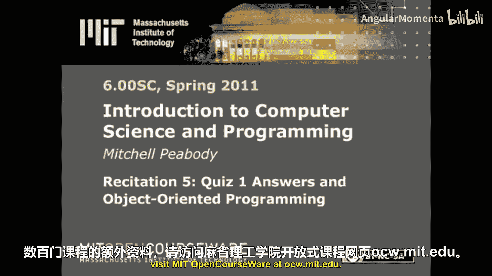
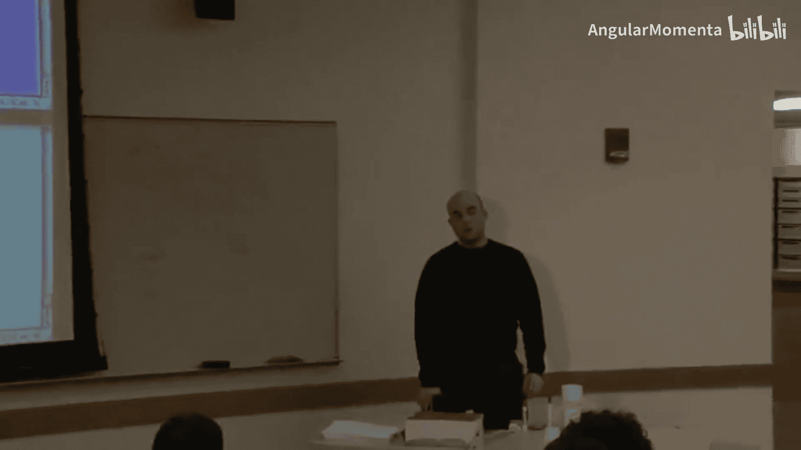
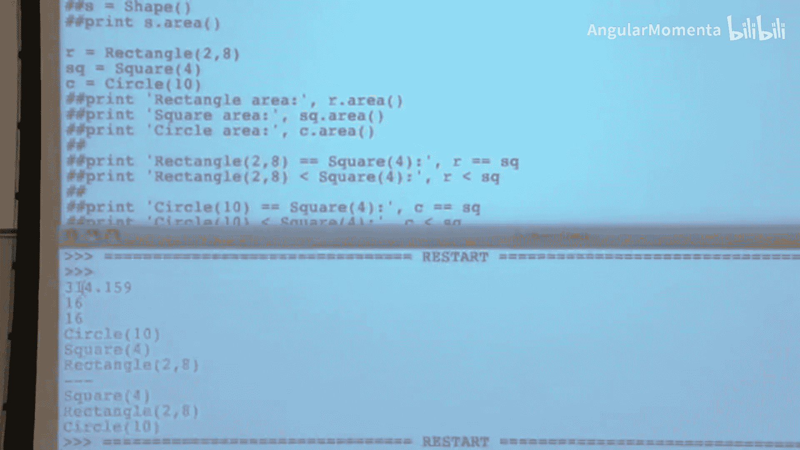
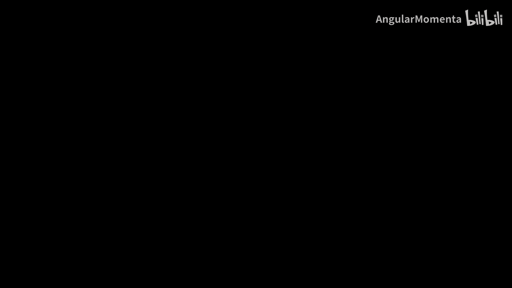

# 016：面向对象编程 🧩



在本节课中，我们将回顾上一次的测验，并深入探讨面向对象编程的核心概念。面向对象编程是一种强大的编程范式，它允许我们通过创建对象来模拟现实世界，从而更有效地组织和管理代码。

---

## 测验回顾 📝

上一节我们介绍了递归和迭代等概念，本节中我们来看看测验中的一些关键问题，以巩固理解。

### 问题一：递归与迭代的必要性

该问题探讨了某些问题是否必须使用递归或迭代来解决。答案是**True**。因为当输入规模可变时，例如需要遍历所有可能解的情况（如暴力搜索），通常需要迭代或递归。

### 问题二：代码阅读练习

以下是代码阅读练习，通过逐步执行代码来理解其输出。

```python
def example_function(s):
    if len(s) < 2:
        return s
    else:
        return example_function(s[1:]) + example_function(s[:-1])
```

通过手动追踪输入（如 `"ATM"`），我们可以得到输出结果。

### 问题三：双重递归

这个问题要求理解双重递归函数的行为。关键在于逐步追踪每次递归调用，并观察字符串如何被分割和重组。

### 问题四：实现函数 `find_words`

该函数需要从一个单词列表中找出所有与给定字母集合存在一一映射关系的单词。一种高效的解决方案是：

1.  对给定的字母集合 `elster` 进行排序。
2.  遍历单词列表，对每个单词的字母也进行排序。
3.  比较排序后的字符串，如果相等，则该单词符合条件。

```python
def find_words(word_list, elster):
    sorted_elster = ''.join(sorted(elster))
    result = []
    for word in word_list:
        if ''.join(sorted(word)) == sorted_elster:
            result.append(word)
    return result
```

### 问题五：代码规范符合性检查



这个问题要求检查一段代码是否符合给定的规范。规范包括：
1.  返回两个向量的逐点求和列表。
2.  处理长度不同的向量（求和至较短向量的长度，然后附加较长向量的剩余部分）。
3.  两个空向量返回空列表。
4.  **不修改输入参数**。

代码违反了第四条规范，因为它通过别名修改了输入列表。

### 问题六：字典与函数操作

这个问题涉及两个函数：`add_up`（对字典值求和）和 `f`（统计字符串中字符频率）。通过理解每个函数的功能，并逐步执行代码，可以得出正确结果。

### 问题七：二进制表示与复杂度分析

函数 `f` 打印整数的二进制表示。其内部循环运行次数与输入 `n` 的二进制位数（即 **log₂(n)**）成正比。由于函数中还有一个 **O(n)** 的操作，整体复杂度由主导项决定，为 **O(n)**。

### 问题八：算法概念匹配

这个问题将算法概念（如大O符号、牛顿法）与其描述相匹配。大O符号描述的是**最坏情况**下的时间复杂度上界。

---

## 面向对象编程 🏗️

上一节我们回顾了测验，本节中我们来看看面向对象编程的核心思想。面向对象编程允许我们将数据（属性）和操作数据的方法封装在一起，形成“对象”。

### 什么是类与对象？

**类** 是创建对象的蓝图或模板。它定义了一类对象共有的属性和方法。
**对象** 是类的实例，拥有类中定义的属性和具体值。

例如，`int`, `float`, `dict` 都是Python内置的类。当我们使用它们时，就是在创建对象。

```python
# ‘str’ 是一个类，‘s’ 是它的一个对象
s = "ABC"
# 调用对象 ‘s’ 的方法 ‘lower’
print(s.lower())  # 输出: abc
```

### 属性与方法

*   **属性** 是对象的状态或特征（如人的姓名、年龄）。
*   **方法** 是对象可以执行的操作（如人说话、行走）。

### 一个不使用类的例子

在引入类之前，我们可以用字典和函数来模拟一个人的信息：

```python
def make_person(name, age, height, weight):
    return {'name': name, 'age': age, 'height': height, 'weight': weight}

def get_name(person):
    return person['name']

def set_age(person, new_age):
    person['age'] = new_age
```

这种方式可行，但缺乏结构。`person` 本质上只是一个字典，Python无法区分它和其他字典。

### 使用类重构

使用类可以更优雅地实现同样的功能：

```python
class Person:
    def __init__(self, name, age, height, weight):
        self.name = name
        self.age = age
        self.height = height
        self.weight = weight

    def get_name(self):
        return self.name

    def set_age(self, new_age):
        self.age = new_age

# 创建Person类的对象（实例）
mitch = Person("Mitch", 32, 70, 200)
serena = Person("Serena", 25, 65, 130)

print(type(mitch))  # 输出: <class '__main__.Person'>
```

现在，`mitch` 和 `serena` 被明确标记为 `Person` 类型，而不仅仅是字典。

### 特殊方法与运算符重载

Python类中可以定义一些以双下划线开头和结尾的**特殊方法**，例如 `__init__`（构造函数）和 `__eq__`（定义相等性比较）。

```python
class Person:
    # ... __init__ 和其他方法同上 ...

    def __eq__(self, other):
        """定义两个Person对象‘相等’的条件，例如姓名相同"""
        return self.name == other.name

# 现在可以使用 ‘==‘ 运算符比较Person对象
print(mitch == serena)  # 输出: False
```

当执行 `mitch == serena` 时，Python内部会将其转换为 `mitch.__eq__(serena)` 来调用。

### `self` 参数

类中方法的第一个参数通常是 `self`，它代表**对象实例本身**。当通过 `object.method()` 调用方法时，Python会自动将 `object` 作为 `self` 参数传入。

```python
# 这两种调用方式是等价的
mitch.set_age(25)
Person.set_age(mitch, 25)  # 显式传递self，不常见但可行
```

### 继承与多态 🎭

**继承** 允许一个类（子类）继承另一个类（父类）的属性和方法。
**多态** 允许我们使用统一的接口处理不同子类的对象。

以下是一个几何形状的例子：

```python
class Shape:
    """形状基类"""
    def area(self):
        raise NotImplementedError("子类必须实现此方法")

    def __eq__(self, other):
        return self.area() == other.area()

    def __lt__(self, other):
        return self.area() < other.area()

class Rectangle(Shape):
    """矩形类，继承自Shape"""
    def __init__(self, length, width):
        self.length = length
        self.width = width

    def area(self):
        return self.length * self.width

    def perimeter(self):
        return 2 * (self.length + self.width)

class Circle(Shape):
    """圆形类，继承自Shape"""
    def __init__(self, radius):
        self.radius = radius

    def area(self):
        return 3.14159 * (self.radius ** 2)

    def perimeter(self):
        return 2 * 3.14159 * self.radius

class Square(Rectangle):
    """正方形类，继承自Rectangle（一种特殊的矩形）"""
    def __init__(self, side):
        # 调用父类的初始化方法
        super().__init__(side, side)

# 使用多态：将不同子类对象放入同一列表，统一处理
shapes = [Circle(5), Square(4), Rectangle(3, 6)]
for shape in shapes:
    print(f"Area: {shape.area()}")  # 尽管形状不同，但接口相同

# 因为定义了 __lt__，所以可以按面积排序
shapes.sort()
print([type(s).__name__ for s in shapes])
```

在这个例子中：
*   `Rectangle` 和 `Circle` 都继承自 `Shape`，因此它们都是 `Shape` 类型。
*   它们都实现了 `area` 方法，但具体计算方式不同。
*   我们可以创建一个 `Shape` 类型的列表，里面放入不同的图形对象，然后统一调用它们的 `area` 方法。这就是多态的魅力。
*   `Square` 继承自 `Rectangle`，表明“正方形是一种矩形”的关系，并复用了矩形的代码。

---

## 总结 🎯

本节课中我们一起学习了以下内容：
1.  **回顾了测验**，涵盖了递归、代码阅读、算法复杂度分析和大O符号等关键点。
2.  **引入了面向对象编程**，理解了**类**作为蓝图和**对象**作为实例的基本概念。
3.  探讨了类的**属性**（数据）和**方法**（操作）。
4.  学习了如何使用 `__init__` 等特殊方法，以及神秘的 `self` 参数的含义。
5.  掌握了**继承**的强大功能，它允许子类复用和扩展父类的功能。
6.  体验了**多态**的便利，它让我们能够以统一的方式处理不同类型的对象。





面向对象编程提供了一种组织复杂程序的强大方式，通过模拟现实世界中的实体和关系，使代码更模块化、更易理解和维护。