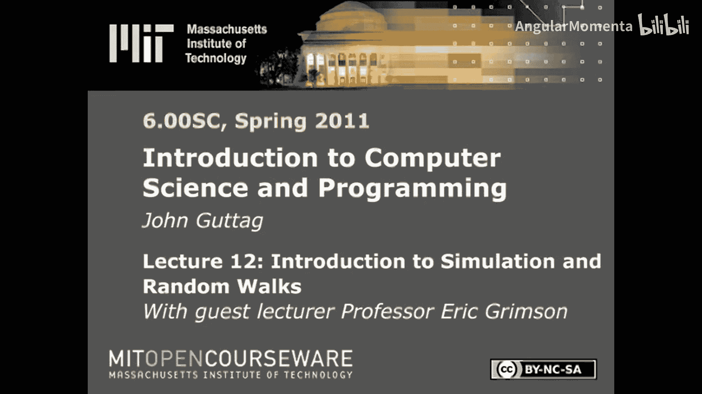
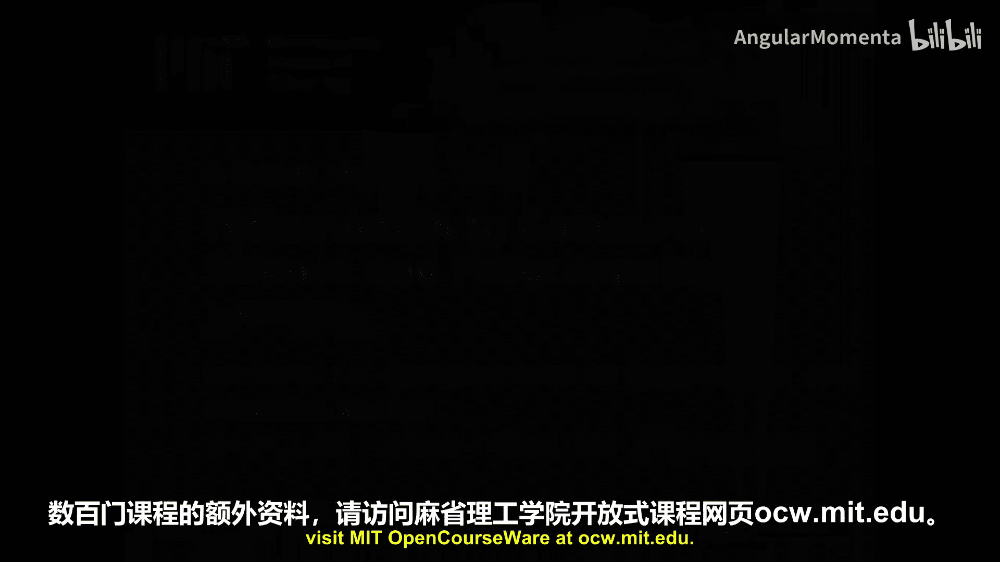
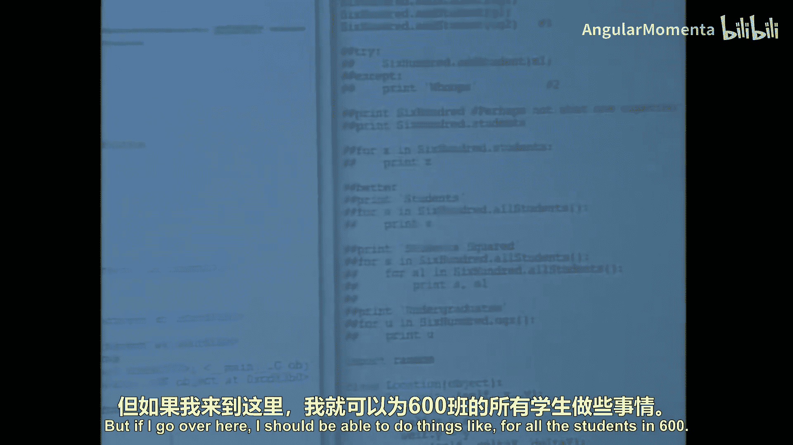
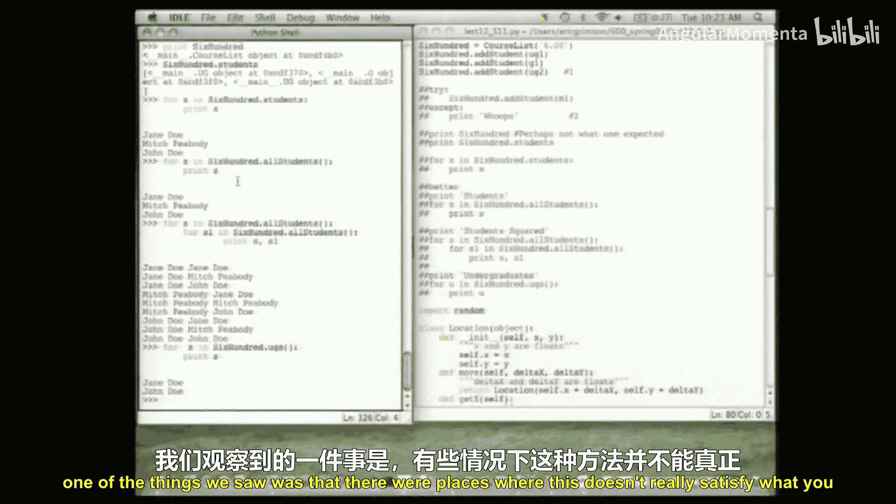
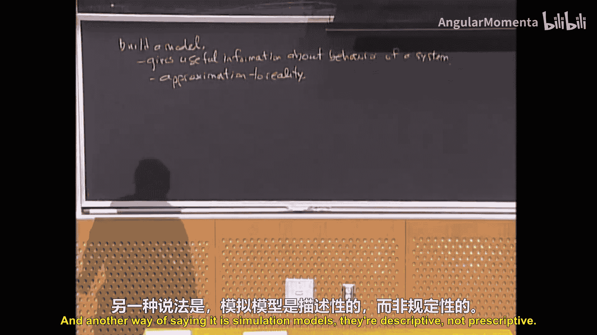
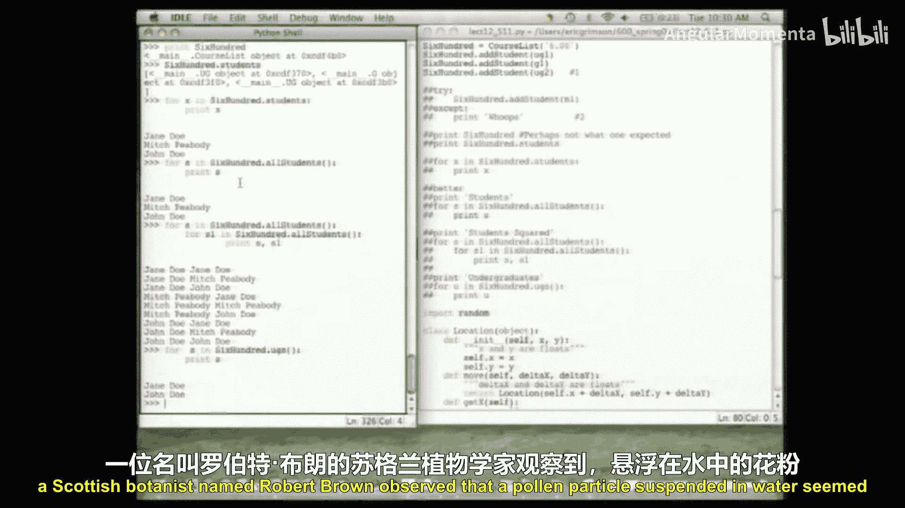
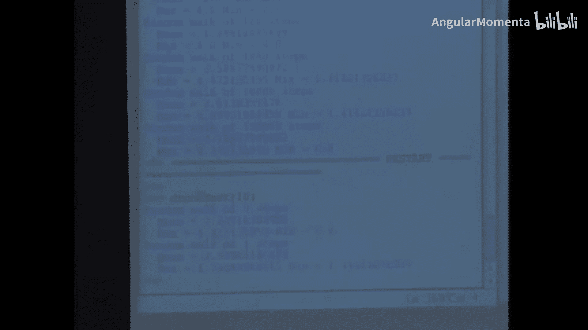

# 017：模拟与随机漫步





在本节课中，我们将学习如何构建计算模型来模拟现实世界中的问题。我们将从回顾上一讲关于类的知识开始，然后引入一个新的语言特性——生成器。最后，我们将转向一个全新的主题：使用模拟方法，特别是随机漫步，来理解和预测复杂系统的行为。

## 回顾：类与继承

上一节我们介绍了如何使用类来构建对象。我们从一个基础的 `Person` 类开始，然后创建了它的一个特化版本 `MITPerson`。`MITPerson` 类有一个内部变量 `idNum`，用于为每个实例分配一个唯一的标识符。此外，我们还创建了 `Undergrad` 和 `Grad` 类作为 `MITPerson` 的进一步特化。

为了管理课程中的学生，我们创建了一个 `CourseList` 类。这个类包含一个学生列表，并提供了添加和移除学生的方法。在添加学生时，我们使用了防御性编程，确保只添加学生，并且不会重复添加同一个学生。

## 引入生成器

本节中，我们来看看一种更优雅地访问集合元素的方法。在 `CourseList` 类中，我们添加了一个名为 `allStudents` 的方法，但更重要的是，我们添加了一个名为 `undergrads` 的方法，它使用了一个新的关键字：`yield`。

`yield` 用于创建**生成器**。生成器是一种特殊的函数，它能记住函数体中的执行点以及所有局部变量的状态。与 `return` 不同，`return` 会返回值并结束函数，而 `yield` 会返回一个值，但会“暂停”函数的执行。当再次调用生成器时，它会从上次暂停的地方继续执行。

以下是 `undergrads` 方法的核心代码片段：
```python
def undergrads(self):
    index = 0
    while index < len(self.students):
        if type(self.students[index]) == Undergrad:
            yield self.students[index]
        index += 1
```
这个生成器会遍历学生列表，每次遇到一个 `Undergrad` 实例时，就“产出”它。这使得我们可以像遍历列表一样使用它，但不需要在内存中一次性构建整个列表。

我们可以这样使用生成器：
```python
for s in course600.undergrads():
    print(s)
```
生成器非常有用，因为它允许我们控制对集合的访问方式，并且可以高效地处理大型或无限序列。

## 转向新主题：模拟方法



现在，我们转向一个完全不同的主题，这将是接下来几节课的重点。这个主题是关于如何构建计算模型来解决实际问题。

在科学史的很大一部分时间里，人们专注于寻找**解析方法**。解析模型允许你基于初始条件和一组参数，精确地预测系统的行为。例如，牛顿物理学和弹簧常数模型就是解析模型。它们非常强大，但并非总是有效。

随着20世纪的发展，我们发现在某些情况下，解析方法并不适用，而**模拟方法**则更为有效。



### 为什么需要模拟方法？

以下是几个选择模拟方法的原因：
1.  **系统难以用数学精确建模**：有些系统过于复杂，无法建立精确的物理模型来预测其行为。例如，天气预报。
2.  **通过迭代细化获得洞察**：对于复杂系统，与其花费精力构建一个非常详细的解析模型，不如运行一系列模拟，逐步细化，以获得对系统行为的理解。
3.  **易于获取有用的中间结果**：从模拟中提取有用的中间结果，通常比构建详细的解析模型更容易。
4.  **计算机使之成为可能**：现代计算机的强大计算能力使得大规模模拟变得可行且经济。

模拟在金融、生物、物理和游戏等领域有数百万的应用实例，它是一种极其常见和有用的工具。

### 模拟的本质

模拟的核心思想是构建一个**模型**，该模型能够提供关于系统行为的**有用信息**。与精确预测的解析模型不同，模拟模型给出的是对现实的**近似**。它们是**描述性**的，而非**规定性**的。对于相同的初始场景，多次运行模拟可能会得到略有不同的结果，但这正是模拟的优势所在——它允许我们探索系统行为的统计特性。



## 示例：随机漫步



一个经典的模拟例子是**随机漫步**。我们将用它来构建我们的第一个模拟。

随机漫步的一个著名历史例子是**布朗运动**。1827年，苏格兰植物学家罗伯特·布朗观察到悬浮在水中的花粉颗粒似乎在做无规则运动。1905年，阿尔伯特·爱因斯坦首次为布朗运动建立了良好的数学模型，这证实了原子的存在。

随机漫步的基本思想是：一个对象（如花粉颗粒）在每个时间步长中，按照某种随机分布向某个方向移动。我们通过模拟大量这样的步骤，来观察系统的整体行为。

### 模拟场景：醉汉游走

为了具体说明，我们考虑一个经典的随机漫步问题：**醉汉游走**。

假设一个醉汉（我们姑且称他为哈佛学生）站在一个大田野的中央。每秒钟，他可以以相等的概率向四个基本方向（北、南、东、西）之一走一步。问题是：在1000步之后，他离起点有多远？

在构建模拟之前，我们可以先做一些简单的估算。经过一两步的手动计算，我们发现平均距离似乎随着步数的增加而增加。但这只是一个粗略的直觉，我们需要通过模拟来验证。

### 构建模拟的类

为了模拟这个场景，我们需要设计几个类来对应我们期望看到的事物：
1.  **Location（位置）**：表示醉汉在田野中的坐标。
2.  **Field（田野）**：一个可以容纳多个醉汉并跟踪其位置的环境。
3.  **Drunk（醉汉）**：定义醉汉如何移动。

以下是核心类的设计思路：

**Location 类**：
*   存储 x 和 y 坐标（浮点数，以便未来扩展）。
*   提供 `move` 方法，根据给定的 `dx` 和 `dy` 返回一个新的 `Location` 实例。
*   提供 `distFrom` 方法，计算与另一个位置的距离（使用勾股定理）。

**Field 类**：
*   使用字典将 `Drunk` 实例映射到其 `Location`。
*   提供 `addDrunk` 方法，将醉汉添加到田野的某个位置。
*   提供 `moveDrunk` 方法，让指定的醉汉移动一步。它通过调用醉汉的 `takeStep` 方法来获取移动方向，然后更新该醉汉的位置。

**Drunk 类**：
*   有一个名字。
*   核心方法是 `takeStep`，它从一组固定的移动选择（如 `[(0,1), (0,-1), (1,0), (-1,0)]`）中随机选择一个，返回 `dx` 和 `dy`。这定义了醉汉的移动模式。

### 运行模拟与发现错误

有了这些类，我们可以编写函数让醉汉行走一定步数，并计算其最终位置与起点的距离。然后，我们可以运行多次试验（模拟），计算平均距离。

然而，当我们首次运行模拟时，结果看起来不对劲：无论步数是10、100还是1000，平均距离都徘徊在2左右，并没有像我们直觉那样增长。

这是一个重要的教训：**在构建模拟后，必须用已知答案的简单案例进行测试**。例如，步数为0时，距离应该总是0；步数为1时，距离应该总是1。通过这种测试，我们发现了代码中的错误（视频中因时间关系未展示具体调试过程，但强调了这一步骤的重要性）。

## 总结

本节课中我们一起学习了两个主要部分。首先，我们回顾了类的使用，并引入了**生成器**这一强大的新工具，它通过 `yield` 关键字实现，能够记住函数状态，非常适合用于按需生成序列。

其次，我们开启了关于**计算模拟**的新篇章。我们比较了解析模型与模拟模型，理解了模拟模型在处理复杂、难以精确数学建模的系统时的优势。我们以**随机漫步**为例，介绍了如何通过设计 `Location`、`Field` 和 `Drunk` 等类来构建一个模拟，并强调了用简单案例验证模拟正确性的重要性。



在接下来的课程中，我们将修正模拟中的错误，并更深入地探索随机漫步及其广泛应用。