# 019：随机过程与数据可视化 📊

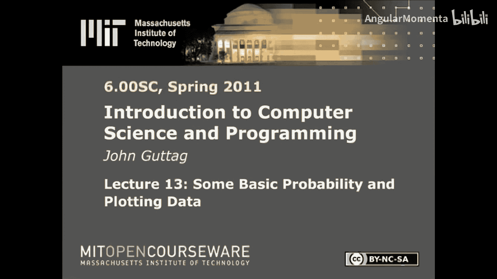

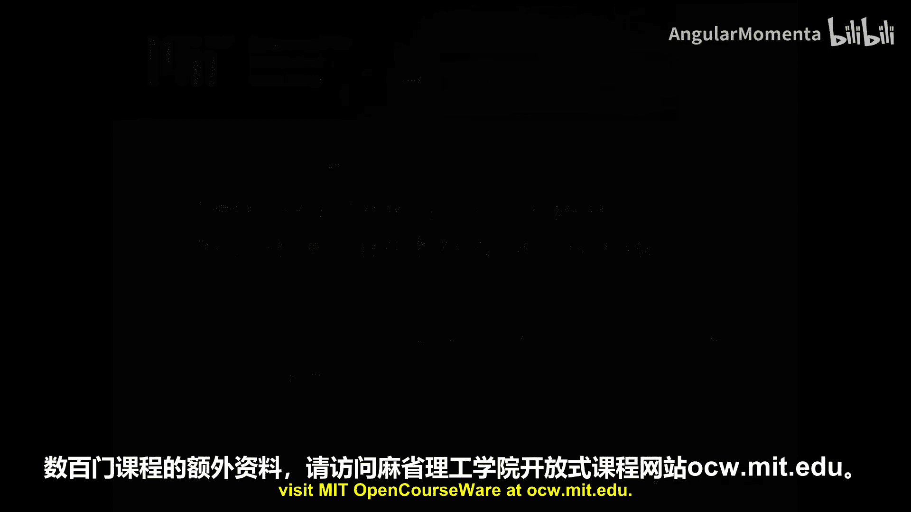

在本节课中，我们将学习随机过程的基本概念，并探讨如何使用Python的Pylab库进行数据可视化。我们将从修复一个模拟程序开始，逐步理解随机性在计算中的作用，并学习如何创建清晰、有意义的图表。


## 修复模拟程序

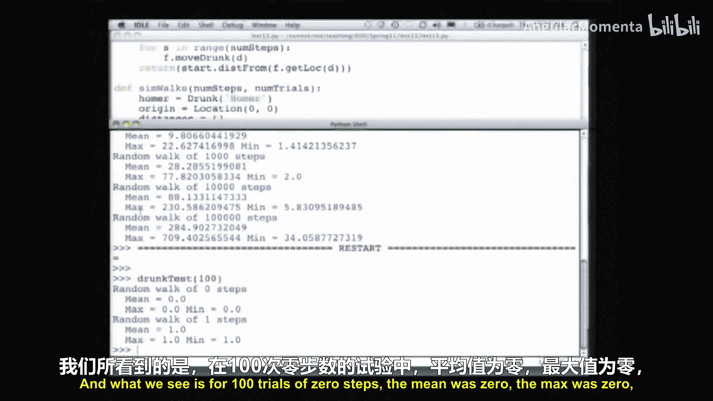


上一节我们介绍了醉汉行走模拟，但发现结果不可信。本节中，我们来看看问题所在并进行修复。

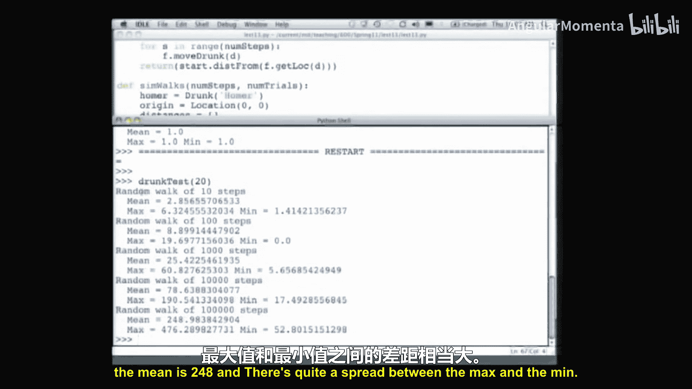


模拟程序 `SimWalk` 中存在一个错误：我们错误地使用了 `numTrials` 参数，而不是 `numSteps`。这导致模拟没有意义。现在我们已经修复了它。

为了验证修复，我们首先在一些已知答案的小规模例子上运行程序。


```python
# 示例：运行0步和1步的模拟
drunkTest(0, 100)  # 预期结果：均值、最大值、最小值均为0
drunkTest(1, 100)  # 预期结果：符合理论推导
```

运行结果显示，对于0步和1步的情况，模拟结果与预期完全一致。这并不能证明程序完美，但至少比之前的结果更可靠。

接下来，我们在更大规模的例子上运行模拟，例如10步、100步甚至100,000步。结果显示出我们期望的离散性：随着步数增加，平均距离增大，最大值和最小值之间的差距也变大。

## 可视化结果

观察数字本身可能不够直观，因此我们通过绘图来可视化数据。我们绘制了平均距离与步数的关系图。

从图中可以看出，距离大致随着步数的平方根增长。然而，我们不应过度解读这张图，因为每次模拟运行的结果都存在差异。例如，对于10,000步，不同次运行得到的平均距离可能分别是78、90、279或248。这种差异引出了本课程下一单元的核心问题：当程序本身是随机（随机）的时候，我们应如何理解和解释其结果？

## 计算中的随机性


随机性在计算中扮演着重要角色，这可能是你在其他初级课程中较少接触的概念。牛顿力学曾给我们带来确定性世界的安慰，但20世纪的量子物理（哥本哈根诠释）表明，在最基本的层面，物理世界的行为无法被完全预测，我们只能做出概率性陈述。

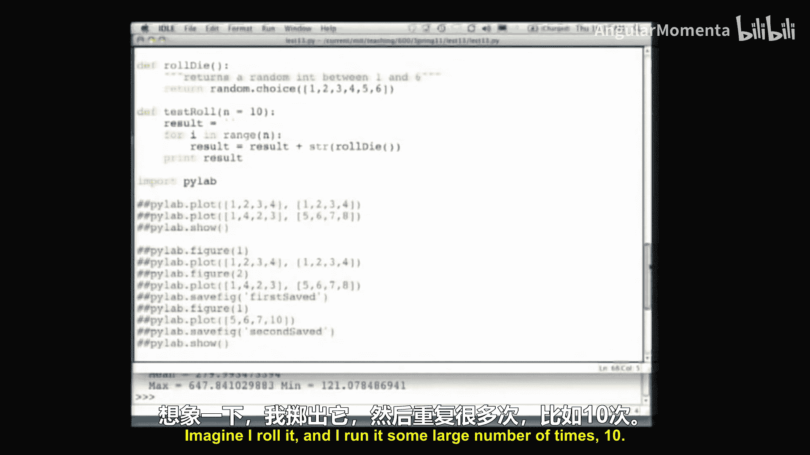

无论背后的哲学真相如何，在实际应用中，由于我们无法进行无限精确的测量，我们必须将世界视为非确定性的来处理。这引出了**随机过程**的概念。

一个过程是随机的，如果它的下一个状态既取决于之前的状态，也取决于某个随机因素。

大多数编程语言，包括Python，都提供了使用随机性的简单方法。在醉汉行走模拟中，我们使用了 `random.choice()` 函数。Python中几乎所有涉及随机性的函数，其底层都基于 `random.random()` 函数实现，该函数生成一个大于等于0.0且小于1.0的随机浮点数。

## 概率基础

让我们通过掷骰子的例子来理解概率。掷一个公平的六面骰子，每次结果是1到6之间的一个整数，且每次投掷是独立的。

以下是理解概率的关键点：
*   **概率是分数**：当我们谈论某个事件发生的概率时，我们实际上是在问，在所有可能的结果中，具有我们所测试属性的结果占多大比例。
*   **范围**：概率值总是在0到1之间（包含0和1）。0表示不可能发生，1表示必然发生。
*   **互补概率**：计算一个事件发生的概率，有时可以通过计算其**不**发生的概率，然后用1减去它来得到。即：`P(A) = 1 - P(非A)`。

例如，投掷一枚均匀硬币10次，得到全部正面的概率是 `(1/2)^10`。得到任何其他特定序列（如 `正反正正反...`）的概率同样是 `(1/2)^10`。对于六面骰子，投掷10次得到全部1点的概率是 `(1/6)^10`。

## 数据可视化入门

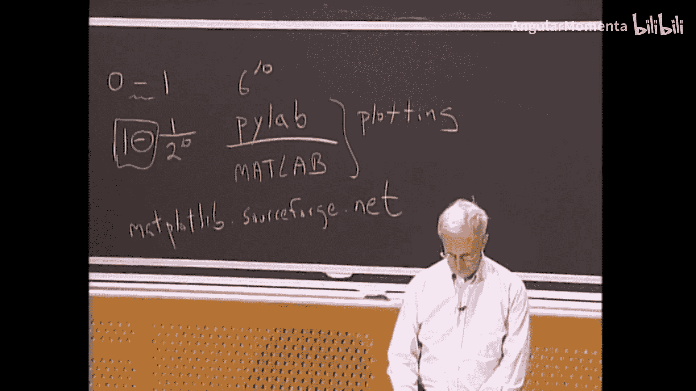

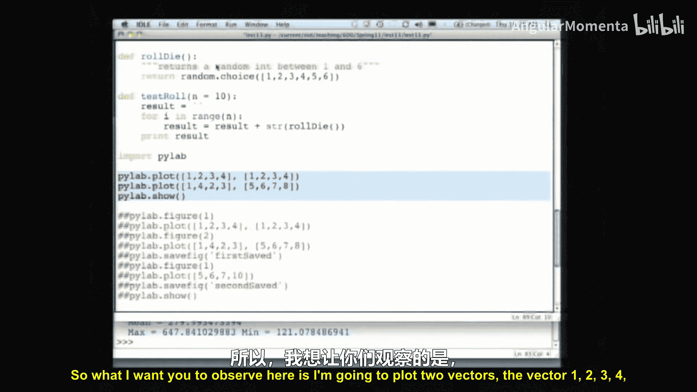

为了更清晰地讨论随机过程和概率，我们需要借助数据可视化。在许多编程语言中，绘图是件麻烦事，但Python通过 **Pylab** 库使其变得简单。Pylab提供了类似MATLAB的功能。


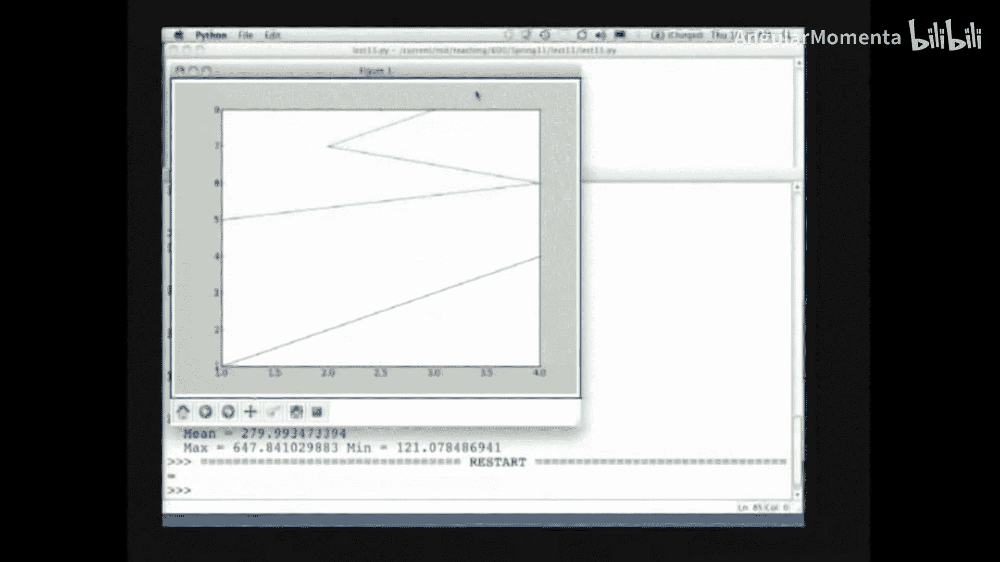


要使用Pylab，需要先安装它（非标准Python发行版的一部分），并在代码中导入：
```python
import pylab
```


以下是一个简单的绘图示例，展示了如何绘制两个向量：
```python
pylab.plot([1, 2, 3, 4], [1, 4, 2, 3]) # 绘制点 (1,1), (2,4), (3,2), (4,3)
pylab.show() # 显示图形
```
**注意**：`pylab.show()` 通常应是程序的最后一步，且每个程序最好只调用一次。


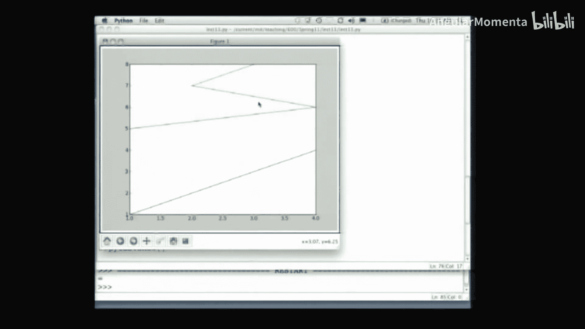

默认情况下，`plot` 函数会连接各点形成线条，这可能具有误导性，让人误以为数据点是连续的。我们稍后会学习如何绘制离散点。

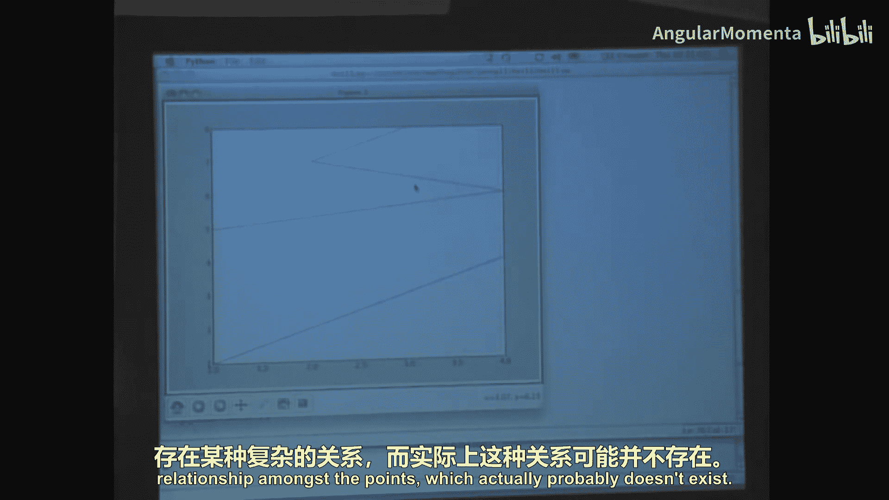

### 创建清晰的图表

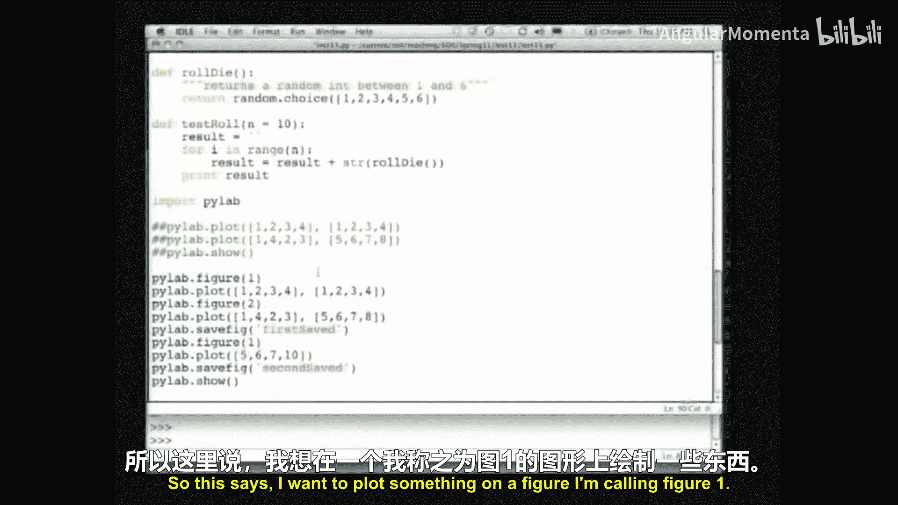

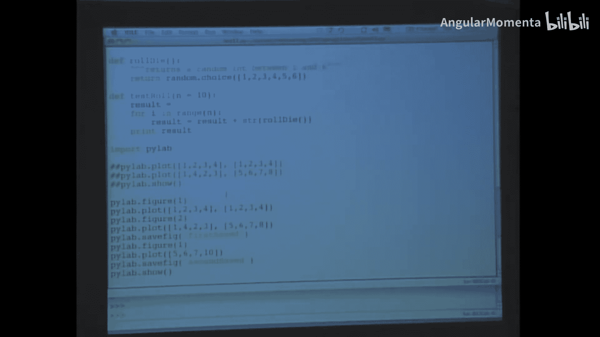

一个常见的错误是生成没有标签和标题的图表，这使图表难以理解。所有图表都应具备：
1.  **信息丰富的标题**：说明图表内容。
2.  **带标签的坐标轴**：明确X轴和Y轴代表什么。

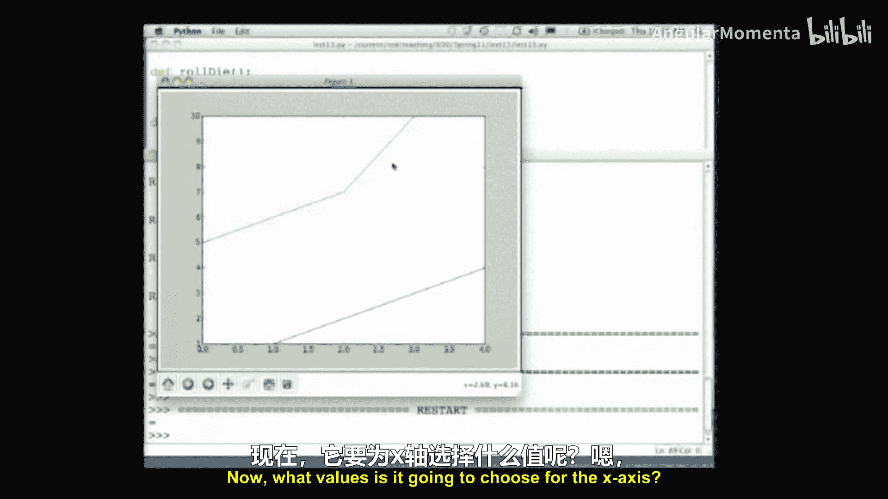

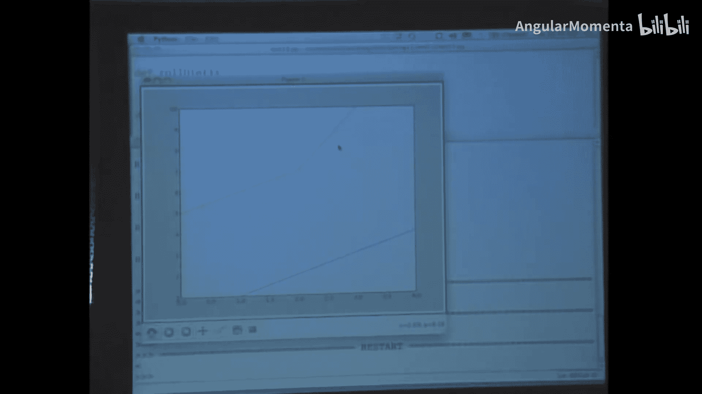

例如，在绘制复利增长图时，我们应该这样做：
```python
pylab.title(‘5% Growth, Compounded Annually’)
pylab.xlabel(‘Years of Compounding’)
pylab.ylabel(‘Value of Principal ($)’)
pylab.plot(years, values)
pylab.show()
```
这样生成的图表能立刻让读者理解其含义。


## 总结


本节课中我们一起学习了：
1.  **调试与验证**：通过修复醉汉行走模拟程序，我们学习了如何用已知的小规模测试用例验证程序。
2.  **随机过程**：理解了随机过程的概念，即下一个状态依赖于历史状态和随机因素。
3.  **概率基础**：回顾了概率的基本原理，包括概率作为分数的本质、其取值范围（0到1），以及利用互补事件计算概率的技巧。
4.  **数据可视化**：介绍了使用Python的Pylab库进行绘图的基本方法，并强调了为图表添加清晰标题和轴标签的重要性，这是进行有效科学沟通的关键。


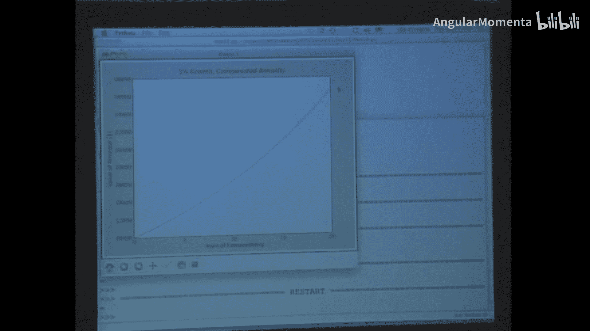

在接下来的课程中，我们将更深入地探讨概率、随机算法以及如何创建更具表现力和信息量的可视化图表。