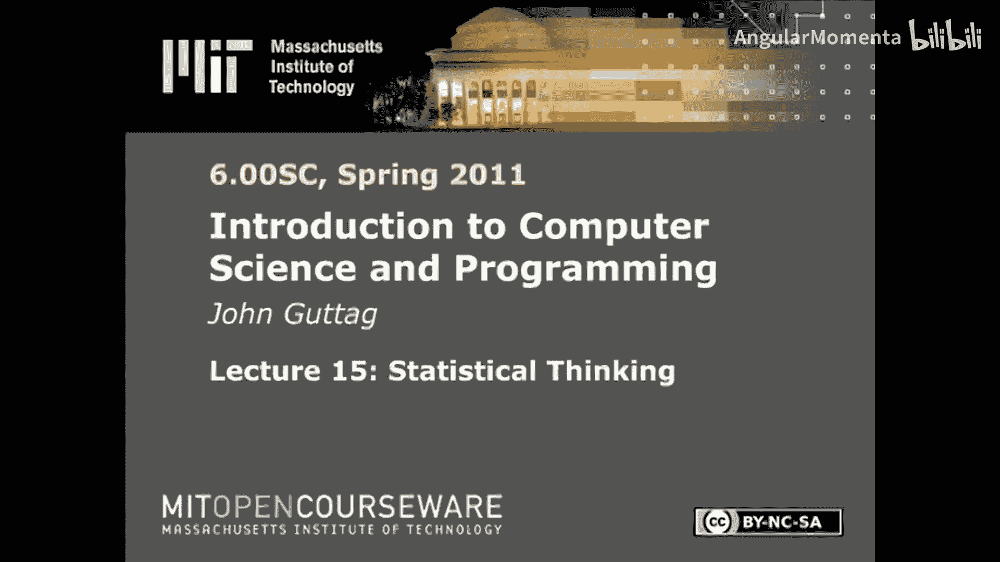
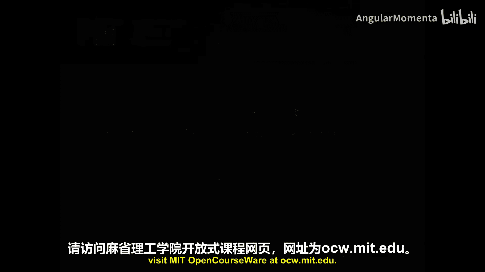
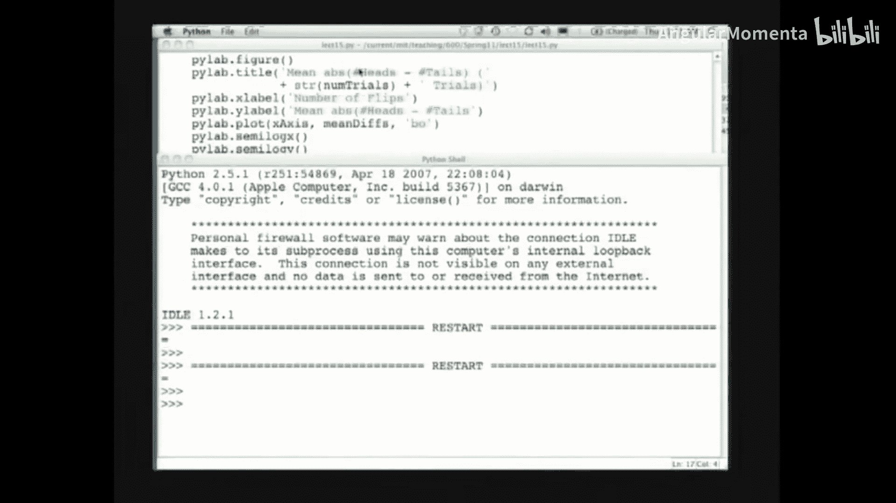
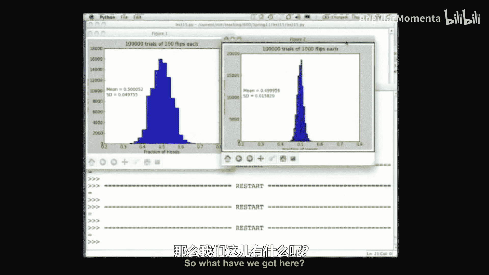
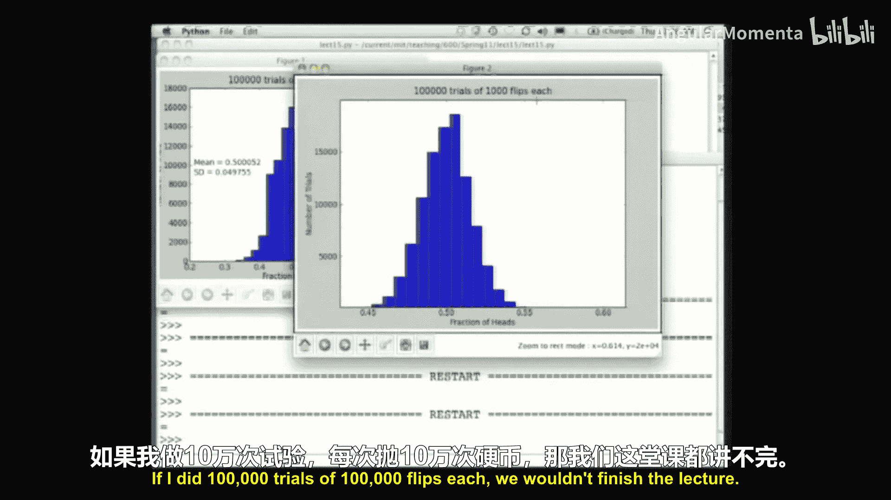
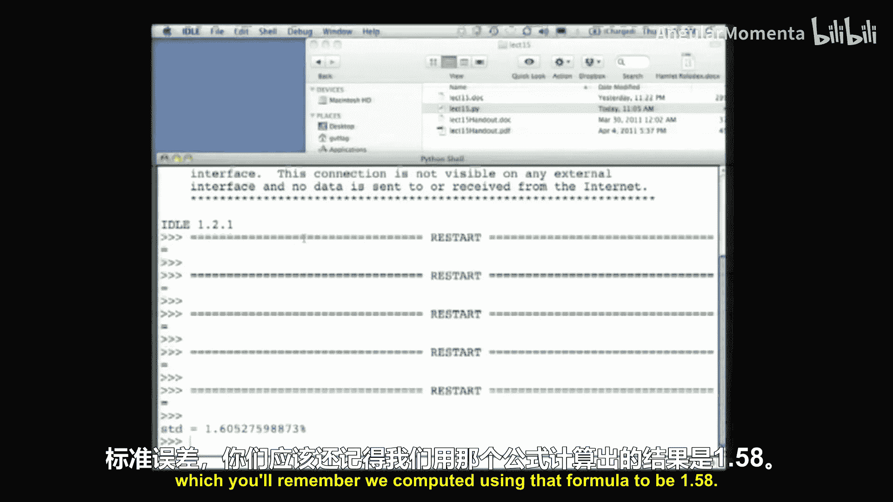
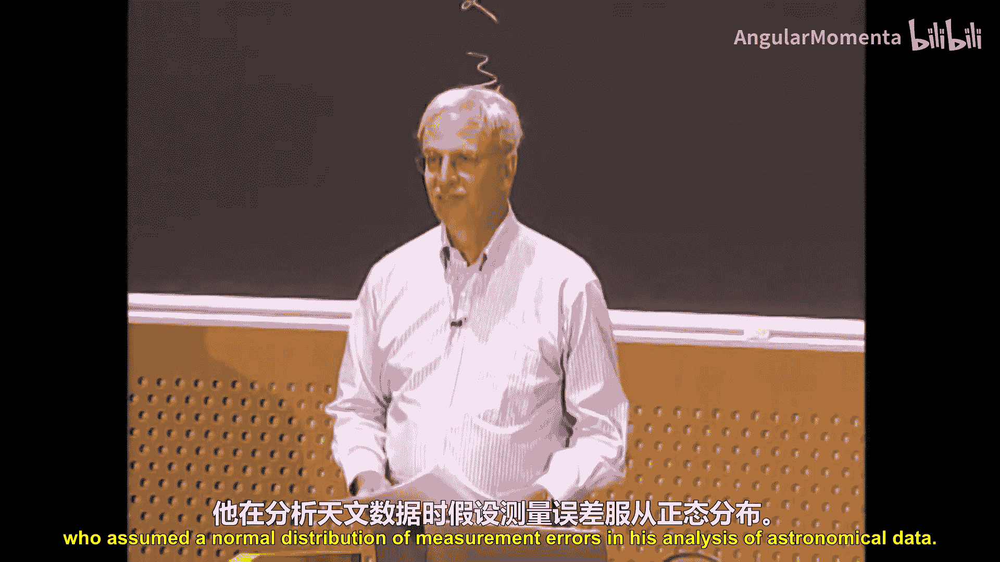

# 021：置信度与正态分布





在本节课中，我们将要学习如何评估通过有限次随机试验（如抛硬币）所得结果的可靠性。我们将探讨方差、标准差等核心概念，并了解如何使用它们来建立置信区间。最后，我们将介绍正态分布及其在现实世界中的广泛应用。

---

## 方差与标准差

上一节我们讨论了通过有限次抛硬币来估计概率。本节中我们来看看如何评估这种估计的可信度。关键在于理解结果的**方差**。

方差是衡量一组可能结果**离散程度**的指标。为了计算方差，我们需要进行多次试验，每次试验得到一个不同的结果，然后观察这些结果之间的差异。

我们可以通过**标准差**来形式化地衡量这种离散程度。标准差衡量的是数值与均值之间的平均距离。

以下是标准差的公式：

**标准差公式：**
`σ = sqrt( (1/|X|) * Σ (x - μ)² )`
其中，`X` 是试验结果集合，`μ` 是均值，`|X|` 是试验次数。

对于更倾向于代码的读者，以下是计算标准差的Python实现：

**标准差代码：**
```python
def stdDev(X):
    mean = sum(X) / float(len(X))
    total = 0.0
    for x in X:
        total += (x - mean)**2
    return (total/len(X))**0.5
```

这段代码与上述公式执行的是相同的计算。

---

## 样本量与可信度


现在我们知道了标准差的含义，接下来我们将用它来研究样本数量与我们对该样本所得答案的**置信度**之间的关系。

我们通过一个抛硬币模拟程序来观察。该程序运行多组试验，每组试验包含不同次数的抛掷，并绘制出头像比例及其标准差的变化图。

运行模拟后，我们观察到两个关键现象：
1.  随着抛掷次数增加，头像比例趋于稳定。
2.  随着抛掷次数增加，头像比例的标准差逐渐减小。




标准差减小意味着不同试验结果之间的差异变小。这不仅使我们更接近正确答案，更重要的是，它为我们相信这个答案提供了证据。仅仅因为运气好而得到正确答案是不够的，必须有证据支持。

---

## 变异系数

在评估标准差时，我们不能只看其绝对值的大小，而必须考虑它相对于**均值**的大小。如果均值是100万，标准差是20，那么相对差异很小。如果均值是10，标准差是20，那么差异就非常巨大。

为此，我们引入**变异系数**的概念。

**变异系数公式：**
`CV = σ / μ`
其中，`σ` 是标准差，`μ` 是均值。

变异系数衡量的是**相对离散度**。通常，如果变异系数小于1，我们认为方差较低。但需要注意两点：
1.  当均值接近0时，变异系数可能失去意义。
2.  与标准差不同，变异系数不能用于构建置信区间。

---



## 数据可视化与直方图

为了更直观地比较不同样本量的结果分布，我们可以使用直方图。以下是使用Python的matplotlib库绘制直方图的简单示例：

**直方图示例代码：**
```python
import pylab
L = [1, 2, 3, 3, 3, 4]
pylab.hist(L, bins=6)
pylab.show()
```

在比较多个图表时，确保它们使用相同的坐标轴范围非常重要，否则可能产生误导。我们可以使用 `pylab.xlim()` 和 `pylab.ylim()` 函数来手动设置坐标轴范围，以确保图表之间的公平比较。


当我们对大量抛硬币试验的结果绘制直方图时，其分布形状会接近**正态分布**。



---

## 正态分布与置信区间

正态分布，也常被称为**钟形曲线**，在自然界和实验中非常常见。它有两个重要特性：
1.  **数学性质良好**：完全由均值（`μ`）和标准差（`σ`）两个参数描述。
2.  **普遍存在**：许多随机变量（如人的身高、测量误差）都近似服从正态分布。

正态分布的一个关键应用是构建**置信区间**。置信区间不是给出一个单一的估计值，而是给出一个**范围**，并声明我们有多大的信心（置信水平）认为真实值落在这个范围内。

例如，政治民调中“52% ± 4%”的表述，通常意味着在95%的置信水平下，真实得票率在48%到56%之间。这个计算隐含了数据服从正态分布的假设。

对于正态分布，有一个实用的**经验法则**：
*   约68%的数据落在均值 ± 1个标准差的范围内。
*   约95%的数据落在均值 ± 2个标准差的范围内。
*   约99.7%的数据落在均值 ± 3个标准差的范围内。

---

## 标准误差与民意调查


你可能会问，民调机构如何知道标准差？他们并不重复进行上百次调查，而是使用一个叫做**标准误差**的估计值。

**标准误差公式（针对比例）：**
`SE = sqrt( p * (100 - p) / n )`
其中，`p` 是样本中的百分比，`n` 是样本大小。



这个公式在误差服从正态分布且样本量远小于总体时，可以很好地近似真实的标准差。通过一个模拟投票的Python程序，我们可以验证计算出的标准误差与实际测量得到的标准差非常接近，这解释了为什么民调在数学上是可靠的。

---

## 正态分布的应用



正态分布之所以有用，不仅因为其数学上的简洁性，更因为它准确地描述了许多现实情况。
*   **自然现象**：如人群的身高、体重分布。
*   **测量误差**：这是其最重要的应用之一。早在19世纪初，高斯在分析天文数据时，就假设测量误差服从正态分布（因此物理学家常称之为高斯分布）。如今，大多数科学领域在评估数据有效性时，都默认测量误差服从正态分布。

---


本节课中我们一起学习了如何通过方差和标准差来评估随机试验结果的可靠性。我们介绍了变异系数用于比较不同数据集的相对离散度，并深入探讨了正态分布的特性及其在构建置信区间中的核心作用。最后，我们了解了标准误差的概念以及正态分布在从民意调查到科学实验等众多领域的广泛应用。理解这些概念，有助于我们更批判性地看待数据与统计结论。