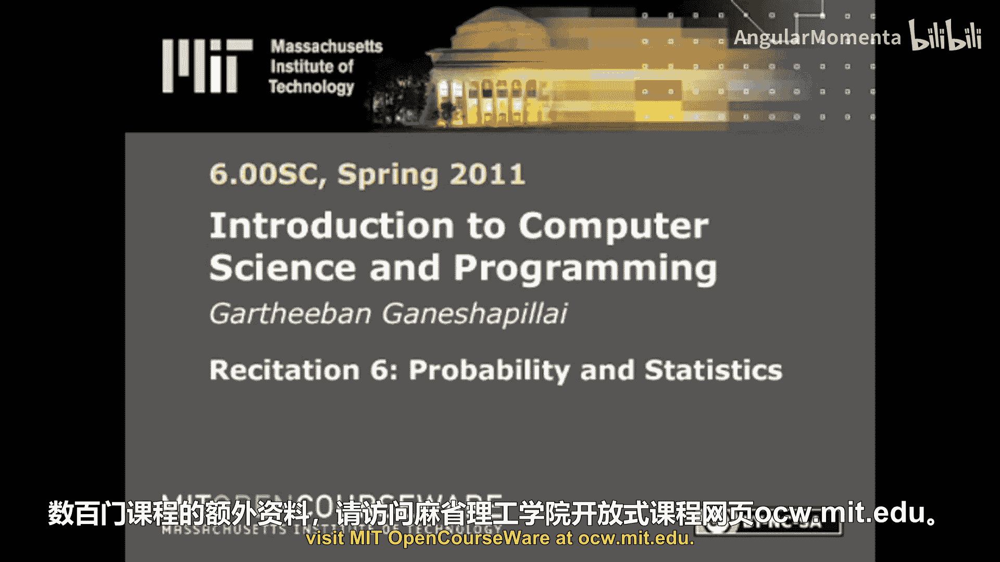

# 022：概率与统计学入门 📊



在本节课中，我们将要学习概率论与统计学的基础概念。我们会从理解概率的基本定义开始，逐步探讨如何计算简单和复杂事件的概率，并介绍统计学中用于描述数据分布的关键指标，如均值、方差和标准差。最后，我们将了解如何通过模拟（蒙特卡洛方法）来估计概率，并学习如何可视化数据。

## 概率基础

概率是表达某个特定事件发生可能性的一种方式。对于一个只能取两种结果的变量，我们称之为二元变量。

### 二元变量与概率

一个二元变量只能取两个值，例如：
*   正面（H）或反面（T）
*   开（1）或关（0）
*   是或否

我们用 **P(A = H)** 来表示变量A取值为H的概率。概率值始终在0到1之间（包含0和1）。概率的取值范围是连续的，而变量本身的值是离散的。

### 联合概率与独立事件

当我们考虑两个事件同时发生时，例如抛掷两枚硬币，我们关心的是联合概率。

假设有两枚硬币A和B，且都是均匀的（无偏），那么：
*   P(A = H) = 0.5
*   P(B = T) = 0.5

事件“A为正面且B为反面”的联合概率记为 **P(A = H ∩ B = T)**。由于两枚硬币的抛掷结果是相互独立的（即A的结果不影响B），我们可以简单地将两个概率相乘：
**P(A = H ∩ B = T) = P(A = H) * P(B = T) = 0.5 * 0.5 = 0.25**

### 事件的并集（“或”）

现在，考虑事件“A或B中至少有一枚是正面”。这包括了三种情况：A正B反、A反B正、A正B正。

在概率论中，这被称为事件的并集，记为 **P(A = H ∪ B = H)**。计算它的高效公式是：
**P(A ∪ B) = P(A) + P(B) - P(A ∩ B)**

这个公式的原理是，当我们把A发生的概率和B发生的概率相加时，A和B同时发生的区域被计算了两次，所以需要减去一次交集的部分。

## 计算概率的方法

上一节我们介绍了概率的基本运算，本节中我们来看看如何系统地计算更复杂情况的概率。主要有两种可视化工具可以帮助我们。

### 树状图

树状图通过分支来表示试验的所有可能结果。例如，抛掷第一枚硬币的结果（H或T）作为第一层分支，然后从每个分支再分出第二枚硬币的结果。

```
第一枚硬币
    ├── H (概率 0.5)
    │      ├── H (概率 0.5) -> 结果 HH (概率 0.25)
    │      └── T (概率 0.5) -> 结果 HT (概率 0.25)
    └── T (概率 0.5)
           ├── H (概率 0.5) -> 结果 TH (概率 0.25)
           └── T (概率 0.5) -> 结果 TT (概率 0.25)
```

通过树状图，我们可以清晰地枚举所有结果并计算其概率。

### 网格图

对于两个试验，我们可以使用网格图。横轴代表第一个试验的结果，纵轴代表第二个试验的结果。网格中的每个单元格代表一个联合结果。

例如，抛掷两个四面骰子，网格将是4x4的，共16个单元格，每个单元格代表一个结果组合，如(1,3)、(2,4)等。

以下是使用网格解决概率问题的例子：
*   **事件“两次点数相同”**：这对应于网格的对角线单元格。共有4个这样的单元格，总共有16个可能结果，所以概率是 **4/16 = 1/4**。
*   **事件“点数之和为6”**：需要找出所有和为6的组合，如(2,4)、(3,3)、(4,2)。共有3个这样的组合，概率为 **3/16**。

## 概率计算实例

掌握了基本工具后，让我们通过一些具体例子来巩固理解。

### 抛掷三枚硬币

抛掷三枚均匀硬币，共有 **2^3 = 8** 种等可能的结果。

*   **特定结果的概率**：例如“正正反”(HHT)。由于每种结果的概率相同，其概率为 **1/8**。
*   **恰好出现两次正面的概率**：我们需要枚举所有恰好包含两个H的结果：HHT, HTH, THH。共有3种这样的结果。因此概率为 **3/8**。

### 从扑克牌中抽牌

考虑一副标准的52张扑克牌。

*   **抽到A的概率**：一副牌有4张A，所以概率是 **4/52 = 1/13**。
*   **抽到特定花色A（如红桃A）的概率**：只有1张红桃A，概率是 **1/52**。
*   **抽不到A的概率（逆概率）**：这等于1减去抽到A的概率，即 **1 - 1/13 = 12/13**。利用逆概率常常能简化计算。

### 从两副牌中抽牌

现在从两副不同的牌中各抽一张。

*   **样本空间大小**：从第一副牌有52种可能，对于每一种，第二副牌也有52种可能。总共有 **52 * 52** 种可能结果。
*   **至少抽到一张A的概率**：设事件E1为“从第一副牌抽到A”，E2为“从第二副牌抽到A”。我们要求P(E1 ∪ E2)。
    *   P(E1) = 1/13
    *   P(E2) = 1/13
    *   P(E1 ∩ E2) = (1/13) * (1/13) = 1/169
    *   根据并集公式：**P(E1 ∪ E2) = 1/13 + 1/13 - 1/169**
*   **抽到的两张牌花色相同的概率**：使用网格思想。第一张牌可以是任意花色（概率1）。第二张牌必须与第一张同花色，在剩下的51张牌中有12张同花色牌，概率为12/51。所以总概率为 **1 * (12/51) = 12/51**。

## 从概率到统计：描述数据分布

前面的讨论基于我们知道事件的真实概率（如硬币是均匀的）。但如果我们不知道呢？我们可以通过多次重复试验（模拟）来估计概率。这就引入了统计学：我们通过收集到的数据（样本）来推断总体特性。

### 均值（期望）

均值是所有数据点的平均值，代表了分布的中心位置。公式为：
**均值 μ = (Σx_i) / N**
其中，x_i 是每个数据点，N 是数据点总数。

### 方差与标准差

仅有均值不足以描述数据。我们还需要知道数据的“分散程度”或变异性。

*   **方差**：衡量每个数据点与均值差异的平方的平均值。公式为：
    **方差 σ² = Σ(x_i - μ)² / N**
*   **标准差**：方差的平方根。它和原始数据有相同的单位，更易于解释。公式为：
    **标准差 σ = √方差**

标准差小意味着数据点紧密聚集在均值周围；标准差大则意味着数据非常分散。

### 变异系数

为了比较不同均值的数据集的离散程度，我们使用变异系数，它是标准差与均值的比值：
**变异系数 CV = σ / μ**

例如，一个班级的考试分数均值为50，标准差为10，则CV=0.2。另一个班级的学生体重均值为150磅，标准差为10磅，则CV≈0.067。虽然标准差相同，但体重的分布相对更集中（一致性更高）。

## 标准差的应用与置信区间

在正态分布（钟形曲线）中，标准差有特别重要的意义。我们可以根据均值(μ)和标准差(σ)来确定数据落在某个范围内的概率。

*   大约 **68%** 的数据落在 **μ ± 1σ** 范围内。
*   大约 **95%** 的数据落在 **μ ± 2σ** 范围内。
*   大约 **99.7%** 的数据落在 **μ ± 3σ** 范围内。

这使我们能够构建**置信区间**。例如，如果我们估计某次考试的平均分μ=80，标准差σ=5，那么我们可以有约95%的把握说，一个随机学生的分数会在 **80 ± 2*5**，即70到90分之间。

## 模拟与可视化

在编程中，我们经常使用模拟（如蒙特卡洛方法）来估计概率和理解随机过程。

### 模拟抛硬币

我们可以用随机数生成器来模拟一个概率为p的事件。例如，模拟一枚均匀硬币（p=0.5）：

```python
import random
if random.random() < 0.5: # random() 生成一个[0,1)之间的均匀随机数
    outcome = "H"
else:
    outcome = "T"
```

通过重复这个实验很多次（比如1000次抛掷），计算出现正面的比例，我们就可以估计出P(H)。随着模拟次数增加，这个估计值会越来越接近真实的0.5。

### 数据可视化

将模拟或实验的结果可视化非常重要，可以帮助我们洞察数据的模式。

*   **散点图**：展示两个变量之间的关系。例如，将每次模拟的“正面概率估计值”与“模拟使用的抛掷次数”画成散点图，可以观察估计值如何随样本量增大而收敛。
*   **直方图**：展示单个变量的分布情况。例如，将多次模拟得到的“正面出现次数”画成直方图，可以看到它是否符合预期的分布（如二项分布）。

在绘图中，务必为图表添加清晰的标题、坐标轴标签和图例。

---


本节课中我们一起学习了概率论的基础，包括如何计算简单和复合事件的概率。我们探讨了使用树状图、网格图和文氏图等工具来辅助计算。接着，我们过渡到统计学，学习了如何使用均值、方差和标准差来描述数据分布的中心趋势和离散程度，并了解了标准差在构建置信区间中的作用。最后，我们介绍了通过计算机模拟来估计概率以及使用图表进行数据可视化的基本概念。这些知识是进行数据分析和理解随机现象的基础。