# 023：概率分布、模拟建模与蒙特卡洛方法

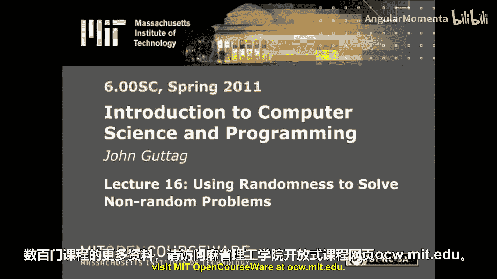

在本节课中，我们将学习几种重要的概率分布，探讨如何通过分析模型和模拟模型来理解现实世界，并介绍蒙特卡洛模拟这一强大的计算工具。


## 高斯分布与参数化建模


上一节我们介绍了高斯分布。高斯分布的一个有趣特性是，它可以完全由**均值**和**标准差**这两个参数来刻画。


这种用少量参数来描述一个曲线或分布的概念，是我们构建计算模型以理解物理系统的一种非常重要的方法。在本课程的这个阶段，我们将花大量时间探讨这个问题。

当我们能够建模时，我们倾向于将分布建模为高斯分布或正态分布，因为它们具有良好的参数化特性。我们有一些经验法则可以告诉我们数据点距离均值有多近。

## 非正态分布：均匀分布与指数分布

然而，理解并非所有分布都是正态分布这一点很重要。如果我们错误地假设一个非正态分布是正态的，可能会从模型中得出非常误导性的结果。


以下是两种常见的非正态分布：

*   **均匀分布**：考虑掷一个单一的骰子。六个结果中的每一个都是等概率的。我们不会期望在3或4处出现峰值，而在1处出现低谷。类似地，在马萨诸塞州彩票或任何公平的彩票中，每个号码出现的概率是相同的。这种分布被称为**均匀分布**。每个结果都等可能发生。我们可以用一个参数——它的**范围**——来完全描述一个均匀分布。均匀分布经常出现在人为设计的游戏中，但在自然界中几乎从未出现，通常对建模复杂系统不太有用。
*   **指数分布**：另一种经常出现的分布是指数分布。它们被用于许多不同的领域，例如规划高速公路系统时，用指数分布来模拟车辆的到达间隔时间。指数分布的关键特性是它具有**无记忆性**。事实上，它是唯一具有无记忆性的连续分布。

## 指数分布实例：药物清除模型

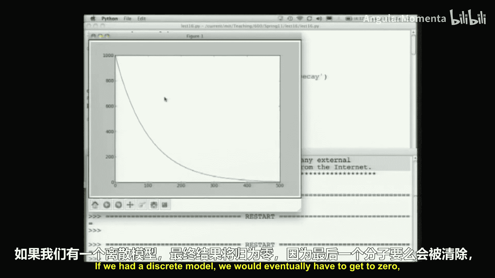

让我们看一个指数分布的例子。考虑药物在人体内的浓度。假设在每个时间步，每个分子被身体清除的概率是 **`P`**。这个系统是无记忆的，因为每个分子在特定时间步被清除的概率与之前发生的事件无关。

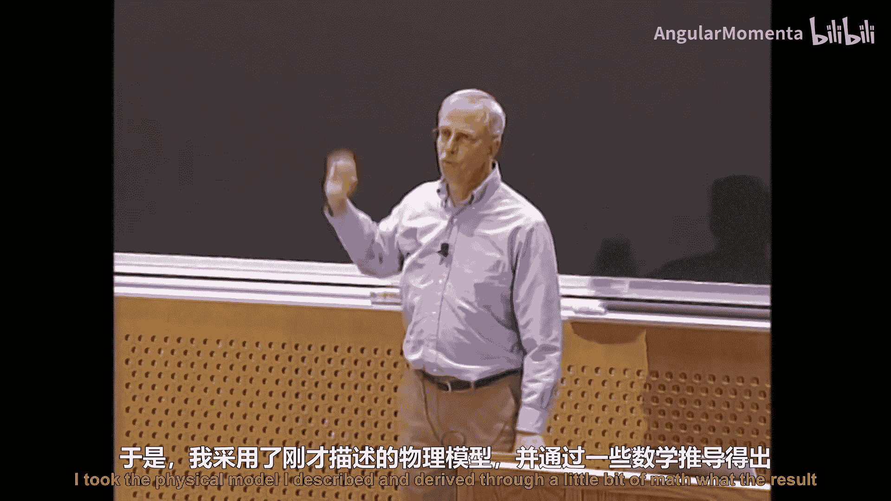

在时间 **`T = 1`**，分子仍然在体内的概率是 **`1 - P`**。在时间 **`T = 2`**，分子仍然在体内的概率是 **`(1 - P)^2`**。更一般地，在时间 **`T`**，分子仍然在体内的概率是 **`(1 - P)^T`**。

现在，假设在时间 **`T = 0`** 有 **`M0`** 个分子。我们可以编写一个简单的程序来模拟在任何时间 **`T`** 可能剩余的分子数量。

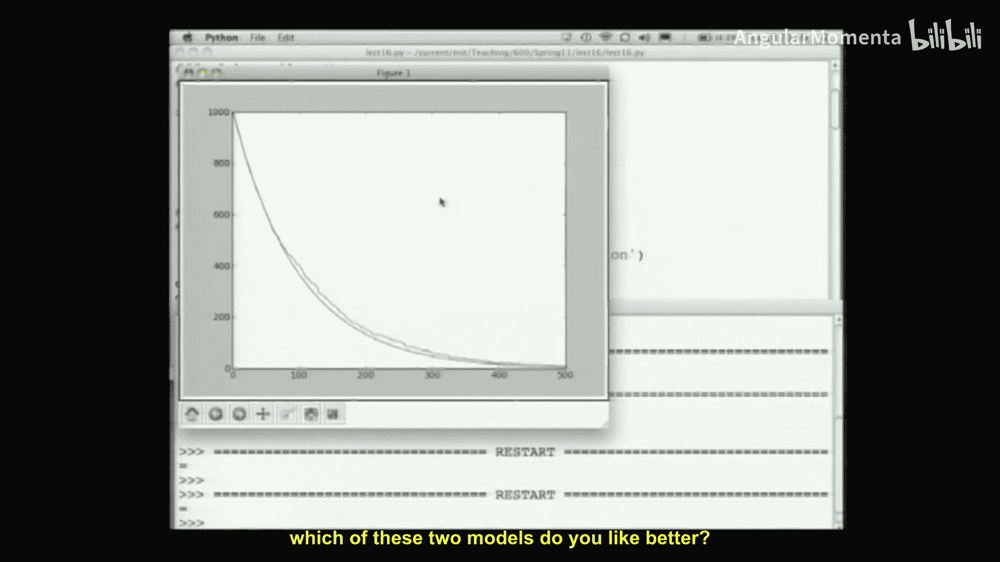

```python
def clear(numMolecules, probClear, numSteps):
    remaining = []
    m = numMolecules
    for t in range(numSteps):
        m = m * (1 - probClear)  # 应用指数衰减公式
        remaining.append(m)
    pylab.plot(remaining)
```

运行这个程序（例如，初始分子数=1000，清除概率=0.01，步数=500），我们会看到一条典型的指数衰减曲线：开始时下降非常快，然后逐渐趋近于0。如果我们在半对数坐标轴上绘制它，指数衰减会变成一条直线，这是判断一个分布是否是指数分布的一个简单有效的方法。

## 分析模型 vs. 模拟模型


上面我们通过物理模型推导出数学公式，并编写代码绘制了结果。让我们看看另一种方法：蒙特卡洛模拟。

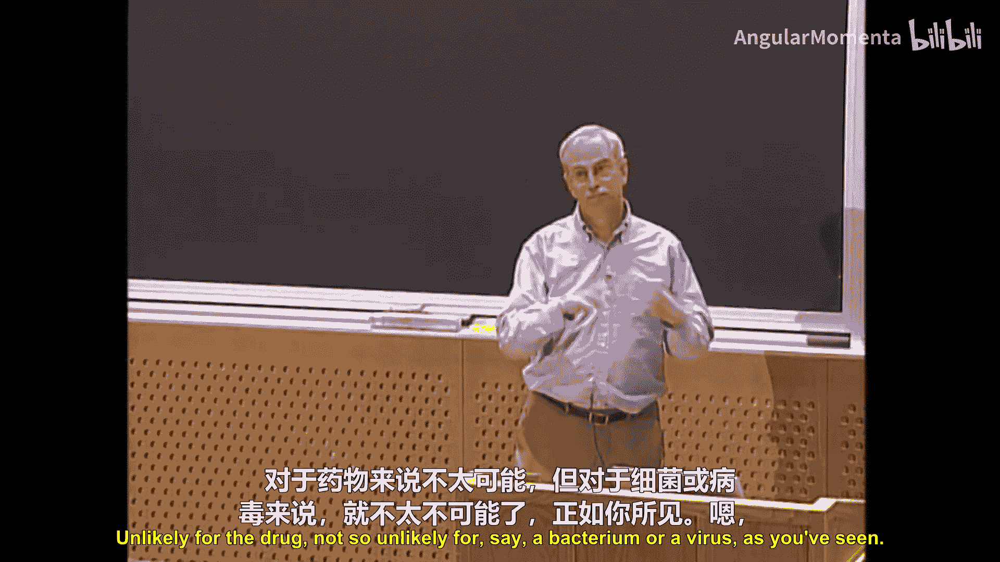

我们可以编写一个模拟模型，直接模仿物理过程，而不是计算概率。

```python
def clearSim(numMolecules, probClear, numSteps):
    remaining = []
    m = numMolecules
    for t in range(numSteps):
        for molecule in range(m):
            if random.random() < probClear:
                m -= 1
        remaining.append(m)
    pylab.plot(remaining)
```

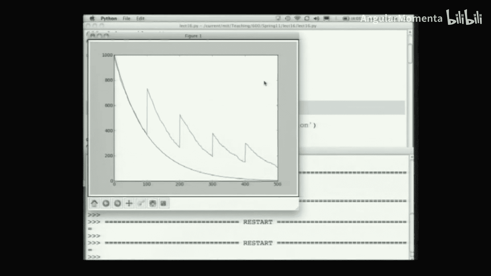

如果我们比较分析模型和模拟模型的结果，会发现它们非常相似：分析模型产生一条平滑的曲线，而模拟模型由于随机性产生一条略有波动的曲线，但整体趋势一致。

那么，我们更喜欢哪个模型？这没有标准答案。评估模型时，我们应该考虑两个问题：
1.  **保真度/可信度**：模型的结果是否可信？我们能否通过推理说服自己模型是准确的？
2.  **效用**：模型能回答什么问题？

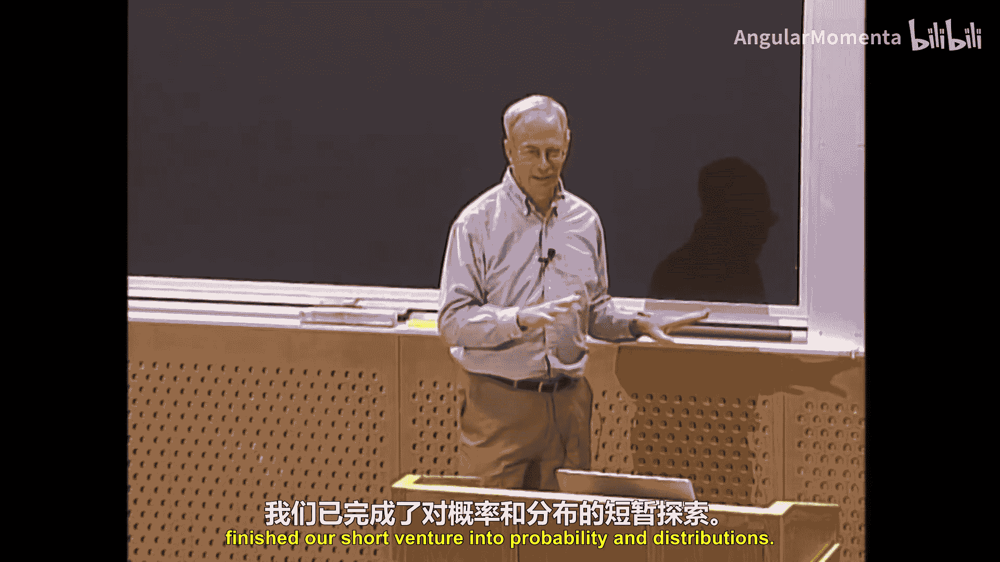

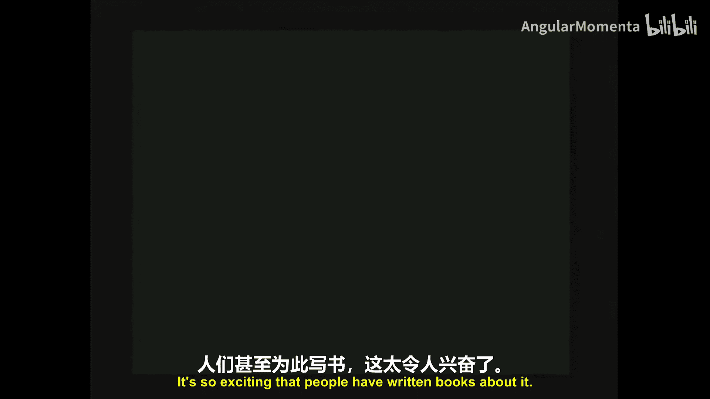


对于这个简单模型，很难说哪个更可信。但模拟模型通常能提供额外的效用，因为它更容易进行“假设分析”。例如，假设药物分子每100个时间步会自我复制一次。在分析模型中推导新公式会很困难，但在模拟模型中，我们只需添加几行代码就能观察结果，看到一种整体呈指数衰减但周期性跳跃的“锯齿状”分布。

## 蒙特卡洛模拟的应用：蒙提霍尔问题


在暂时离开概率论之前，让我们看一个著名的概率谜题：蒙提霍尔问题。这个问题展示了如何使用模拟模型来理解复杂或违反直觉的概率情景。

蒙提霍尔问题描述如下：
1.  有三扇门，一扇后面有汽车（大奖），两扇后面是山羊（安慰奖）。
2.  参赛者选择一扇门（比如1号门）。
3.  知道汽车在哪里的主持人（蒙提）打开一扇有山羊的、参赛者未选择的门（比如3号门）。
4.  主持人问参赛者：你是坚持原来的选择（1号门），还是换到另一扇未打开的门（2号门）？

问题是：参赛者应该换门吗？

通过概率分析可以得出：换门将获胜概率从 **`1/3`** 提高到 **`2/3`**。这是因为最初选择正确的概率是1/3，汽车在另外两扇门后的概率是2/3。主持人打开一扇有山羊的门后，剩下的那扇门拥有这2/3的概率。

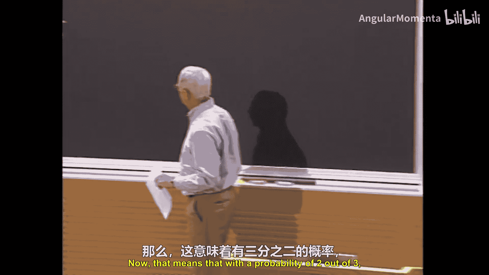

我们可以编写一个模拟程序来验证这一点：

```python
def montyChoose(guessDoor, prizeDoor):
    # 蒙提的策略：打开一扇不是参赛者选择且没有奖品的门
    if 1 != guessDoor and 1 != prizeDoor:
        return 1
    if 2 != guessDoor and 2 != prizeDoor:
        return 2
    return 3

def randomChoose(guessDoor, prizeDoor):
    # 随机策略：从非参赛者选择的门中随机打开一扇（可能打开有奖品的门）
    if guessDoor == 1:
        return random.choice([2,3])
    if guessDoor == 2:
        return random.choice([1,3])
    return random.choice([1,2])

def simMontyHall(numTrials, chooseFcn):
    stickWins = 0
    switchWins = 0
    for t in range(numTrials):
        prizeDoor = random.choice([1,2,3])
        guessDoor = random.choice([1,2,3])
        toOpen = chooseFcn(guessDoor, prizeDoor)
        if toOpen == prizeDoor:
            continue # 如果随机打开有奖品的门，此轮无效（对应随机主持人）
        if guessDoor == prizeDoor:
            stickWins += 1
        else:
            switchWins += 1
    return stickWins, switchWins
```

运行模拟会发现，当主持人采用蒙提的策略时，换门的胜率约为2/3，坚持的胜率约为1/3。如果主持人随机开门，则换门与坚持的胜率相同。这说明了事件的独立性（或非独立性）对概率结果的巨大影响。

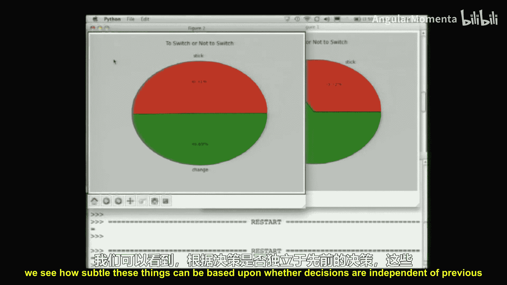

## 蒙特卡洛方法：估算圆周率 π

最后，我们探讨一个更广泛的概念：使用随机算法（蒙特卡洛方法）解决本身并不随机的问题。一个经典的例子是估算圆周率 **`π`**。

布丰投针实验的思路如下：
1.  画一个边长为2的正方形，并在其中内接一个半径为1的圆。
2.  向正方形内随机投掷大量“针”（点）。
3.  统计落在圆内的针的数量和落在正方形内的针的总数。

根据几何关系，圆的面积是 **`π * r^2`**，这里 **`r=1`**，所以面积是 **`π`**。正方形的面积是 **`(2r)^2 = 4`**。
如果投掷是随机的，那么落在圆内的针的比例应等于圆的面积与正方形面积之比，即：
**`(落在圆内的针数) / (总针数) ≈ (圆的面积) / (正方形的面积) = π / 4`**
因此，**`π ≈ 4 * (落在圆内的针数) / (总针数)`**

我们可以用程序模拟这个过程：

```python
def estPi(numPoints):
    pointsInCircle = 0
    for i in range(numPoints):
        x = random.random() * 2 - 1  # 生成[-1, 1)之间的随机x坐标
        y = random.random() * 2 - 1  # 生成[-1, 1)之间的随机y坐标
        if x**2 + y**2 <= 1:  # 检查点是否在半径为1的圆内
            pointsInCircle += 1
    return 4.0 * pointsInCircle / numPoints
```

投掷的点越多，估算值通常越接近真实的π。这展示了蒙特卡洛方法如何利用随机性来解决确定性的数学问题。

## 总结

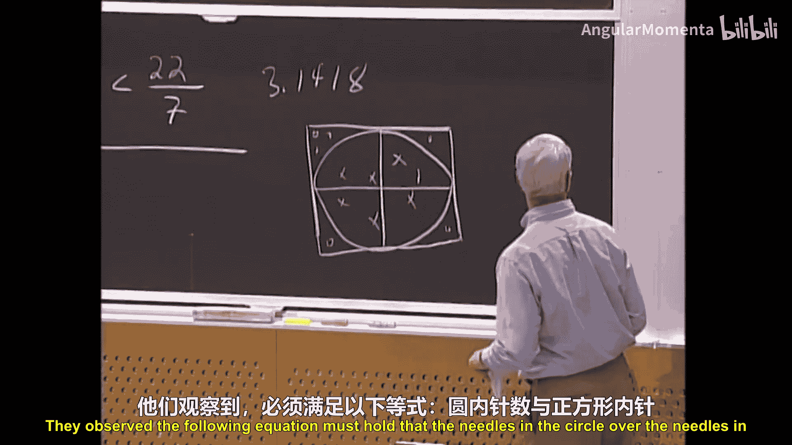

本节课中我们一起学习了：
1.  回顾了高斯分布，并引入了均匀分布和指数分布，理解了用少量参数描述分布的重要性。
2.  通过药物清除的例子，对比了**分析模型**（基于公式推导）和**模拟模型**（蒙特卡洛模拟）的构建与评估，认识到模拟模型在“假设分析”中的灵活性。
3.  深入探讨了著名的**蒙提霍尔问题**，利用概率分析和程序模拟验证了违反直觉的概率结果，理解了事件依赖关系对概率的影响。
4.  最后，介绍了**蒙特卡洛方法**的核心思想，即利用随机性解决非随机问题，并通过估算圆周率π的实例演示了其应用。

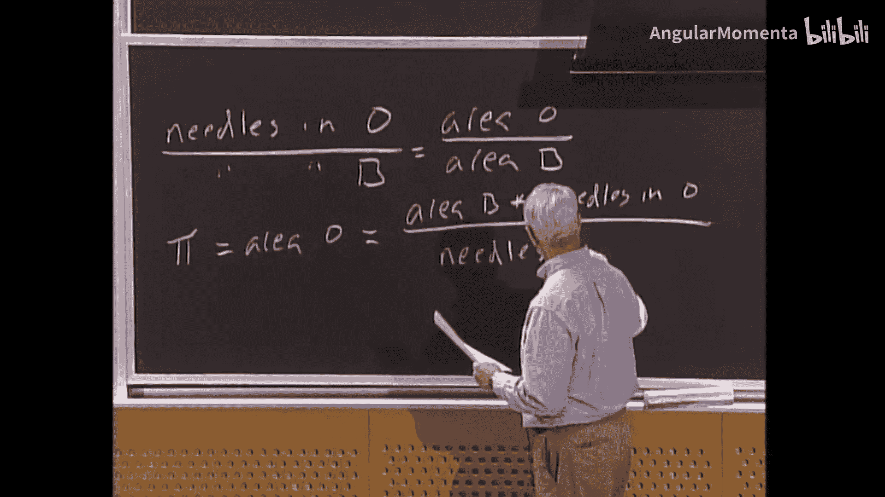

通过这些内容，我们看到了计算模型，特别是模拟模型，在理解和预测复杂系统行为方面的强大能力。