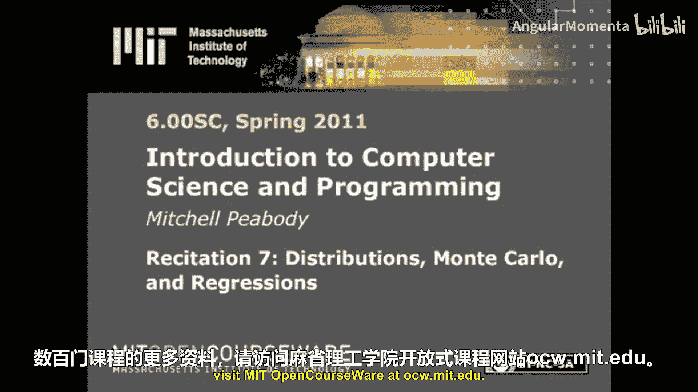

# 025：概率分布、蒙特卡洛方法与回归分析 📊

在本节课中，我们将学习三个核心主题：概率分布、蒙特卡洛方法以及回归分析。我们将探讨不同类型的分布，如何使用随机抽样来解决问题，以及如何通过回归分析来拟合数据并预测趋势。

## 概率分布 📈

上一节我们介绍了课程的整体结构，本节中我们来看看概率分布。概率分布描述了随机变量取值的可能性。我们已经学习了几种常见的分布。

以下是三种主要的概率分布：

1.  **均匀分布**：在区间 `[A, B]` 内，每个值出现的概率相等。其概率密度函数为 `P(x) = 1 / (B - A)`。
2.  **正态分布（高斯分布）**：呈钟形曲线，由均值 `μ` 和标准差 `σ` 两个参数完全定义。其概率密度函数为 `f(x) = (1 / (σ√(2π))) * e^(-(x-μ)²/(2σ²))`。
3.  **指数分布**：通常用于描述事件发生的时间间隔，其概率密度函数为 `f(x) = λe^(-λx)`，其中 `λ > 0`。

在Python中，我们可以使用随机数生成器来模拟这些分布，并通过绘制直方图来可视化它们。例如，使用 `random.uniform(A, B)` 生成均匀分布的随机数，使用 `random.gauss(μ, σ)` 生成正态分布的随机数。

## 蒙特卡洛方法 🎲

上一节我们介绍了不同的概率分布，本节中我们来看看蒙特卡洛方法。这是一种通过重复随机抽样来获得数值结果的计算方法。

以下是蒙特卡洛方法的几个应用实例：

1.  **蒙提霍尔问题**：通过模拟证明，在游戏中选择“换门”策略的获胜概率是2/3。
2.  **估算圆周率π**：通过在单位正方形内随机投点，并计算落在内切圆内的点的比例来估算π。公式为：`π ≈ 4 * (圆内点数 / 总点数)`。
3.  **数值积分**：通过在一个包围函数曲线的矩形区域内随机投点，估算曲线下的面积。公式为：`曲线下面积 ≈ 矩形面积 * (曲线下点数 / 总点数)`。

蒙特卡洛方法的核心思想是利用大数定律，当抽样次数足够多时，随机模拟的结果会趋近于理论值。这种方法特别适用于解决解析方法难以处理的问题，例如计算复杂棋盘游戏（如大富翁）中各个位置被访问的概率。

## 回归分析 📉

上一节我们探讨了如何使用蒙特卡洛方法解决各种问题，本节中我们来看看回归分析。回归分析用于确定两种或多种变量间相互依赖的定量关系，常用于从带有噪声的实验数据中找出潜在的函数模型。

以下是回归分析的关键步骤和概念：

1.  **拟合模型**：给定一组观测数据 `(x, y)`，我们尝试用一个多项式函数 `y = f(x)` 来拟合它。在Python中，可以使用 `numpy.polyfit(x, y, degree)` 进行多项式拟合。
2.  **评估拟合优度**：
    *   **均方误差**：计算预测值与实际观测值之差的平方和的均值。MSE越小，拟合越好。
    *   **决定系数**：表示模型对数据变异的解释程度。其值越接近1，说明模型拟合度越好。
3.  **过拟合问题**：使用过高次数的多项式进行拟合可能会过度贴合训练数据中的噪声，导致模型在未知数据上表现变差。因此，需要选择合适的多项式次数。

通过比较不同次数多项式的MSE和决定系数，我们可以选择一个既能较好拟合数据，又不会过于复杂的模型。这使得我们能够利用找到的模型进行预测，填补数据缺口或推断趋势。

## 总结 🎯

本节课中我们一起学习了三个重要的数据分析概念。我们回顾了均匀分布、正态分布和指数分布的特性及其可视化方法。我们深入探讨了蒙特卡洛方法的原理，并通过估算π和数值积分等例子理解了其应用。最后，我们学习了回归分析，掌握了如何使用多项式拟合数据、评估拟合质量并警惕过拟合现象。这些工具是进行科学计算和数据分析的基础。