# 026：模型评估与优化问题入门 🎯

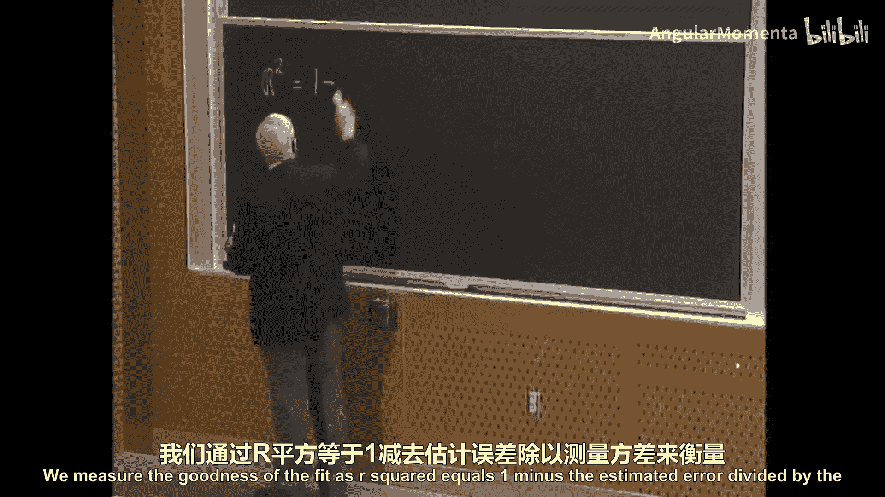

在本节课中，我们将要学习如何评估数据拟合模型的好坏，并初步了解一类重要的计算问题——优化问题。我们将从计算决定系数（R²）开始，然后探讨如何利用模型回答实际问题，最后引入经典的“0/1背包问题”作为优化问题的例子。

## 模型评估：决定系数（R²）

上一节我们介绍了如何用多项式拟合数据。本节中我们来看看如何量化一个拟合模型的“绝对好坏”，这可以通过一个叫做**决定系数**的指标来实现，通常写作 **R²**。

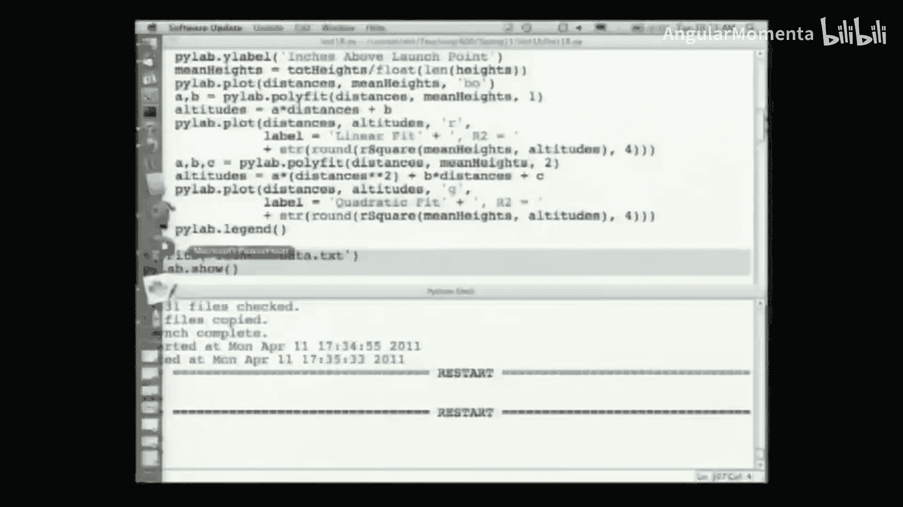


其公式非常简单：

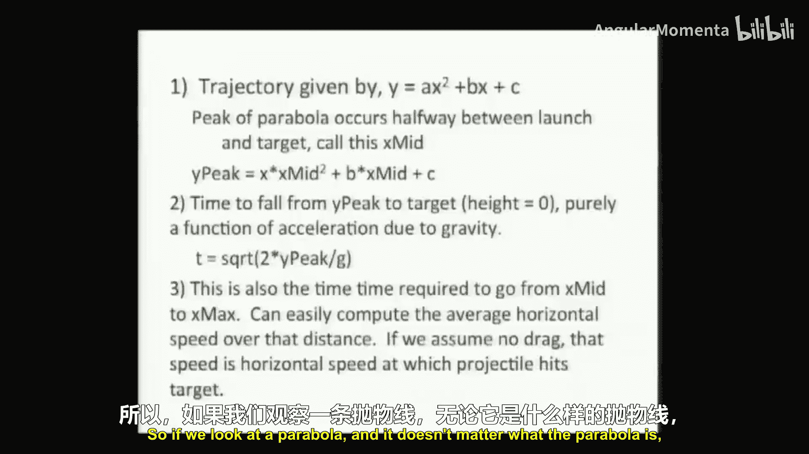

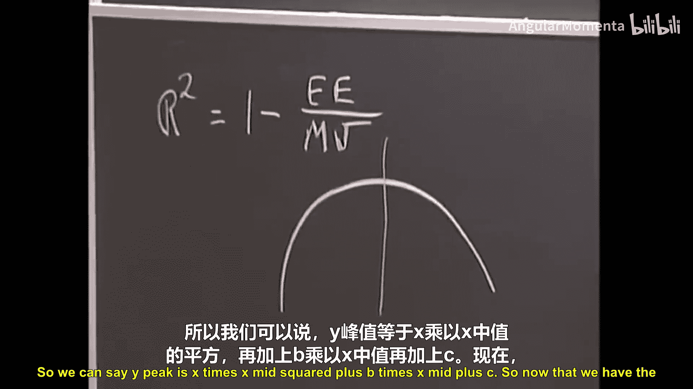

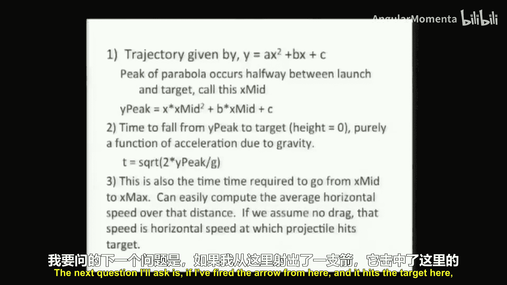

**R² = 1 - (估计误差 / 测量方差)**

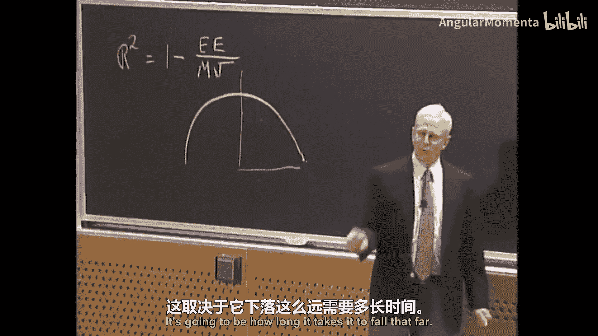

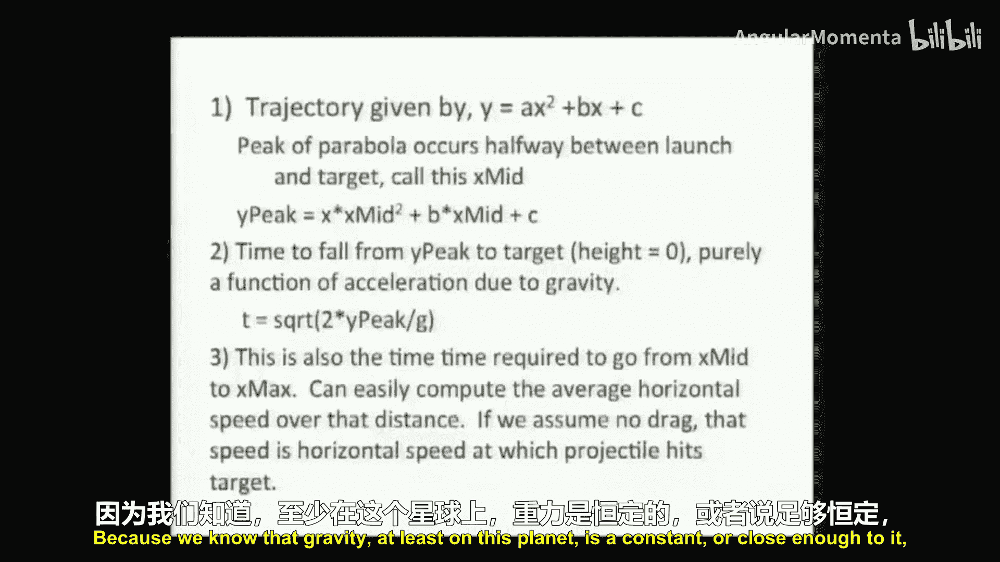


其中，估计误差是模型预测值与实际数据点之间的差异总和，测量方差是数据本身的变化程度。

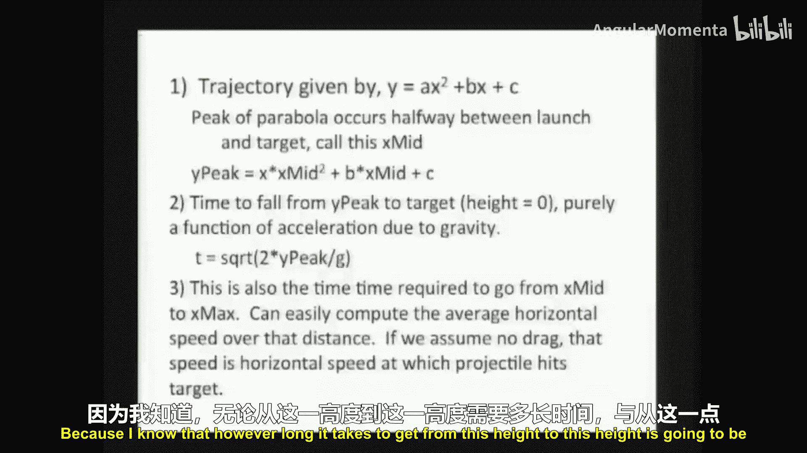

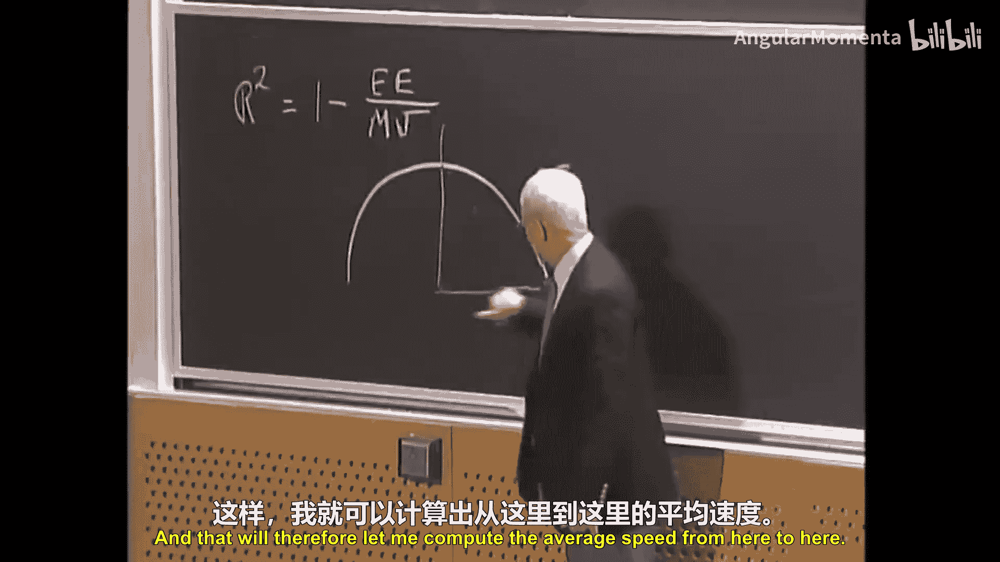


R²的值总是在0和1之间。如果R²等于1，意味着我们构建的模型完美地解释了数据中的所有变化。如果R²等于0，则意味着模型预测值与实际数据之间完全没有线性关系，模型毫无价值。

以下是计算R²的示例代码，它清晰地展示了公式的含义：

```python
def compute_r_squared(measured, predicted):
    # 计算估计误差 (SSE)
    sse = sum((measured[i] - predicted[i])**2 for i in range(len(measured)))
    # 计算测量方差 (SST)
    mean_measured = sum(measured) / len(measured)
    sst = sum((y - mean_measured)**2 for y in measured)
    # 计算 R²
    r2 = 1 - (sse / sst)
    return r2
```

## 应用模型：计算箭矢速度

既然我们有了一个评估模型好坏的方法，并且知道我们的二次模型拟合度很高（R² ≈ 0.98），那么一个自然的问题是：我们为什么要建立模型？模型能帮助我们回答哪些仅凭数据无法回答的问题？

例如，考虑射箭实验。我们有一组箭矢飞行轨迹的（x, y）坐标数据点。我们无法直接从这些离散点看出箭矢的飞行速度。但是，我们可以利用拟合出的抛物线模型，结合基础物理理论，来计算其平均速度。

具体步骤如下：
1.  **确定顶点**：抛物线模型为 **y = Ax² + Bx + C**。抛物线的最高点（顶点）总是出现在x轴的中点位置，即 **x_mid**。因此，最高高度 **y_peak = A * (x_mid)² + B * x_mid + C**。
2.  **计算下落时间**：箭矢从最高点落到靶子（地面）所经过的距离就是 **y_peak**。根据物理公式，物体自由下落高度 **h** 所需时间 **t** 为 **t = √(2h / g)**，其中 **g** 是重力加速度。
3.  **计算水平速度**：假设空气阻力等因素可忽略，箭矢从发射点到靶子的水平飞行时间与从顶点下落的时间相同。因此，平均水平速度 **v_avg = (水平距离) / t**。

通过这个例子，我们看到了一个典型的模式：**实验 -> 数据 -> 计算（建模与评估）-> 理论与分析 -> 推导结论**。这个模式在现代科学与工程中反复出现。

## 引入优化问题

现在，让我们转向一个新的主题：**优化问题**。

优化问题通常包含两个部分：
1.  **目标函数**：需要最大化或最小化的量（例如，最小化成本、最大化利润）。
2.  **约束条件**：解决问题时必须满足的限制（例如，时间上限、重量限制）。


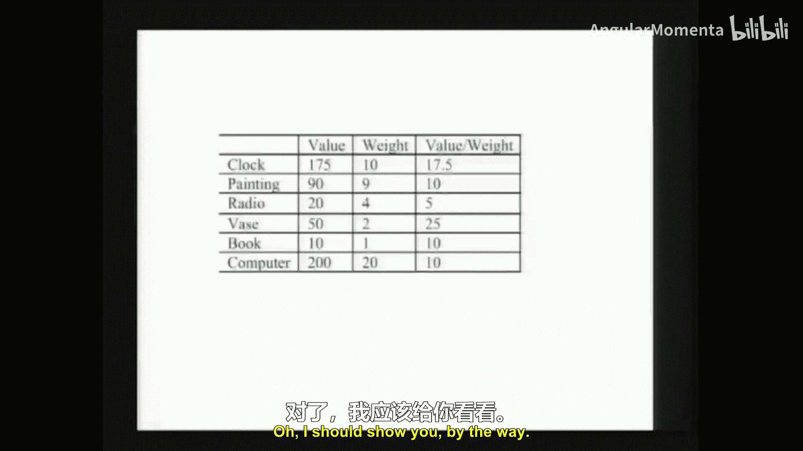


现实中有大量问题可以这样表述，例如规划最短路径、分配有限资源、机器学习中的模型训练等。

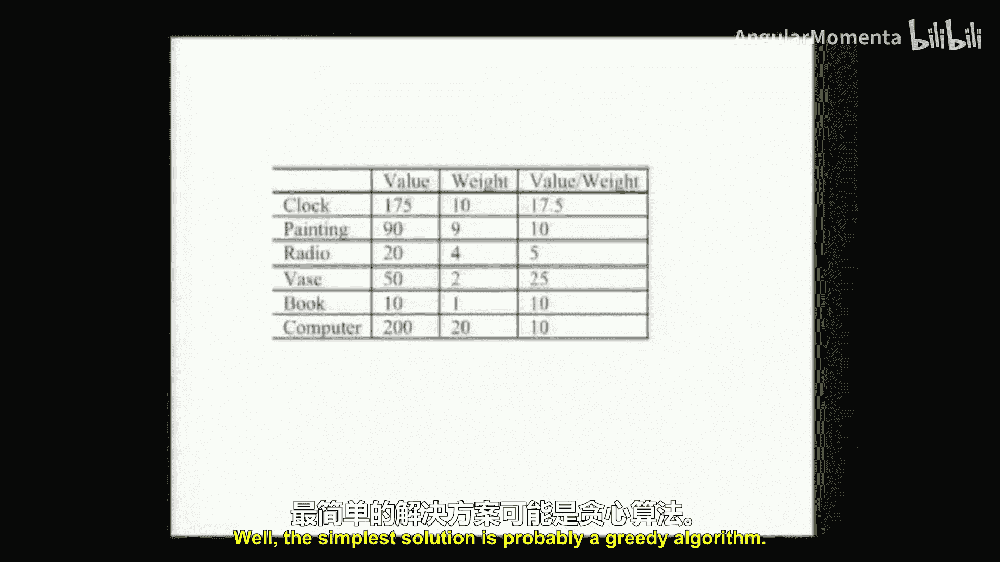

## 经典案例：0/1背包问题


一个经典的优化问题是 **0/1背包问题**。其场景是：一个小偷有一个最大承重为 **W** 的背包，闯入一间放有各种物品的屋子。每件物品 i 都有其价值 **v_i** 和重量 **w_i**。小偷的目标是**在背包承重限制下，使偷走的物品总价值最大**。

“0/1”意味着对于每件物品，小偷只能做出二元选择：要么整个拿走（取1），要么不拿（取0），不能只拿一部分。

### 贪心算法尝试

面对这个问题，一个直观的解决思路是使用**贪心算法**。贪心算法在每一步都做出当前看来最优的（“最贪心的”）选择。

对于背包问题，至少有三种贪心策略：
*   **按价值贪心**：每次选择剩余物品中价值最高的。
*   **按重量贪心**：每次选择剩余物品中最轻的（以便能装更多件）。
*   **按价值密度贪心**：每次选择剩余物品中“价值/重量”比最高的。

以下是实现贪心算法的代码框架：

```python
def greedy(items, max_weight, key_function):
    """ 贪心算法解决背包问题
    items: 物品列表
    max_weight: 最大承重
    key_function: 决定排序规则的函数，如按价值、重量或价值密度
    """
    # 按指定规则排序，降序（最好的在前）
    items_sorted = sorted(items, key=key_function, reverse=True)

    result = []
    total_value = 0.0
    total_weight = 0.0

    for item in items_sorted:
        if (total_weight + item.get_weight()) <= max_weight:
            result.append(item)
            total_weight += item.get_weight()
            total_value += item.get_value()
    return (result, total_value)
```

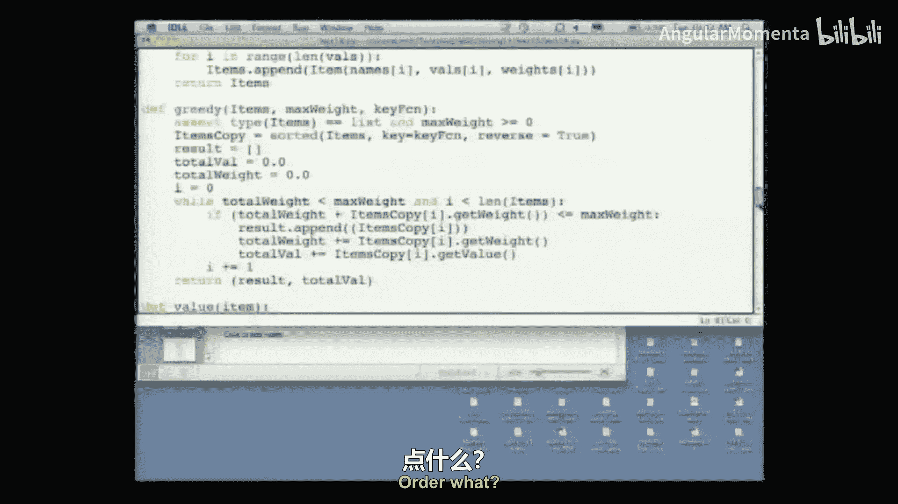

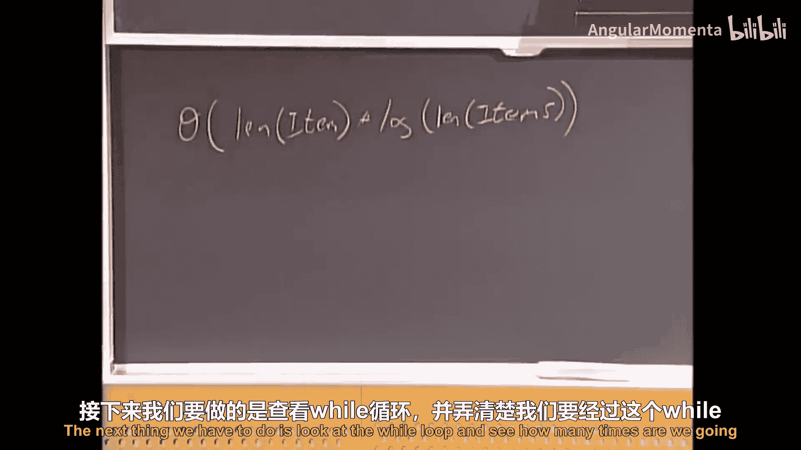

贪心算法的优点是**效率高**，其时间复杂度主要来自排序操作，通常是 **O(n log n)**，其中 n 是物品数量。然而，它的缺点是**不能保证得到全局最优解**。不同的贪心策略在不同的问题实例上可能产生不同的结果，且都可能不是最好的。

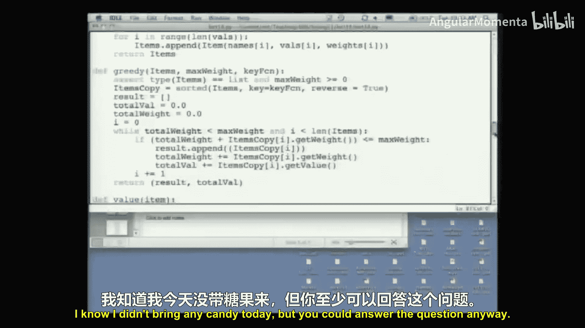

### 寻求最优解与复杂度挑战

如果我们不满足于近似解，坚持要找到**绝对最优**的组合，该怎么办？最直接的方法是**穷举所有可能性**。

我们可以将选择方案表示为一个二进制向量 **V = [v1, v2, ..., vn]**，其中 **vi = 1** 表示拿取第 i 件物品，**vi = 0** 表示不拿。那么，所有可能的向量总数就是 **2^n**。

问题随之而来：当物品数量 n 增大时，穷举法所需的时间会呈**指数级爆炸**。例如，对于 n=50 件物品，即使每评估一个组合只需1微秒，穷举所有 **2^50** 种可能也需要大约36年！这显然是不切实际的。

因此，对于像0/1背包这样的**NP难问题**，我们常常需要在**求解精度**和**计算时间**之间做出权衡。贪心算法提供了一种快速的近似方案。在后续课程中，我们将探讨其他更智能的算法（如动态规划）来更有效地处理这类问题，或在可接受的时间内找到非常接近最优的解。

## 总结


本节课中我们一起学习了：
1.  使用**决定系数 R²** 来量化评估数据拟合模型的质量。
2.  理解了建立模型的意义：利用**模型、理论和计算**相结合，从实验数据中推导出新的结论（如计算箭速）。
3.  认识了**优化问题**的基本结构：目标函数 + 约束条件。
4.  以**0/1背包问题**为例，实践了用**贪心算法**寻找可行解，并分析了其高效但不保证最优的特性。
5.  意识到了对于组合爆炸问题（复杂度为 **O(2^n)**），穷举搜索不可行，从而引出了对更优算法需求。


这为我们后续深入探讨算法设计与复杂度分析奠定了基础。