# 027：机器学习简介 🧠


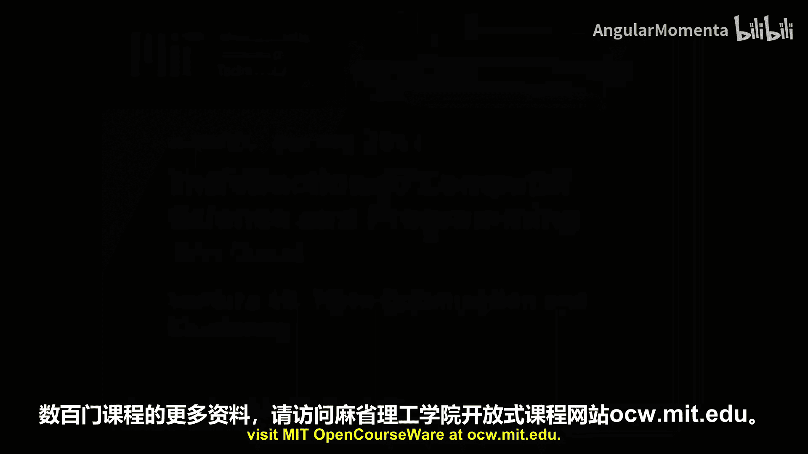

在本节课中，我们将要学习机器学习的核心概念，包括监督学习与无监督学习，并重点探讨聚类算法。

## 概述

上一节我们介绍了背包问题及其暴力求解算法。本节中，我们将离开复杂度的话题，转而探讨另一类优化问题——机器学习。机器学习是当今计算机科学中最激动人心的领域之一，它旨在构建能够从数据中学习并做出智能决策的程序。

## 暴力求解背包问题回顾

首先，我们回顾一下用于求解0/1背包问题的暴力算法代码。理解其基本思想有助于我们认识寻找全局最优解与局部最优解的区别。

该算法的核心是生成所有可能的物品组合（幂集），然后从中选出在重量限制下价值最高的组合。

以下是生成二进制字符串（用于表示是否选择某物品）的辅助函数：
```python
def dec_to_bin(n, num_digits):
    """返回长度为num_digits的二进制字符串，表示十进制数n。"""
    result = ''
    while n > 0:
        result = str(n % 2) + result
        n = n // 2
    if len(result) > num_digits:
        raise ValueError('位数不足')
    for i in range(num_digits - len(result)):
        result = '0' + result
    return result
```

接下来是生成所有物品子集（幂集）的函数：
```python
def gen_powerset(items):
    """生成物品列表的所有可能子集。"""
    powerset = []
    for i in range(0, 2**len(items)):
        bin_str = dec_to_bin(i, len(items))
        subset = []
        for j in range(len(items)):
            if bin_str[j] == '1':
                subset.append(items[j])
        powerset.append(subset)
    return powerset
```

最后是选择最优组合的主函数：
```python
def choose_best(powerset, max_weight, get_val, get_weight):
    """从幂集中选择在重量限制下总价值最高的子集。"""
    best_val = 0.0
    best_set = None
    for items in powerset:
        items_val = 0.0
        items_weight = 0.0
        for item in items:
            items_val += get_val(item)
            items_weight += get_weight(item)
        if items_weight <= max_weight and items_val > best_val:
            best_val = items_val
            best_set = items
    return (best_set, best_val)
```

运行此算法可以找到一个比贪心算法更优的解。这是因为贪心算法每一步只做局部最优选择，而无法保证达到全局最优。暴力算法通过检查所有可能性来寻找全局最优解。

然而，暴力算法的问题是计算成本过高。对于中等规模的问题，其运行时间可能长达数年。这引出了一个问题：是否存在更快的算法？从理论上讲，0/1背包问题的**最坏情况时间复杂度是固有的指数级别**。这意味着，任何保证找到最优解的算法，在最坏情况下都可能需要指数时间。

尽管如此，在实际应用中，存在一些技术（如动态规划、启发式算法）可以在合理时间内解决许多这类“固有指数”问题，或者找到接近最优的解。我们将在后续课程中探讨这些技术。

## 机器学习简介

现在，让我们转向今天的主要话题：机器学习。机器学习研究如何让计算机基于经验数据演化行为，其核心是**从数据中自动识别复杂模式并做出智能决策**。这个过程被称为**归纳推理**。

机器学习主要分为两大类：**监督学习**和**无监督学习**。

### 监督学习

在监督学习中，训练数据集中的每个样本都有一个**标签**，可以将其视为该样本的“答案”。

*   如果标签是离散的（例如“是/否”、“猫/狗”），我们称之为**分类问题**。
*   如果标签是连续值（例如房价、温度），我们称之为**回归问题**。我们之前学习的曲线拟合就是一个回归问题。

监督学习的目标是构建一个模型，能够根据训练集的统计特性，对未见过的数据做出预测。

让我们看一个分类问题的例子。假设我们有一些红点和蓝点，其特征是它们的 (x, y) 坐标，标签是颜色（红或蓝）。我们的任务是学习一个规则来区分红点和蓝点。

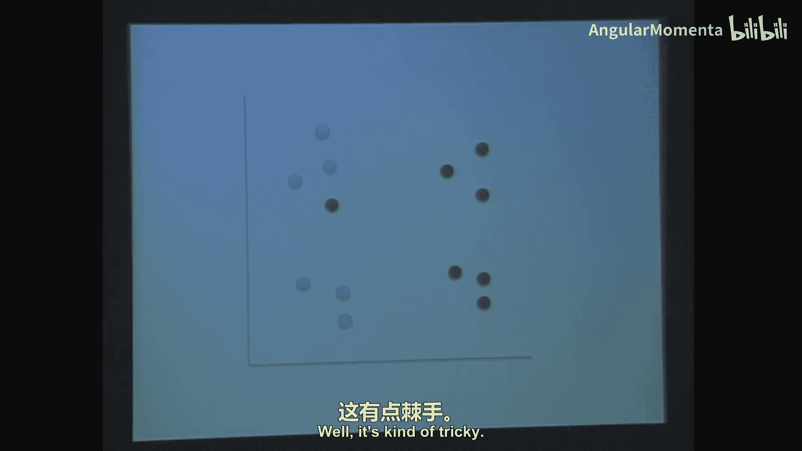

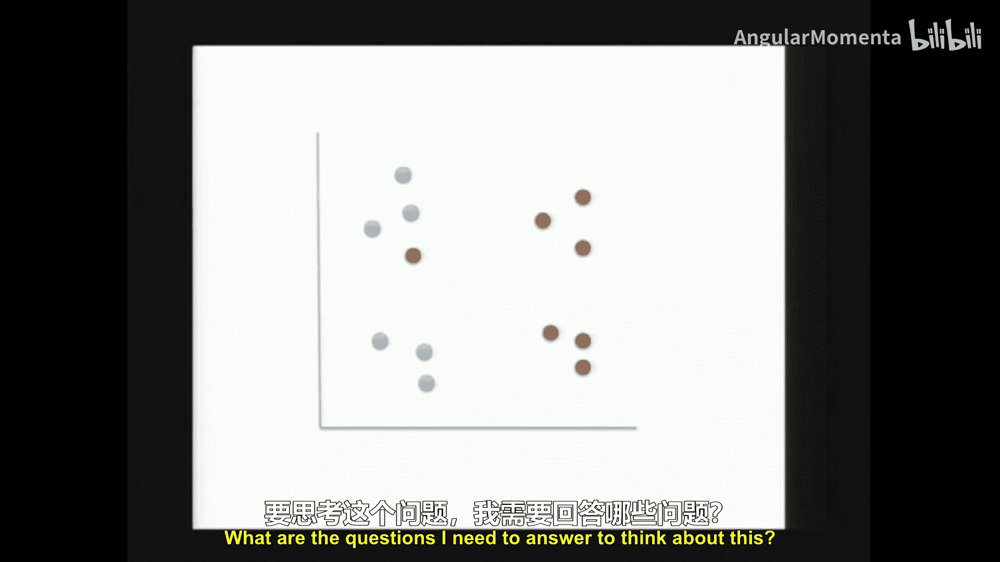

在构建模型时，我们需要考虑几个关键问题：
*   标签是否准确？现实数据中常有噪声或错误标签。
*   过去是否能代表未来？训练数据可能无法覆盖所有情况。
*   是否有足够的数据进行泛化？小训练集得出的结论不可靠。
*   应该使用哪些特征？特征选择至关重要。
*   拟合应该多紧密？这引出了**过拟合**问题。

例如，我们可以用一个复杂的形状（如三角形）完美分隔所有训练数据点，实现**零训练误差**。也可以用一条简单的直线来分隔，但可能会有个别点被错误分类（产生训练误差）。

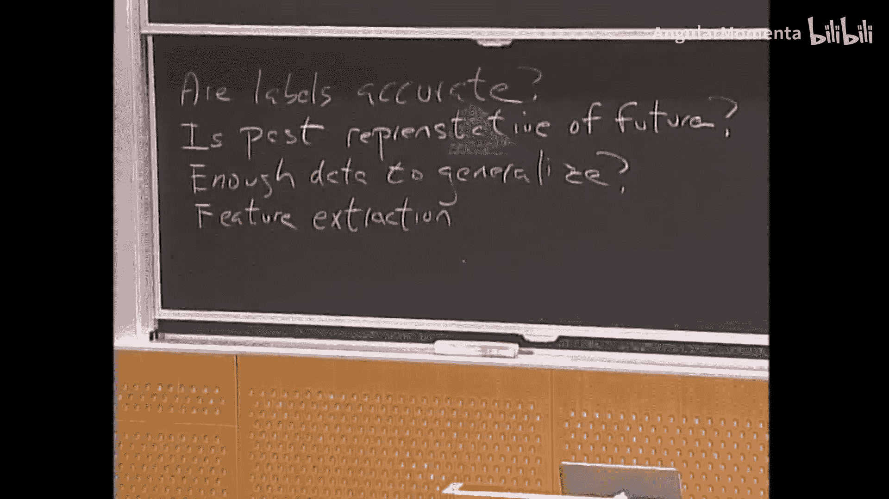


哪个模型更好？复杂模型虽然训练误差小，但可能因为过度贴合训练数据中的噪声或异常值，而导致**泛化能力差**，对未来数据的预测效果不佳。简单模型（直线）虽然训练时有误差，但可能更能捕捉数据的总体趋势，泛化能力更强。避免过拟合是机器学习的核心挑战之一。


### 无监督学习


与监督学习不同，无监督学习的数据没有标签。我们只有一堆数据点，不知道每个点属于哪一类。

无监督学习的目标是发现数据中隐藏的**规律或结构**。最主流的无监督学习方法是**聚类**。


聚类是将数据点组织成**组**的过程，使得**同一组内的成员彼此相似**，而**不同组之间的成员差异较大**。这里的关键在于如何定义“相似”。


例如，如果我们有一组人的身高和体重数据，我们可以根据不同的相似性度量进行聚类：
*   如果只关心身高，可能会分成“高”和“矮”两组。
*   如果只关心体重，可能会分成“重”和“轻”两组。
*   如果同时考虑身高和体重，可能会得到四个聚类。


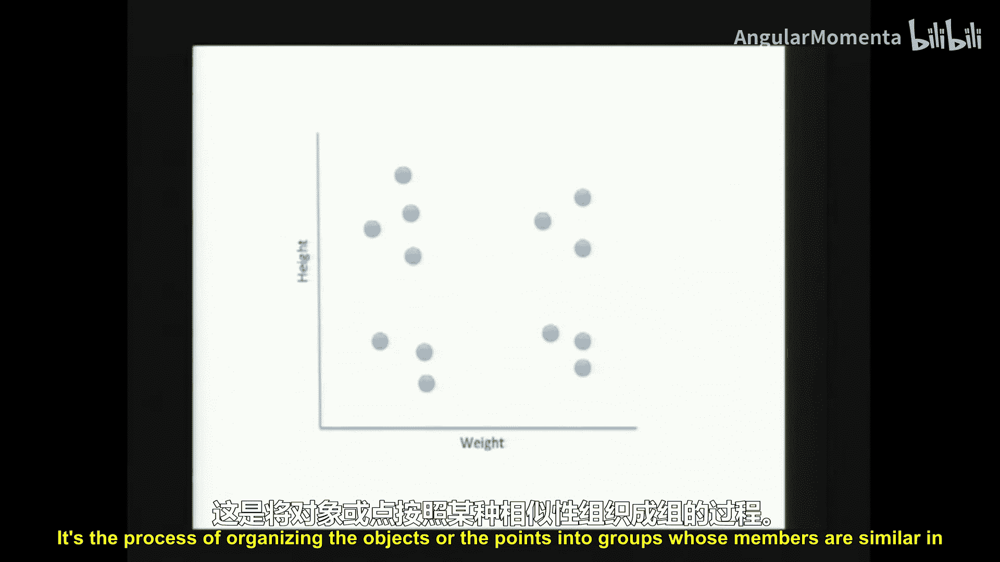

聚类应用广泛：
*   **市场营销**：发现具有相似行为的客户群体（如沃尔玛发现啤酒和尿布的购买关联）。
*   **推荐系统**：亚马逊根据购书习惯聚类用户和书籍，进行推荐。
*   **生物学**：根据特征对动植物或基因进行聚类分析。
*   **保险**：根据驾驶行为对司机进行聚类以评估风险。

## 聚类算法

我们可以将寻找最佳聚类形式化为一个优化问题。一个好的聚类应该满足：
1.  **组内差异小**：同一聚类内的点非常相似。
2.  **组间差异大**：不同聚类间的点非常不同。

我们可以用**方差**来衡量组内差异。对于聚类 *C*，其方差可定义为：
`方差(C) = Σ (x ∈ C) (均值(C) - x)²`
方差越小，说明组内点越相似。

然而，仅最小化“不良度”（如组内方差之和）会导致一个平凡解：**将每个点单独作为一个聚类**，此时每个聚类的方差为零，“不良度”最小，但这毫无意义。

因此，我们需要为优化问题添加**约束**，例如：
*   指定最大聚类数量 *K*。
*   指定聚类间的最小距离。

实际上，找到全局最优聚类通常是计算上不可行的。因此，实践中人们常用**贪心算法**。接下来我们介绍两种最常用的聚类算法：**层次聚类**和 **K均值聚类**。

### 层次聚类

层次聚类创建了一个聚类的层次结构（树状图）。它有两种主要策略：
*   **凝聚式**：从每个点作为一个聚类开始，逐步合并最相似的聚类。
*   **分裂式**：从所有点在一个聚类开始，逐步分裂。

我们重点看凝聚式层次聚类的步骤：
1.  开始时，每个数据点自成一个聚类。
2.  找到**最相似的两个聚类**，将它们合并。
3.  重复步骤2，直到所有点合并为一个聚类，或达到预设的聚类数量。

关键问题在于：如何定义两个**聚类**之间的距离（相似度）？这被称为**连接准则**。常用的有：
*   **单连接**：两个聚类中最近的两个点之间的距离。
*   **全连接**：两个聚类中最远的两个点之间的距离。
*   **平均连接**：两个聚类中所有点对之间距离的平均值。

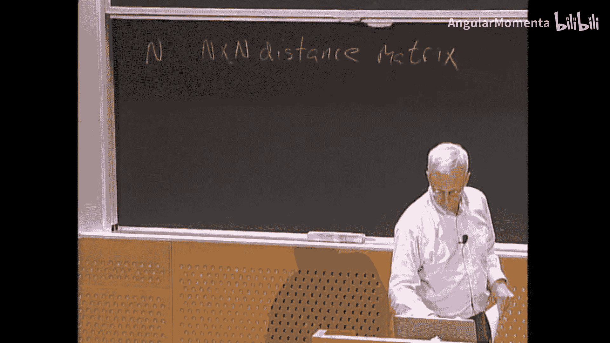

不同的连接准则会产生不同的聚类结果。

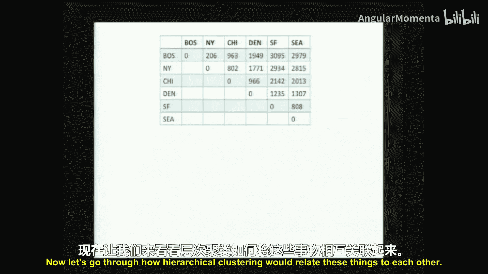


让我们看一个基于美国城市间飞行距离的例子。我们有一个距离矩阵：


应用层次聚类（单连接）的过程如下：


1.  每个城市自成一类。
2.  合并距离最近的波士顿和纽约。
3.  合并芝加哥到{波士顿，纽约}集群（单连接下，芝加哥到纽约的距离是最近距离）。
4.  合并旧金山和西雅图。
5.  此时，丹佛既可以合并到东部集群，也可以合并到西部集群，这取决于连接准则（单连接可能将其归入东部，平均连接可能将其归入西部）。
6.  最后合并所有集群。

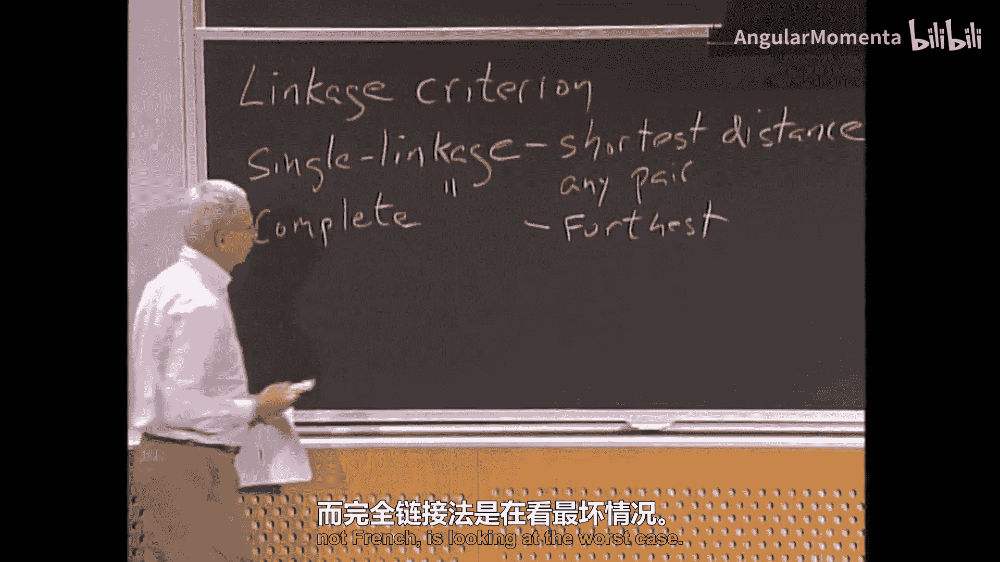

如果我们想在某个层级停止，比如得到3个聚类，我们可以查看树状图在相应高度的划分。

层次聚类的缺点是**计算量大**，复杂度至少是 *O(n²)*，其中 *n* 是数据点数量。同时，它每一步的合并是局部最优的，不保证得到全局最优的聚类结构。

### 特征空间与特征向量

无论是监督学习还是无监督学习，一个根本性的挑战是**特征选择**。我们如何表示一个数据对象？哪些属性（特征）是相关的？

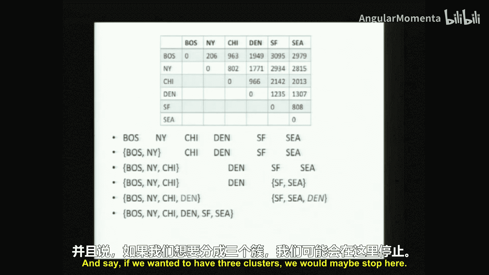

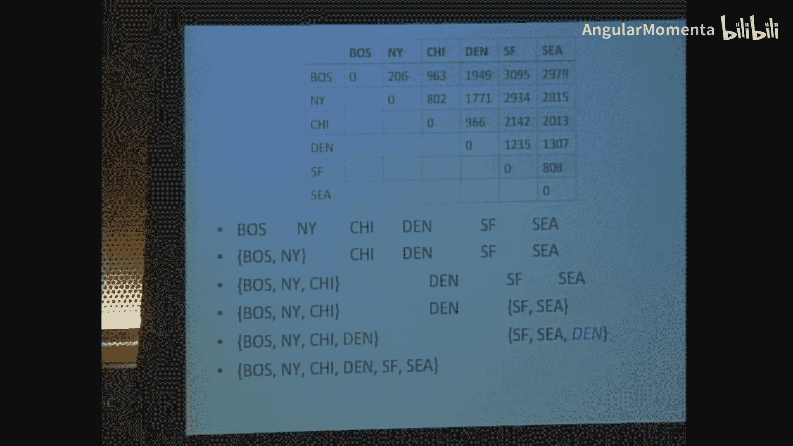

在之前的城市例子中，我们只用了“飞行距离”这一个特征。现实中，一个城市可以用**特征向量**来表示，例如：
`城市 = [经度， 纬度， 人口， 平均收入， ...]`

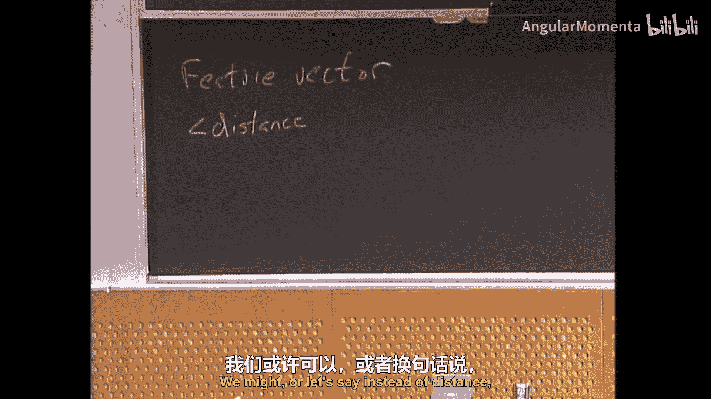

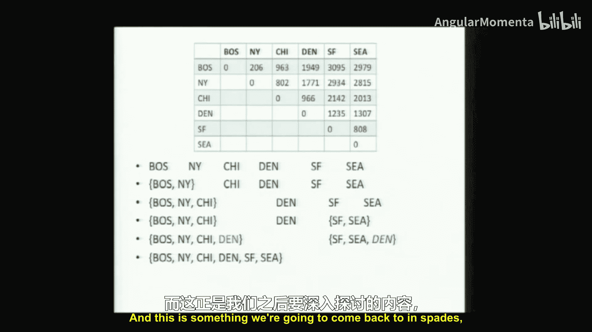

当特征向量包含多个不同尺度、不同意义的维度（如坐标和人口）时，如何定义点之间的“距离”或“相似度”就变得复杂。我们需要处理特征标准化、加权以及选择合适距离度量（如欧氏距离、曼哈顿距离）等问题。**构建能有效捕捉相似性的特征向量，是机器学习中最关键也最困难的任务之一。**

## 总结


本节课中我们一起学习了：
1.  回顾了暴力算法求解背包问题，理解了其保证全局最优但计算代价高的特点，以及问题固有的计算复杂性。
2.  介绍了机器学习的基本概念，包括其目标——从数据中学习模式并预测未来。
3.  区分了**监督学习**（有标签，包括分类和回归）和**无监督学习**（无标签，重点是发现结构）。
4.  深入探讨了**聚类**这一无监督学习任务，其目标是将相似对象分组。
5.  学习了**层次聚类**算法的步骤，以及不同的**连接准则**（单连接、全连接、平均连接）如何影响聚类结果。
6.  认识到**特征选择**和**特征向量构建**是机器学习成功的核心，需要将现实对象转化为具有合适度量的数学表示。


下节课，我们将继续探索机器学习，特别是如何在实际问题中处理多维特征向量，并介绍另一种流行的聚类算法——K均值聚类。