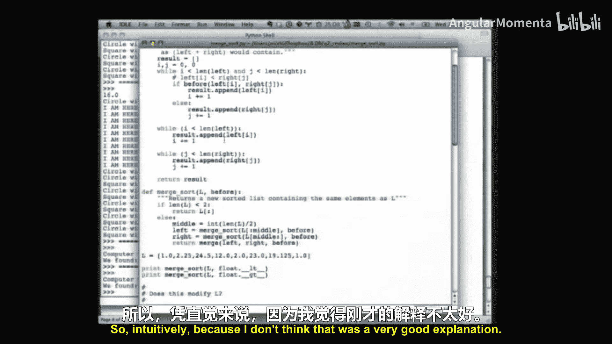
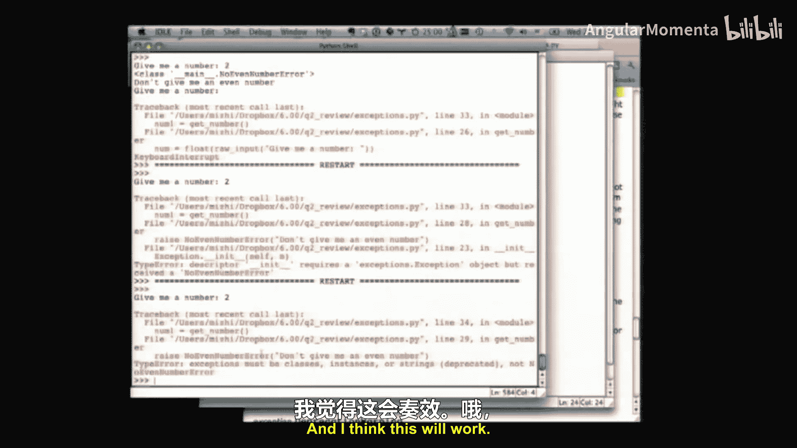

# 028：复习课


## 概述
在本节课中，我们将一起复习课程的核心概念，涵盖算法分析、数据结构、面向对象编程、概率模拟等多个主题。我们将通过解析练习题、解释关键概念和演示代码示例，帮助你巩固知识，为后续学习或考试做好准备。

## 核心概念复习

### 算法与复杂度分析
上一节我们介绍了课程的整体框架，本节中我们来看看算法分析中的几个核心概念。

**大O表示法**用于描述算法的渐近时间复杂度，它关注输入规模增长时，算法运行时间的增长趋势。

以下是常见的时间复杂度：
*   **O(1)**: 常数时间复杂度，例如哈希表查找。
*   **O(log n)**: 对数时间复杂度，例如二分查找。
*   **O(n)**: 线性时间复杂度，例如遍历列表。
*   **O(n log n)**: 线性对数时间复杂度，例如归并排序。
*   **O(n²)**: 平方时间复杂度，例如简单的嵌套循环。

**平摊分析**考虑一系列操作的整体成本，而非单次操作的最坏情况。例如，虽然排序列表的成本是 O(n log n)，但如果你需要进行大量（如一百万次）查找，先排序（O(n log n)）再使用二分查找（每次 O(log n)）的总成本，远低于进行一百万次线性查找（O(n) 每次）。

### 数据结构：哈希表
哈希表是一种高效的数据结构，它通过哈希函数将键映射到存储位置（或“桶”），从而实现平均情况下接近常数时间的查找、插入和删除操作。

在Python中，字典就是基于哈希表实现的。哈希函数 `hash(key)` 计算一个地址，用于快速定位值。

### 面向对象编程：多态与继承
多态允许我们使用统一的接口处理不同类型的对象。在类层次结构中，子类可以重写父类的方法。当调用一个方法时，Python会根据对象的实际类型来决定执行哪个版本的方法，调用者无需关心对象的具体类型。

例如，定义一个 `Shape` 基类，并让 `Rectangle` 和 `Circle` 继承它。两者都实现了 `area()` 方法。我们可以创建一个包含各种形状的列表，并统一调用它们的 `area()` 方法，而无需检查每个对象的类型。





```python
class Shape:
    def area(self):
        raise NotImplementedError

class Rectangle(Shape):
    def __init__(self, length, width):
        self.length = length
        self.width = width
    def area(self):
        return self.length * self.width
class Circle(Shape):
    def __init__(self, radius):
        self.radius = radius
    def area(self):
        return 3.14 * self.radius ** 2

shapes = [Rectangle(3, 4), Circle(5)]
for shape in shapes:
    print(shape.area())  # 多态：自动调用正确的area方法
```

### 概率与统计
**标准差**衡量数据分布的离散程度。**变异系数**是标准差与均值的比值，用于比较不同均值的数据集的相对离散程度。公式为：`CV = σ / μ`。

**置信区间**表示我们对一个统计估计值（如均值）的确定范围。对于一个正态分布，大约68%的数据落在均值的一个标准差内，95%落在两个标准差内，99.7%落在三个标准差内。

### 异常处理
异常处理机制允许程序在发生错误时进行优雅的恢复或报告，而不是直接崩溃。使用 `try...except` 块来捕获和处理异常。

```python
try:
    result = 10 / 0
except ZeroDivisionError as e:
    print(f"发生了除零错误: {e}")
    result = None  # 或进行其他处理
```

`pass` 是一个空语句，用作占位符。`continue` 用于跳过当前循环的剩余语句，直接进入下一次迭代。

### 生成器与 `yield`
`range()` 函数返回一个列表（在Python 2中）或一个范围对象（在Python 3中，行为类似生成器）。`xrange()`（Python 2）或 `range()`（Python 3）返回一个生成器，它惰性地产生值，节省内存，特别适用于大范围迭代。

`yield` 关键字用于定义生成器函数，它每次产生一个值并暂停，下次从暂停处继续。

```python
def my_xrange(n):
    i = 0
    while i < n:
        yield i
        i += 1

for num in my_xrange(5):
    print(num)  # 输出 0, 1, 2, 3, 4
```



### 蒙特卡洛方法
蒙特卡洛方法通过重复随机采样来获得数值结果。例如，通过随机投点来估算圆周率 π 的值。

## 总结
本节课中我们一起复习了计算机科学编程导论中的多个核心主题。我们回顾了算法复杂度分析（大O表示法、平摊分析）、哈希表的工作原理、面向对象编程中的多态与继承、关键的概率统计概念（标准差、变异系数、置信区间）、Python中的异常处理机制、生成器与 `yield` 语句，以及蒙特卡洛模拟的基本思想。理解这些概念对于编写高效、健壮和可维护的程序至关重要。