# 029：聚类分析进阶 🧮


在本节课中，我们将深入学习聚类分析，重点关注特征向量的处理、特征缩放的重要性，以及如何将聚类算法应用于更复杂的数据集。我们将通过具体的例子，如根据牙齿数据聚类哺乳动物和根据社会经济数据聚类美国各县，来理解这些概念的实际应用。

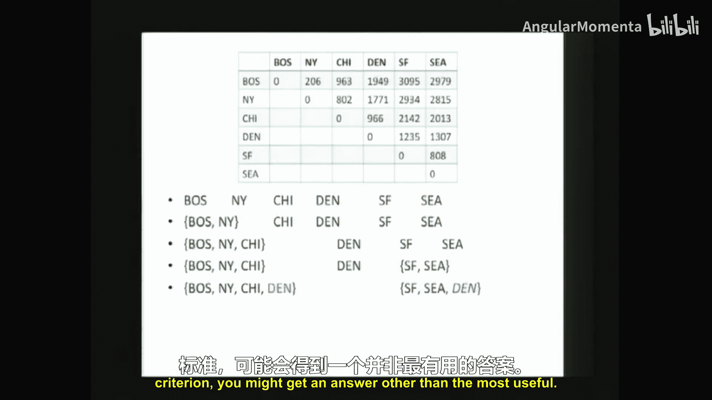

---

## 特征向量与距离度量

上一节我们介绍了基于简单距离（如城市间直线距离）的聚类。本节中我们来看看当特征变得更复杂时，我们该如何处理。


当我们需要用多个特征（如距离、温度）来描述一个对象（如城市）时，我们使用**特征向量**。特征向量是一个数字列表，每个数字代表一个特征的值。

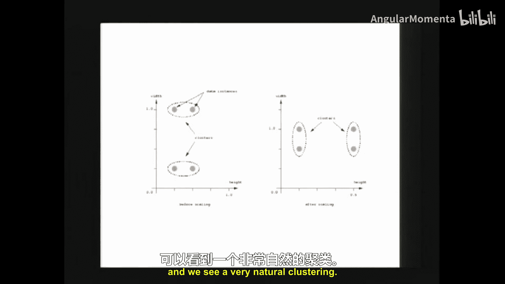

为了比较两个特征向量，我们需要一个距离度量。一个常见的方法是计算它们之间的欧几里得距离。公式如下：

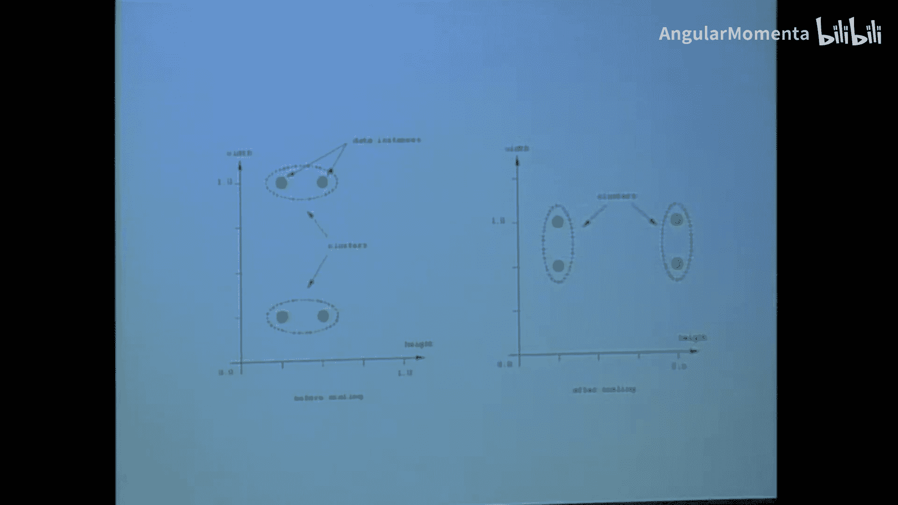

`distance = sqrt((x1 - x2)^2 + (y1 - y2)^2 + ...)`

然而，如果特征向量的元素单位不同（例如，距离以英里计，温度以摄氏度计），直接比较会产生误导。一个20英里的距离差异和一个20度的温度差异在物理意义和重要性上完全不同。

因此，我们必须考虑如何**缩放**特征向量中的各个元素，使它们具有可比性。

---

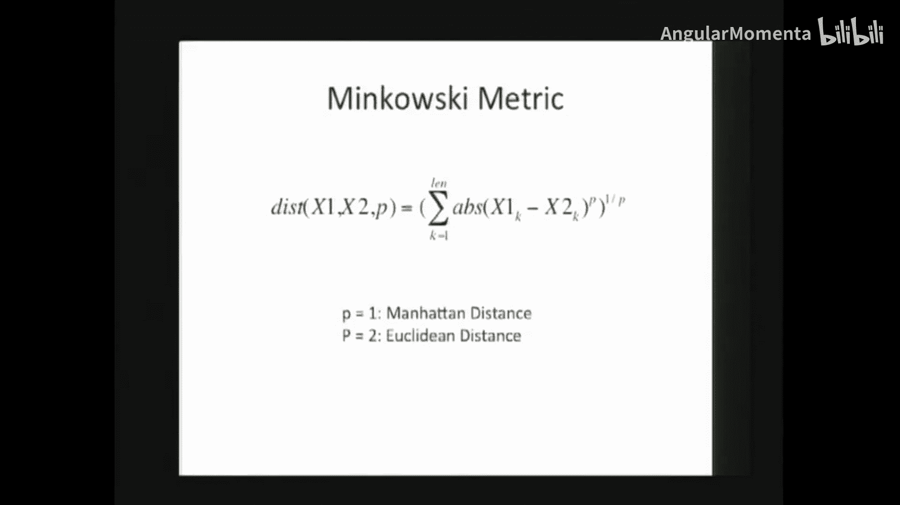

## 特征缩放的重要性

特征缩放，或称归一化，对聚类结果有巨大影响。即使特征单位相同，动态范围（数值变化的幅度）不同也会导致聚类偏向于动态范围更大的特征。

请看以下示例：假设我们根据身高（英寸）和体重（磅）来聚类人群。如果不进行缩放，身高的数值范围（例如从50到80英寸）可能远大于体重的数值范围（例如从100到200磅）。在计算距离时，身高的差异会主导结果，导致聚类主要依据身高进行划分。

如果我们对数据进行缩放，使身高和体重都归一化到0到1的范围内，那么两个特征在距离计算中就会具有同等的重要性，从而可能得到完全不同的、更合理的聚类结果。

**核心要点**：在进行任何机器学习（包括聚类）时，**特征选择和缩放至关重要**。这需要结合领域知识来思考我们试图学习什么，以及学习的目标是什么。

---

## 距离度量：闵可夫斯基度量


如何进行缩放和距离计算？通常使用**闵可夫斯基度量**的一个变体。两个向量 **x1** 和 **x2** 之间的距离公式为：

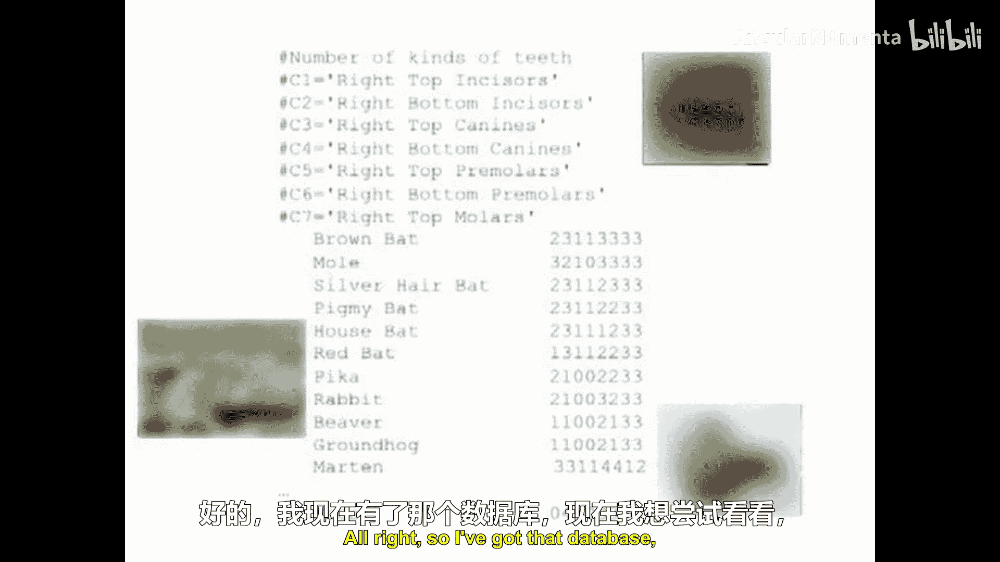

`distance = ( Σ |x1_i - x2_i|^p )^(1/p)`


其中，`p` 是一个参数。
*   当 `p=2` 时，这就是我们熟悉的**欧几里得距离**（直线距离）。
*   当 `p=1` 时，这被称为**曼哈顿距离**（网格距离）。想象在曼哈顿街区行走，你只能沿街道垂直或水平移动，不能走对角线。

曼哈顿距离在某些领域（如基因序列比较）中很常用。

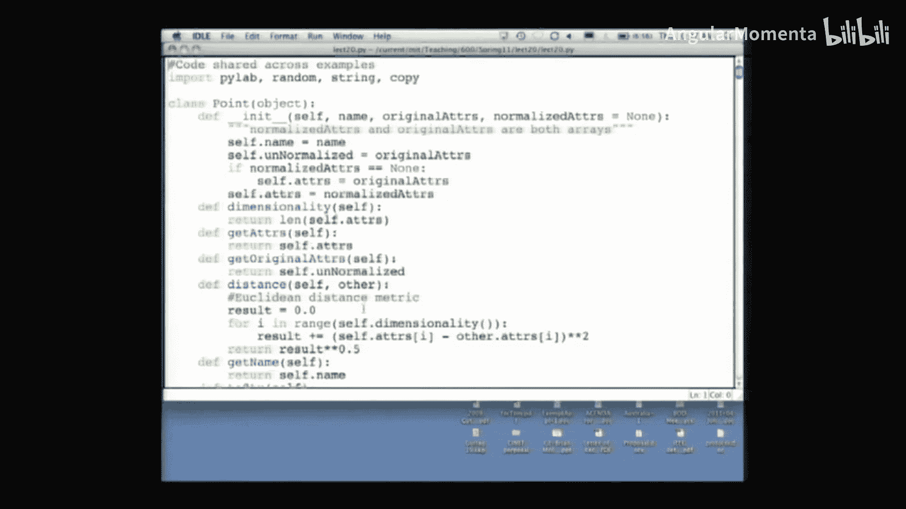


---

## 处理分类数据

到目前为止，我们讨论的都是数值型、可比较的特征。但现实中，我们经常需要处理**名义分类数据**，即具有名称而非数字的类别（例如眼睛颜色：蓝色、棕色、绿色）。

处理这类数据，我们需要将其转换为数字，并定义这些数字之间的关系。这同样需要领域知识。例如：
*   我们可以将“蓝色”编码为0，“绿色”编码为0.5，“棕色”编码为1。这隐含地表示了我们认为蓝色和绿色比蓝色和棕色更相似。

一旦转换为数字，我们又回到了**缩放（归一化）** 的问题。通常，我们会将所有特征缩放到相同的范围（如0到1之间），以便比较。但请注意，有时某些特征可能更重要，需要赋予更大的权重。

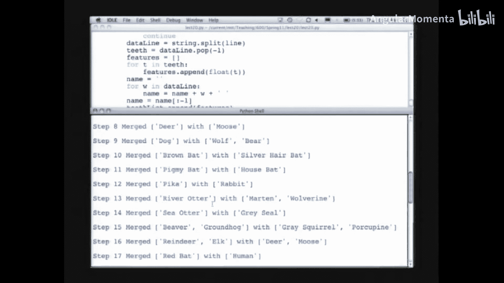

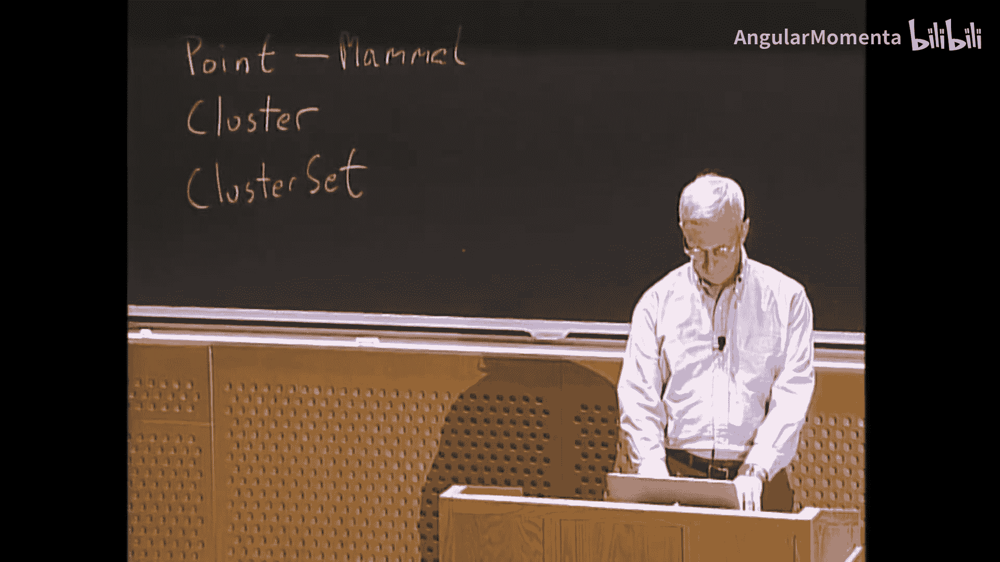

---

## 实例分析：根据牙齿数据聚类哺乳动物 🦷

为了让概念更具体，我们来看一个实例：根据牙齿数据聚类哺乳动物。目标是推断它们的食性（草食、肉食等），但我们不直接使用“食性”这个标签数据。

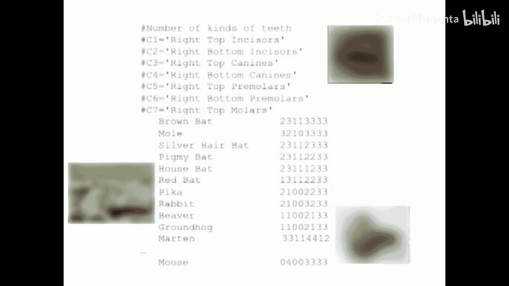

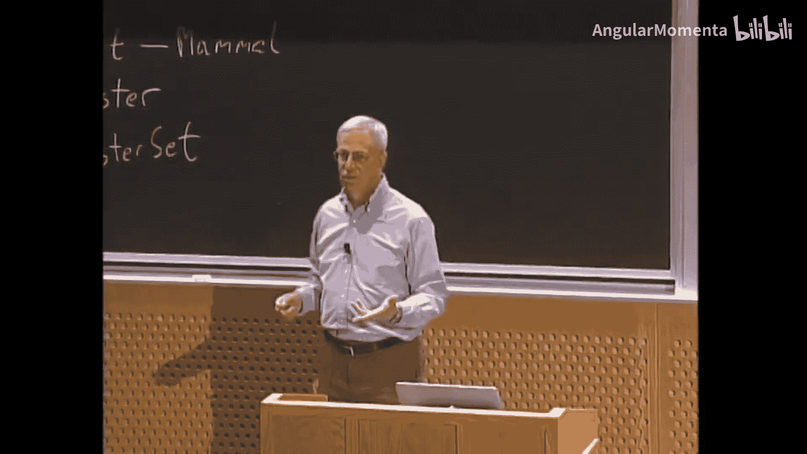

假设是：动物的牙齿特征（各类牙齿的数量）与其食性相关。我们有一个数据库，记录了多种哺乳动物不同类型牙齿的数量。


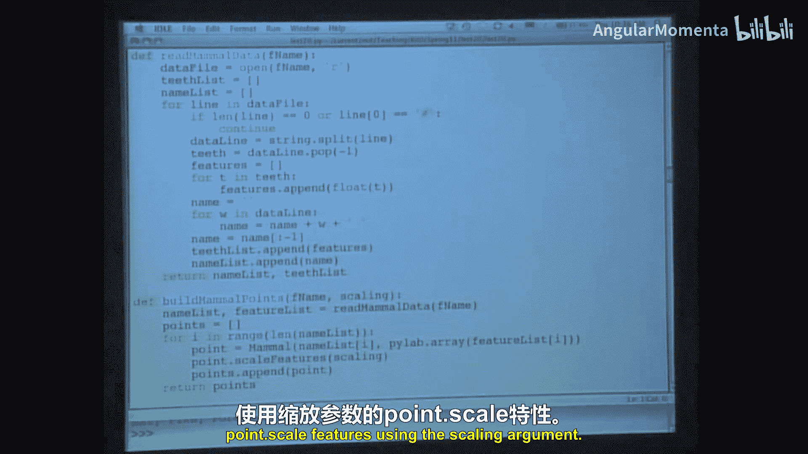

我们使用层次聚类算法。代码结构设计如下：
*   **Point类**：表示待聚类对象的基础抽象，包含名称、原始特征向量等。
*   **Cluster类**：表示一个簇（一组点），包含计算簇间距离（单连接、全连接、平均连接）等方法。
*   **ClusterSet类**：表示一组簇，包含合并最近簇等操作。
*   **Mammal类**：`Point`的子类，专门表示哺乳动物及其牙齿特征向量。

**首次尝试（无缩放）**：直接使用原始牙齿数量进行聚类，结果不理想。例如，人类（杂食偏肉食）与一些典型草食动物被分在了一起。这是因为不同种类牙齿的数量范围差异很大，某些数量多的牙齿类型主导了距离计算。

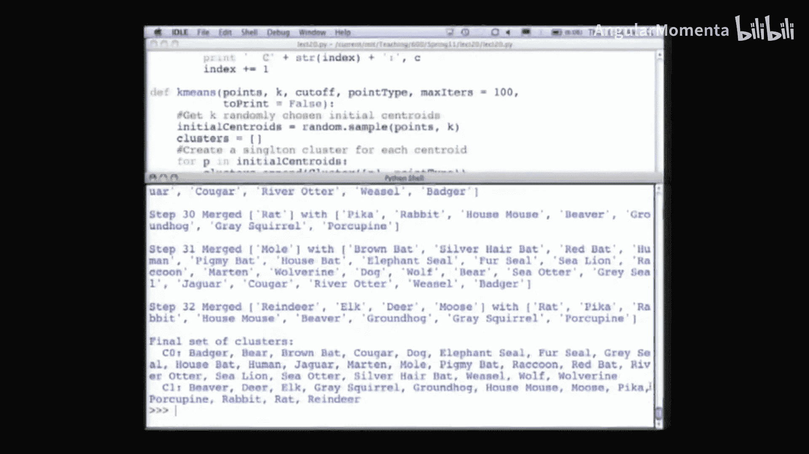

**第二次尝试（使用缩放）**：采用“1/最大值”的缩放方法，将每种牙齿的数量除以其在所有样本中的最大值，从而将所有特征归一化到相近的范围。

以下是缩放的核心代码逻辑：
```python
def scale_features(features, scaling_method):
    if scaling_method == 'one_over_max':
        max_vals = [max(feature_i for feature_i in feature_vector) for feature_vector in all_vectors]
        scaled_features = [f / max_val for f, max_val in zip(features, max_vals)]
        return scaled_features
    elif scaling_method == 'identity':
        return features  # 不进行缩放
```
**结果**：缩放后，聚类结果发生了显著变化，产生了看起来更合理的分组。一组可能对应草食动物，另一组可能对应肉食动物。尽管我们没有使用食性标签，但通过聚类，我们能够根据牙齿结构推断出可能存在不同的食性群体。

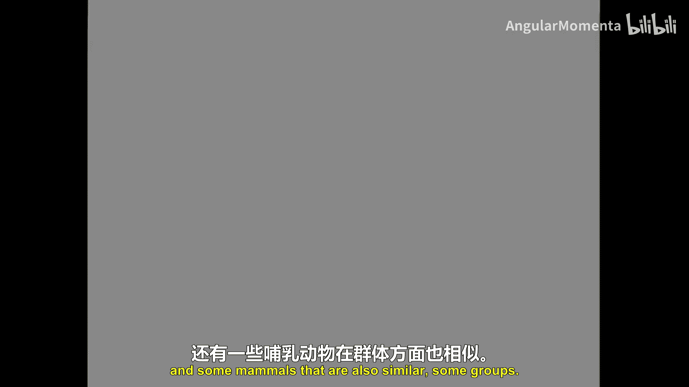

**结论**：这个例子清晰地表明，**特征缩放至关重要**，并且我们可以通过无监督学习（聚类）从结构数据中发现潜在的模式和分组。

---

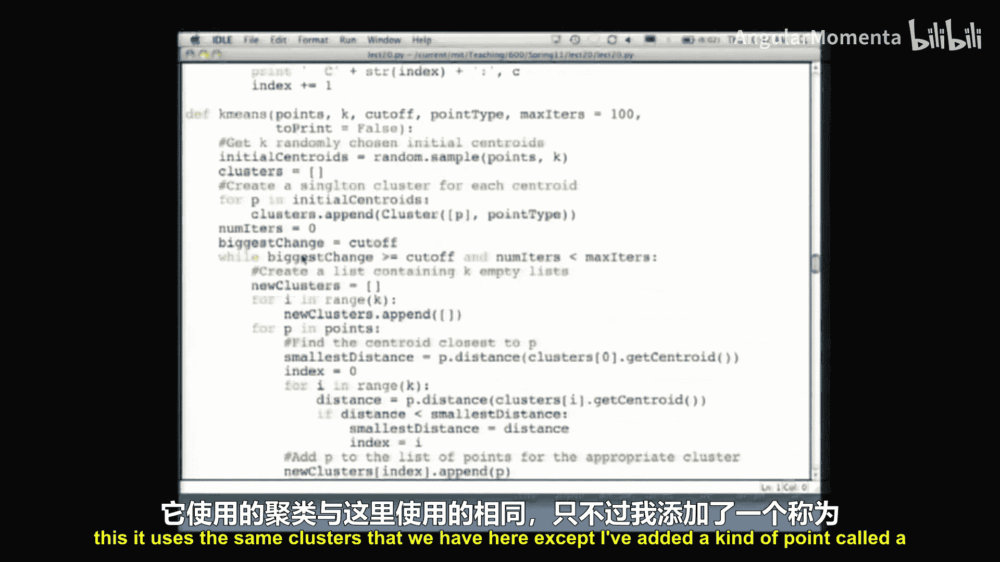

## 实例分析：聚类美国各县 🗺️


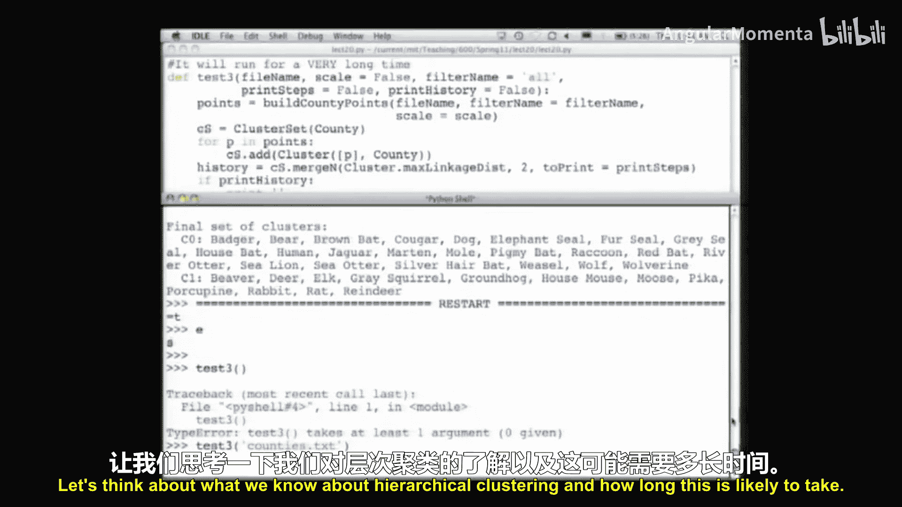

现在，我们来看一个更丰富的数据集：美国所有县的社会经济数据（如房屋均价、贫困率、人口密度、65岁以上人口比例等）。

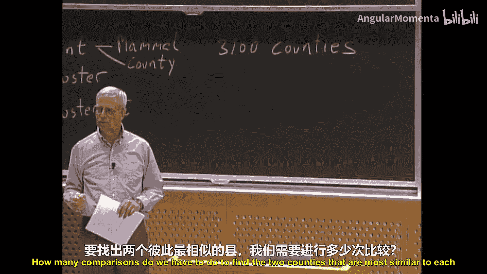

**挑战**：各特征的尺度差异极大（百分比是0-100，人口密度可能上万），缩放问题更加突出。

**首次尝试（无缩放，仅新英格兰地区县）**：使用层次聚类。结果非常奇怪：马萨诸塞州的米德尔塞克斯县独自成一类，其他所有县成另一类。原因是该县的人口数量比其他县多出约60万，这个巨大的数值差异在没有缩放的情况下淹没了所有其他特征（教育水平、房价等）的影响。

**第二次尝试（启用缩放）**：我们编写代码自动计算每个特征在所有县中的最大值，并进行“1/最大值”缩放。
```python
# 在读取数据时动态计算最大值并缩放
max_vals = [0] * num_features
for county in counties:
    features = read_features(county)
    for i, val in enumerate(features):
        if val > max_vals[i]:
            max_vals[i] = val

scaled_counties = []
for county in counties:
    features = read_features(county)
    scaled_features = [f / max_vals[i] for i, f in enumerate(features)]
    scaled_counties.append(Point(scaled_features, county.name))
```
**结果**：缩放后，米德尔塞克斯县与其他一些县（如康涅狄格州的费尔菲尔德县、哈特福德县等）聚在了一起，得到了一个不同的、可能更有意义的聚类结果。聚类结果的好坏取决于我们想通过聚类学习什么。

**效率问题**：层次聚类对于大数据集（如全美3100个县）计算量过大，因为其复杂度约为O(n²)。我们需要更高效的算法。

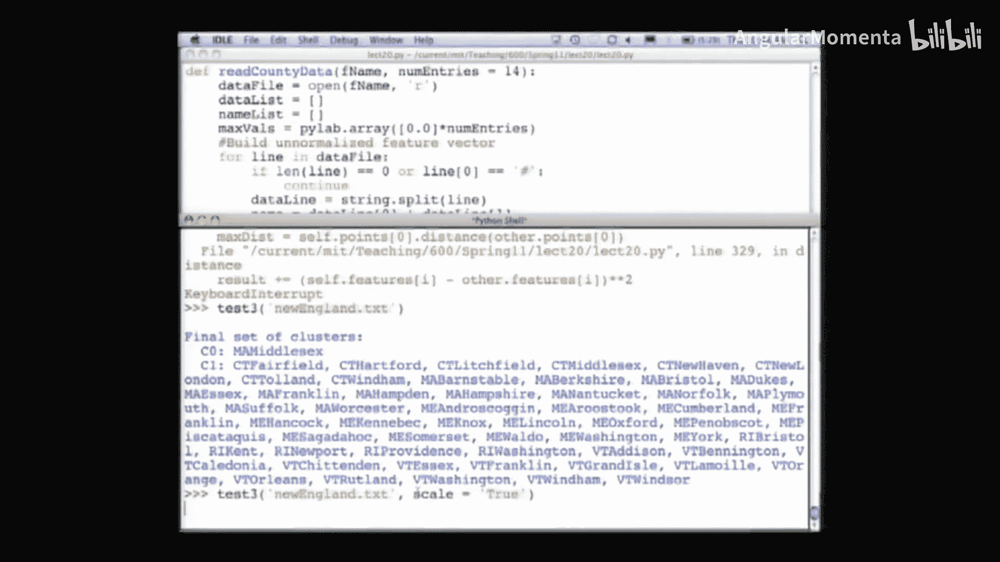

---

## 引入K均值聚类 ⚡

为了处理像全美各县这样的大数据集，我们引入**K均值聚类**算法。它的主要优点是速度快，复杂度大致为O(k * n * i)，其中k是簇数，n是点数，i是迭代次数，通常远小于n。

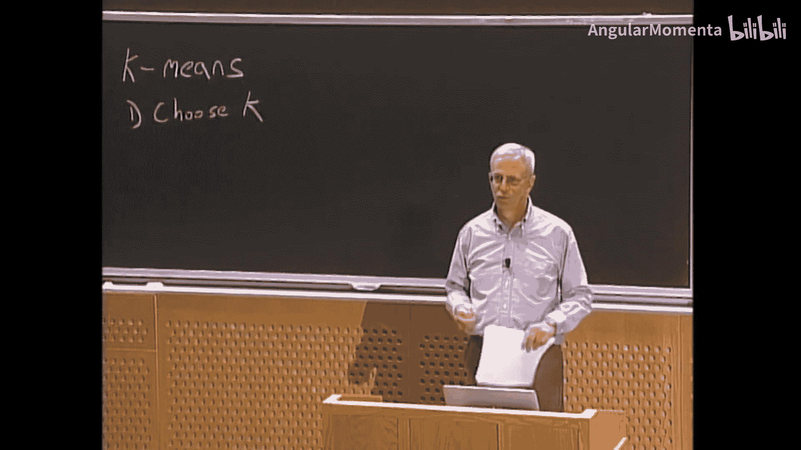

K均值的工作步骤如下：

1.  **选择K**：确定最终想要的簇的数量。
2.  **初始化质心**：随机选择K个数据点作为初始质心。
3.  **分配点到最近质心**：将每个数据点分配给距离它最近的质心，形成K个初始簇。
4.  **重新计算质心**：对于每个簇，计算其所有点的平均值（或找到最接近平均值的点），作为新的质心。
5.  **重新分配点**：根据新的质心，将所有点重新分配到最近的质心。
6.  **迭代**：重复步骤4和5，直到质心的变化或点所属簇的变化非常小（即收敛）。

K均值的关键点：
*   **需要预先指定K**：这是该算法的一个主要参数，选择不当可能影响结果。
*   **随机初始化**：由于初始质心随机选择，多次运行可能得到不同结果。
*   **高效**：每次迭代的计算量与数据点数量成线性关系，适合大数据集。

在下节课中，我们将详细查看K均值聚类的代码，并将其应用于美国各县数据集，探索我们能从中学到什么。

---


本节课中我们一起学习了聚类分析中的高级主题。我们认识到将对象表示为特征向量的必要性，并深入探讨了特征缩放对聚类结果的决定性影响。通过哺乳动物牙齿和美国各县的实例，我们看到了如何在实际问题中应用聚类，以及如何处理不同尺度和类型的数据。最后，我们介绍了更高效的K均值聚类算法，为处理大规模数据集提供了工具。理解这些概念对于有效地从数据中提取信息至关重要。