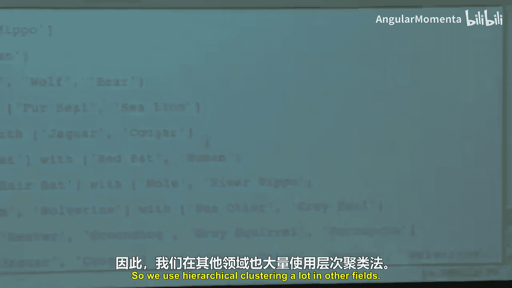
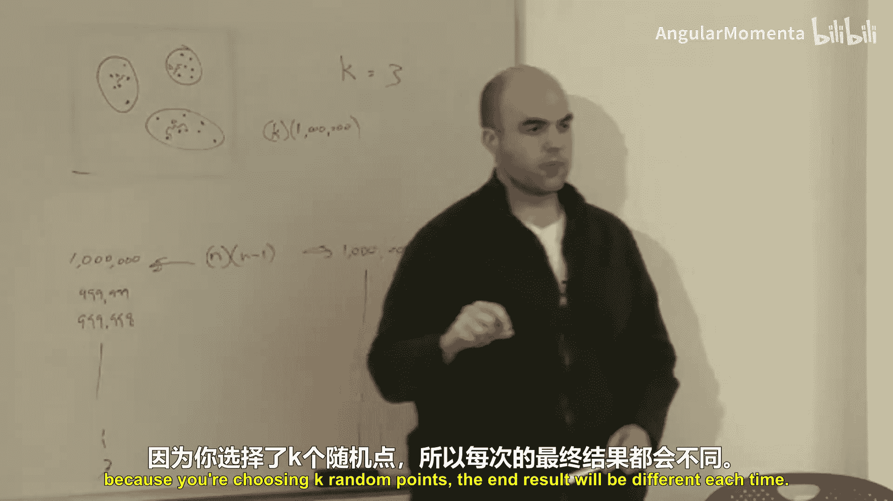
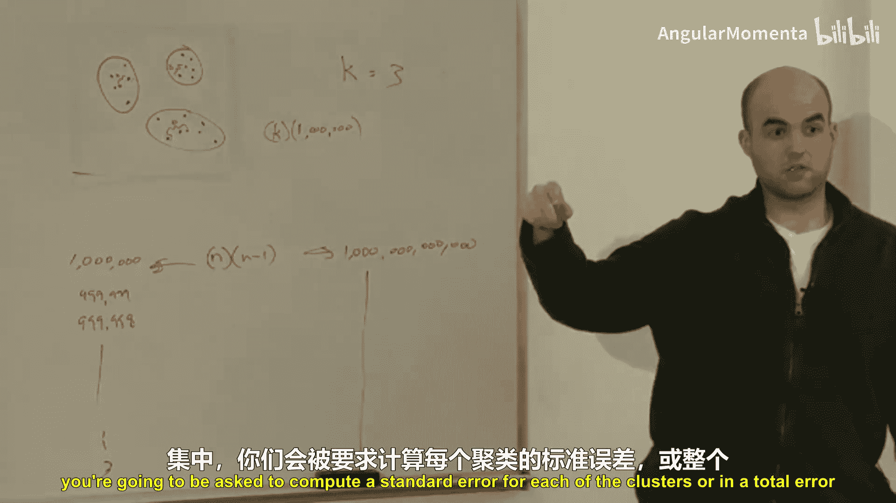
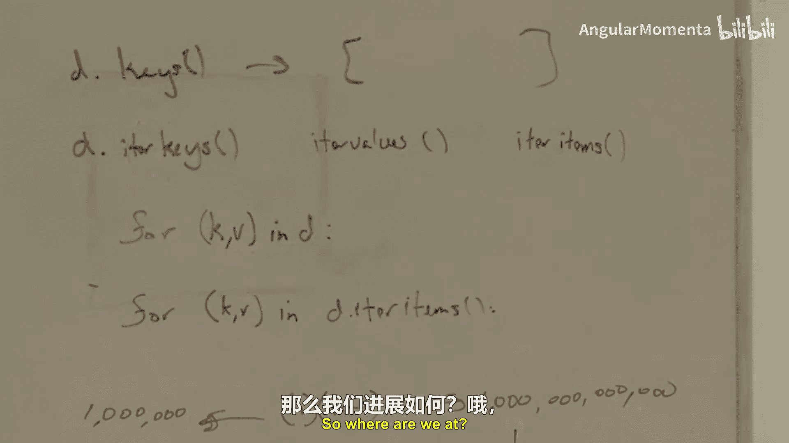
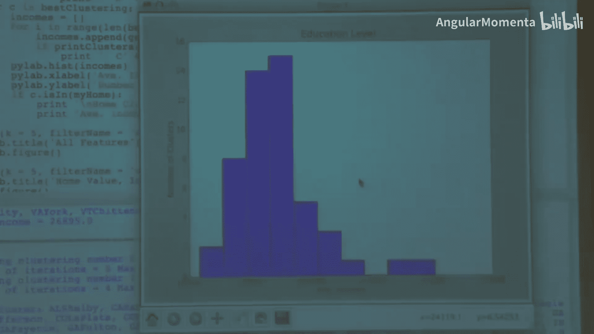

# 030：聚类算法详解 🧮


在本节课中，我们将深入学习两种核心的聚类算法：层次聚类和K均值聚类。我们将探讨它们的工作原理、实现步骤、各自的优缺点以及适用场景。

## 层次聚类 🌳


上一节我们提到了数据分组的概念，本节中我们来看看层次聚类的具体步骤。层次聚类是一种自底向上的方法，它通过逐步合并最相似的簇来构建一个树状的聚类结构。


以下是层次聚类的基本步骤：

1.  **初始化**：将数据集中的每个数据点视为一个独立的簇。
2.  **计算与合并**：计算所有簇对之间的距离，找到距离最近的两个簇。
3.  **更新**：将这两个簇合并为一个新的簇。
4.  **迭代**：重复步骤2和3，直到达到预设的簇数量或满足其他停止条件。

在代码实现中，`ClusterSet` 类管理簇的集合，其核心方法是 `mergeN`。该方法循环调用 `mergeOne`，直到簇的数量达到目标值。


```python
while len(self.members) > numClusters:
    mergedPair = self.mergeOne(distMetric)
```


`mergeOne` 方法负责找到当前簇集合中距离最近的两个簇（通过 `findClosest` 方法），然后调用 `mergeClusters` 将它们合并。

每个 `Cluster` 对象包含一组点和一个质心。质心是簇中所有点的平均位置，计算公式为：
`centroid = (sum(points)) / len(points)`

簇间距离的计算有多种方式（即连接标准）：
*   **单连接**：两个簇中任意两点之间的最小距离。
*   **全连接**：两个簇中任意两点之间的最大距离。
*   **平均连接**：两个簇中所有点对之间的平均距离。



层次聚类是确定性的，对于同一数据集，每次运行都会得到相同的结果。它的一个主要优点是能够展示数据在不同层次上的分组情况。

## K均值聚类 🔢

上一节我们介绍了层次聚类，本节中我们来看看另一种截然不同的方法——K均值聚类。K均值是一种基于质心的迭代算法，其目标是将数据点划分到K个簇中，使得每个点到其所属簇质心的距离平方和最小。

以下是K均值聚类的基本步骤：



1.  **初始化**：随机选择K个数据点作为初始质心。
2.  **分配点**：对于数据集中的每个点，计算其到所有质心的距离，并将其分配到距离最近的质心所在的簇。
3.  **更新质心**：对于每个簇，重新计算其质心（即该簇所有点的平均值）。
4.  **迭代**：重复步骤2和3，直到质心的移动变化小于某个阈值，或达到最大迭代次数。



在代码中，主要循环如下：


```python
while biggestChange > cutoff and iterations < maxIters:
    newClusters = []
    for p in points:
        # 寻找距离p最近的质心对应的簇索引 smallestIndex
        newClusters[smallestIndex].addPoint(p)
    biggestChange = 0.0
    for i in range(len(clusters)):
        change = clusters[i].update(newClusters[i].points())
        biggestChange = max(biggestChange, change)
    iterations += 1
```


与层次聚类相比，K均值的主要优势在于计算效率高，尤其适用于大型数据集。然而，它也存在一些缺点：
*   **结果非确定性**：由于初始质心是随机选择的，多次运行可能得到不同的结果。因此，通常需要运行多次并选择最佳结果（例如，选择簇内误差平方和最小的那次）。
*   **需要预先指定K**：用户必须事先确定簇的数量K。
*   **对异常值敏感**：质心的计算受极端值影响较大。
*   **可能收敛到局部最优**：算法可能无法找到全局最优的聚类方案。

评估聚类质量的一个常见指标是**簇的相干性**，即所有点与其所属簇质心之间的最大距离。另一种更全面的指标是**总误差**，即所有点到其质心距离的平方和。


## 特征选择与缩放 🎛️


聚类结果很大程度上依赖于所使用的数据特征。在之前的例子中，`County` 类通过“过滤器”来选择用于计算距离的特征子集（例如，只使用财富相关特征，或只使用教育相关特征）。使用不同的特征集会导致完全不同的聚类结果。

此外，特征的尺度差异也会影响聚类。例如，如果“收入”的数值范围是数万，而“人口”的数值范围是数百万，那么“人口”特征将在距离计算中占据主导地位。为了解决这个问题，需要对特征进行**缩放**（或标准化），例如使用“1/最大值”方法将每个特征的值缩放到[0, 1]区间。


## 生成器与 `yield` 关键字 ⚙️

在讨论代码效率时，我们提到了生成器。与 `range()` 一次性生成所有数字的列表不同，`xrange()`（在Python 3中 `range()` 的行为类似 `xrange`）返回一个生成器对象。生成器使用 `yield` 关键字，它可以逐个产生值，而不需要一次性在内存中创建整个序列。

```python
def my_xrange(n):
    i = 0
    while i < n:
        yield i
        i += 1
```


当函数执行到 `yield` 语句时，它会返回一个值并暂停，下次请求值时再从暂停处继续执行。这与 `return` 完全不同，`return` 会直接终止函数。在字典中，`.iterkeys()`, `.itervalues()`, `.iteritems()` 方法（在Python 3中为 `.keys()`, `.values()`, `.items()`，它们返回视图对象，行为类似生成器）也采用了类似的思想，以提高遍历效率。



---



本节课中我们一起学习了层次聚类和K均值聚类这两种核心的无监督学习算法。我们了解了它们从原理到代码的实现过程，比较了各自的优缺点和适用场景。同时，我们也探讨了影响聚类结果的关键因素，如特征选择和缩放，并介绍了 `yield` 和生成器这一提升代码效率的重要概念。掌握这些知识将为你在实际数据分析中应用聚类技术打下坚实的基础。