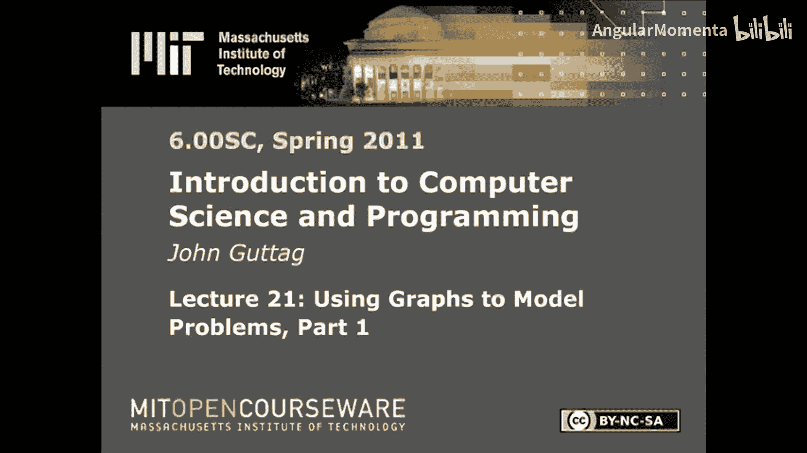
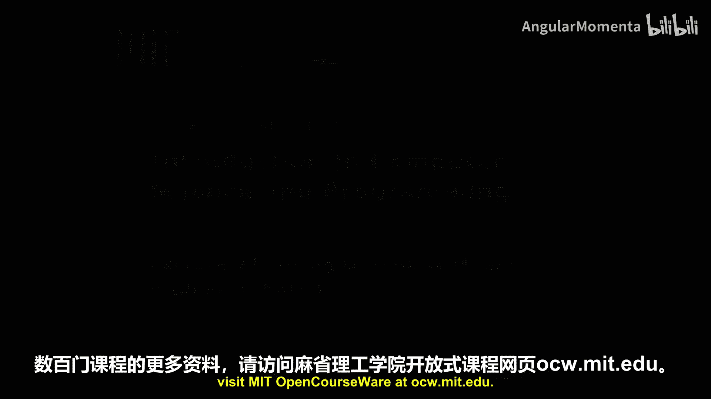
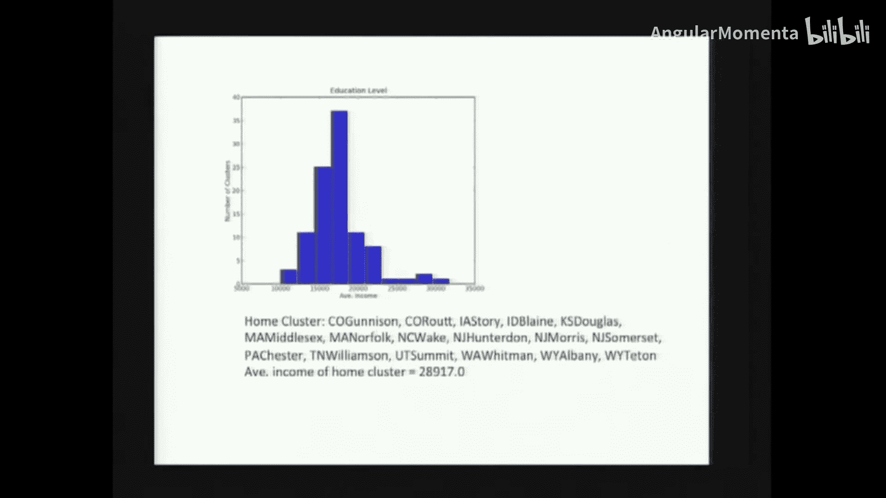
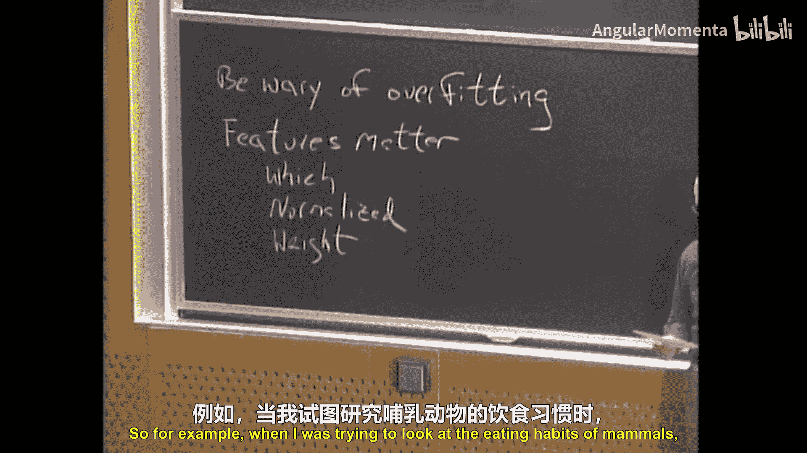
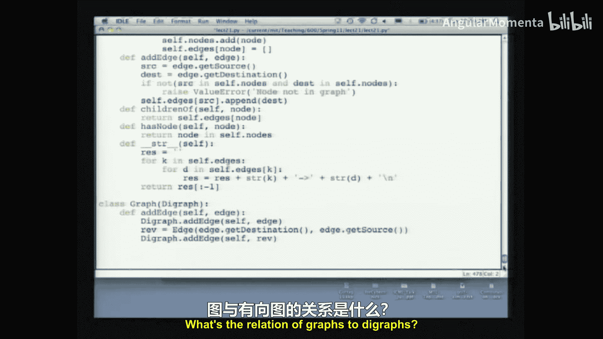
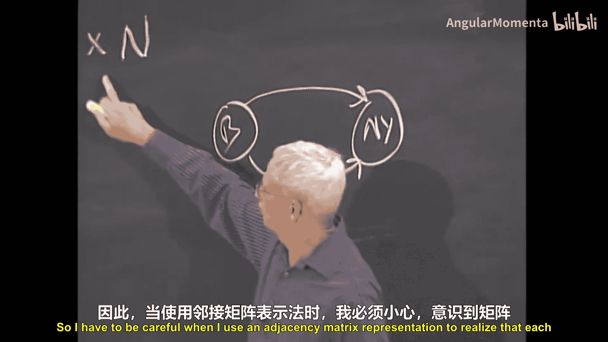
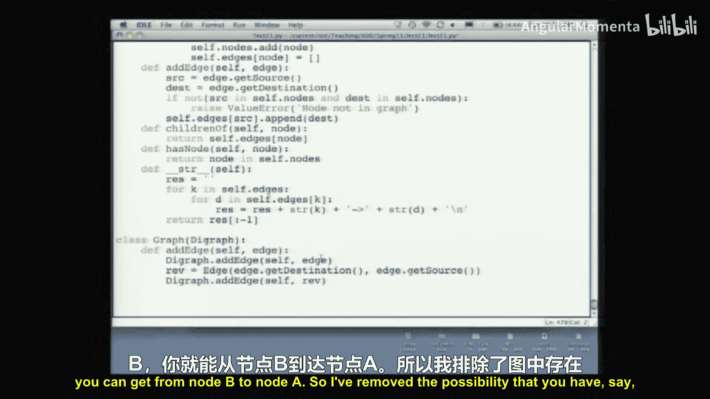

# 031：K均值聚类与图论基础 🧠





## 概述
在本节课中，我们将从K均值聚类的伪代码过渡到实际代码实现，并探讨其在真实数据集（如美国各县数据）上的应用。随后，我们将引入一种新的建模方式——图论，并学习其基本概念和代码实现。

---

## 从伪代码到真实代码 🔄

上一节我们介绍了K均值聚类的核心思想。本节中，我们来看看如何将其转化为可运行的Python代码。

以下代码实现了K均值聚类算法：

```python
def kMeans(points, k, cutoff, pointType, maxIterations=100, printProgress=False):
    # 1. 随机选择k个初始质心
    initialCentroids = random.sample(points, k)
    clusters = []
    for p in initialCentroids:
        clusters.append(Cluster([p], pointType))
    biggestChange = cutoff
    numIterations = 0

    # 2. 迭代直到质心变化小于阈值
    while biggestChange >= cutoff and numIterations < maxIterations:
        newClusters = []
        for i in range(k):
            newClusters.append([])
        for p in points:
            # 找到距离p最近的质心
            smallestDistance = p.distance(clusters[0].getCentroid())
            index = 0
            for i in range(k):
                distance = p.distance(clusters[i].getCentroid())
                if distance < smallestDistance:
                    smallestDistance = distance
                    index = i
            # 将p添加到对应的新簇中
            newClusters[index].append(p)
        # 3. 更新簇并计算最大变化
        biggestChange = 0.0
        for i in range(k):
            change = clusters[i].update(newClusters[i])
            biggestChange = max(biggestChange, change)
        numIterations += 1
    # 4. 计算并返回统计信息
    maxDiameter = 0.0
    for c in clusters:
        if c.diameter() > maxDiameter:
            maxDiameter = c.diameter()
    return clusters, maxDiameter, numIterations
```

代码的核心步骤包括：
1.  **随机初始化**：从数据点中随机选择k个点作为初始质心。
2.  **分配点**：将每个数据点分配到距离其最近的质心所在的簇。
3.  **更新质心**：根据新分配的簇重新计算质心。
4.  **迭代**：重复步骤2和3，直到质心的变化小于预设的阈值 `cutoff`。

由于初始质心是随机选择的，单次运行的结果可能不稳定。因此，通常的做法是进行多次试验（`numTrials`），并选择效果最好的一次（例如，簇内最大直径最小的那次）。

---

## 聚类美国各县数据 🗺️

现在，让我们将K均值算法应用于一个更大的数据集：美国各县数据。这里的关键在于特征的选择和标准化。

我们为`County`类添加了“过滤器”功能，以便灵活地选择用于聚类的特征。例如，我们可以只关注教育水平或性别比例。



```python
class County(Point):
    # 类变量，用于设置特征过滤器
    attrFilter = None

    def __init__(self, name, originalAttrs, normalizedAttrs = None):
        Point.__init__(self, name, originalAttrs, normalizedAttrs)
        # 如果是第一次创建County实例，则根据过滤器设置距离计算方式
        if County.attrFilter is None:
            County.attrFilter = list(range(len(originalAttrs)))
        self.filteredAttrs = []
        filterSet = County.attrFilter
        for i in range(len(originalAttrs)):
            if i in filterSet:
                self.filteredAttrs.append(self.attrs[i])
    # 重写距离计算方法，只考虑过滤后的特征
    def distanceFrom(self, other):
        result = 0.0
        for i in range(len(self.filteredAttrs)):
            result += (self.filteredAttrs[i] - other.filteredAttrs[i])**2
        return result**0.5
```

通过设置不同的过滤器，我们可以进行实验。例如，仅使用“教育水平”特征进行聚类后，绘制各簇的平均收入，会发现其并非均匀分布，而是呈现出明显的相关性。这表明教育水平与收入之间存在关联，这正是无监督学习希望发现的“知识”。

**核心要点**：特征的选择至关重要。它们必须与希望探索的问题相关，并且通常需要进行标准化处理，以避免量纲差异带来的偏差。

---

## 引入图论：一种强大的建模工具 🕸️



我们的机器学习之旅是关于如何使用计算来理解世界信息的一部分，其核心在于找到有用的抽象方法来建立模型。现在，我们来看另一种极其流行的建模方式：图论。

**图**由**节点**（或称顶点）和连接节点的**边**组成。
*   如果边有方向（如单行道），则称为**有向图**。
*   如果边上带有权重（如距离、成本），则称为**加权图**。

图的首次著名应用是欧拉在1735年解决的**柯尼斯堡七桥问题**。欧拉的关键洞察是将地图抽象为图（用点代表陆地，线代表桥），从而将问题大大简化，并证明了一次走遍七桥且不重复是不可能的。

如今，图论模型应用广泛：
*   **交通网络**：用加权有向图表示公路或航线，可以解决最短路径、最低成本等问题。
*   **万维网**：用有向图表示网页间的链接关系，是搜索引擎排名算法的基础。
*   **生物学**：用于建模蛋白质相互作用网络、基因表达网络。
*   **流行病学**：用于模拟疾病传播路径。

---

## 图的代码实现 💻

让我们看看如何用Python类来实现图。以下是关键类的结构：

```python
class Node:
    def __init__(self, name):
        self.name = name

class Edge:
    def __init__(self, src, dest, weight=1):
        self.src = src
        self.dest = dest
        self.weight = weight

class Digraph:
    def __init__(self):
        self.nodes = []
        self.edges = {}
    def addNode(self, node):
        # 防止添加重复节点
        if node in self.nodes:
            raise ValueError('Duplicate node')
        else:
            self.nodes.append(node)
            self.edges[node] = []
    def addEdge(self, edge):
        src = edge.src
        dest = edge.dest
        if not (src in self.nodes and dest in self.nodes):
            raise ValueError('Node not in graph')
        self.edges[src].append(edge)
    def childrenOf(self, node):
        return [edge.dest for edge in self.edges[node]]

class Graph(Digraph):
    def addEdge(self, edge):
        Digraph.addEdge(self, edge)
        # 为无向图添加反向边
        rev = Edge(edge.dest, edge.src, edge.weight)
        Digraph.addEdge(self, rev)
```



**设计选择**：
1.  **继承关系**：`Graph` 继承自 `Digraph`。因为无向图可以看作是一种特殊的有向图（每条边都是双向的），而有向图的功能更通用。
2.  **数据结构**：我们使用了**邻接表**来存储图。即，为每个节点维护一个列表，存储所有从该节点出发的边。这对于边比较稀疏的图来说更节省空间。另一种常见选择是邻接矩阵（一个N×N的矩阵），适用于边非常稠密的情况。

---



## 总结 🎯

本节课中我们一起学习了：
1.  **K均值聚类的代码实现**：理解了如何将迭代过程转化为代码，并通过多次试验选择最佳结果。
2.  **特征工程的重要性**：在聚类县数据时，我们看到了特征选择、标准化和相关性分析的关键作用。
3.  **图论基础**：认识了图（节点和边）作为建模复杂关系网络的强大工具，了解了其历史渊源和广泛应用。
4.  **图的面向对象实现**：学习了如何使用`Node`、`Edge`、`Digraph`和`Graph`类来构建和表示图结构，并理解了邻接表与邻接矩阵的区别。




下节课，我们将探索如何使用图来解决一些经典的计算问题。