# 032：图算法与动态编程 🧠

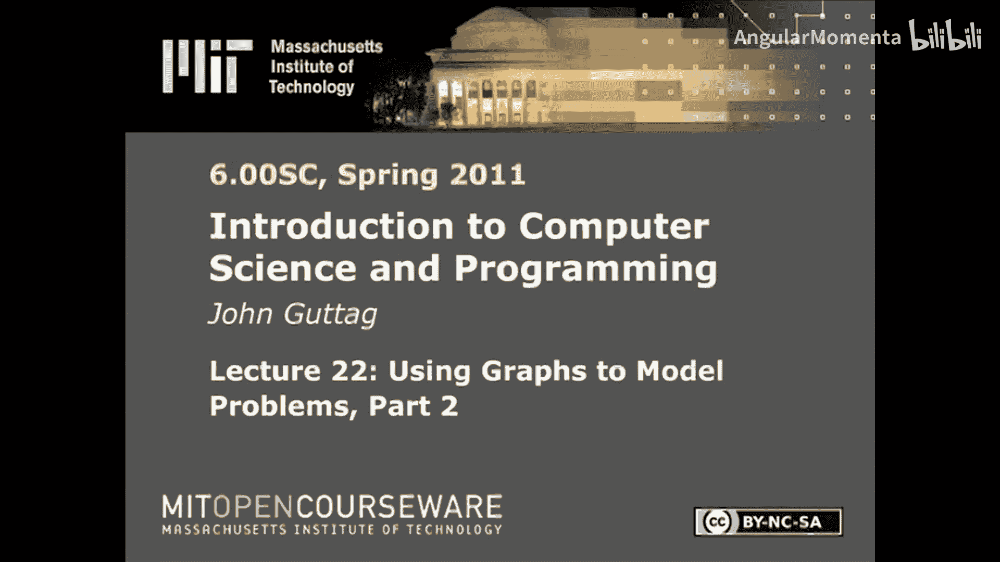

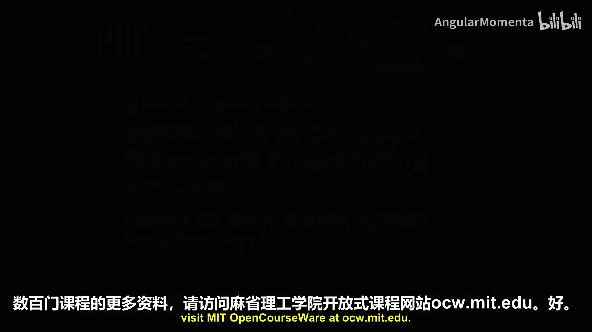

在本节课中，我们将学习图论中的几个核心问题，并重点介绍一种强大的优化技术——动态编程。我们将通过具体的例子和代码，理解如何高效地解决看似复杂的图搜索问题。

---

## 测试图与有向图

首先，我们通过一个简单的测试来观察图（Graph）与有向图（Digraph）的区别。我们构建一些节点，添加几条边，然后打印图结构。

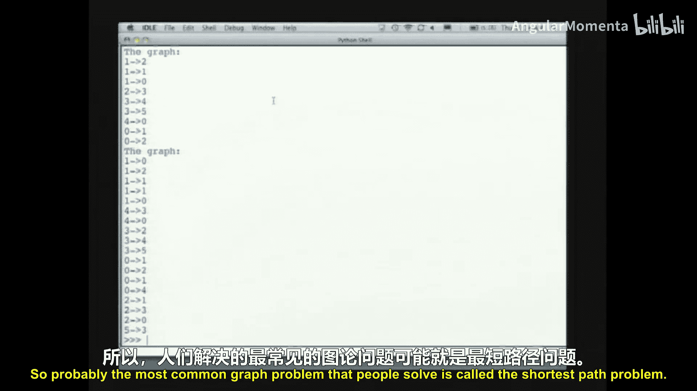


以下是测试代码的核心部分：

```python
# 构建节点和边
for name in range(10):
    # 创建节点
    # 添加边
    pass
# 打印图
print(graph)
```

运行测试后，我们发现图与有向图的输出结果不同。在图（无向图）中，边是双向的；而在有向图中，边具有方向性。这个简单的测试验证了我们数据结构的基本功能。

---

## 常见的图论问题

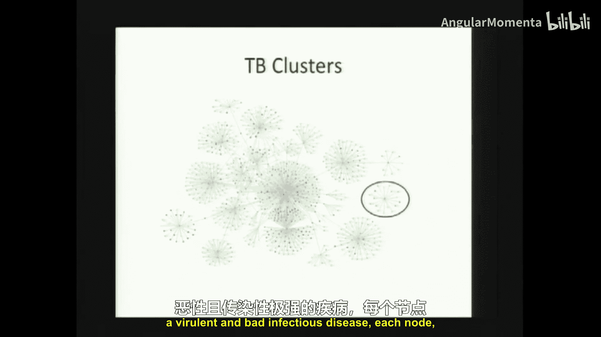

上一节我们介绍了图的基本结构，本节中我们来看看几个在图论中非常常见且重要的问题。

以下是几个核心的图论问题：

1.  **最短路径问题**：对于给定的一对节点 N1 和 N2，找到连接这两个节点的最短边序列。
    *   **公式**：`最短路径 = min(所有从 N1 到 N2 的路径长度)`
2.  **最短加权路径问题**：这是最短路径问题的扩展，目标不是边数最少，而是路径上所有边的权重总和最小。
    *   **公式**：`最短加权路径 = min(Σ 路径上每条边的权重)`
3.  **团问题**：寻找一个节点集合，使得集合中任意两个节点之间都存在路径相连。
4.  **最小割问题**：给定一个图和两组节点，找到需要移除的最少数量的边，使得这两组节点之间不再连通。

这些问题在实际中有着广泛的应用，例如地图导航（最短加权路径）、社交网络分析（团、最短路径）和网络可靠性设计（最小割）。

---

## 实例分析：疾病传播网络

为了更具体地理解图论的应用，我们来看一个真实的案例——美国疾病控制与预防中心（CDC）在2003年对肺结核爆发的研究。

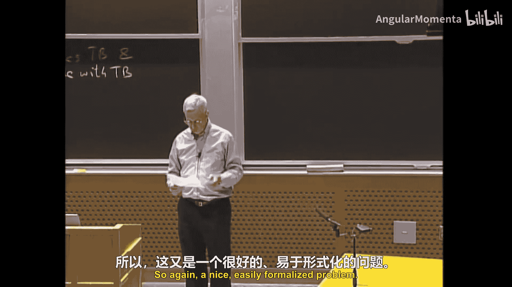

在这个模型中：
*   **节点** 代表人，并根据其肺结核状态（活跃、暴露阳性、阴性、未检测）用不同颜色标记。
*   **边** 代表人与人之间的联系，并且带有权重，表示联系的紧密程度（如密切接触、偶然接触）。

基于这个图模型，我们可以提出并形式化一些关键问题：

*   **寻找零号病人**：是否存在一个节点（病人），其本身患有肺结核，并且与图中所有其他肺结核患者节点都相连？这可以帮助判断疾病是否由单一源头引入社区。
*   **优化疫苗分配**：如果疫苗有限，应该为哪些未感染者接种，以最有效地阻断疾病传播？这可以形式化为一个**最小割问题**：将已感染者视为一组节点，未感染者视为另一组，找到连接这两组的关键边（即最薄弱环节），并对这些边附近的未感染者进行接种。

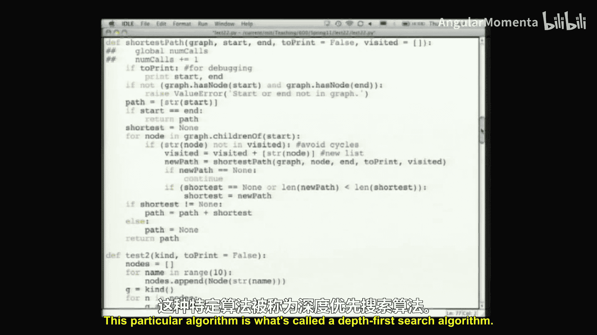

这个案例展示了如何将复杂的现实世界问题抽象为图模型，并利用图算法来寻找解决方案。

---

## 深度优先搜索与最短路径


现在，让我们聚焦于**最短路径问题**，并探讨一种基础的解决方法。我们将以社交网络（如Facebook）中的“六度分隔”理论为例。

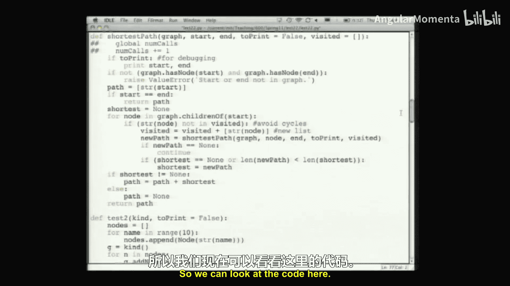

假设我们想知道从自己到某个名人（如Donald Trump）之间最短的“朋友链”有多长。这等价于在朋友关系图中寻找最短路径。

我们使用**深度优先搜索**算法来解决这个问题。DFS会从起点开始，沿着一条路径尽可能深地探索，直到无法继续或找到目标，然后回溯并尝试其他路径。

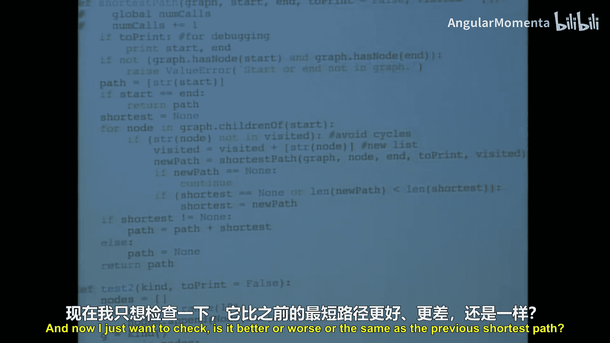

以下是递归实现的DFS最短路径算法的核心代码：

```python
def shortest_path(graph, start, end, visited=[]):
    if start == end:
        return [start]  # 递归基础情况：已到达终点
    shortest = None
    for node in graph.children_of(start):
        if node not in visited:  # 避免循环
            new_visited = visited + [node]  # 创建新的已访问列表，避免副作用
            new_path = shortest_path(graph, node, end, new_visited)
            if new_path is not None:
                if shortest is None or len(new_path) < len(shortest):
                    shortest = [start] + new_path
    return shortest
```

该算法虽然正确，但在处理复杂图时效率很低。因为它会反复求解相同的子问题（例如，从某个中间节点到终点的最短路径），导致大量的重复计算。

---


## 动态编程：消除重复计算

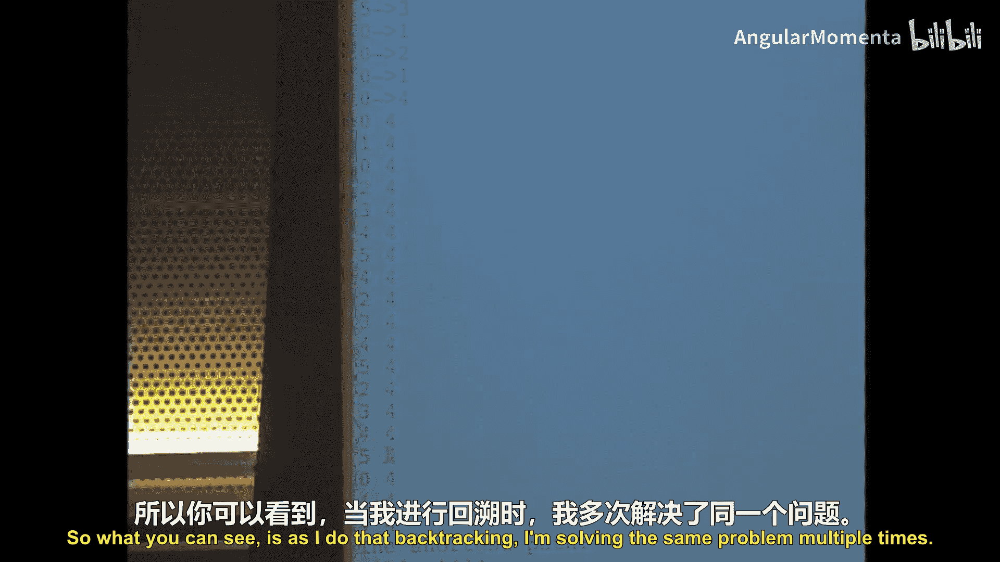

上一节我们看到了深度优先搜索的效率问题，本节中我们来看看如何通过**动态编程**技术来大幅提升性能。

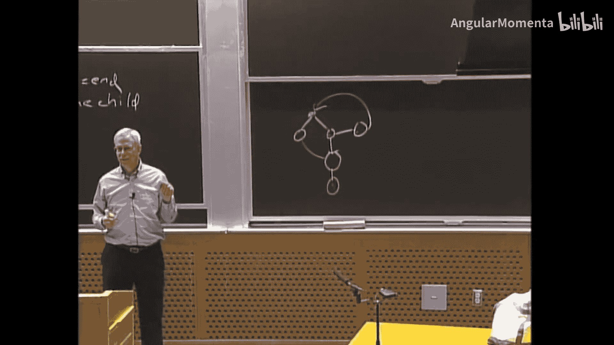

动态编程的核心思想是**记忆化**：存储已经计算过的子问题的解，当再次需要时直接查找，避免重复计算。

我们对之前的`shortest_path`函数进行改造，加入一个备忘录`memo`（字典）：

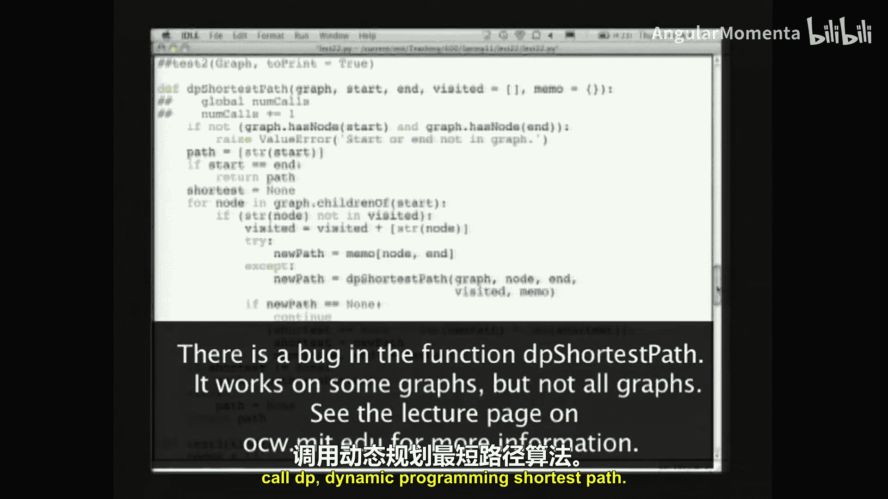

```python
def dp_shortest_path(graph, start, end, visited=[], memo={}):
    if start == end:
        return [start]
    # 首先检查备忘录中是否已有从start到end的解
    try:
        return memo[(start, end)]
    except KeyError:
        pass  # 没找到，继续计算
    shortest = None
    for node in graph.children_of(start):
        if node not in visited:
            new_visited = visited + [node]
            new_path = dp_shortest_path(graph, node, end, new_visited, memo)
            if new_path is not None:
                if shortest is None or len(new_path) < len(shortest):
                    shortest = [start] + new_path
    # 将计算结果存入备忘录
    memo[(start, end)] = shortest
    return shortest
```

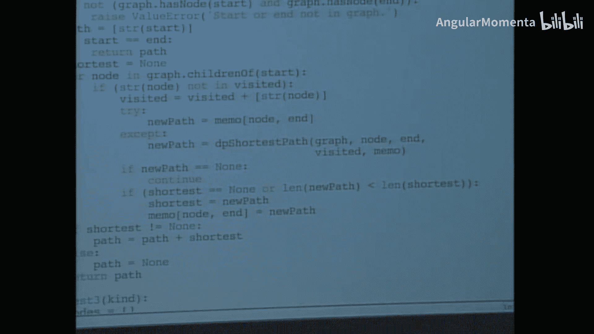

通过对比测试，动态编程版本相比朴素DFS版本，递归调用次数从数十万次锐减到数千次，带来了巨大的性能提升。

---

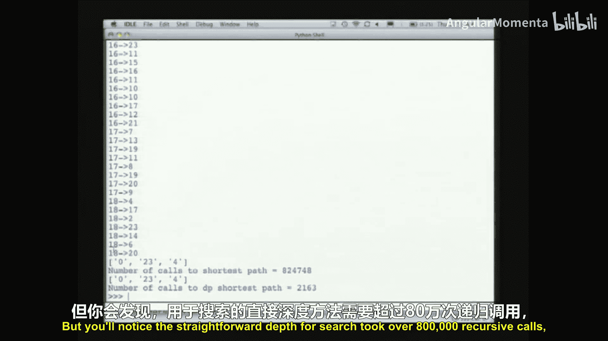

## 动态编程的适用条件

动态编程并非万能钥匙，它适用于具有以下两个关键性质的问题：

1.  **最优子结构**：一个问题的最优解包含其子问题的最优解。例如，从A到C的最短路径必然由从A到B的最短路径和从B到C的最短路径组成。
2.  **重叠子问题**：在递归求解过程中，相同的子问题会被多次计算。这正是记忆化能够发挥作用的前提。

动态编程由理查德·贝尔曼在20世纪50年代提出，它能够将许多表面上看是指数复杂度的问题，转化为可用多项式时间高效求解的问题，是算法设计中极其重要的工具。


---

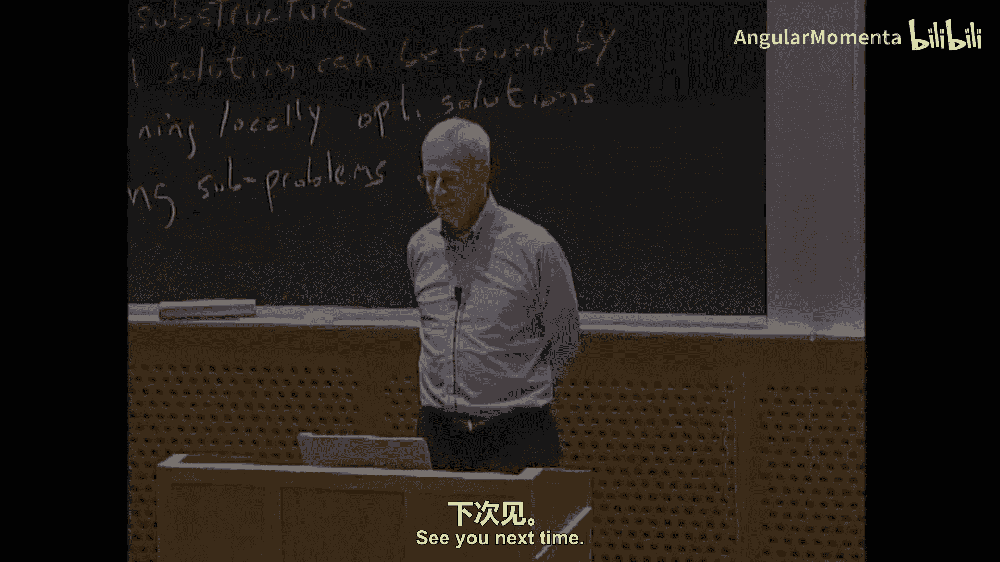

本节课中我们一起学习了图论中的几个经典问题（最短路径、团、最小割），并通过社交网络和疾病传播的实例加深了理解。我们重点剖析了深度优先搜索算法的低效根源，并引入了强大的**动态编程**技术。通过**记忆化**存储子问题的解，我们避免了重复计算，从而实现了算法性能的质的飞跃。记住动态编程的两个适用条件——**最优子结构**和**重叠子问题**，这将帮助你识别哪些问题可以用这种方法优雅地解决。