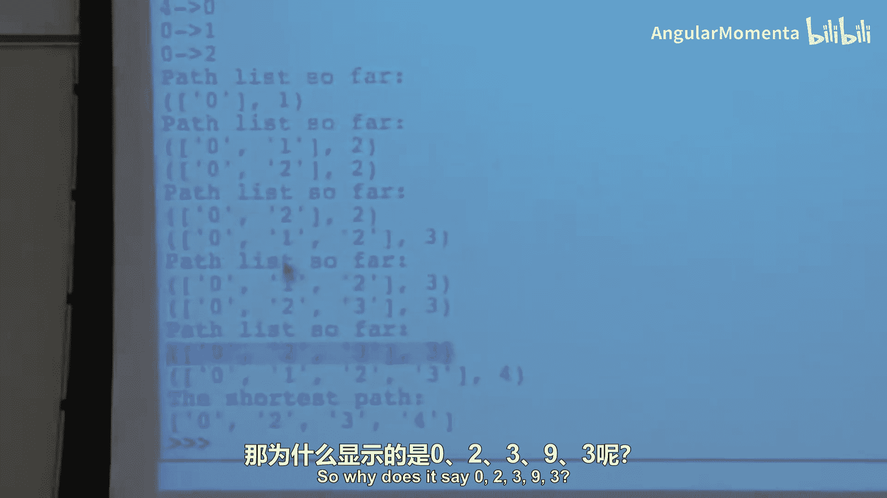

# 033：图与搜索算法


在本节课中，我们将学习图的基本概念，并深入探讨两种重要的图搜索算法：深度优先搜索和广度优先搜索。我们将通过简单的例子和代码来理解它们的工作原理。

## 图的基本概念

上一节我们介绍了课程背景，本节中我们来看看什么是图。

图是一种形式化表示，它包含顶点和边。顶点可以看作是一组事物，而边则表示这些事物之间的关系。例如，你和你的朋友以及朋友之间的友谊关系就可以构成一个图。

以下是图的核心组成部分：
*   **顶点**：也称为节点，代表图中的实体。
*   **边**：也称为弧，连接两个顶点，表示它们之间的关系。

## 图的类型

了解了图的基本构成后，我们来看看图的几种主要类型。

### 有向图与无向图

有向图中的边具有方向，只能沿着箭头的方向从一个节点移动到另一个节点。例如，从波士顿到蒙特利尔的路径可能只能按特定方向前进。

无向图中的边没有方向，可以在两个相连的节点之间自由移动。从波士顿到蒙特利尔可能只需一步。

### 加权图

加权图不仅表示顶点间存在关系，还为每条边关联了一个权重或成本。例如，在道路网络中，权重可以代表通行费或距离。一个常见的问题是找到两点之间的最小成本路径。

## 深度优先搜索

上一节我们介绍了图的类型，本节中我们来看看深度优先搜索算法。

深度优先搜索是一种探索图的策略，它沿着一条路径尽可能深地搜索，直到无法继续，然后回溯并尝试其他路径。其核心思想是从目标节点反向构建最短路径。

以下是深度优先搜索查找最短路径的伪代码逻辑：

```python
def shortest_path_dfs(graph, start, end, visited=[]):
    # 检查起点和终点是否在图中
    if start not in graph or end not in graph:
        return None
    # 如果起点就是终点，路径只包含自身
    if start == end:
        return [start]
    # 初始化最短路径
    shortest = None
    # 遍历当前节点的所有子节点
    for child in graph.children_of(start):
        if child not in visited:
            # 标记为已访问，防止循环
            new_visited = visited + [child]
            # 递归查找从子节点到终点的最短路径
            new_path = shortest_path_dfs(graph, child, end, new_visited)
            # 如果找到路径，且比当前最短路径更短，则更新
            if new_path:
                if shortest is None or len(new_path) < len(shortest):
                    shortest = new_path
    # 如果找到了从某个子节点到终点的路径，则将当前节点添加到路径前端
    if shortest:
        return [start] + shortest
    else:
        return None
```

算法从起点开始，询问每个子节点到目标节点的最短路径，然后选择最短的那条，并将自己添加到该路径的前面，从而从后向前构建出完整的最短路径。`visited` 参数用于记录已访问的节点，避免陷入循环。

## 广度优先搜索

上一节我们探讨了深度优先搜索，本节中我们来看看广度优先搜索算法。

广度优先搜索采用不同的策略：它从起点开始，逐层向外探索所有可能的路径。其核心思想是从起点向前构建路径，优先探索所有距离起点为一步的节点，然后是两步的节点，依此类推。

以下是广度优先搜索的算法步骤：

1.  初始化一个队列，其中只包含从起点开始的路径（即只包含起点本身的路径）。
2.  从队列中取出**最短**的路径（最初就是起点路径）。
3.  检查该路径的最后一个节点：
    *   如果它是目标节点，则找到最短路径，算法结束。
    *   如果不是，则将该节点的所有未访问过的子节点，分别形成新的路径（原路径加上子节点），并添加到队列中。
4.  重复步骤2和3，直到队列为空或找到目标节点。

在代码实现中，我们通常用一个列表来存储待探索的路径，并使用一个Lambda函数作为键对列表进行排序，以确保总是优先探索长度最短的路径。

```python
# 示例：使用lambda函数按路径长度排序
paths = [ (['A', 'B'], 2), (['A'], 1) ]
paths_sorted = sorted(paths, key=lambda x: x[1]) # 按元组第二个元素（长度）排序
# 结果：[(['A'], 1), (['A', 'B'], 2)]
```

广度优先搜索保证当找到目标节点时，所发现的路径就是最短路径（在边没有权重的情况下）。与深度优先搜索相比，它需要更多的内存，因为需要同时存储许多部分路径。

## 总结




本节课中我们一起学习了图的基本概念，包括顶点、边、有向图、无向图和加权图。我们重点探讨了两种基础的图搜索算法：深度优先搜索和广度优先搜索。深度优先搜索通过递归深入探索单条路径，并从目标节点反向构建答案；而广度优先搜索通过队列逐层扩展，从起点正向构建并保证找到最短路径。理解这两种算法是解决许多图论问题的基础。