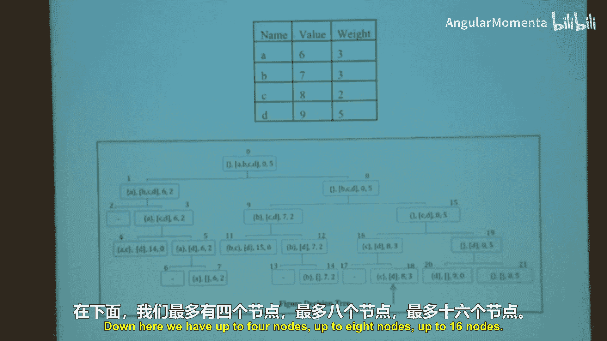
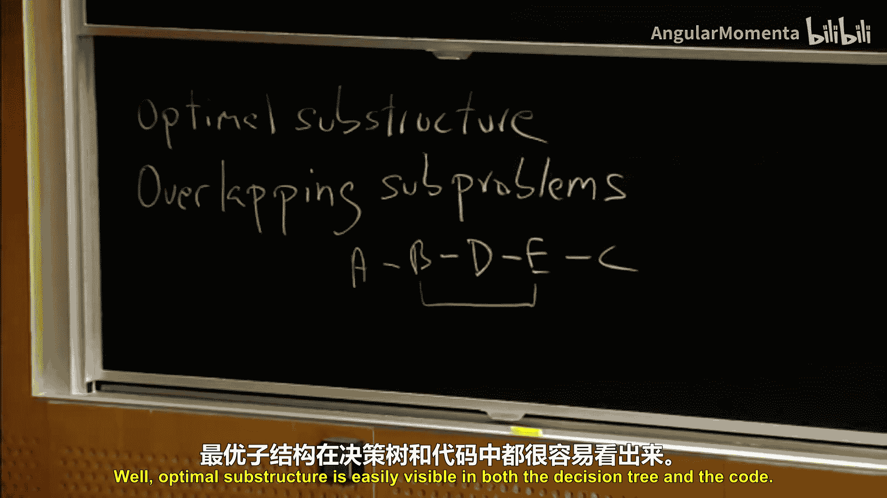
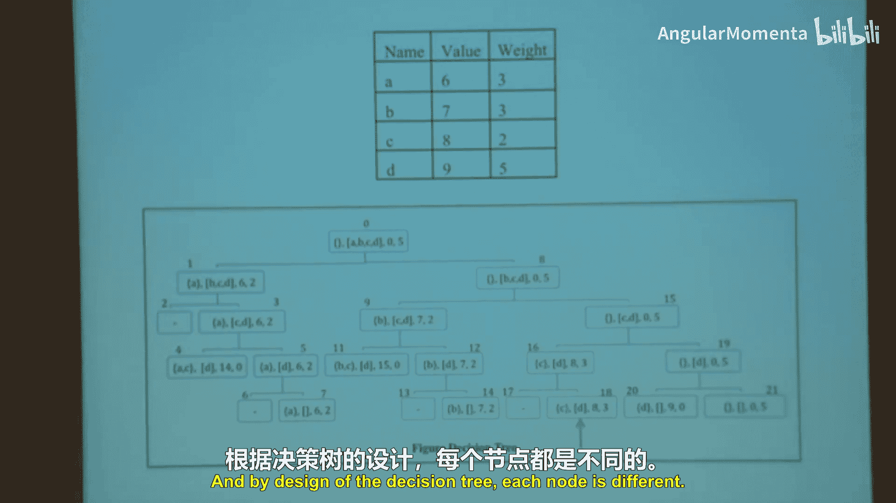
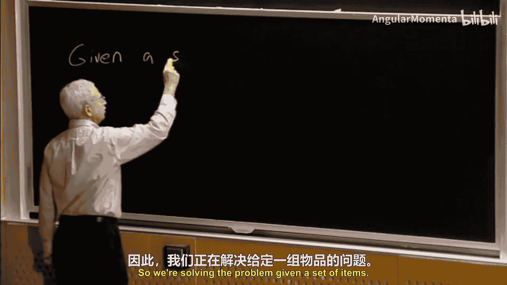
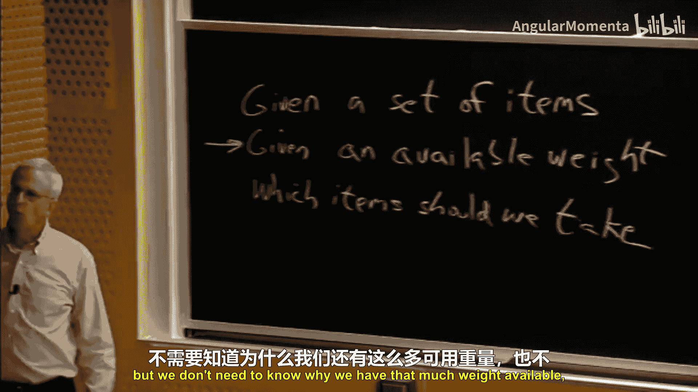
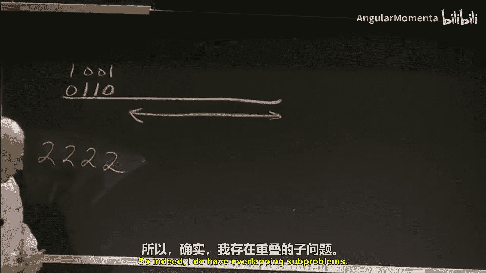
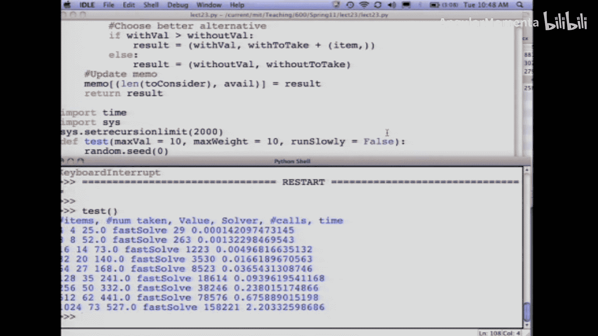
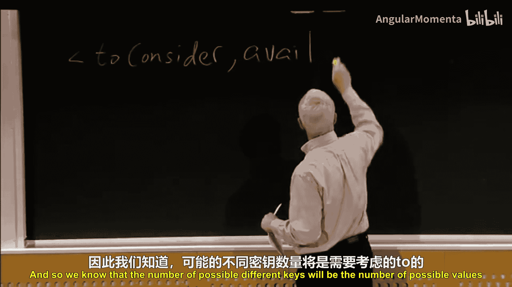
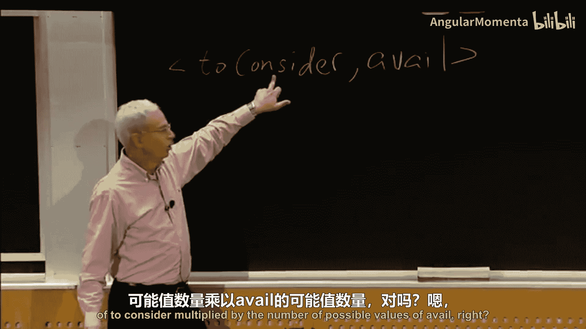
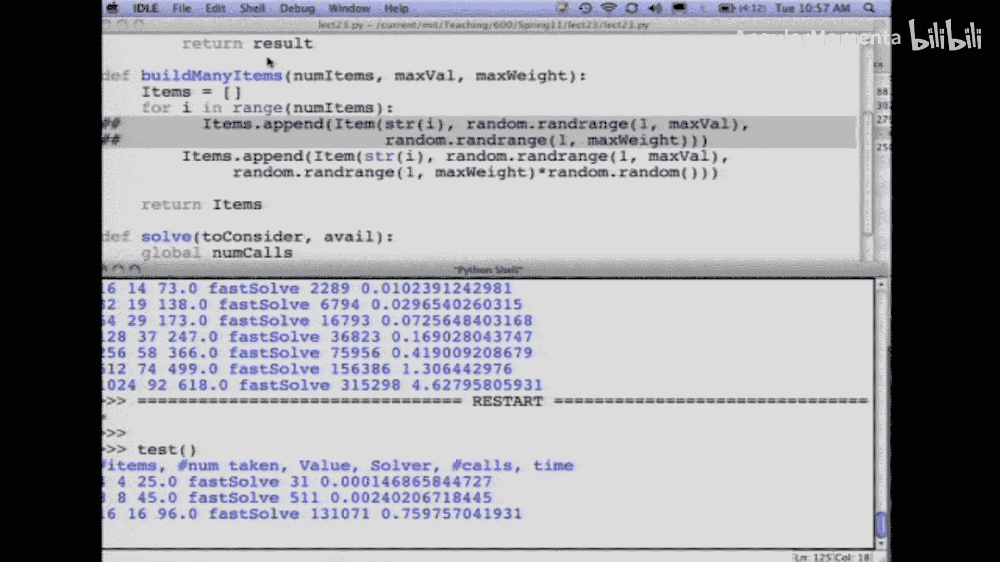

# 034：动态规划与0/1背包问题 🎒


在本节课中，我们将深入学习动态规划，并探讨如何将其应用于解决经典的0/1背包问题。我们将回顾动态规划的两个关键属性，并分析背包问题是否满足这些属性，从而理解动态规划为何能显著提升算法效率。

## 动态规划回顾

上一节我们介绍了动态规划，并展示了它如何为最短路径问题提供实用的解决方案。这种方案允许我们快速解决理论上复杂的问题。我们讨论了使动态规划成为可能的关键属性。

动态规划适用于具有以下两个属性的问题：


1.  **最优子结构**：我们可以通过组合局部子问题的最优解，来构建全局最优解。
2.  **重叠子问题**：在算法运行过程中，我们会多次遇到并需要解决相同的子问题。

例如，归并排序具有**最优子结构**，因为它通过先排序子列表再合并来排序整个列表。然而，它**没有重叠子问题**，因此在排序过程中不会遇到相同的子列表。所以，我们不能用动态规划来解决排序问题。

## 最短路径问题分析

那么，最短路径问题是否具备这两个属性呢？



首先看**最优子结构**。如果已知从A到C的最短路径是 `A -> B -> D -> E -> C`，那么这条路径上的任何子路径，例如从B到E的路径 `B -> D -> E`，也必须是B到E的最短路径。否则，从A到C的最短路径就会选择另一条路。这正是我们在上一讲中利用的动态规划子结构。



其次，最短路径问题也存在**重叠子问题**，因为我们在计算过程中会反复求解相同的中间节点对之间的最短路径。


因此，最短路径问题同时具备这两个属性，适合用动态规划解决，并且实际运行速度很快。



## 0/1背包问题分析




0/1背包问题同样具备这两个属性。我们之前通过回溯法（决策树）递归地解决了这个问题。




以下是该问题的一个简单示例，包含物品A、B、C、D及其价值和重量：

| 物品 | 价值 | 重量 |
| :--- | :--- | :--- |
| A    | 6    | 3    |
| B    | 7    | 3    |
| C    | 8    | 2    |
| D    | 9    | 5    |


假设背包容量为5。其决策树的一部分如下所示（为简化，未画出全部）：

```
开始 (剩余物品: A,B,C,D, 剩余容量:5, 当前价值:0)
├── 拿A (剩余物品: B,C,D, 剩余容量:2, 当前价值:6)
│   ├── 拿B? (重量3 > 剩余容量2) -> 不可行
│   ├── 不拿B (剩余物品: C,D, 剩余容量:2, 当前价值:6)
│   │   ├── 拿C (剩余物品: D, 剩余容量:0, 当前价值:14) -> 叶节点
│   │   └── 不拿C (剩余物品: D, 剩余容量:2, 当前价值:6)
│   │       └── 拿D? (重量5 > 剩余容量2) -> 不可行
│   └── ...
└── 不拿A (剩余物品: B,C,D, 剩余容量:5, 当前价值:0)
    └── ... (继续探索)
```



这种回溯算法在物品数量稍多时就会变得非常慢。对于N个物品，决策树最多有 `2^N` 个节点，是指数级复杂度。

### 最优子结构

在决策树和代码中，**最优子结构**是显而易见的。每个父节点通过比较两个子节点的解（拿或不拿当前物品）来选择更优的一个，从而向上传递最优解。代码中的关键部分正是“选择更好的分支”。

### 重叠子问题

重叠子问题则不那么明显。初看决策树，每个节点似乎都在解决不同的问题：剩余物品列表和可用容量构成的组合各不相同。

然而，关键在于：**决定接下来拿什么物品，只取决于“剩余哪些物品”和“剩余多少容量”，而不取决于“已经拿了哪些物品”**。可能存在许多不同的已拿物品组合，其总重量相同，从而留下完全相同的子问题需要解决。

例如，假设前四个物品的价值都是2。在决策树中，可能通过拿物品1和3用掉了4单位容量，也可能通过拿物品2和4用掉了4单位容量。当到达这个状态（剩余容量为某值，剩余物品列表为某后缀）时，解决后续子问题的最优方案与之前是如何用掉这4单位容量的**无关**。

因此，只要物品重量可能重复，使得不同物品组合能凑出相同的总重量，就会产生**重叠子问题**。这使得动态规划可以大显身手，通过记忆化避免重复计算。

## 动态规划实现：带记忆化的快速解法

现在，让我们看看如何将标准的递归解法 `solve` 改造成动态规划版本的 `fastSolve`。核心是为递归函数添加一个备忘录 `memo`，用于存储已计算过的子问题结果。

以下是实现时需要注意的两个技术细节：

1.  **Python默认参数的可变性陷阱**：在函数定义中，如果默认参数是可变对象（如列表、字典），它只会在函数定义时被创建一次。后续所有调用都会共享同一个对象，导致错误。正确的做法是使用 `None` 作为默认值，在函数内部进行初始化。
    ```python
    def fastSolve(toConsider, avail, memo=None):
        if memo is None:
            memo = {}  # 每次调用都初始化为新的空字典
        # ... 其余代码
    ```
2.  **递归深度限制**：Python默认的递归深度限制可能较小。对于深度递归，可以使用 `sys.setrecursionlimit()` 提高限制。
    ```python
    import sys
    sys.setrecursionlimit(10000)
    ```

`fastSolve` 的核心逻辑如下：
*   检查备忘录 `memo`，如果当前 `(len(toConsider), avail)` 这个键已存在，则直接返回存储的结果。
*   如果 `toConsider` 为空或 `avail` 为0，返回基础解 `(0, ())`。
*   否则，考虑第一个物品：
    *   如果太重（`weight > avail`），则递归调用 `fastSolve`，不考虑此物品。
    *   否则，计算两种选择：
        1.  **拿**：递归调用，物品列表移除第一个，可用容量减去其重量，价值加上其价值。
        2.  **不拿**：递归调用，物品列表移除第一个，可用容量和价值不变。
    *   比较两种选择的结果，取价值更高的一个。
*   将当前子问题的最优解存入 `memo`，然后返回该解。

## 性能对比与分析

我们通过实验对比了朴素递归解法 `solve` 和动态规划解法 `fastSolve` 的性能。



当物品重量为1到10之间的整数时：
*   `solve` 在物品数达到16时（约 `2^16` 次调用）就已非常缓慢，在32时无法在合理时间内完成。
*   `fastSolve` 则能轻松处理1024个物品，仅耗时约2秒，且调用次数随物品数近似线性增长，性能提升巨大。

### 运行时间分析




`fastSolve` 的运行时间主要取决于需要计算并存入备忘录的不同子问题的数量。子问题的键是 `(len(toConsider), avail)`。
*   `len(toConsider)` 的可能值最多为物品数量 `N`。
*   `avail` 的可能值取决于初始容量和物品重量的组合情况。如果物品重量取值范围小，不同重量和就少，子问题数量就少，算法就快。反之，如果物品重量是连续浮点数，几乎每个子问题都不同，动态规划就退化成朴素递归，恢复指数级复杂度。




这种算法被称为**伪多项式时间**算法。它在输入数值（如重量）范围不大时表现优异，但在最坏情况下仍可能是指数级的。

## 总结

本节课我们一起深入探讨了动态规划。我们回顾了其两大基石——最优子结构和重叠子问题，并分析了最短路径问题和0/1背包问题如何满足这些条件。



我们重点将0/1背包问题的回溯解法改造为动态规划解法，通过添加备忘录避免重复计算，实现了从指数级到近似多项式级的巨大性能飞跃。同时，我们也了解了其局限性：当问题不具备真正的重叠子问题时，动态规划的优势将不复存在。

通过本讲，你应当掌握识别动态规划适用问题的能力，并学会实现基本的带记忆化的动态规划算法来解决类似优化问题。