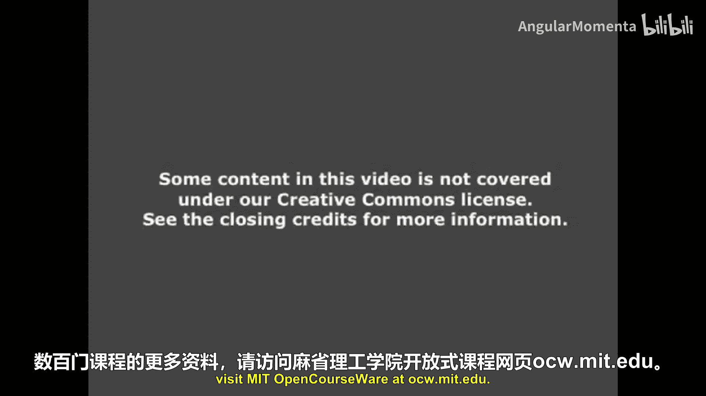
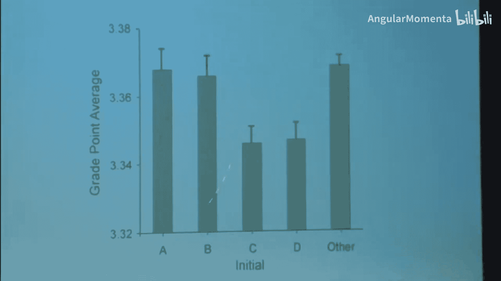
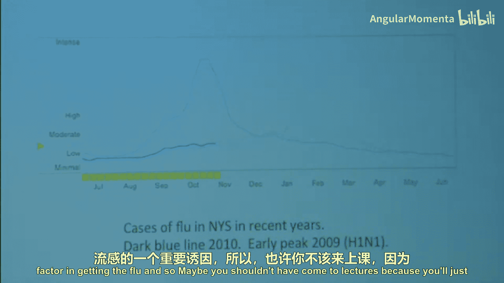
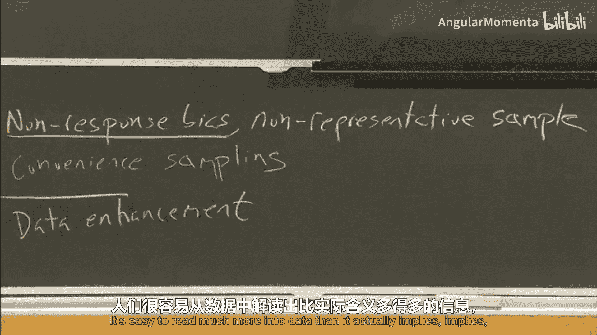
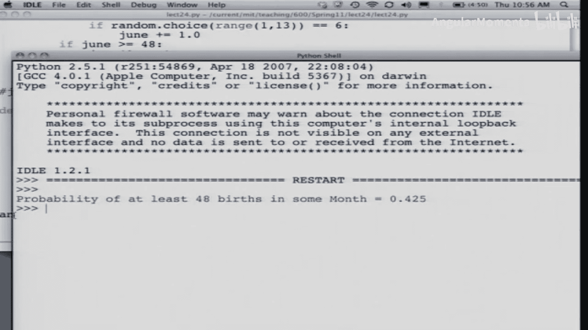
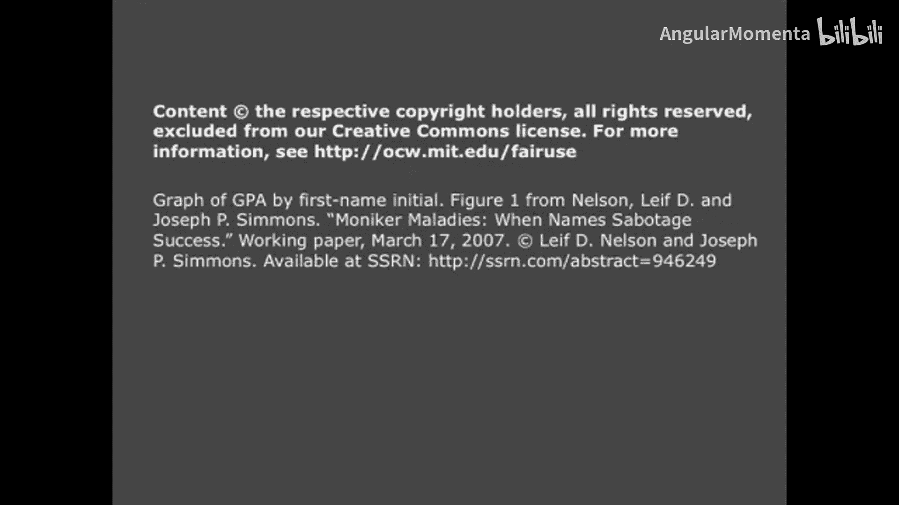

# 035：统计学的陷阱与谬误



在本节课中，我们将探讨如何从统计数据和图表中得出有意义的结论，以及如何识别和避免常见的统计陷阱与谬误。我们将学习到，即使数据本身是真实的，统计方法的选择、图表的呈现方式以及逻辑推理的错误都可能导致完全错误的结论。

---

## 统计学的历史背景

上一节我们介绍了课程的基本框架，本节中我们来看看统计学的起源。在17世纪中叶之前，人们主要进行定性而非定量思考。他们缺乏统计学的概念，只能依靠直觉和轶事来理解世界。

这种情况在17世纪中叶发生了戏剧性的变化。一位名叫约翰·格兰特的英国人出版了《对死亡账单的自然与政治观察》。这是有记录的历史上第一部真正使用统计学的著作。他研究了伦敦市相当全面的死亡统计数据，并试图建立一个模型来预测瘟疫的传播。事实证明，他的模型相当有效。这彻底改变了人们的思维方式。

自那时起，人们开始使用统计学来提供信息，但不幸的是，有时也用来误导。有些人故意使用统计学来误导他人，而另一些人则仅仅是能力不足。这引出了我们今天要讨论的主题：统计学。

---

## 统计学的误导性

本杰明·迪斯雷利曾说过，世界上有三种谎言：谎言、该死的谎言和统计学。这句话不幸地包含了很多真理。更近一些，在20世纪50年代，达雷尔·哈夫写了一本很棒的书，名为《统计数字会撒谎》。书中有这样一句话：“如果你无法证明你想证明的东西，那就去证明别的东西，并假装它们是同一回事。在统计学与人类思维碰撞之后的日子里，几乎没有人会注意到其中的差异。”这似乎是真的。

因此，今天我想讨论几种可能使人从统计数据中得出不当结论的方式。我相信你们只会将这些信息用于好的方面，使自己成为更好的数据消费者和提供者，而不是更好的说谎者。但这取决于你们自己。

---

## 陷阱一：统计量无法讲述完整故事

首先，我们需要记住，无论你的统计数据有多好，统计量本身并不能讲述完整的故事。我们在学期早些时候已经看到过这样的例子。

从一个数据集中可以提取出大量的统计量。通过精心挑选和选择，你几乎可以就同一数据集传达任何你想要的印象。当然，最好的解药是查看数据本身。

1973年，统计学家约翰·安斯科姆发表了一篇论文，其中包含以下数据集。他给出了四组不同的X和Y值。有趣的是，从许多方面来看，这四个数据集的统计数据非常相似。

以下是计算这些统计量的代码示例：

```python
# 假设 data_sets 是一个包含四个 (x, y) 数据对的列表
for i, data in enumerate(data_sets):
    x = [point[0] for point in data]
    y = [point[1] for point in data]
    mean_x = sum(x) / len(x)
    mean_y = sum(y) / len(y)
    # ... 计算其他统计量，如中位数、方差、相关性、线性回归拟合等
```

它们具有相同的均值、中位数、方差，X和Y之间的相关性相同，甚至使用线性回归得到的拟合结果也非常相似。我可能会写一篇论文，告诉你从统计意义上讲，这些数据集都是相同的。我运行的每一个统计结果都说这些数据集无法区分。

然而，这些数据集真的无法区分吗？一种方法是实际绘制数据点。当我们这样做时，会看到相当戏剧性的结果。例如，图2和图1看起来并不相似。图3看起来完全不同，而图4则截然不同。将图4与图1进行比较，差异显著。

这里的教训很简单，我们之前也看到过：永远不要忽视数据本身。不要只看数据的统计量，要设法查看数据本身。

---

## 陷阱二：图表可能具有欺骗性



上一节我们强调了查看原始数据的重要性，本节中我们来看看图表的潜在误导性。毫无疑问，图表对于快速传达信息非常有用。然而，如果使用不慎或带有恶意，图表可能极具误导性。

让我们看一个关于中西部房价的图表。我们这里有一个图表，年份是2006、2007，然后在2008、2009年，我们使用了季度数据。你可能记得2008年房地产市场发生了一个事件，引发了全球金融危机。看这个图表，我们对这一时期中西部房价的印象是什么？我的印象是它们非常稳定。你可能会发表这个图表并说，看，房价真的没有太大变化，也许下降了一点，但没什么大不了的。

如果我们与另一个图表进行比较，它使用的是完全相同的数据。现在，我问你关于中西部房价的情况，你可能会告诉我它们非常不稳定。事实上，这里显然发生了某种可怕的事件。

完全相同的数据，两个图表，都是真实的，但对所发生事情的印象却截然不同。右边的图表（在你的讲义中）被设计成显示房价高度不稳定。那么区别是什么？我用了什么技巧来制作这两个图表？

其中一个技巧是，在第一个图表中，我使用了**对数刻度**绘制Y轴，这总是让变化看起来比线性刻度小。在这个图表中，我使用了线性图。另一个技巧是，我作弊了。我这里显示的是完整的年份，然后我转到了季度。所以，在我的图表中，部分X轴的分辨率很宽，是一整年，而另一部分则是一个季度。毫不奇怪，因为我们知道房价有季节性变化，春季和冬季的房价不同。一旦我开始绘制季度数据，即使没有发生崩盘，在后续年份中看起来也会不稳定得多，因为我改变了X轴的分辨率。

我没有撒谎，你可以从图例中看出我做了什么。但我肯定可以用这些图表愚弄很多人。


---

## 陷阱三：垃圾进，垃圾出

另一个常见的严重统计错误被称为“垃圾进，垃圾出”。它如此常见，以至于人们通常用其首字母缩写**GIGO**来指代。

一个典型的例子发生在1840年。美国人口普查显示，自由黑人和混血儿中的精神错乱发生率大约是 enslaved 黑人或混血儿的10倍。由此得出的结论是显而易见的。美国参议员、前副总统、后来的国务卿约翰·C·卡尔霍恩根据人口普查得出结论：“这次人口普查中揭示的关于精神健全的数据是无可辩驳的。我们的国家必须由此得出结论，废除奴隶制对非洲人来说将是一场灾难。”毕竟，如果你把他们从奴隶制中解放出来，他们都会发疯。统计数据是这么说的。

然而，很快人们就清楚，事实上那次人口普查充满了错误。马萨诸塞州居民、前副总统约翰·昆西·亚当斯回应卡尔霍恩说，不，这是一个荒谬的结论，人口普查充满了错误。非常有耐心的卡尔霍恩向亚当斯解释道：错误太多了，以至于它们相互抵消，得出了相同的结论，就好像它们都是正确的一样。错误刚好足够多，以至于你可以忽略它们。

他依赖的是什么？如果他想让这个陈述在数学上更精确，他应该说什么？他基本上暗示测量误差是**无偏的**且**相互独立的**。因此，误差几乎均匀地分布在均值两侧。

如果他做出了这个更精确的陈述，那么你就可以进行有意义的讨论（假设与约翰·卡尔霍恩进行有意义的讨论是可能的，这或许值得怀疑），讨论误差是否确实是独立的。因为如果它们不是，例如，如果它们代表了数据编译者的偏见，那么你就不能依赖统计方法来声称它们会相互抵消。

记得在高斯的时代，高斯在谈到正态分布时说过，如果我们进行这些天文测量，并假设我们的误差是独立且正态分布的，那么我们可以观察均值并假设它接近真实值。这些都是重要的假设，而在本例中，这些假设被证明是不正确的。事实上，后来表明误差并没有很好地相互抵消。今天，你可以说无法从那次普查中得出任何统计结论。


另一方面，最近，美国国家研究委员会（可能是美国最负盛名的学术组织）发布了一份全国所有大学的排名。后来表明，这份排名充满了垃圾输入。他们对最终被证明是错误的数据进行了广泛的统计分析并予以发布。这非常尴尬。好消息是麻省理工学院在这次分析中名列前茅。坏消息是我们不能断定它真的应该名列前茅，因为谁知道数据的质量如何。但这有点尴尬。

---

## 陷阱四：相关性与因果关系的混淆

另一个常见的用统计学撒谎的方式是利用所谓的“**cum hoc ergo propter hoc**”谬误。它的意思是“伴随此，因此由于此”。我不知道为什么，但统计学家像医生和律师一样，喜欢用拉丁语来炫耀。



例如，这是一个统计事实：包括麻省理工学院学生在内的大学生，定期听课的学生比只是偶尔听课的学生有更高的平均绩点。这告诉我们，在座的各位可能比那些没有来上6.00课程的学生的平均绩点更高。我希望这是真的。

现在，如果你是讲授这些课程的教授，你愿意相信这是因为讲座信息量极大，使得来上课的学生变得更聪明，因此他们表现得更好。所以我们想假设因果关系：因为我讲了精彩的课，你选择来听，你将在6.00课程中获得更好的成绩。

是的，存在相关性。这无疑是正确的。但很难直接跳到因果关系。例如，也许关键在于，那些费心来听课的学生也费心去做习题集，只是更认真负责。无论他们是否来听课，他们更认真负责这一事实会给他们带来更好的平均绩点。除了进行对照实验，我不知道有什么方法可以区分这两件事。也许每天把你们一半人赶出课堂，看看效果如何。但这很危险。

同样，你可能会读到像教职员通讯这样的东西，上面会谈论来听课是多么重要，因为你会做得更好。因为写那篇教职员通讯文章的人不理解这个谬误，或者只是一厢情愿。

另一个很好的例子，一个不久前出现在新闻中的例子，与流感有关。这是纽约州近年来的流感病例数。你会注意到2009年有一个高峰，那就是著名的猪流感疫情，我相信你们都记得。现在，如果你仔细看，甚至不用太仔细，你会注意到一个相关性：在学校上课期间，流感发生得更多。事实上，在学校上课的那些月份，流感病例比学校不上课的月份要多。高中、大学等等。事实上，相关性相当强。

这导致许多人得出结论：上学是感染流感的一个重要致病因素。所以，也许你不应该来听课，因为这样做只会让你感染流感。事实上，正因为如此，在猪流感疫情期间，许多家长不送孩子上学。事实上，在一些社区，许多学校因此关闭。

让我们想一想。正如你可以用这种相关性来得出结论说上学会导致猪流感，你也可以用它来证明流感导致你去上学，因为流感季节高峰期时在学校的人更多。因此，是流感的增长导致人们去上学。从这个数据来看，这是一个同样有效的统计假设。有点奇怪，但这是真的。就像我们可以得出结论说高平均绩点导致人们来听课一样。你每天早上查看你的平均绩点，如果足够高，你就来听课，否则就不来。你也可以从数据中得出这个结论。

这里的问题是你必须考虑是否存在所谓的**潜伏变量**。一些与其他两个变量相关的变量，也许那才是致病因素。例如，这里的一个潜伏变量是学校学期与夏季重合。事实上，如果你在实验室研究流感病毒，你会发现它在寒冷天气中比在炎热潮湿天气中存活时间更长。当天气寒冷干燥时，流感病毒在物体表面存活的时间更长。因此，事实上，也许是天气，而不是学校的存在，导致流感在一年中的某些时候更具传染性。事实上，这很可能是真的。所以有一个潜伏变量我们必须考虑，也许那才是致病因素。

这实际上可能导致世界上一些非常糟糕的决策。我对医疗保健和公共卫生相关的问题特别感兴趣。2002年，大约有600万美国妇女接受激素替代疗法，认为这会大大降低她们患心血管疾病的风险。有人认为，达到一定年龄的妇女，如果服用额外的激素，她们患心脏病的可能性就会降低。这一观点得到了几项发表在高度 reputable 期刊上的研究的支持，这些研究显示了接受激素替代疗法与未患心血管疾病之间的强相关性。这些数据已经存在一段时间了，正如我所说，到2002年，美国大约有600万妇女在接受这种疗法。

同年晚些时候，《美国医学会杂志》发表了一篇文章，断言事实上接受这种疗法会增加妇女患心血管疾病的风险，使你更有可能患心脏病。这怎么可能发生？在新的研究发表后，人们回过头重新分析了旧的研究，发现该研究中接受激素替代疗法的妇女比组内其他妇女更有可能拥有更好的饮食和锻炼习惯。事实上，她们是更注重健康的妇女。所以存在饮食、锻炼和其他方面的潜伏变量，这些实际上可能是健康状况更好的致病因素，而不是替代疗法。但在最初的数据分析中，这个潜伏变量没有被发现。


所以我们看到的是，接受激素替代疗法和改善心脏健康是一个共同原因（即注重健康）的 coincident effects。有点奇怪，但却是真的。这是一个悲伤的故事。

---

## 陷阱五：无应答偏差与非代表性样本

另一个需要警惕的是**无应答偏差**，以及相关的**非代表性样本**问题。你可能还记得，当我第一次开始谈论统计学和随机数的使用时，我说所有的统计技术都基于这样一个假设：通过对总体中的一个子集进行抽样，我们可以推断出整个总体的情况。这是真的。通常，因为如果使用随机抽样，你可以假设随机样本的结果分布（如果样本足够大）将与整个总体的结果分布相同。这就是为什么我们通常希望进行随机抽样。在我们看过的所有模拟中，我们都使用随机抽样来确保少量样本能代表总体，然后我们使用统计技术来回答需要多少随机样本的问题。

但这些技术只有在样本确实是随机的情况下才有效。否则，你可以随心所欲地分析，但你得出的任何结论都可能是谬误的。

不幸的是，许多研究，特别是在社会科学中，基于所谓的**便利抽样**。例如，如果你查看心理学期刊，你会发现许多心理学研究使用本科生群体作为研究对象。他们为什么这样做？是因为他们相信本科生能代表整个人口吗？不，是因为本科生是 captive audience，他们必须同意参与。如果你碰巧在大学里，对本科生做实验很方便。所以他们这样做，然后他们说，嗯，本科生和整个人口是一样的。你可能已经观察到，至少在这个机构，本科生可能不能代表整个人口。

一个众所周知的例子发生在第一次世界大战期间。每当一架盟军飞机从德国上空的轰炸任务返回时，飞机会被检查，看高射炮弹击中了哪里。所以飞机会飞过去投炸弹，德国人会用高射炮射击飞机，试图把它们从空中打下来。飞机返回英国后，会被检查。他们会说，平均而言，高射炮弹击中飞机这个部位比那个部位更频繁。因此，他们会加固飞机上他们预计高射炮会击中的那些部位的蒙皮，试图使飞机在未来的任务中（或泛指飞机）更不容易受损。

这有什么问题？他们抽样的不是那些从未从轰炸任务中返回的飞机。那些飞机无法被抽样。事实上，也许情况是，他们正在加固的是那些被高射炮击中无关紧要的部位，因为那不会导致飞机坠毁，而没有加固那些最容易因高射炮受损的部位。他们做了一个便利抽样，得出了结论，并且可能在他们选择加固飞机的部位上完全做错了。

这种特殊的错误被称为**无应答偏差**。例如，当你进行某种调查时，有些人不回应，因此你忽略了他们可能给出的答案。也许我们在做6.00课程的地下指南时会看到这种情况。事实上，我应该指出，它现在在线上了。如果你们每个人都能去评价这门课程、评价讲师、评价助教等等，那就太好了。我们确实会阅读这些评价，它会影响我们在后续学期中如何教授这门课程。但显然存在偏差。也许只有那些对课程有强烈感受的人（无论是积极还是消极）才会费心填写调查。我们得出的结论是存在双峰分布，没有人认为课程一般般，因为他们懒得回应。或者也许只有讨厌这门课的人回应，我们就认为每个人都讨厌这门课。谁知道呢？这是一个大问题。

我们今天在电话民意调查中也看到了这个问题，存在更多的便利抽样或非代表性样本。许多民意调查使用电话进行。根据法律，这些民意调查机构不能拨打手机。所以他们只拨打固定电话。你们中有多少人有固定电话？记录显示没有人。你们的父母有多少人有固定电话？记录显示几乎所有人都有。这意味着，在进行例如总统候选人提名的民意调查时，你的父母比你更有可能被抽样。因此，任何基于电话的这些民意调查都会有偏差。不幸的是，他们的民意调查可能只说“电话样本”，人们可能没有意识到这意味着整个人口中的一部分被抽样不足。这样的例子有很多。

---

## 陷阱六：数据增强与过度解读

我们经常看到的另一个问题是**数据增强**。人们很容易从数据中解读出比实际含义更多的东西，尤其是在脱离上下文的情况下。



例如，2009年4月29日，CNN报道称：“墨西哥卫生官员怀疑猪流感疫情已导致超过159人死亡，约2500人患病。”这在当时是相当可怕的事情，人们开始担心猪流感。另一方面，你们认为美国每年有多少死亡归因于常规的季节性流感？平均每年有**36000**人死于季节性流感。这从某种程度上说明了159例猪流感死亡也许不应该那么可怕。

但同样，人们通常不会同时报告这两个数据。另一个很棒的（且准确的）统计数据是：大多数汽车事故发生在离家10英里以内。我相信你们很多人都听说过。那么这意味着什么呢？几乎没有任何意义。大多数驾驶都是在离家10英里以内进行的。除此之外，这里的“家”是什么意思？“家”指的是汽车的注册地址。所以，如果我选择在阿拉斯加注册我的车，这是否意味着我在麻省理工学院附近开车时发生事故的可能性更小？我不这么认为。同样，这有点毫无意义。

这个问题的另一个方面是人们经常从数据中进行**外推**。我们可以看一个互联网使用率的例子，这个也很有趣。我在这里绘制的是美国互联网使用率占人口的百分比。我从1994年开始绘制。这里的蓝线是数据点，绿线是线性拟合。如果你看我的代码，你会看到我使用`polyfit`函数并设置参数为1来得到一条拟合线。你可以看到这是一个相当不错的拟合。

人们实际上看了这些东西并用它来外推未来的互联网使用率。我们可以这样做。现在，我们运行相同的代码，开启外推功能。图1和之前一样，相同的数据，相同的拟合。这是图2。你会注意到，截至去年，大约**115%**的美国人口在使用互联网。这可能不是真的。在体育运动中也许可以给出110%的努力，但在统计学中不行。

同样，当人们做这些预测时，你总是看到这种情况：他们拟合一些数据，然后外推到未来，而不理解为什么这可能不是一件好事。顺便说一下，我们在模拟弹簧时也看到了这一点，我们可以准确地线性预测，直到我们超过了弹性常数，此时我们的线性模型完全失效。所以你总是需要有一些理由（不仅仅是拟合数据）来相信你所做的事情实际上是有意义的。

---

## 陷阱七：德克萨斯神枪手谬误

最后我想讨论的，在文献中通常被称为**德克萨斯神枪手谬误**。这有时有点难以理解。这里有人来自德克萨斯吗？哦，很好。那么没有人会因此感到被冒犯。

想象一下，你正开车行驶在德克萨斯州的某条乡村道路上。你看到一个谷仓，那个谷仓上画着六个靶子，每个靶子的正中心都有一个弹孔。你开车经过，印象非常深刻，于是停下来，看到谷仓的主人，你说：“你一定是个神枪手。”他说：“当然，我从不失手。”就在这时，农夫的妻子走出来说：“没错，整个德克萨斯州没有哪个男人用喷漆枪比他更准了。”他做了什么？他朝谷仓开了六枪，枪法很差，子弹到处都是。然后他走过去，在每个弹孔周围画了一个靶子。看起来他就像个神枪手。

你可能会想，嗯，这太傻了。实际上没人会这么做。但事实上，在实践中这种情况经常发生。这类谬误的一个经典例子出现在2001年的《新科学家》杂志上。它报道说，由阿伯丁皇家康希尔医院的约翰·伊格尔斯领导的一个研究小组发现：“厌食症女性最有可能出生在春季或初夏，即3月至6月之间。”事实上，在这些月份出生的厌食症患者平均多出13%以上，而6月份出生的厌食症患者比平均水平高出30%。

现在，让我们看看这个令人担忧的统计数据。你们这里有女性是6月出生的吗？好吧，我不会询问你们的健康史。但也许你应该担心，或者也许不必。让我们看看他们是如何进行这项研究的。你可能会想知道为什么这么多有缺陷的研究都是关于女性健康的，也许是因为它们都是由男医生做的。

该团队研究了446名被诊断为厌食症的女性。如果你把它除以12，你会发现平均每个月应该有37名女性出生。事实上，在6月份，有48名厌食症女性出生。于是他们说，嗯，这种情况纯属偶然发生的可能性有多大？正如我在这种场合惯常做的那样，我检查了他们的分析。我写了一段代码来做这件事。

为了计算6月份有48名女性出生的概率，我运行了一个模拟。在模拟中，我模拟了446次出生，并随机选择了一个月份，然后观察概率。让我们看看运行结果。6月份至少有48次出生的概率是**0.042**。事实上，相当低。你可能会说，嗯，这种情况偶然发生的几率很小。因此，也许我们真的发现了什么。也许这与出生时的条件、天气或谁知道什么有关。

那么，这个分析有什么问题？一种看待它的方式是，如果研究人员从假设开始，即6月份出生的未来厌食症患者比其他任何月份都多，然后进行这个实验来检验它，并验证了它，那么这个分析将是完全有效的。所以，如果他们从假设开始，然后进行所谓的**前瞻性研究**，那么他们或许有正当理由相信该研究支持这个假设。

但这不是他们所做的。相反，他们做的是查看数据，然后选择一个与数据匹配的假设。这就是德克萨斯神枪手谬误。鉴于他们进行的实验，正确的问题不是问“6月份有48名未来厌食症患者出生的概率是多少”，而是问“在12个月中，至少有一个月有48名未来厌食症患者出生的概率是多少”，因为这才是他们真正在做的事情。

因此，我们真的应该运行这个模拟。与之前的模拟类似，这些也在你的讲义中。是否存在至少一个月，其中有48次出生？如果我们运行这个，我们会看到概率超过**40%**。不像4%那么令人印象深刻。所以，事实上，我们可能不应该得出任何结论。这种情况纯属偶然发生的概率几乎是50%。那么我们为什么要相信它有意义呢？

这又是德克萨斯神枪手谬误的一个例子，出现在文献中，很多人上当了。如果我们有更多时间，我会给你们更多例子，但我们没有时间了。我们周二再见，还有两节课。周二，我将讲解一些代码，这些代码是我要求你们为期末考试准备的。然后在周四，我们将进行总结。

---

## 总结



在本节课中，我们一起学习了从统计数据中得出可靠结论时需要注意的多种陷阱与谬误。我们了解到，统计量本身可能具有误导性，图表可以被操纵来呈现特定印象，低质量的数据输入会导致无意义的输出（GIGO）。我们重点区分了**相关性**与**因果关系**，认识到潜伏变量的存在可能完全改变对数据的解释。我们还探讨了**无应答偏差**和**非代表性样本**如何扭曲结果，以及**过度解读数据**和**不当外推**的危险。最后，我们剖析了**德克萨斯神枪手谬误**，即先有数据后构建假设的错误做法。




理解这些陷阱是成为负责任的统计数据消费者和生产者至关重要的一步。关键在于始终保持批判性思维，审视数据来源、分析方法及其呈现方式，并始终考虑是否存在其他合理的解释。