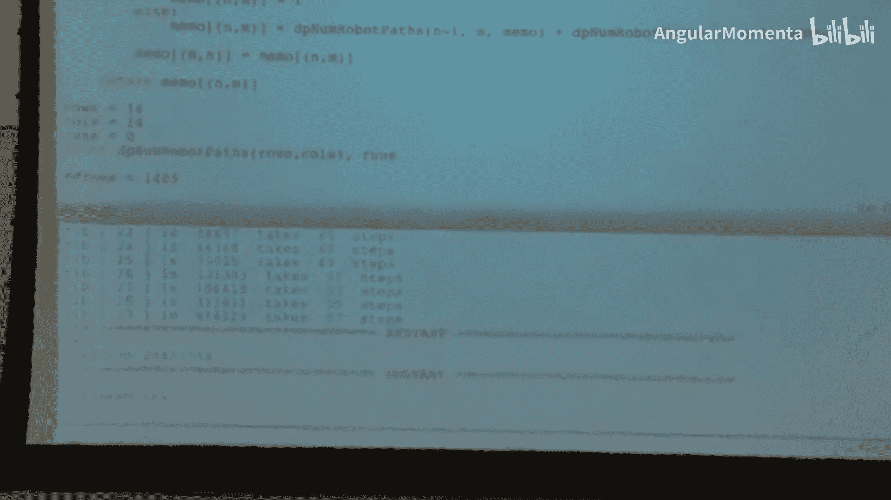

# 036：动态编程 🧠

在本节课中，我们将要学习动态编程的核心概念。动态编程是一种优化算法设计的技术，其核心思想是避免重复计算已经解决过的子问题。我们将通过几个经典例子来理解其工作原理和实现方式。

## 动态编程的核心思想

动态编程的关键在于，对于一个问题，你希望找到一种方法，使得每个计算只执行一次。这是一种“懒惰”的形式，旨在提高效率。

一个能够用动态编程解决的问题需要具备两个关键属性。

以下是这两个关键属性：

1.  **重叠子问题**：这意味着我们可以将一个大问题分解为若干个更小的、相同类型的子问题。然后，我们可以利用这些较小子问题的解来构建原问题的解。
2.  **最优子结构**：这指的是，如果我们能获得某个子问题的最优解，那么我们就可以利用这个最优解来得到原问题的最优解。

这两个属性紧密相关，但并不完全相同。

## 示例一：斐波那契数列 🔢

为了开始，我们先看一个大家熟悉的函数：斐波那契数列。

我们之前已经见过无数次了。很明显，这里存在重叠子问题。`F(n)` 的解是 `F(n-1)` 和 `F(n-2)` 的解之和。因此，如果我结合这两个较小斐波那契实例的解，就能得到较大斐波那契实例的解。

在屏幕上，你有一个之前见过的示例函数。我将运行这个斐波那契函数，从0到30（实际上是n=29）。我们将观察它执行所需的步骤数。

当计算到 `Fibonacci(29)` 时，大约需要160万步来计算这个值。观察图表，Y轴是对数坐标。蓝点代表函数实际执行的步骤数（即需要执行计算的次数）。蓝色实线代表 `2^n`。红线代表黄金比例 `φ^n`，这是该版本斐波那契数列的紧确上界。绿线是二次函数的一部分。这里没有什么特别令人惊讶的，我们之前已经确定它效率很低。

然而，我们可以通过动态编程使其更高效。让我们画出 `F(5)` 的调用树。我们看到在很多地方我们重复了计算：`F(2)` 被计算了三次，`F(3)` 被计算了两次。动态编程背后的思想是，与其一遍又一遍地重复这些计算，不如只计算一次。

观察这个递归斐波那契的实现，我们看到第一个递归调用会沿着树的这一侧向下进行。结果是，`F(5)`、`F(4)`、`F(3)`、`F(2)`、`F(1)`、`F(0)` 这些值都会在任何一个分支返回之前被计算出来。

因此，我们可以这样做：与其在这里重新计算 `F(2)`，不如在这里计算它，然后将这个值保存在某个“大脑”（记忆存储）中。对 `F(3)` 和 `F(4)` 也做同样处理。当我们进行第二个递归调用时，例如在调用 `Fibonacci(3)` 并计算了 `F(2)` 和 `F(1)` 之后，我们返回到 `Fibonacci(4)`。下一个递归调用将是 `Fibonacci(2)`。但由于我们已经计算过它并将其保存在“大脑”中，我们可以直接查找这个值，而无需再次进行所有计算。

对于像这样非常小的树，好处并不巨大。但如果你有像 `F(100)` 这样的大树，这将产生巨大的差异。

让我们来看一下。这是一个带有额外参数 `memo` 的斐波那契实现。`memo` 就是我所说的“大脑”，我们将把计算过的值存放在这里，这样就不必再次计算它们。

当函数最初被调用时，如果 `memo` 是 `None`（即我们没有传入字典，或者这是对该函数的第一次调用），那么它会将键 `0` 设为 `0`，键 `1` 设为 `1`。这些对应 `F(0)` 和 `F(1)`。

完成初始化后，它会执行到这个 `if` 语句。它将检查 `n` 是否在 `memo` 中。这实际上是在问：我们在计算这个大斐波那契数的过程中，以前见过这个数字吗？如果它在这棵树的下方，并且正在查看 `F(2)`，它会问：我之前进行这个计算时，见过 `Fibonacci(2)` 吗？如果它在这棵树中，那么答案是肯定的，因为它在这里见过。如果它没见过，那么它就必须做实际工作，即进行递归调用。这就是它沿着树的左侧分支向下遍历的时候。

我们要做的就是把值存储在这里。最后，我们只需返回 `memo` 中存储的值。让我们看看这个版本如何运行。旧的实现需要160万步，而现在只需要57步。事实上，它是线性的，恰好是 `2n - 1` 步。这为你节省了大量工作，因为一旦它计算了 `F(4)` 这整个子树，当它看到 `F(3)` 时，它会查看它的“大脑”，发现已经见过 `F(3)`，于是它说：我已经见过这个了，所以我不需要在这里进行所有这些计算，不需要进行所有这些递归调用，我只需要返回字典中的值。这就是节省的来源。

## 示例二：机器人路径问题 🤖

让我们看另一个例子。重点是，如果你代码写得正确，可以获得巨大的节省。让我们看一个不同的问题。

假设我有一个机器人，它位于一个网格上。网格有 `N` 行和 `M` 列。机器人从这里出发，想要到达这里。但这个机器人非常笨，它只能向下和向右移动。问题是：在给定这些约束条件下，从左上角方格到右下角方格有多少条唯一的路径？

如果你尝试用分析方法来做，可能会很困难。我认为更简单的方法是意识到，要到达目标格子 `G`，它只能从两个地方来：可以从这里来，也可以从这里来。因此，进入 `G` 的唯一路径总数，等于进入这个格子的唯一路径总数加上进入那个格子的唯一路径总数。这就是你的重叠子问题。同时，如果你能算出这两个数字，你就能算出这个数字，这就是最优子结构。然后，对于这些格子，同样的条件也适用：如果我知道这两个数字，我就能算出这个数字；如果我知道这两个数字，我就能算出这个数字。

另外，如果我遇到一个 `1 x M` 的网格这种情况，从这里到这里有多少种不同的方式？只有1种。对于 `N x 1` 的网格也是如此。

以下是该问题的第一个实现尝试。这是一个递归函数。我们要做的就是：如果我们只有一行或一列，我们返回1。否则，我们查看 `(n-1) x M` 矩阵中的机器人路径数，以及 `n x (M-1)` 矩阵中的路径数。

让我们在 `14 x 14` 的网格上运行这个。这需要几秒钟。有大约1000万条唯一路径，但它花了2000万步才计算出来。

我们将对这个问题使用与斐波那契数列相同的技巧：我们将记忆化（或备忘）不同的路径或不同的解。只是我们的键会有点不同，它将是 `(n, m)`。同样，如果 `(n, m)` 不在 `memo` 中，那么我们需要计算它。如果 `n` 或 `m` 等于1，我们将其记为1。如果两者都大于1，那么我们将查看 `(n-1, m)` 和 `(n, m-1)` 的路径数。我们还知道解是对称的，所以 `(n, m)` 和 `(m, n)` 的解是相同的。然后返回解。

让我们试试这个。我们得到了相同的答案，但只用了104步。所以这是一个相当大的节省。

## 自顶向下与自底向上

上面的例子是自顶向下动态编程解决方案的一个例子。我们审视大问题，然后将其分解为两个较小的子问题，再将这些较小的子问题进一步分解。

我们也可以自底向上地进行。我们可能出于某种原因想要这样做，我稍后会展示。

自底向上的方法将从起点开始，而不是从终点回溯。例如，在机器人路径问题中，自顶向下是从终点问“从这两个格子有多少种方式到达我”，而自底向上是从起点问“有多少种方式到达这里”（答案是1），然后问“到达这里有多少种方式”。

想象我们只有一个 `2 x 2` 的网格。它将查看到达左边方格和上方方格的方式数，并将其相加到这里。在这个版本中，我们正在做的是朝着解决方案的方向“增长”我们的网格。

这个实现只是建立了一个矩阵。顶行初始化为1，第一列初始化为1。然后对于其他所有格子，我们只需添加上方的行和左边的列。最后返回右下角的值。

这样我们以不同的方向得到了相同的解。

现在，你可能想这样做是因为，想象一下，如果不是14，而是1400。递归版本应该会崩溃。Python 有最大递归深度限制。如果你有太多的递归调用，它会告诉你无法深入那么深，然后把你踢出去。我有1400行和1400列，那是大量的递归。但如果我们以迭代方式（没有递归）来做，那么这就是唯一路径的数量（一个相当大的数字）。这是你进行的调用次数，对于一个1400x1400的矩阵来说，这不算太差。

## 示例三：硬币找零问题 💰

刚才那个比较简单。现在我们要看一个稍微难一点的。

这是硬币找零问题。假设我有一种货币，其硬币有特定的面值。问题是，假设我有一个总金额，问题是：有多少种不同的硬币组合等于这个总金额？

分解这个问题的方法是：首先考虑，如果我使用集合中最大面值的硬币至少一次，组合数会是多少。另一个子问题是，如果不使用最大面值的硬币，组合数是多少。

这实际上变成了一个更简洁的子问题：对于 `总金额 - 最大面值` 这个新总额，有多少种组合？对于第二个子问题，我仍然有原来的总金额，但硬币集合现在去掉了最大面值的硬币（例如，原来最大是27分，现在最大是25分）。

这个大问题的解，是这两个子问题的解之和。

让我们看一下这个问题的第一个版本实现。函数参数是 `total`（我们想要的金额）和 `coins`（我们货币中的硬币集合）。我们首先检查 `total` 是否为零。这意味着我们试图找出等于零的硬币组合，当然只有一种组合：没有硬币。所以这返回1。第二种情况是，如果我们尝试使用一个对于当前总额来说太大的硬币，导致总额变为负数。这意味着我们不能为这个特定的总额使用那枚硬币。没有有效的组合。最后一种情况是，如果我们不再有硬币了（硬币集合为空），而我们仍然需要凑出一些金额（`total` 仍有值），那么这意味着我们正在尝试的这种特定组合也无效，我们返回0。

我们的第一个递归调用是寻找不使用最后一枚（最大）硬币的方式数。我们传入之前的总金额，以及除了最大一枚之外的所有硬币（每次递归调用去掉一枚）。第二种情况是，如果我们确实使用了至少一枚最大面值的硬币。在这种情况下，我们将从总金额中减去该面值，并原样传入硬币集合。然后我们返回两者之和。

这是没有任何记忆化的版本，只是使用递归，将其分解为两个子问题并找出解。

现在我们将使用动态编程来优化它。在这种情况下，我们有自己的记忆化字典。你注意到这里的模式了吗？我们将基于我们试图寻找的总金额和我们拥有的最大货币面值来进行记忆化。如果它不在我们的字典中，那么我们将计算它。一旦我们得到解，我们就将其记忆化并返回。

现在让我们尝试一个不同的表述。这个有点棘手。想象我有一个网格。在行方向上，我有从0到总金额的数字。在列方向上，我有不同的货币面值。

前两个实现是自顶向下的，现在我们要自底向上。阅读这个表格的方式是：如果我总金额为0，并且我的最大货币面值是5、10、25或27，那么等于这个总金额的硬币组合数是多少？在第一行（总金额为0），那是我的基本情况，都是1。在这里（第一列，硬币集合为空），我们知道这都将是0，因为如果我没有硬币。

自底向上的方法是，我们将填充这个表格。我们将遍历所有可能的总金额。对于每个总金额，我们将遍历所有最大的硬币面值。然后我们将进行两次检查。我们将查看当前正在查看的总金额，假设我们在第1行，所以总金额是1。我们将减去我们正在查看的最大面值（从5开始）。从1中减去5，结果小于0。当它小于0时，我们要做的就是将当前总金额的组合数“携带”到下一个较小的最大面值。所以如果我们在面值5这里，并且知道小于0，那么我们将把这个值（0）带过来。

然后我们将对所有值做同样的事情。现在让我们看一个有趣的情况。现在我们看总金额为5。当我们的最大硬币是5时，我们从5中减去它，结果不小于0。这意味着我们将进入 `if` 语句的第二个分支。同样，我们将查看使用最大硬币的方式数。为此，我们将使用我们的表格。我们将查看当前总金额（5）减去我们正在查看的最大硬币（5），结果是0。这将索引到总金额为0的这一行。然后我们查看当前硬币（5），所以这将是1。这是使用最大硬币的方式数。然后我们查看不使用最后一枚硬币的方式数。如果这是我们正在查看的最大硬币，那么没有它，我们拥有的硬币集合就少了它，所以那将是0。因此 `0 + 1 = 1`。

对于面值10，同样，这变成0。下一个有趣的是总金额10。这将是0，这将是 `1 + 0`，这将是 `1 + 1`。我们只是在填充这个表格。因为最小的面值是5，所以只有一种方法用5来凑出5。如果有1分的硬币，这里会是2。但因为我们只有5分，所以只有一种方法凑出5。如果有25分是最大的，你可以用5分。这可能会让人困惑，但这个疯狂的方法是有效的。

让我们扩展这个。使用所有三个版本。所有三个版本都给出相同的输出，只是它们所采取的步骤数不同：初始版本用了855步，带记忆化的版本用了209步，而不带记忆化但自底向上的版本只用了337步。这只是攻击同一问题的三种不同方式。客观地说，后两种比第一种好。我们可能会想到一些情况，我们更愿意使用基于表格的方法而不是递归方法，例如，如果我们要探索大量的组合，或者遇到递归深度太深导致Python无法处理而崩溃的情况，就像我们在机器人路径问题中遇到的那样。这将是选择哪种算法优于另一种的标准。

## 总结 📝

本节课中我们一起学习了动态编程。我们了解到动态编程通过避免重复计算子问题来优化算法，其适用的问题必须具有重叠子问题和最优子结构两个特性。我们通过斐波那契数列、机器人网格路径和硬币找零三个经典例子，分别探讨了自顶向下（带记忆化的递归）和自底向上（迭代填表）两种实现方式，并比较了它们的效率差异和适用场景。动态编程是一种强大的工具，能够将某些指数级复杂度的问题优化为多项式级，是算法设计中不可或缺的技术。