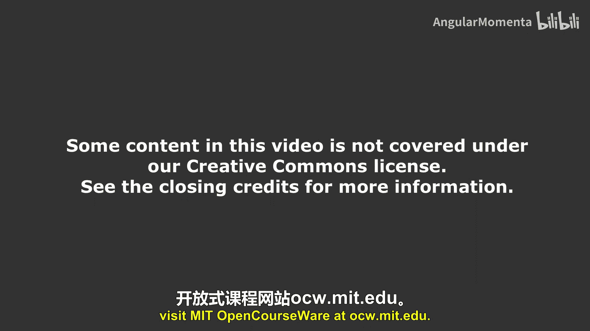
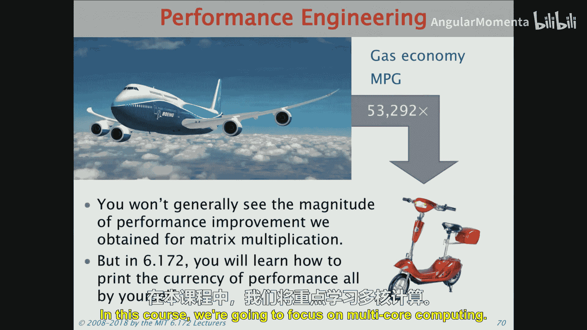
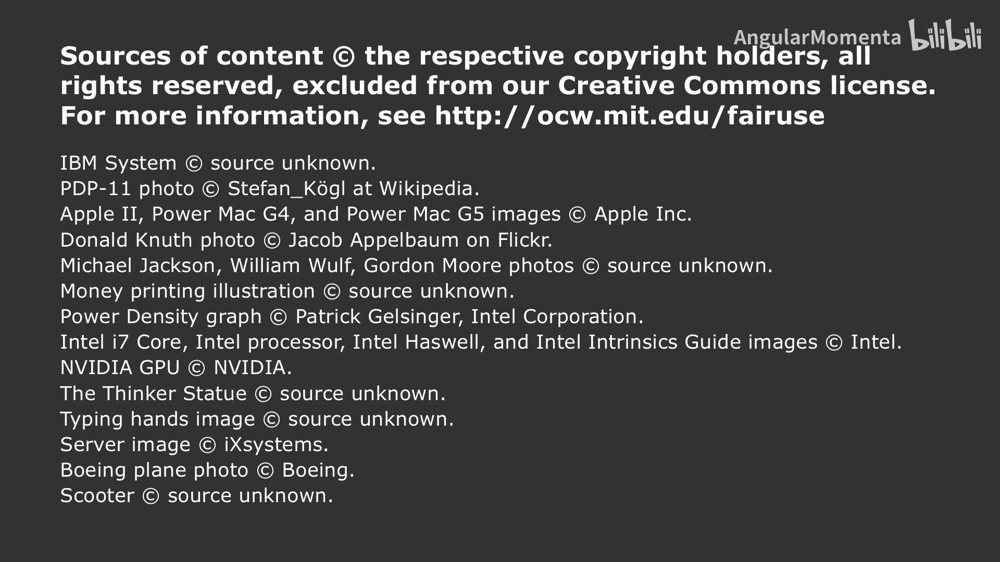

# 001：引言与矩阵乘法 🚀



在本节课中，我们将要学习软件性能工程的基本概念，并通过一个经典的矩阵乘法案例，了解性能优化带来的巨大潜力。我们将看到，通过一系列从简单到复杂的优化技术，可以将一个程序的运行速度提升数万倍。

***

## 课程概述

性能工程是计算机科学中的一个关键领域。虽然性能本身可能不是软件开发中最优先考虑的因素，但它却是实现其他重要属性（如易用性、安全性、可扩展性）的“货币”。随着硬件发展进入多核时代，性能不再是免费的午餐，软件开发者必须主动进行性能优化，才能充分利用现代硬件的计算能力。

***

## 为什么需要性能工程？

上一节我们介绍了性能作为“计算货币”的概念。本节中我们来看看性能工程的历史背景和现实意义。

在计算机发展的早期，机器资源非常有限。程序员必须进行深入的性能优化，才能使程序在有限的内存和极低的时钟频率下运行。然而，随着摩尔定律和登纳德缩放定律的盛行，硬件性能每两年就会翻倍，程序员只需等待几年，程序就会自动变快。因此，像高德纳这样的计算机科学家提出了“过早优化是万恶之源”的著名观点。

这种情况在2004年左右发生了根本性改变。由于功耗和散热问题，处理器的时钟频率停止增长。芯片制造商转而通过增加核心数量（即多核处理器）来提升性能。这意味着，为了获得更好的性能，软件必须能够并行执行。此外，现代处理器还集成了向量单元、复杂的多级缓存等特性。

因此，性能工程在今天变得至关重要。数据显示，自2004年后，开源项目中对“性能”的讨论显著增加，招聘市场中对性能工程技能的需求也在上升。掌握性能优化技能，能让你在职业发展中更具竞争力。

***

## 案例研究：矩阵乘法

现在，让我们通过一个具体的例子——矩阵乘法，来直观感受性能优化的威力。我们将在一个现代多核服务器上进行测试。

### 测试环境

我们使用的是一台AWS上的计算优化型实例，其关键硬件规格如下：
*   **架构**： Haswell微架构，主频2.9 GHz。
*   **核心数**： 2个处理器芯片，每芯片9个核心，共18个物理核心。
*   **向量单元**： 每个核心每周期可执行8个双精度浮点操作（包括融合乘加）。
*   **缓存**：
    *   L1缓存： 32 KB（数据），8路组相联。
    *   L2缓存： 256 KB。
    *   L3缓存（末级缓存）： 25 MB。
*   **内存**： 60 GB DRAM。
*   **理论峰值性能**： `2.9 GHz * 2 chips * 9 cores/chip * 16 FLOPs/cycle ≈ 836 GFLOPs`。

### 基准性能：Python实现

我们首先用Python实现一个最朴素的三重循环矩阵乘法（假设矩阵大小为 `n=4096`）。

```python
import time
n = 4096
A = [[1]*n for _ in range(n)]
B = [[1]*n for _ in range(n)]
C = [[0]*n for _ in range(n)]

start = time.time()
for i in range(n):
    for j in range(n):
        for k in range(n):
            C[i][j] += A[i][k] * B[k][j]
end = time.time()
print(end - start)
```

**运行结果**： 约21,000秒（接近6小时）。

**性能分析**：
*   总操作数约为 `2 * n^3 = 2 * 4096^3 ≈ 1.37e11` 次浮点运算。
*   计算得到的性能约为 `1.37e11 ops / 21000 s ≈ 6.25 MFLOPs`。
*   这仅达到了机器理论峰值性能（836 GFLOPs）的 **0.00075%**。效率极低。

### 优化步骤1：更换编程语言

Python是一种解释型语言，执行每条语句都需要额外的解释和状态管理开销。我们尝试用编译型语言重写。

以下是不同语言实现相同算法的性能对比：

| 实现语言 | 运行时间 | 相对加速（较上一行） | 绝对加速（较Python） | 达到峰值百分比 |
| :--- | :--- | :--- | :--- | :--- |
| Python | 21,000 秒 | 1.0x | 1.0x | 0.00075% |
| Java | ~3,000 秒 | ~7x | ~7x | 0.005% |
| C (Clang, -O0) | ~1,100 秒 | ~2.7x | ~19x | 0.014% |

仅仅通过将代码从解释型的Python迁移到编译型的C语言，我们就获得了近20倍的性能提升。这是因为编译后的机器码能更直接、高效地利用硬件。

***

### 优化步骤2：循环顺序与缓存局部性

上一节我们通过更换语言获得了显著提升。本节中我们来看看一个更微妙的优化点：循环顺序。

矩阵乘法的三重循环 (`i`, `j`, `k`) 可以有6种不同的排列方式，且计算结果相同。但不同的顺序会导致完全不同的内存访问模式，从而严重影响性能。

**关键概念**： **缓存局部性**。
现代处理器通过缓存来加速内存访问。数据以**缓存行**（通常64字节）为单位在内存和缓存间传输。如果程序访问的数据在物理地址上相邻（空间局部性），或者不久后会再次访问同一数据（时间局部性），那么缓存命中率会很高，访问速度就快。

在C语言中，多维数组按**行优先**顺序存储。分析 `i-j-k` 顺序（即 `for i for j for k`）：
*   `C[i][j]`： 在内层`k`循环中保持不变，具有极好的时间局部性。
*   `A[i][k]`： 随`k`连续访问，具有很好的空间局部性。
*   `B[k][j]`： 随`k`变化时，访问的是不同行的同一列元素，地址间隔很大（`n * sizeof(double)`），空间局部性极差，导致大量缓存行被浪费。

通过简单地调整循环顺序为 `i-k-j`，我们可以让 `B[k][j]` 的访问也变得连续。实验表明，仅此一项改动就能带来 **约6.5倍** 的加速。

***

### 优化步骤3：编译器优化选项

除了修改代码，我们还可以通过告诉编译器进行更激进的优化来免费提升性能。Clang/GCC 提供了 `-O1`, `-O2`, `-O3` 等优化等级。

在我们的测试中，使用 `-O2` 选项比默认的无优化 (`-O0`) 带来了 **约3.25倍** 的加速。此时性能达到了理论峰值的 **0.3%**。编译器优化会自动进行循环展开、指令调度、寄存器分配等操作。

***

### 优化步骤4：并行化

到目前为止，我们只使用了18个核心中的1个。现代性能工程的核心就是利用并行性。

我们可以使用Cilk Plus（或类似的OpenMP）并行框架。只需在外部循环前添加 `cilk_for` 关键字，即可将迭代分配到多个核心上执行。

以下是并行不同循环的测试结果：
*   并行化 `i` 循环： ~3.18 秒 （优秀）
*   并行化 `j` 循环： 性能下降 （较差）
*   同时并行化 `i` 和 `j` 循环： 性能不佳

**经验法则**： 通常应该并行化最外层的循环，以减少任务创建和调度的开销。通过并行化 `i` 循环，我们获得了接近18倍的加速（因为核心数为18），总加速比达到约 **220倍**，性能达到峰值的 **5%**。

***

### 优化步骤5：分块（Tiling）优化

尽管并行化带来了巨大提升，但我们仍只利用了5%的峰值性能。瓶颈之一在于**缓存未命中**。

朴素算法在计算矩阵C的一行时，需要遍历矩阵B的所有列。对于大矩阵，B的数据无法完全放入缓存，导致每次计算新行时，B的数据都需要从慢速内存中重新加载，产生了大量重复访问。

**分块算法** 通过将大矩阵分解为小块（Tile）来解决这个问题。例如，我们将矩阵划分为 `S x S` 的子块。计算时，我们专注于一个能放入高速缓存的C子块，并只加载计算该子块所需的A和B的相应子块。这样，在缓存中的数据被重复利用多次后才被换出，极大地提高了缓存命中率。

实现分块后，矩阵乘法会变成六层循环（外层遍历块，内层遍历块内元素）。通过实验调整分块大小 `S`，我们找到了最佳值（在此例中为32）。分块优化带来了约 **1.7倍** 的额外加速，总性能达到峰值的 **10%**。

对于多级缓存（L1, L2, L3），理论上可以进行多层分块，但这会导致代码极其复杂（例如三层缓存需要12层循环！）。一个更优雅的解决方案是使用**递归分治**算法。

***

### 优化步骤6：递归分治与向量化

递归分治算法将矩阵不断四等分，递归计算子矩阵的乘积，最后合并结果。这种结构天然具有良好的缓存局部性，并且易于并行化（可以并行计算独立的子问题）。然而，过深的递归会导致巨大的函数调用开销。

**解决方案**： 设置一个递归基阈值。当子矩阵尺寸小于该阈值时，不再递归，而是调用一个高度优化的基础版本（例如我们之前调优过的分块并行版本）。通过实验，我们确定最佳阈值约为32。

此时，性能达到了峰值的 **12%**。

**下一步：向量化**。
现代CPU拥有SIMD（单指令多数据）向量寄存器，可以一次性对多个数据执行同一操作。我们的处理器支持AVX指令集，每个向量寄存器可容纳4个双精度浮点数。编译器在高级优化模式下（如 `-O3 -march=native -ffast-math`）会自动尝试向量化循环。`-ffast-math` 允许编译器为了速度而重新排列浮点运算顺序（牺牲严格的结合律）。

启用向量化后，性能再次翻倍。

***

### 优化步骤7：使用内联函数与最终优化

为了榨取最后一点性能，我们可以绕过编译器，直接使用CPU提供的**内联函数**来手动编写向量化代码。我们还可以进行其他微调，例如：
*   预转置矩阵，优化访问模式。
*   确保数据内存对齐。
*   为递归基编写更精巧的算法。

通过结合手动向量化和其他优化，我们最终将矩阵乘法的性能提升到了机器理论峰值的 **41%**，总加速比达到惊人的 **50,000倍**。这个版本甚至在某些情况下超越了英特尔官方的高度优化的数学核心库。

***

## 总结与课程范围

本节课中我们一起学习了性能工程的重要性，并通过矩阵乘法的案例，实践了一系列性能优化技术：
1.  **选择高效的语言**： 编译型语言（C）远快于解释型语言（Python）。
2.  **理解内存层次结构**： 循环顺序和分块技术能极大改善缓存局部性。
3.  **利用编译器**： 使用合适的优化标志。
4.  **并行化**： 使用多核处理器是提升性能的关键。
5.  **算法重构**： 递归分治等算法能更好地匹配硬件特性。
6.  **向量化**： 使用SIMD指令集进行数据级并行。






最终，我们见证了将一个运行数小时的程序优化到仅需不到一秒的完整过程。本课程（6.172）将主要专注于**多核计算**的性能工程，这是理解更广泛性能问题（如GPU、文件系统、网络）的坚实基础。掌握了这些核心技能，你将能够为自己编写的软件“印制”性能货币，而不再完全依赖他人的库。