# 002：宾利工作优化法则 🚀


在本节课中，我们将要学习一系列旨在减少程序“工作量”的优化法则。这些法则由约翰·路易斯·宾利提出，通过优化数据结构、循环、逻辑和函数，可以显著提升程序的性能。我们将逐一探讨这些技巧，并通过实例理解其应用。

## 概述

程序的“工作量”定义为程序在特定输入下执行的所有操作的总和。优化工作的核心思想是减少程序需要执行的操作数量，从而提升运行时间和性能。虽然算法设计能带来显著的工作量减少，但本节课将聚焦于许多其他实用的优化技巧。

需要注意的是，减少工作量并不总是直接转化为运行时间的减少，因为现代计算机硬件非常复杂，涉及指令级并行、缓存、向量化等因素。然而，减少工作量是降低程序整体运行时间的一个良好启发式方法。

---

## 数据结构优化 📊

上一节我们介绍了工作优化的基本概念，本节中我们来看看如何通过优化数据结构来减少工作量。

### 1. 数据打包与编码

**核心思想**：将多个数据值存储在一个机器字中（打包），或将数据值转换为需要更少比特的表示形式（编码）。这可以减少内存访问次数，从而提升性能。

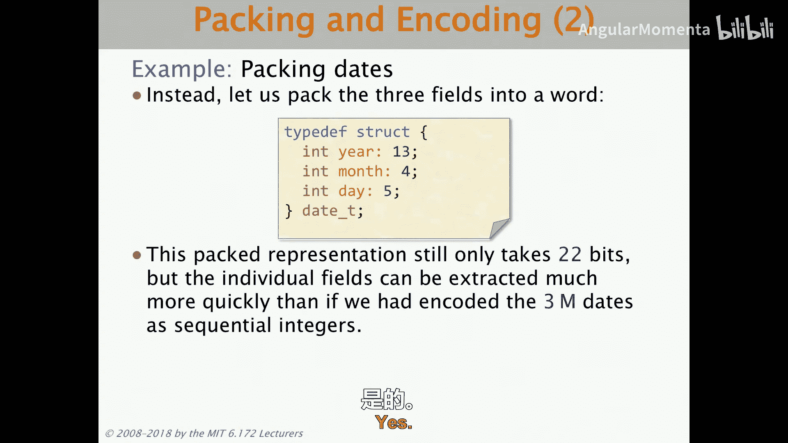

**示例**：存储日期 “September 11, 2018”。
*   **字符串表示**：需要18字节（超过2个双字）。
*   **编码表示**：如果我们只存储公元前4096年到公元4096年之间的日期，大约有300万个日期。使用 `ceil(lg(3,000,000)) = 22` 比特即可表示，这可以轻松放入一个32位字中。

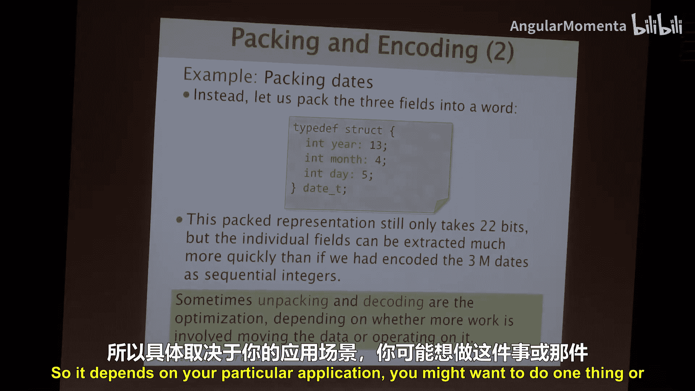

虽然编码节省了空间，但提取月份等信息可能需要更多计算。C语言中的位域（bit-field）提供了一种折中方案，既能节省空间，又能方便地访问各个字段。

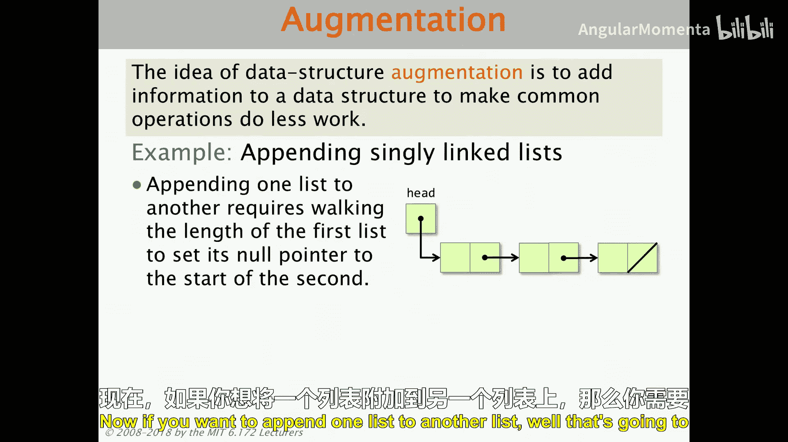

```c
struct date_t {
    int year:13;  // 13 bits for year (8192 possibilities)
    int month:4;  // 4 bits for month (12 possibilities)
    int day:5;    // 5 bits for day (31 possibilities)
};
```

### 2. 数据结构增强

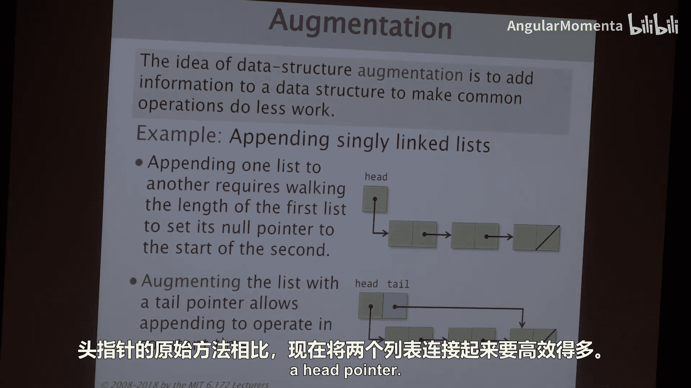

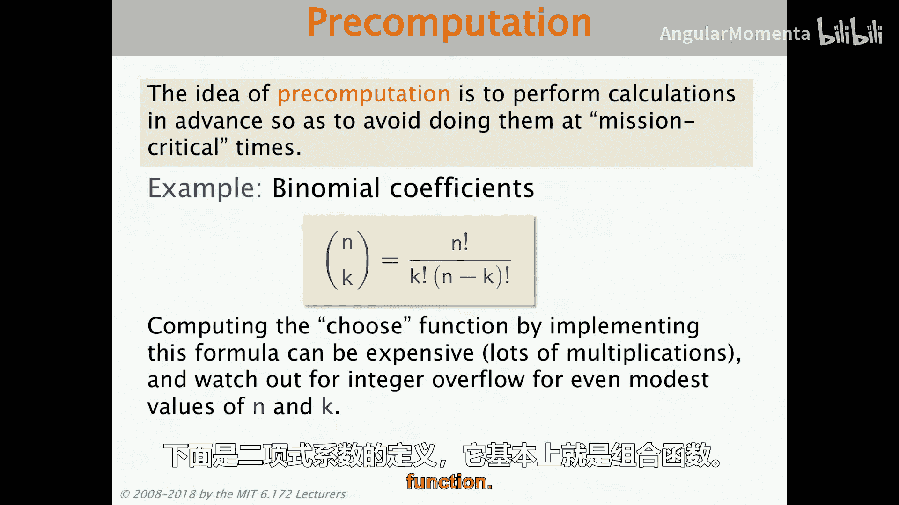

**核心思想**：向数据结构中添加额外信息，使常见操作需要更少的工作量。

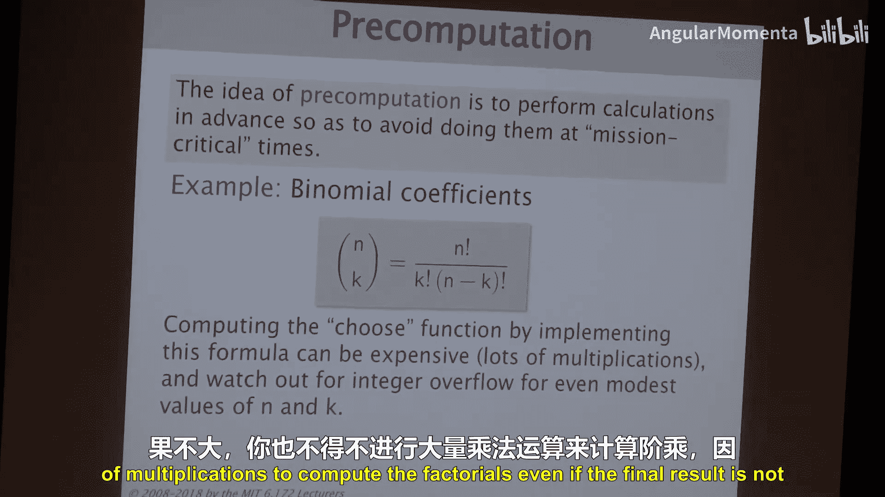

**示例**：连接两个单链表。
*   **原始结构**：只存储头指针。要追加列表，需要遍历第一个列表找到最后一个元素，操作复杂度为 O(n)。
*   **增强结构**：同时存储头指针和尾指针。现在，追加两个列表可以在常数时间 O(1) 内完成，只需更新尾指针即可。

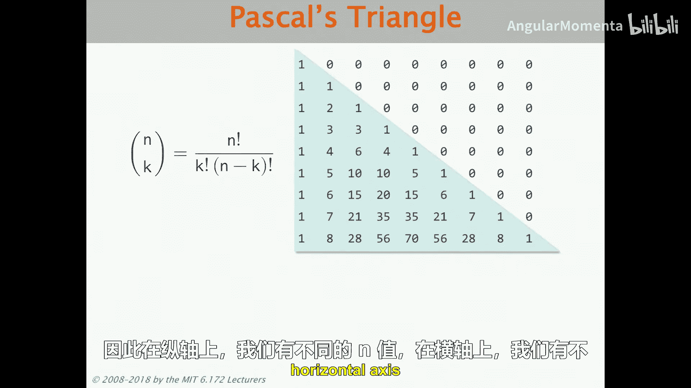

### 3. 预计算

**核心思想**：提前执行一些计算，避免在程序运行的关键时刻进行这些计算。

**示例**：使用二项式系数。
计算 `n choose k` 的公式是 `n! / (k! * (n-k)!)`，计算阶乘开销大且可能溢出。我们可以预计算帕斯卡三角形（Pascal‘s Triangle）并存储在表中，运行时直接查表。

```c
// 预计算帕斯卡三角形（示例代码片段）
int choose[SIZE][SIZE];
for (int n = 0; n < SIZE; n++) {
    choose[n][0] = choose[n][n] = 1;
    for (int k = 1; k < n; k++) {
        choose[n][k] = choose[n-1][k-1] + choose[n-1][k];
    }
}
// 运行时查表：result = choose[n][k];
```

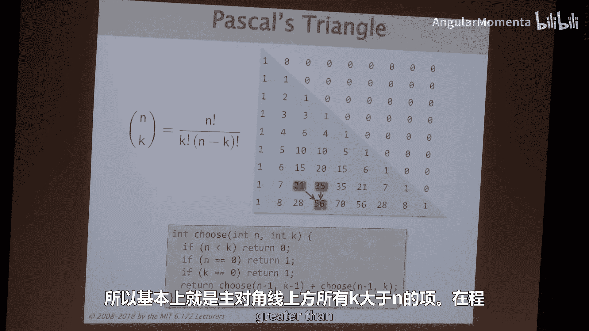

为了进一步优化，我们可以使用**编译时初始化**或**元编程**（编写程序来生成包含常量表的源代码），从而完全消除运行时的初始化开销。

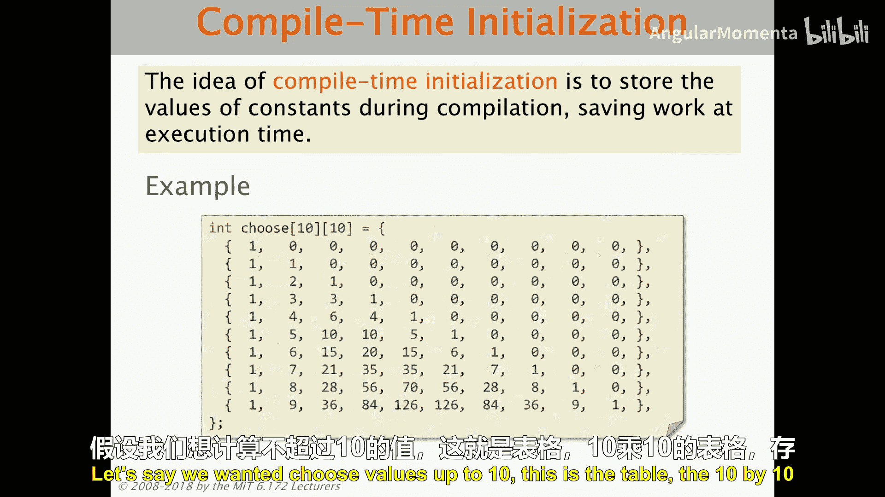

### 4. 缓存

**核心思想**：存储最近访问过的结果，避免重复计算。

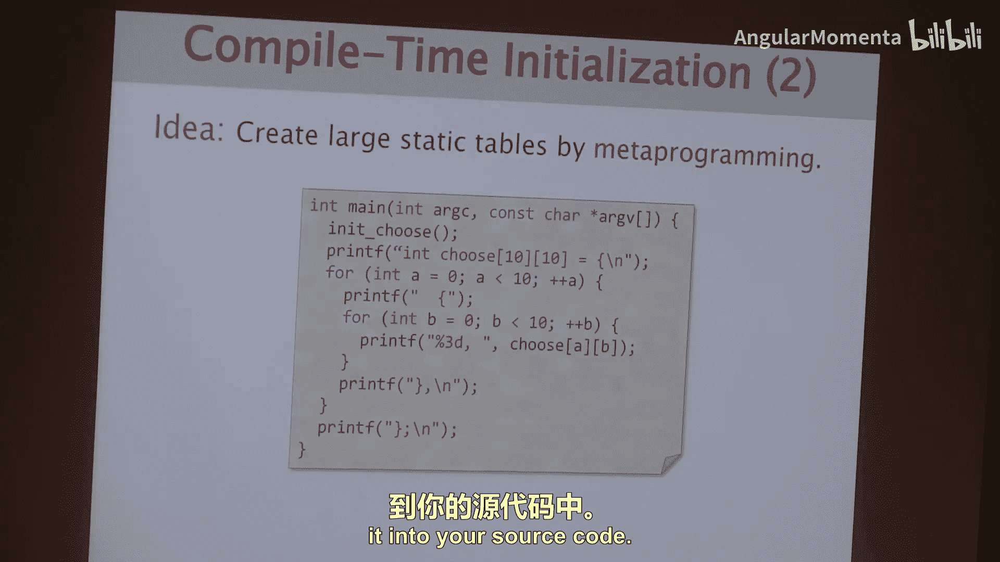

**示例**：计算直角三角形的斜边 `hypotenuse = sqrt(a*a + b*b)`。平方根运算相对昂贵。我们可以创建一个缓存来存储最近计算过的 `(a, b, hypotenuse)` 三元组。当再次调用函数时，首先检查输入 `(a, b)` 是否与缓存匹配，如果匹配则直接返回缓存的斜边值。

虽然示例中的缓存大小仅为1，但在实际应用中，可以维护一个更大的缓存（如最近1000次计算结果）。软件缓存可以与硬件缓存协同工作，进一步提升性能。


### 5. 利用稀疏性

**核心思想**：避免存储和计算输入中的零元素，因为对零的操作结果是已知的。

**示例**：稀疏矩阵向量乘法。
*   **稠密方法**：进行 `n^2` 次标量乘法，即使很多元素是零。
*   **稀疏方法**：使用压缩稀疏行（CSR）格式存储矩阵。
    CSR 使用三个数组：
    *   `rows`：长度为 `n+1`，存储每行非零元素在 `columns` 数组中的起始偏移。
    *   `columns`：存储非零元素的列索引。
    *   `values`：存储非零元素的值。
    存储开销为 `O(n + nnz)`，其中 `nnz` 是非零元素数量。矩阵向量乘法只需进行 `nnz` 次操作。

```c
// 稀疏矩阵向量乘法 (SPMV) 伪代码
for (int i = 0; i < n; i++) {
    y[i] = 0;
    for (int k = rows[i]; k < rows[i+1]; k++) {
        int j = columns[k];
        y[i] += values[k] * x[j];
    }
}
```

类似地，CSR 格式也可用于高效表示和计算稀疏静态图。

---

## 逻辑优化 ⚙️

在优化了数据结构之后，我们来看看如何通过优化程序逻辑来减少不必要的工作。

### 6. 常量折叠与传播

**核心思想**：在编译时计算常量表达式，并将结果代入后续表达式中，避免运行时计算。

**示例**：构建一个数字太阳系模型（Orrery）。当半径 `radius` 是常量时，直径、周长、横截面积等所有相关量都可以在编译时计算出来。编译器在高级优化模式下通常会自动执行此优化。

### 7. 公共子表达式消除

**核心思想**：避免多次计算相同的表达式，改为计算一次并将结果存储起来供后续使用。

**示例**：
```c
a = b + c;
b = a - d; // 第一次计算 a - d
c = b + c; // 注意：此处的 b 已改变，所以 b+c 不是公共子表达式
d = a - d; // 第二次计算 a - d，可以消除
```
优化后：
```c
a = b + c;
temp = a - d; // 计算一次并保存
b = temp;
c = b + c;
d = temp; // 使用保存的结果
```
编译器通常能识别并执行此优化。

### 8. 利用代数恒等式

**核心思想**：用计算成本更低的等效代数表达式替换昂贵的表达式。

**示例**：检测两个球体是否碰撞。原始检查：`distance = sqrt(dx^2 + dy^2 + dz^2) <= r1 + r2`。由于平方根运算昂贵，我们可以对不等式两边平方：`dx^2 + dy^2 + dz^2 <= (r1 + r2)^2`。这样就消除了平方根运算。但需注意浮点数精度问题。

### 9. 短路评估

**核心思想**：在执行一系列测试时，一旦知道结果就停止后续评估。

**示例**：检查非负整数数组的和是否超过某个限制。
*   **简单方法**：求和所有元素，最后比较。总是需要查看所有元素。
*   **短路方法**：在累加过程中，一旦部分和超过限制，立即返回 `true`。如果数组元素经常在早期就超过限制，这种方法更快。但若通常需要查看所有或大部分元素，则可能稍慢，因为每次迭代多了条件检查。

C/C++ 中的 `&&`（逻辑与）和 `||`（逻辑或）运算符就是短路运算符。

### 10. 测试排序

**核心思想**：将更可能成功（或成本更低）的测试放在前面，以利用短路评估。

**示例**：检查字符是否为空白字符（空格、换行、制表符、回车）。由于空格在文本中最常见，应首先检查 `c == ‘ ‘`，然后是 `c == ‘\n‘`，接着是 `c == ‘\t‘`，最后是 `c == ‘\r‘`。

### 11. 创建快速路径

**核心思想**：设计一个能提前得出结果的快速检查，避免执行更昂贵的完整计算。

**示例**：回到球体碰撞检测。在计算精确距离平方之前，可以先进行一个快速的包围盒相交测试：如果两个球体在某个坐标轴上的距离绝对值大于其半径之和，则它们不可能碰撞，可立即返回 `false`。这个测试只涉及减法和比较，比乘法（平方运算）成本低。

### 12. 合并测试

**核心思想**：将一系列测试替换为一个测试或 `switch` 语句。

**示例**：实现一个全加器（输入三个比特，输出进位和和位）。与其使用多层嵌套的 `if-else` 语句检查8种输入组合，不如将三个输入比特组合成一个0到7的整数，然后使用一个 `switch` 语句。更优的方法是使用查表法，预计算所有结果。

---

## 循环优化 🔄

循环是程序中执行最频繁的部分，优化循环能带来显著的性能提升。

### 13. 循环不变代码外提

**核心思想**：将循环体内不变的计算移到循环外部，避免每次迭代都重复计算。

**示例**：
```c
for (i = 0; i < n; i++) {
    y[i] = x[i] * exp(sqrt(PI/2)); // exp(sqrt(PI/2)) 是循环不变的
}
```
优化后：
```c
double factor = exp(sqrt(PI/2)); // 计算一次
for (i = 0; i < n; i++) {
    y[i] = x[i] * factor;
}
```
编译器通常能自动进行此优化。

### 14. 哨兵

**核心思想**：在数据结构中放置特殊哑元值，以简化边界条件处理，特别是循环退出测试。

**示例**：检查非负整数数组求和是否溢出。原始代码每个迭代需要检查循环边界和溢出条件。通过向数组末尾添加两个哨兵值（`MAX_INT` 和 `1`），可以修改循环逻辑，使得每个迭代只进行一次比较，并在循环结束后判断溢出原因。

### 15. 循环展开

**核心思想**：将循环的多次迭代合并到一次迭代中，减少循环迭代次数和控制指令的执行开销。

*   **完全展开**：适用于迭代次数少且已知的情况。直接写出所有迭代的代码，消除所有循环控制。
*   **部分展开**：更常见。例如，以因子4展开循环：
    ```c
    for (j = 0; j < n-3; j += 4) {
        // 处理 a[j], a[j+1], a[j+2], a[j+3]
    }
    for (; j < n; j++) {
        // 处理剩余元素
    }
    ```
    **好处**：
    1.  减少循环控制开销（检查次数减少）。
    2.  为编译器提供更大的基本块以进行更多优化（如指令调度、寄存器分配），这通常是更重要的好处。
    **注意**：过度展开会污染指令缓存，可能降低性能。

### 16. 循环融合

**核心思想**：将多个遍历相同索引范围的循环合并成一个循环，节省循环控制开销，并改善缓存局部性。

**示例**：
```c
// 两个独立的循环
for (i=0; i<n; i++) c[i] = min(a[i], b[i]);
for (i=0; i<n; i++) d[i] = max(a[i], b[i]);
```
融合后：
```c
// 一个融合的循环
for (i=0; i<n; i++) {
    c[i] = min(a[i], b[i]);
    d[i] = max(a[i], b[i]);
}
```
融合后，`a[i]` 和 `b[i]` 被加载到缓存后，会在同一次循环迭代中用于计算 `c[i]` 和 `d[i]`，缓存利用率更高。

### 17. 消除无效迭代

**核心思想**：修改循环边界，避免执行那些循环体基本为空的迭代。

**示例**：转置方阵。原始代码遍历所有 `i, j`，但只在 `i > j` 时交换 `a[i][j]` 和 `a[j][i]`。这导致约一半的迭代是浪费的。可以修改内层循环的边界来消除这些无效迭代：
```c
for (i = 1; i < n; i++) {
    for (j = 0; j < i; j++) { // 只遍历下三角部分
        swap(&a[i][j], &a[j][i]);
    }
}
```

---

## 函数优化 🛠️

最后，我们探讨如何通过优化函数调用来减少开销。

### 18. 内联

**核心思想**：通过将函数体直接插入到调用处，避免函数调用的开销（如参数传递、栈帧管理）。

**示例**：
```c
int square(int x) { return x * x; }
// ... 在循环中调用
for (i=0; i<n; i++) sum += square(a[i]);
```
内联优化后：
```c
for (i=0; i<n; i++) {
    int temp = a[i] * a[i]; // 函数体被直接插入
    sum += temp;
}
```
在C语言中，使用 `static inline` 关键字声明函数可以建议编译器进行内联。现代编译器非常擅长自动内联。与宏相比，内联函数更安全，能保证参数只被求值一次。

---

## 总结

本节课中我们一起学习了宾利工作优化法则，涵盖了四大类共22项优化技巧：

1.  **数据结构优化**：包括打包/编码、增强、预计算、缓存和利用稀疏性，旨在减少存储开销和计算量。
2.  **逻辑优化**：包括常量折叠、公共子表达式消除、代数恒等式、短路评估、测试排序、快速路径和合并测试，旨在消除冗余计算和简化控制流。
3.  **循环优化**：包括代码外提、哨兵、循环展开、循环融合和消除无效迭代，旨在减少循环控制开销并提升指令和缓存效率。
4.  **函数优化**：主要是内联，旨在消除函数调用开销。


**重要建议**：
*   **避免过早优化**：首先保证程序的正确性。
*   **进行回归测试**：建立测试套件，确保优化不会破坏原有功能。
*   **理解启发式方法**：减少工作量是提升性能的良好启发，但并非绝对，需结合性能分析。
*   **善用编译器**：现代编译器能自动完成许多低层优化，可以检查汇编代码来验证。

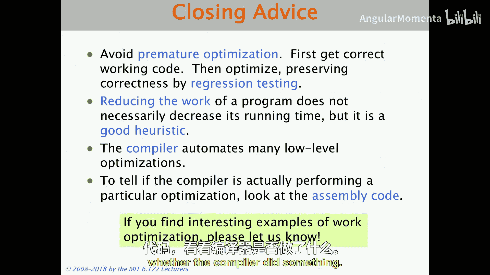


通过应用这些规则，你可以系统地减少程序的工作量，从而为性能提升奠定坚实基础。在后续课程中，我们将学习更多关于计算机体系结构特性的优化方法。