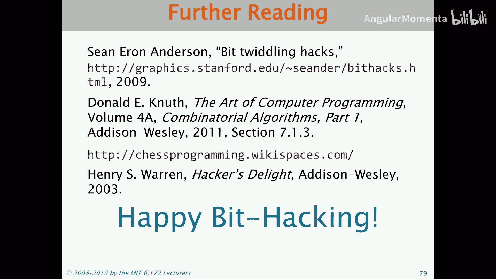

# 003：位操作技巧 🧠


在本节课中，我们将要学习计算机中数据的基本表示方法——二进制，并探索一系列利用位运算（Bit Hacks）来高效操作和计算数据的技巧。这些技巧是底层性能优化的基础。

## 二进制表示回顾

上一节我们介绍了课程概述，本节中我们来看看数据在计算机中的基本表示形式。

一个 **W** 位的字（Word）可以表示如下，我们从最右侧开始，将位编号为 **x₀** 到 **x_{w-1}**。

存储在 **X** 中的无符号整数值可以通过以下公式计算：
```
value = Σ (x_k * 2^k)， 其中 k 从 0 到 w-1
```
本质上，它是许多 2 的幂次方的和。如果位置 **k** 的位是 1，则乘以 2^k；如果是 0，则加 0。

例如，对于一个 8 位字 `0b10010110`：
*   位置 1（2^1）的位是 1：贡献 2
*   位置 2（2^2）的位是 1：贡献 4
*   位置 4（2^4）的位是 1：贡献 16
*   位置 7（2^7）的位是 1：贡献 128
将所有贡献相加：2 + 4 + 16 + 128 = 150。前缀 `0b` 表示这是一个二进制常量。

计算机也需要表示负数，这通过 **二进制补码** 实现。其计算公式为：
```
有符号值 = (-x_{w-1} * 2^{w-1}) + Σ (x_k * 2^k)， 其中 k 从 0 到 w-2
```
对于最高有效位（位 w-1），如果为 1，则减去 2^{w-1}。

以前面的 `0b10010110` 为例：
*   低 7 位的贡献仍然是 2 + 4 + 16 = 22
*   最高位（第7位）为 1，因此减去 2^7 = 128
最终得到的有符号值为：22 - 128 = -106。

最高位因此被称为 **符号位**。

在二进制补码表示中：
*   全 0 的字表示 **0**。
*   全 1 的字表示 **-1**。这是因为求和 Σ2^k (k=0 到 w-2) 等于 2^{w-1} - 1，再减去符号位的 2^{w-1}，结果正好是 -1。

由此可以推导出一个重要恒等式：`x + (~x) = -1`。这里 `~x` 是 **x 的按位取反**（即1的补码）。因为 `x` 和 `~x` 的每一位都相反，相加后每一位都是1，即全1字，也就是 -1。

从这个恒等式可以得出：`-x = ~x + 1`。这关联了二进制补码和1的补码表示。

例如，`x = 0b00101100`：
*   `~x = 0b11010011`
*   `-x = ~x + 1 = 0b11010011 + 1 = 0b11010100`
另一种理解方式是：从右向左找到 `x` 中第一个为 1 的位，保持该位及其左边的所有位不变，将该位右边的所有位取反。

## 十六进制表示法

由于二进制书写冗长，我们常用更紧凑的 **十六进制**（基数为16）表示法。

十六进制使用数字 0-9 和字母 A-F（代表10-15）来表示。每个十六进制数字对应4个二进制位。

转换时，只需将每个十六进制数字查表替换为对应的4位二进制值并拼接即可。

例如，十六进制常量 `0xDEADBEEF`：
*   D -> 1101
*   E -> 1110
*   A -> 1010
*   D -> 1101
*   B -> 1011
*   E -> 1110
*   E -> 1110
*   F -> 1111
因此，`0xDEADBEEF` 的二进制表示为 `1101 1110 1010 1101 1011 1110 1110 1111`。在代码中，我们使用 `0x` 前缀表示十六进制数。

## C语言中的位运算符

了解了表示法后，我们来看看操作它们的工具。C语言提供了一系列位运算符：

| 运算符 | 名称 | 描述 |
| :--- | :--- | :--- |
| `&` | 按位与 (AND) | 两位都为1时结果为1 |
| `\|` | 按位或 (OR) | 两位至少一个为1时结果为1 |
| `^` | 按位异或 (XOR) | 两位不同时结果为1 |
| `~` | 按位取反 (NOT) | 翻转每一位，1变0，0变1 |
| `<<` | 左移 | 位向左移动，右侧补0 |
| `>>` | 右移 | 位向右移动，**对于无符号数，左侧补0** |

例如：
*   `A & B`: 对每一位进行与操作。
*   `A \| B`: 对每一位进行或操作。
*   `A ^ B`: 对每一位进行异或操作。相同为0，不同为1。
*   `~A`: 翻转A的所有位。
*   `A >> 3`: A的位向右移动3位，左侧补0。
*   `A << 2`: A的位向左移动2位，右侧补0。

**注意**：对于有符号数的右移 (`>>`)，左侧可能填充符号位（算术右移）。但在位操作中，我们通常使用无符号整数以避免此问题。

## 常用位操作技巧

掌握了基本运算符，现在我们可以学习一些实用的位操作技巧。以下是几个核心操作：

**1. 设置特定位**
目标：将字 `x` 的第 `k` 位设置为1。
方法：`x = x \| (1 << k)`
原理：`(1 << k)` 生成一个只有第 `k` 位是1的掩码。与 `x` 进行或操作后，该位被设为1，其他位不变。

**2. 清除特定位**
目标：将字 `x` 的第 `k` 位清零。
方法：`x = x & ~(1 << k)`
原理：`~(1 << k)` 生成一个只有第 `k` 位是0的掩码。与 `x` 进行与操作后，该位被强制为0。

**3. 翻转特定位**
目标：将字 `x` 的第 `k` 位取反（1变0，0变1）。
方法：`x = x ^ (1 << k)`
原理：利用异或的特性，与1异或翻转该位，与0异或保持该位不变。

**4. 提取位字段**
目标：从字 `x` 中提取从第 `p` 位开始、长度为 `n` 的位字段。
方法：`(x >> p) & ((1 << n) - 1)`
原理：先右移 `p` 位将目标字段移到最低位，然后与一个低 `n` 位全为1的掩码进行与操作，以屏蔽掉高位不需要的位。

**5. 设置位字段**
目标：将字 `x` 中从第 `p` 位开始、长度为 `n` 的字段设置为值 `y`。
方法：
```
mask = ((1 << n) - 1) << p; // 创建目标位置为1的掩码
x = (x & ~mask) \| ((y & ((1 << n) - 1)) << p);
```
原理：首先用 `~mask` 清除 `x` 中的目标字段（设为0），然后将 `y` 限制在 `n` 位内并左移到正确位置，最后通过或操作合并到 `x` 中。

## 无临时变量交换

一个经典的技巧是如何在不使用临时变量的情况下交换两个整数 `x` 和 `y`。

标准方法需要临时变量 `t`：
```
t = x; x = y; y = t;
```

使用位技巧的无临时变量交换代码如下：
```
x = x ^ y;
y = x ^ y; // 此时 y 变为原来的 x
x = x ^ y; // 此时 x 变为原来的 y
```

**工作原理**：
1.  `x = x ^ y`：将 `x` 设置为一个“差异掩码”，其中为1的位表示 `x` 和 `y` 在该位不同。
2.  `y = x ^ y`：用这个掩码与原来的 `y` 异或。由于异或是自身的逆运算，`(x^y)^y = x`，所以 `y` 得到了 `x` 的原始值。
3.  `x = x ^ y`：此时 `y` 已是原始 `x`，再用掩码与之异或：`(x^y)^x = y`，所以 `x` 得到了 `y` 的原始值。

**注意**：虽然巧妙，但这段代码通常比使用临时变量的版本**性能更差**，因为它引入了三条顺序依赖的指令，无法利用指令级并行。现代编译器能够很好地优化标准交换代码。不过，它常出现在面试题中。

## 无分支最小值计算

条件分支（如 if 语句）可能导致处理器分支预测错误，引起性能损失。有时我们可以用位运算避免分支。

计算 `x` 和 `y` 的最小值，标准方法是：
```
if (x < y) r = x; else r = y;
// 或使用三元运算符： r = (x < y) ? x : y;
```

无分支的位运算方法如下（假设为32位整数）：
```
r = y ^ ((x ^ y) & -(x < y));
```

**工作原理**（利用C语言中 `true=1`, `false=0`）：
*   情况1：`x < y` 为真。
    *   `-(x < y)` 结果为全1字（即 -1）。
    *   表达式变为 `y ^ ((x ^ y) & -1) = y ^ (x ^ y) = x`。因为与全1字与操作等于本身，且 `y ^ y ^ x = x`。
    *   结果 `r = x`，正确。
*   情况2：`x >= y` 为假。
    *   `-(x < y)` 结果为全0字。
    *   表达式变为 `y ^ ((x ^ y) & 0) = y ^ 0 = y`。
    *   结果 `r = y`，正确。

**重要提示**：在现代编译器和处理器上，使用 `-O3` 等优化选项时，简单的条件语句通常会被编译器优化成无分支的 **条件移动指令**，其性能往往优于手写的位运算技巧。因此，这个技巧主要用于理解原理，或在编译器无法优化时使用。

## 实际应用：合并有序数组

让我们看一个分支预测影响性能的实际例子：合并两个有序数组（归并排序的子过程）。

标准实现包含一个核心比较分支：`if (*a <= *b)`。这个分支的结果取决于数据，是**不可预测的**，容易导致分支预测失败。

我们可以用无分支最小值技巧重写核心部分：
```
int comp = (*a <= *b);
int min = *b ^ ((*a ^ *b) & -comp);
*c++ = min;
a += comp;       // 如果*a较小，comp=1，a前进
b += 1 - comp;   // 否则，b前进
na -= comp;
nb -= (1 - comp);
```
这样就消除了不可预测的分支。但如前所述，现代编译器可能已经为原始代码生成了更优的无分支指令。

## 更多实用位技巧

尽管有些技巧编译器能做得更好，但了解它们对理解底层优化、处理特殊场景或进行向量化编程仍有价值。

**1. 模加法（无分支）**
计算 `(x + y) mod n`，其中 `0 <= x, y < n`。除法操作 `%` 较慢。
```
z = x + y;
r = z - (n & -(z >= n));
// 等价于： if (z >= n) r = z - n; else r = z;
```

**2. 向上取整到2的幂**
计算大于等于 `n` 的最小的2的幂，即 `2^ceil(log2(n))`。
```
n--; // 处理n本身就是2的幂的情况
n \|= n >> 1;
n \|= n >> 2;
n \|= n >> 4;
n \|= n >> 8;
n \|= n >> 16; // 对于32位字，扩展到64位需增加 n \|= n >> 32
n++;
```
原理：通过一系列移位和或操作，将最高位的1“扩散”到其右侧的所有位，最终得到 `...011...1` 的形式，加1后即得到 `...100...0`（2的幂）。

**3. 获取最低有效1位掩码**
获取一个只在 `x` 的最低有效1位处为1的掩码。
```
mask = x & -x;
```
原理：`-x = ~x + 1`。`~x` 将 `x` 最低1位左边的位取反，右边（包括该位）先取反后因加1而恢复。与 `x` 相与时，只有原最低1位处两个操作数都为1，故得到该掩码。

**4. 计算二进制中1的个数**
也称为“种群计数”。

*   **方法A（消除最低1）**：`while (x) { count++; x &= (x-1); }` 每次循环清除最低位的1。时间复杂度与1的个数成正比。
*   **方法B（查表法）**：预计算0-255所有数的1的个数。将长字拆分为字节查表累加。速度受限于内存访问。
*   **方法C（并行分治）**：通过巧妙的移位、掩码和加法，以对数步数完成计算。例如：
    ```
    // 计算32位整数x中1的个数
    x = (x & 0x55555555) + ((x >> 1) & 0x55555555); // 每2位一组，计算组内1的个数
    x = (x & 0x33333333) + ((x >> 2) & 0x33333333); // 每4位一组
    x = (x & 0x0F0F0F0F) + ((x >> 4) & 0x0F0F0F0F); // 每8位一组
    x = (x & 0x00FF00FF) + ((x >> 8) & 0x00FF00FF); // 每16位一组
    x = (x & 0x0000FFFF) + ((x >> 16) & 0x0000FFFF); // 每32位一组
    return x;
    ```
*   **最佳实践**：现代CPU通常有硬件指令 `POPCNT`。在GCC中可使用 `__builtin_popcount()` 内建函数，它最快且由编译器处理可移植性。

**5. 德布鲁因序列技巧**
这是一个非常巧妙的技巧，用于快速计算一个 **2的幂** 的以2为底的对数（即找到最高位1的位置）。它利用了一个特殊的 **德布鲁因序列**，该序列是一个循环二进制序列，其中每个可能的 k 位二进制串都作为子串恰好出现一次。

对于 64 位字，使用 k=6 的序列（因为 2^6 = 64）。核心代码如下：
```
// 预先计算的德布鲁因常数和查找表
const uint64_t de_bruijn = 0x022fdd63cc95386dULL;
const int convert[64] = {
    0,  1,  2, 53,  3,  7, 54, 27, 4, 38, 41,  8, 34, 55, 48, 28,
   62,  5, 39, 46, 44, 42, 22,  9, 24, 35, 59, 56, 49, 18, 29, 11,
   63, 52,  6, 26, 37, 40, 33, 47, 61, 45, 43, 21, 23, 58, 17, 10,
   51, 25, 36, 32, 60, 20, 57, 16, 50, 31, 19, 15, 30, 14, 13, 12
};

int log2_of_power_of_two(uint64_t x) { // x必须是2的幂
    return convert[(x * de_bruijn) >> 58];
}
```
**原理简述**：将2的幂 `x`（即 `1 << n`）乘以德布鲁因常数，相当于将德布鲁因序列左移 `n` 位。取结果的高6位作为索引查表，即可得到 `n`。这个技巧展示了如何用乘法和查表代替循环或位扫描指令。如今，更简单的方法是使用 `popcount(x - 1)`。

## 案例研究：N皇后问题

N皇后问题要求在 N×N 棋盘上放置 N 个皇后，使其互不攻击。回溯法是常见解法。

高效的实现可以使用 **位向量** 来加速冲突检测：
*   `down`：长度为 N 的位向量，记录哪些列已被占用。
*   `left`：长度为 2N-1 的位向量，记录“左上-右下”对角线是否被占用。位置 `(r, c)` 对应的对角线索引为 `r + c`。
*   `right`：长度为 2N-1 的位向量，记录“右上-左下”对角线是否被占用。位置 `(r, c)` 对应的对角线索引为 `N - 1 - r + c`。

放置皇后前，只需一次位运算即可检查位置 `(r, c)` 是否安全：
```
if ( !( (down & (1 << c)) \| (left & (1 << (r+c))) \| (right & (1 << (N-1-r+c))) ) ) {
    // 位置安全，可以放置
}
```
这比检查二维数组要快得多。

## 总结与资源

本节课中我们一起学习了计算机数据的二进制表示、核心的位运算符，以及一系列强大而巧妙的位操作技巧。我们从设置、清除、翻转特定位等基本操作，到无临时变量交换、无分支最小值计算等进阶技巧，再到种群计数、德布鲁因序列等高效算法，最后探讨了位向量在N皇后问题中的应用。

虽然现代编译器和硬件指令有时能自动优化，但深入理解这些位技巧对于进行底层性能工程、理解编译器行为、编写高性能算法（尤其是向量化代码）以及解决某些特殊问题至关重要。它们也是编程面试和计算机科学素养的一部分。

**延伸阅读资源**：
*   Sean Eron Anderson 的 *Bit Twiddling Hacks* 网站
*   《计算机系统：程序员的视角》（CS:APP）教科书
*   国际象棋编程维基百科上的位操作技巧
*   书籍 *Hacker‘s Delight*




在接下来的项目一中，你们将有机会实践许多今天学到的位操作技巧。祝各位位运算愉快！