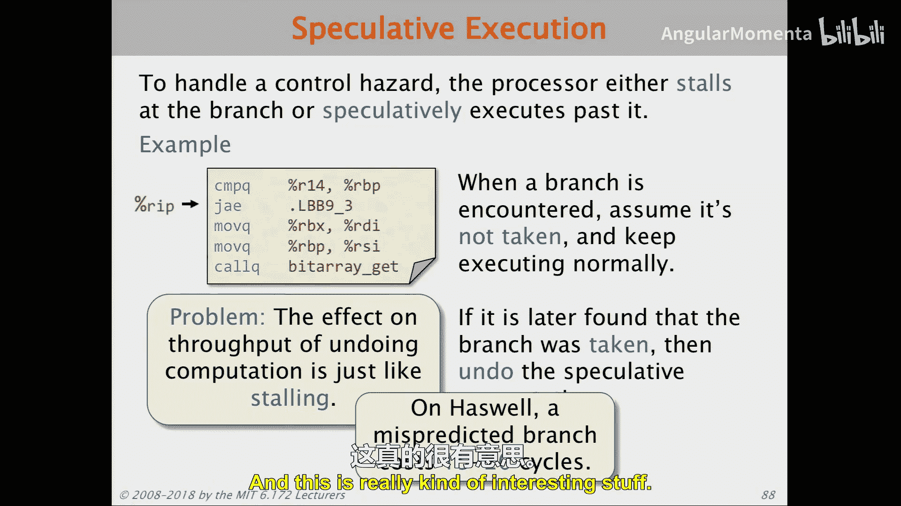
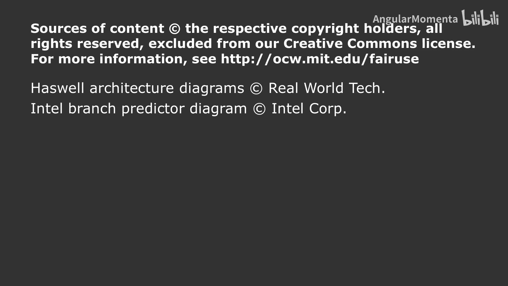

# 004：汇编语言与计算机体系结构 🖥️

在本节课中，我们将要学习汇编语言与计算机体系结构。理解这些底层知识对于编写高性能代码至关重要，因为它能帮助我们充分利用硬件架构的优势。汇编语言是我们与硬件交互的最佳接口。

## 编译过程概述

上一节我们介绍了学习汇编语言的重要性，本节中我们来看看代码是如何从高级语言转换为机器可执行指令的。编译过程并非一步完成，它包含四个主要阶段。

以下是编译过程的四个阶段：
1.  **预处理**：处理宏定义和文件包含等指令。可以使用 `clang -E` 命令单独运行此阶段。
2.  **编译**：将预处理后的源代码转换为汇编代码。可以使用 `clang -S` 命令生成汇编文件。
3.  **汇编**：将汇编代码转换为机器码，生成目标文件。
4.  **链接**：将一个或多个目标文件链接在一起，生成最终的可执行文件。通常使用 `ld` 或 `gold` 链接器。

汇编代码是机器码的助记符表示，比二进制机器码更易于人类阅读。由于汇编与机器码结构非常相似，我们可以使用 `objdump` 工具对机器码进行反汇编，将其转换回汇编形式进行分析。

## 为何需要查看汇编代码

了解编译过程后，一个自然的问题是：为什么我们需要查看程序的汇编代码？这主要有以下几个原因。

以下是查看汇编代码的几个关键原因：
*   **揭示编译器行为**：汇编代码能精确展示编译器实际执行了哪些优化，以及没有执行哪些优化。
*   **调试编译器错误**：编译器本身也是软件，可能存在缺陷。当代码行为异常时，查看汇编有助于判断是否是编译器优化错误所致。
*   **手动优化**：有时无法通过高级语言代码生成期望的汇编指令，此时可以直接编写汇编代码以达到最优性能。
*   **逆向工程**：在没有源代码的情况下，可以通过分析二进制文件的汇编代码来理解程序的功能。

## 课程期望与X86-64 ISA简介

在开始深入学习之前，我们先明确本课程对汇编语言掌握程度的期望，并介绍指令集架构的核心概念。

我们期望你能达到以下水平：
*   理解编译器如何用X86指令实现各种C语言结构。
*   能够借助架构手册阅读X86汇编代码。
*   理解常见汇编模式对性能的高级影响。
*   能够使用编译器内置函数来调用特定的汇编指令。
*   在必要时，具备从零开始编写汇编代码的能力。

指令集架构定义了汇编语言的语法和语义，其核心包含四个重要概念：寄存器、指令、数据类型和内存寻址模式。

## 寄存器

寄存器是处理器存储数据的地方。X86架构有多种寄存器，以下是最重要的几类。

以下是X86-64架构中的主要寄存器类型：
*   **通用寄存器**：通常为64位宽，用于存储整数和地址。例如 `RAX`、`RBX`、`RCX`、`RDX` 等。
*   **标志寄存器**：`RFLAGS`，用于记录上一条算术运算的结果状态，如是否溢出、结果是否为零等。
*   **指令指针**：`RIP`，指向下一条要执行的指令地址。
*   **向量寄存器**：`XMM`（128位）、`YMM`（256位）和 `ZMM`（512位），用于单指令多数据流操作和浮点运算。

由于历史原因，X86架构从16位扩展到32位再到64位。为了保持向后兼容，寄存器存在别名。例如，修改32位的 `EAX` 寄存器也会影响其对应的64位 `RAX` 寄存器的高32位（在32位操作中，高32位会被清零）。

## 指令格式与常见操作码

上一节我们介绍了数据的存储位置，本节中我们来看看处理器执行的具体指令格式。X86-64指令的基本格式包含一个操作码和一个操作数列表。

操作数列表通常包含1个、2个或（较少见的）3个操作数，以逗号分隔。通常，所有操作数都是源操作数，而其中一个也可能同时是目的操作数。例如，在 `add %edi， %ecx` 指令中，操作是加法，操作数是 `%edi` 和 `%ecx`，结果存储在第二个操作数 `%ecx` 中。

需要注意的是，汇编语法有AT&T和Intel两种主要格式。**AT&T语法中，最后一个操作数是目的操作数；而Intel语法中，第一个操作数是目的操作数**。本课程使用的工具主要采用AT&T语法。

以下是一些非常常见的X86操作码：
*   **`mov`**：将数据从一个位置复制到另一个位置。
*   **`cmov`**：条件移动，根据标志寄存器的状态决定是否执行移动。
*   **`add`/`sub`/`mul`/`div`**：整数加、减、乘、除运算。
*   **`and`/`or`/`xor`/`not`**：位逻辑与、或、异或、非操作。
*   **`test`/`cmp`**：测试和比较操作，用于设置标志寄存器。
*   **`jmp`/`jcc`**：无条件跳转和条件跳转。
*   **`call`/`ret`**：调用子程序和返回。

## 数据类型与操作码后缀

操作码通常附带后缀，用于指示操作的数据类型或条件码。这对于理解指令的精确行为非常重要。

对于数据移动、算术和逻辑操作，使用单个字符后缀表示数据类型。如果后缀缺失，通常可以从上下文中推断。例如，`movq` 表示移动一个四字（8字节，64位）数据。

X86-64支持多种数据类型，其汇编后缀与C语言类型的对应关系如下：
*   **字节**：C类型 `char`， 汇编后缀 `b`
*   **字**：C类型 `short`， 汇编后缀 `w`
*   **双字**：C类型 `int`， 汇编后缀 `l` 或 `d`
*   **四字**：C类型 `long`， 汇编后缀 `q`
*   **单精度浮点**：C类型 `float`， 汇编后缀 `ss`
*   **双精度浮点**：C类型 `double`， 汇编后缀 `sd`

条件跳转和条件移动指令也使用后缀来指示所检查的条件码。例如，`jne` 表示“如果不相等则跳转”，它检查的是 `RFLAGS` 寄存器中的零标志。

## 内存寻址模式

除了寄存器，指令还可以直接操作内存中的数据。X86提供了多种灵活的内存寻址模式。

内存寻址模式主要分为直接寻址和间接寻址两大类。**一条指令中最多只能指定一个内存地址操作数**。

以下是三种直接寻址模式：
1.  **立即数寻址**：操作数是一个硬编码在指令中的常数。例如：`mov $172， %eax`
2.  **寄存器寻址**：操作数存储在寄存器中。例如：`mov %ecx， %edi`
3.  **直接内存寻址**：使用一个绝对内存地址。例如：`mov 0x1000， %eax`

以下是三种间接寻址模式：
1.  **寄存器间接寻址**：寄存器的内容是一个内存地址。例如：`mov (%rax)， %rdi`
2.  **基址+偏移寻址**：在寄存器内容的基础上加上一个常数偏移量。例如：`mov 8(%rax)， %rdi`
3.  **指令指针相对寻址**：基于当前指令指针加上一个偏移量。

最通用的形式是**基址+索引*比例+偏移寻址**，其语法为：`位移(基址寄存器， 索引寄存器， 比例因子)`。例如，`mov 0x10(%rdi， %rsi， 4)， %eax` 计算的地址是 `%rdi + %rsi*4 + 0x10`。这种模式在访问数组或栈帧中的元素时非常有用。

跳转指令使用标签作为操作数，标签可以是符号、绝对地址或相对于指令指针的地址。间接跳转则使用一个包含目标地址的内存位置或寄存器作为操作数。

## 汇编语言惯用法

在阅读汇编代码时，会遇到一些常见的惯用模式，理解它们有助于快速把握代码意图。

以下是一些常见的汇编惯用法：
*   **`xor %rax， %rax`**：这条指令将 `%rax` 寄存器与自身进行异或操作，结果为零。这是一种快速将寄存器清零的常用技巧。
*   **`test %rcx， %rcx`**：这条指令对 `%rcx` 自身进行位与操作并丢弃结果，但会根据结果设置标志寄存器。后接 `je`（如果为零则跳转）可用于判断 `%rcx` 是否为零。
*   **空操作指令**：如 `nop`、`data16 nop` 等。编译器有时会插入这些指令以实现代码对齐优化，例如确保下一条指令从缓存行起始处开始，以提高取指效率。

## 浮点与向量硬件

现代处理器拥有专门用于浮点数和向量计算的硬件单元，理解它们对性能优化至关重要。

标量浮点运算主要通过SSE和AVX指令集（使用 `XMM`/`YMM` 寄存器）以及传统的x87指令集来执行。编译器通常更倾向于使用SSE/AVX指令，因为它们更易于优化，且其操作码与常规整数指令类似。浮点指令使用后缀指示精度，例如 `movsd` 表示移动双精度标量浮点数。

向量硬件通过单指令多数据流的方式提升性能。一个向量寄存器被划分为多个“通道”，一条向量指令会同时对所有通道执行相同的操作。例如，一条 `addps` 指令可以一次性完成4个单精度浮点数的加法。

X86架构的向量指令集经历了多次扩展：
*   **SSE**：使用128位 `XMM` 寄存器。
*   **AVX/AVX2**：引入256位 `YMM` 寄存器和三操作数指令格式（如 `vaddps %ymm0， %ymm1， %ymm2`）。
*   **AVX-512**：使用512位 `ZMM` 寄存器。

向量操作通常要求内存地址对齐（即地址是向量长度的整数倍），未对齐的访问可能导致性能下降或回退到标量执行。

## 计算机体系结构基础

为了理解软件性能如何受硬件影响，我们需要了解一些现代处理器体系结构的基本概念。经典的处理器设计采用五级流水线。

五级流水线包括以下阶段：
1.  **取指**：从内存读取指令。
2.  **译码**：解析指令，确定操作和操作数。
3.  **执行**：在算术逻辑单元中执行操作。
4.  **访存**：读写数据内存。
5.  **写回**：将结果写回寄存器。

流水线允许多条指令重叠执行，从而提高吞吐量。然而，当指令间存在依赖关系时，会导致“流水线停顿”。停顿主要由三种“冒险”引起：
*   **结构冒险**：两条指令争用同一个硬件功能单元。
*   **数据冒险**：一条指令需要用到前一条指令尚未产生的结果。
*   **控制冒险**：遇到分支指令，无法确定下一条要执行的指令。

现代处理器（如Intel Haswell）采用更深的流水线（14-19级）和多种技术来减少冒险的影响，提升指令级并行度。

## 提升指令级并行度的技术

为了克服流水线停顿，现代处理器采用了多种先进技术。

以下是几种关键的技术：
*   **超标量设计**：每个时钟周期可以取指、译码并发射多条指令到不同的执行单元。
*   **乱序执行**：处理器动态分析指令间的数据依赖关系，在不影响最终结果的前提下，重新排序指令的执行顺序，以充分利用空闲的执行单元。
*   **寄存器重命名**：通过动态分配物理寄存器来消除指令间的假数据依赖，从而允许更多的指令并行执行。
*   **旁路**：将一条指令的执行结果直接转发给需要它的下一条指令，而无需等待结果写回寄存器文件，减少数据冒险的延迟。
*   **分支预测与推测执行**：处理器预测分支指令的走向，并提前执行预测路径上的指令。如果预测正确，则获得性能提升；如果预测错误，则需要清空推测执行的结果，这会带来约15-20个周期的惩罚。

本节课中我们一起学习了汇编语言的基础知识、X86-64指令集架构的核心概念、以及现代处理器为提升性能所采用的体系结构技术。理解从高级语言到机器指令的转换过程、掌握阅读汇编代码的能力、并知晓底层硬件如何并行执行指令，是进行软件性能工程分析和优化的坚实基础。在后续课程中，我们将运用这些知识来分析和改进程序的性能。