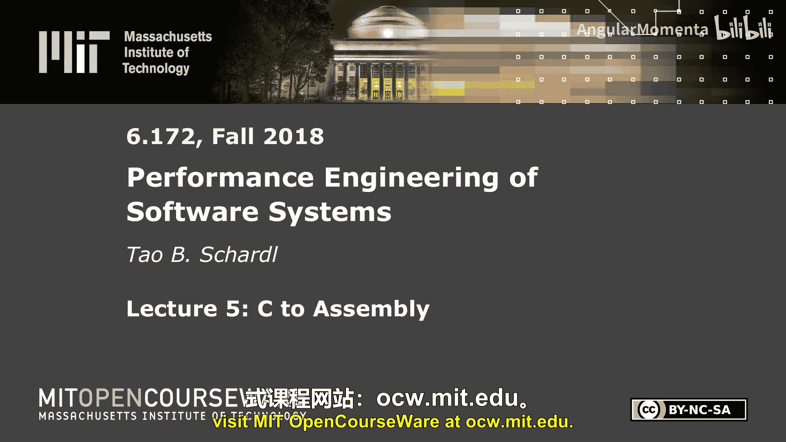
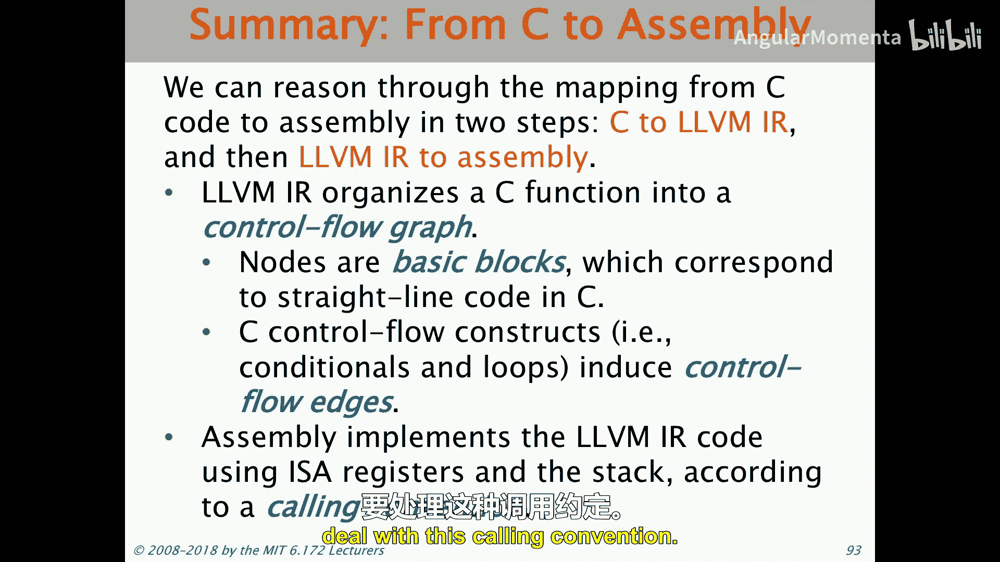

**MIT 6.172 软件系统性能工程：第5讲：C语言转汇编** 🖥️

在本节课中，我们将学习C语言代码如何被翻译成汇编语言。我们将通过一个中间表示（LLVM IR）来理解这一过程，并最终了解如何生成X86-64汇编代码。课程将涵盖从简单的直线代码到复杂的控制结构（如条件语句和循环）的翻译过程，并解释Linux X86-64调用约定。

---

**概述**

理解C语言到汇编的翻译过程对于性能工程至关重要。通过查看汇编代码，我们可以更精确地了解程序的执行细节，发现编译器优化，甚至调试仅在低级别出现的错误。本节课将引导您完成从C代码到LLVM IR，再到最终汇编代码的完整翻译过程。

---

**LLVM IR 简介** 📘

LLVM IR（中间表示）是编译器在将C代码转换为汇编之前使用的一种伪汇编语言。它比X86-64汇编更简单，但保留了类似的结构。以下是LLVM IR的基本组件：

*   **函数**：代码被组织成函数块。
*   **指令**：每个操作对应一条指令，通常每行一条。
*   **寄存器**：使用命名的寄存器（如 `%0`, `%1`）存储数据，类似于C语言中的变量。
*   **类型系统**：所有数据都有显式类型（例如，`i64` 表示64位整数）。

LLVM IR采用静态单赋值形式，这意味着每个寄存器最多只被赋值一次。这简化了编译器分析和代码阅读。

---

**C语言结构到LLVM IR的翻译**

**直线代码**

直线代码是指没有条件分支或循环的连续操作序列。在LLVM IR中，这些操作被直接翻译为一系列指令。例如，C表达式 `foo(n-1) + bar(n-2)` 会被翻译为计算 `n-1`，调用 `foo`，计算 `n-2`，调用 `bar`，最后将结果相加的指令序列。

**函数**

C语言中的函数直接对应LLVM IR中的函数。参数和返回语句的翻译也非常直接。例如，一个返回64位整数的函数在LLVM IR中会有相应的返回指令。

**条件语句**

C语言中的 `if-else` 语句在LLVM IR中被翻译为条件分支。这涉及到比较操作和基于结果的跳转。控制流图会形成菱形结构，其中包含条件检查、两个分支路径以及合并点。

**循环**

循环的翻译更为复杂。C语言中的循环在LLVM IR中表现为控制流图中的循环结构。循环体被翻译为基本块，而循环控制（初始化、条件检查、递增）则通过额外的指令和 `phi` 指令来处理。`phi` 指令用于解决在循环入口处变量可能有多重定义的问题。

**属性**

LLVM IR指令可能附带属性，这些属性提供额外信息，如内存对齐或指针别名限制。这些属性有助于编译器进行优化。

---

**LLVM IR 到汇编的翻译**

将LLVM IR翻译为汇编时，编译器需要执行几个关键任务：选择具体的X86-64指令、分配寄存器，以及协调函数调用。这引入了额外的复杂性，主要涉及Linux X86-64调用约定。

**Linux X86-64 调用约定**

调用约定定义了函数如何调用彼此、如何传递参数、如何返回值，以及如何保存寄存器状态。关键点包括：

*   **栈帧**：每个函数调用都有自己的栈帧，用于存储局部变量、参数和返回地址。
*   **寄存器保存**：寄存器分为调用者保存和被调用者保存，以协调函数间的寄存器使用。
*   **函数序言和尾声**：函数开始和结束时执行特定指令来管理栈帧和寄存器。

**案例研究：斐波那契数列**

我们通过一个计算斐波那契数的简单C函数来演示整个翻译过程。从C代码开始，我们首先生成LLVM IR，其中包含条件检查和递归调用。然后，我们将LLVM IR翻译为X86-64汇编，展示如何插入函数序言、管理寄存器、执行条件跳转以及处理递归调用。

---

**总结**

本节课中，我们一起学习了C语言代码如何通过LLVM IR中间表示被翻译成汇编语言。我们探讨了各种C语言结构（如直线代码、函数、条件语句和循环）的翻译方法，并了解了Linux X86-64调用约定在生成最终汇编代码时的重要性。掌握这些知识将帮助您更好地理解程序在低级别的行为，从而进行有效的性能分析和优化。