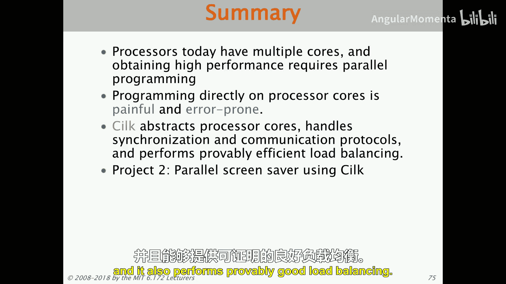

# 006：多核编程


在本节课中，我们将要学习多核编程的基础知识。我们将从了解促使多核处理器发展的硬件背景开始，然后探讨共享内存多核机器面临的硬件挑战，特别是缓存一致性问题。最后，我们将介绍几种不同的并发编程平台，包括Pthreads、Intel TBB、OpenMP和Cilk，并学习如何使用它们来编写并行程序以充分利用多核处理器的性能。

## 硬件挑战与多核架构

上一节我们介绍了课程背景，本节中我们来看看为什么现代处理器都采用了多核设计。在很长一段时间里，芯片上只有一个核心。那么，为什么如今的半导体厂商开始生产拥有多个处理器核心的芯片呢？

答案源于两个因素。首先是摩尔定律，它指出芯片上可容纳的晶体管数量大约每两年翻一番。其次是时钟频率扩展的终结。在2004到2005年左右，我们无法再继续提高单核的时钟频率了。

下图展示了芯片晶体管数量和处理器时钟频率随时间的变化趋势。请注意，Y轴是对数刻度。蓝线代表了摩尔定律，显示晶体管数量持续稳定增长。然而，时钟频率线在21世纪初快速增长后便趋于平缓。如今，处理器的时钟频率通常被限制在4 GHz左右。

在2004到2005年左右发生了什么？摩尔定律意味着晶体管变得更小，从而可以降低工作电压，进而在保持相同功率密度的前提下提高时钟频率。制造商正是这样做的。但当晶体管小到一定程度，工作电压低到一定程度时，会出现漏电流现象。我们无法在保证可靠开关的同时继续降低电压。如果电压无法再降低，那么为了保持相同的功率密度，时钟频率也就无法再提高。

下图是英特尔在2004年开始生产多核处理器时展示的图表，描绘了功率密度随时间的变化。如果按照每年25%到30%的趋势继续提高时钟频率（这是2004年之前的做法），由于无法继续降低电压，功率密度将会急剧上升，最终会达到核反应堆、火箭喷嘴甚至太阳表面的功率密度。如果芯片的功率密度等于太阳表面，那它实际上已经无法正常工作了。

为了解决这个问题，半导体厂商不再提高时钟频率，但摩尔定律仍在每年提供更多的晶体管。于是，他们决定利用这些额外的晶体管来制造多个核心，并将它们放在同一块芯片上。从2004年左右开始，每芯片的核心数开始超过一个。每一代摩尔定律都可能使芯片上能容纳的核心数量翻倍，因为晶体管数量翻倍了。这个趋势一直持续到今天，并且在摩尔定律终结前还会持续几年。这就是为什么我们今天拥有多核芯片。

## 抽象多核架构与缓存一致性

现在，让我们来看看多核处理的具体架构。首先，我想介绍抽象的多核架构。这是一个非常简化的版本，但足以说明问题。我们有一组处理器，每个处理器都有缓存（用美元符号表示）。它们通常有私有缓存以及共享的最后一级缓存（例如L3缓存），然后它们都连接到网络。通过网络，它们可以连接到主内存，都能访问相同的共享内存。通常还有一个独立的I/O网络。这种抽象的多核架构被称为芯片多处理器（CMP）。

以下是今天讲座的提纲。首先，我将介绍共享内存多核机器的一些硬件挑战。我们将了解缓存一致性协议。在了解硬件之后，我们将研究一些软件解决方案，以便在这些多核机器上编写并行程序来利用额外的核心。我们将研究以下几种并发平台：Pthreads（一种用于并行运行代码的低级API）、Intel Threading Building Blocks（一种库解决方案），以及两种语言解决方案：OpenMP和Cilk+。Cilk+实际上是我们本课程主要使用的并发平台。

让我们看看缓存是如何工作的。假设内存中某个位置有一个值，例如 `x = 3`。如果一个处理器要加载 `x`，它会从主内存读取这个值，将其带入自己的缓存，然后加载到寄存器中。它会在缓存中保留这个值，以便在不久的将来再次访问时，无需访问主内存。

现在，如果另一个处理器也想加载 `x`，它会做同样的事情：从主内存读取值，带入自己的缓存，然后加载到寄存器。实际上，如果值已经在其他处理器的缓存中，不一定非要访问主内存，有时通过其他处理器的缓存获取值可能更便宜。

现在，如果我们想存储 `x`，将其值改为其他值，比如这个处理器想设置 `x = 5`。它会将 `x = 5` 写入并存储在自己的缓存中。现在，当第一个处理器再次加载 `x` 时，它看到 `x` 的值在自己的缓存中，于是直接读取，得到值 `3`。这里的问题是什么？问题是第一个处理器缓存中的 `x` 值已经过时了，因为另一个处理器更新了它。现在，第一个处理器缓存中的 `x` 值无效了。这就是问题所在。多核硬件的主要挑战之一就是解决缓存一致性问题，确保不同处理器缓存中的值在更新后保持一致。

解决这个问题的基本协议之一是MSI协议。在这个协议中，每个缓存行都有一个状态标签，共有三种可能的状态：M（修改）、S（共享）和I（无效）。这是在缓存行粒度上进行的，因为存储这些信息的开销相对较大。我们使用的机器上缓存行大小是64字节，这是当今大多数Intel和AMD机器的典型值。

MSI协议中的三种状态含义如下：
*   **M（修改）**：当缓存块处于修改状态时，意味着没有其他缓存可以以M或S状态包含此块。
*   **S（共享）**：块是共享的，其他缓存也可以拥有处于共享状态的此块。
*   **I（无效）**：缓存块无效，本质上等同于该缓存块不在缓存中。

为了解决缓存一致性问题，当一个缓存修改某个位置时，它必须通知所有其他缓存，它们的值现在已经过时。它会通过将其他缓存中该缓存行的状态从S改为I，来使所有其他副本失效。

让我们看看这是如何工作的。假设第二个处理器要存储 `y = 5`，而之前 `y` 的值是17，并且处于共享状态。当执行 `y = 5` 时，第二个处理器会将其缓存中该缓存行的状态设置为M，然后使所有包含该缓存行的其他缓存中的缓存行失效。现在，第一个和第四个缓存中 `y=17` 的状态都是I，因为该值已过时。

当加载一个值时，可以首先检查缓存行是M还是S状态。如果是，可以直接读取该值。但如果处于I状态或不存在，则必须从另一个处理器的缓存或主内存中获取该块。

实际上还有许多其他协议，例如MESI（“messy”协议）、MOESI等。有些是专有的，它们的功能各不相同。所有这些协议都非常复杂，很难保证正确性。事实上，形式化验证最早的成功案例之一就是改进这些缓存一致性协议以保证其正确性。

如果两个处理器试图修改同一个值，硬件会处理这个问题，其中一个会先发生。首先实际修改的处理器将使所有其他副本失效，然后第二个修改的处理器再次使所有其他副本失效。当许多处理器试图修改同一个值时，会产生所谓的“失效风暴”，大量失效消息在硬件中传播，这可能导致巨大的性能瓶颈。硬件仍然会保证其中一个处理器最终写入该值，但在编写并行代码时应该意识到这个性能问题。

所有这些都是在硬件中实现的。对于我们的目的，我们不需要理解硬件的所有细节，只需要从高层次理解它在做什么，以便理解何时以及为何会出现性能瓶颈。

## 并发编程平台简介

前面我们讨论了共享内存硬件，现在让我们看看一些并发平台。今天我们将研究四个平台。

首先，什么是并发平台？编写并行程序非常困难，要保证正确性已属不易，若要优化性能则更加困难。这个过程非常痛苦且容易出错。并发平台抽象了处理器核心，处理同步和通信协议，并执行负载均衡，从而使编程工作变得容易得多。

为了说明这些并发平台，我将使用斐波那契数列的例子。斐波那契数列中每个数字是前两个数字之和，递推关系如下：

```
F(n) = F(n-1) + F(n-2)，其中 F(0)=0, F(1)=1
```

这是一个递归程序，基本上实现了上一张幻灯片中的递推关系。如果 `n` 小于2，直接返回 `n`。否则，计算 `fib(n-1)` 存入 `x`，计算 `fib(n-2)` 存入 `y`，然后返回 `x` 和 `y` 的和。

需要声明的是，这实际上是一个非常糟糕的算法，因为它需要指数时间。有更好的线性时间算法（自底向上计算）甚至对数时间算法（基于矩阵乘法）。尽管如此，它仍然是一个很好的教学示例，因为它能放在一张幻灯片上，并说明我们今天要涵盖的所有并行概念。

`fib(4)` 的执行树显示，`fib(2)` 被计算了两次，存在重复计算。对于更大的树（如 `fib(40)`），会有更多重叠计算。两个递归调用实际上可以并行执行，因为它们是独立的计算。提取并行性的关键思想是同时执行两个递归子调用。事实上，可以递归地进行：`fib(3)` 的两个子调用也可以并行执行，`fib(2)` 的两个子调用也可以，依此类推。这就是从该算法中提取并行性的关键思想。

## 使用 Pthreads 实现并行

现在，让我们看看如何使用 Pthreads 来实现这个简单的斐波那契算法。Pthreads 是线程的标准 API，在所有基于 Unix 的机器上都受支持。如果使用微软产品编程，等效的是 WinAPI 线程。Pthreads 实际上是 POSIX 标准（IEEE 1003.1c-1995）。它基本上是一个“自己动手”的并发平台，类似于并行编程的汇编语言。

它作为一个函数库构建，具有特殊的非C语义，因为仅用C语言无法指定代码的哪些部分应并行执行。Pthreads 提供了一个函数库，允许你在程序中指定并发性。每个线程实现了一个处理器的抽象，这些线程随后被多路复用到实际的机器资源上。创建的线程数量不一定必须与机器上的处理器数量匹配。所有线程通过共享内存进行通信。Pthreads 提供的库函数屏蔽了线程间协调所涉及的协议。

现在，我想看看关键的 Pthreads 函数。第一个是 `pthread_create`，它接受四个参数：
1.  `pthread_t *` 类型，用于存储新线程的标识符。
2.  `pthread_attr_t *`，设置一些线程属性，我们可以设为 NULL 使用默认属性。
3.  一个函数指针，指定线程创建后要执行的函数。
4.  `void *` 参数，存储要传递给执行函数的参数。
该函数返回一个错误状态整数。

另一个函数是 `pthread_join`。它表示我们希望在此处阻塞，直到指定的线程完成。它接受线程标识符作为参数，以及一个用于存储终止线程状态的指针。`pthread_join` 也返回一个错误状态。

使用 Pthreads 实现斐波那契的代码如下所示。左边是原始的顺序代码 `fib` 函数。为了使其并行运行，我们添加了许多其他内容。首先，有一个 `thread_args` 结构体，用于存储传递给线程执行函数的参数。然后，有一个 `thread_fun` 函数，它从 `thread_args` 结构体中读取输入参数，调用 `fib(i)`，并将结果存储到结构体的输出字段中，最后返回 NULL。

在右侧，是实际调用左侧 `fib` 函数的主函数。我们初始化执行这些线程所需的一系列变量。首先检查如果 `n` 小于30，由于线程创建的开销，并行执行并不划算，因此直接顺序执行程序。这个想法被称为“粗化”。

接下来，它将输入参数 `n-1` 打包到 `args` 结构体中。然后调用 `pthread_create`，传入线程变量、NULL属性、我们定义的 `thread_fun` 以及 `args` 结构体。如果线程创建成功，状态将为0，我们可以继续。在继续的同时，我们执行 `fib(n-2)` 并将其结果存储到 `result` 变量中。此时，`fib(n-1)` 和 `fib(n-2)` 正在并行执行。接着是 `pthread_join`，它等待我们创建的线程完成，因为我们需要两个子调用的结果才能完成此函数。完成后，检查状态，如果成功，则将参数结构体的输出加到 `result` 中。

这段代码的并行程度如何？这里只创建了一个线程，所以并行执行两件事。如果在四个处理器上运行此代码，最大加速比只能是2，因为它只在顶层创建一个线程。如果想让它递归创建线程，代码会变得复杂得多。这是使用 Pthreads 实现此代码的缺点之一。

Pthreads 的一些问题包括：
1.  **高开销**：创建线程通常需要超过10^4个周期，这导致非常粗粒度的并发。
2.  **可扩展性问题**：所示的斐波那契代码最多只能获得1.5倍的加速（对于双核）。这是因为两个并行调用的工作量不同（`fib(n-1)` 和 `fib(n-2)`），其工作量比例约为黄金比例1.6，加上一些开销，所以加速比约为1.5。要利用更多核心，需要重写代码，使其更复杂。
3.  **模块性问题**：斐波那契逻辑没有很好地封装在一个函数中，这使代码缺乏模块性，难以维护。
4.  **代码复杂**：必须进行参数打包，并参与容易出错的负载均衡协议。

为什么这里提到1958年的影子？1958年发生了第一件大事：第一个编译器（Fortran编译器）诞生。在此之前，程序员用汇编语言编写程序，必须手动进行参数打包。第一个编译器的好处在于它为我们完成了所有这些参数打包工作。在 Pthreads 中必须这样做，类似于用汇编语言编写代码。

## 使用 Intel TBB 实现并行

我们看了 Pthreads，接下来看看 Threading Building Blocks。TBB 是一个库解决方案，由英特尔开发。它作为C++库实现，运行在本机线程之上，但程序员不直接处理线程，而是指定任务。这些任务使用受MIT研究启发的工作窃取算法自动在线程间进行负载均衡。Intel TBB 专注于性能，并且使用 TBB 编写的代码比使用 Pthreads 编写的代码更简单。

在 TBB 中，我们必须创建任务。在斐波那契代码中，我们创建了一个 `FibTask` 类。在任务内部，我们必须定义 `execute` 函数，该函数在启动任务时执行计算，这是我们定义斐波那契逻辑的地方。该任务接受参数 `n` 和 `sum`（输入和输出）。

在 TBB 中，可以轻松创建提取更多并行性的递归程序。在这里，我们递归创建两个子任务 A 和 B，可以直接将参数传递给 `FibTask`，而无需自己打包参数。然后，我们设置 `ref_count`，这是我们必须等待的任务数量加1（加1是等待我们自己）。这里我们创建了两个子任务，加上我们自己，所以是2+1。之后，我们使用 `spawn(b)` 调用启动任务 B。然后执行 `spawn_and_wait_for_all(a)`，这将启动任务 A 并等待 A 和 B 都完成后再继续。之后，我们可以将结果相加并存入 `sum` 变量。

这些任务是递归创建的，因此与仅在顶层创建一个线程的 Pthreads 实现不同，这里我们实际上递归创建了更多任务，从而可以从代码中获得更多并行性，并扩展到更多处理器。我们还需要一个主函数来启动程序：创建一个计算 `fib(n)` 的根任务，然后调用 `spawn_root_and_wait(a)`。

TBB 除了任务之外还有许多其他功能。它提供了许多C++模板来表达常见模式，例如用于循环并行的 `parallel_for`、用于数据聚合的 `parallel_reduce`、用于软件流水线的 `pipeline` 和 `filter`。TBB 还提供了许多并发容器类（如哈希表、树、优先队列），允许多个线程安全地并发访问和更新。此外，还有各种互斥库函数，如锁和原子操作。

## 使用 OpenMP 实现并行

TBB 是并发问题的库解决方案，现在我们将看两种语言解决方案：OpenMP 和 Cilk。让我们从 OpenMP 开始。

OpenMP 是一个行业联盟制定的规范。有多个编译器支持 OpenMP，包括开源和专有的。如今，GCC、ICC、Clang 以及 Visual Studio 都支持 OpenMP。OpenMP 以编译器编译指令的形式为 C/C++ 和 Fortran 提供语言扩展。程序员使用这些编译指令来指定哪些代码段应并行运行。OpenMP 也运行在本机线程之上，但程序员不接触这些线程。OpenMP 支持循环并行（`parallel for`）、任务并行以及流水线并行。

使用 OpenMP 实现斐波那契的代码如下。整个代码非常简洁，比 Pthreads 实现干净得多，性能也更好。我们有一些编译器指令。创建并行任务的编译指令是 `#pragma omp task`，我们为 `fib(n-1)` 和 `fib(n-2)` 创建 OpenMP 任务。还有 `shared` 编译指令，指定参数中的两个变量在不同线程间共享。然后，`#pragma omp taskwait` 表示我们将等待前面的任务完成后再继续。之后，返回 `x + y`。这就是全部代码。

OpenMP 还提供了许多其他编译指令，例如用于循环并行的 `parallel for`、`reduction`，以及用于调度和数据共享的指令。OpenMP 还有各种同步结构，如屏障、原子更新、互斥锁等。OpenMP 也是一种非常流行的编写并行程序的解决方案。

这段代码实际上与处理器数量无关。有一个调度算法决定任务如何映射到不同的处理器。可以拥有比可用处理器更多的任务，调度算法会处理这些任务到处理器的映射，这对程序员是隐藏的，尽管可以使用调度编译指令向编译器提供提示。在底层，这是使用 Pthreads 实现的，Pthreads 必须进行操作系统调用来直接与处理器核心通信并进行多路复用等。

## 使用 Cilk 实现并行

我们将看的最后一个并发平台是 Cilk。更准确地说，我们将看 Cilk Plus。Cilk Plus 中的 Cilk 部分是对 C/C++ 的一小组语言扩展，支持 fork-join 并行。例如，斐波那契示例就使用了 fork-join 并行。Plus 部分支持向量并行（在作业中已经体验过）。Cilk+ 最初由 Cilk Arts（一家 MIT 衍生公司）开发，该公司于2009年7月被英特尔收购。Cilk+ 的实现基于获得奖项的 MIT Cilk 多线程语言，该语言由 Charles Leiserson 的研究小组在二十年前于 MIT 开发。

它采用了一个可证明高效的工作窃取调度器，允许实现理论高效的算法。Cilk Plus 还提供了一个用于并行化带有全局变量代码的超对象库。在作业四中将有机会使用超对象。Cilk Plus 生态系统还包括有用的编程工具，例如用于检测确定性竞争的 Cilksan 竞争检测器，以及称为 Cilkview 的可扩展性分析器。

但实际上，我们本课程不会使用 Intel Cilk+，而是使用一个更好的编译器，该编译器基于 Tapir-LLVM，并支持 Cilk+ 的 Cilk 子集。Tapir-LLVM 最近由 MIT 的 TB Schardl、William Moses 和 Charles Leiserson 开发。与其他现有的 Cilk 实现相比，Tapir-LLVM 通常能生成更好的代码。它是目前可用的最好的 Cilk 编译器。他们去年就此写了一篇很好的论文，并获得了 PPoPP 的最佳论文奖。Tapir-LLVM 目前使用 Intel Cilk+ 运行时系统，并且支持比现有 Cilk 编译器更通用的功能，例如，除了生成函数，还可以生成不是单独函数的代码块，这使得编写程序更加灵活。

Cilk 的斐波那契代码如下所示。它也非常简单，看起来与顺序程序非常相似，只是代码中多了 `cilk_spawn` 和 `cilk_sync` 语句。这些语句的作用是：`cilk_spawn` 表示命名的子函数（即 `cilk_spawn` 语句后面的函数）可以与父调用者并行执行。然后，该函数将调用 `fib(n-2)`，现在 `fib(n-2)` 和 `fib(n-1)` 可以并行执行。`cilk_sync` 表示在所有生成的子函数返回之前，控制流不能通过此点。它将等待 `fib(n-1)` 返回，然后再执行返回 `x+y` 的返回语句。

需要注意的是，Cilk 关键字授予并行执行的权限，但并不强制命令并行执行。即使这里写了 `cilk_spawn`，运行时系统也不一定必须并行运行 `fib(n-1)` 和 `fib(n-2)`。我只是说这两件事可以并行运行，由运行时系统根据其调度策略决定是否并行运行。

让我们看另一个 Cilk 的例子：循环并行。我们想进行矩阵转置，并且希望就地完成。想法是将对角线以下的元素与其在对角线以上的镜像元素交换。代码如下：我们有一个 `cilk_for` 循环，从 `i=1` 到 `n-1`，内层循环从 `j=0` 到 `i-1`，然后交换 `A[i][j]` 和 `A[j][i]`。要并行执行 for 循环，只需在 for 关键字前加上 `cilk_`。就这么简单。在内部，`cilk_for` 循环被转换为嵌套的 `cilk_spawn` 和 `cilk_sync` 调用。编译器将递归地将迭代空间分成两半，生成其中一半并并行执行另一半，然后递归进行，直到迭代范围变得足够小，此时并行执行不再有意义，就顺序执行该范围。

除了循环并行，Cilk 还有其他特性。假设我们有一个 for 循环，每次迭代只是将变量 `sum` 增加 `i`，这实际上是计算从0到 `n-1` 的总和然后打印结果。尝试并行化此代码的一个直接方法是将 `for` 改为 `cilk_for`。这段代码能正常工作吗？不一定，因为它不一定给出正确答案。`cilk_for` 说可以并行执行这些迭代，但它们都在更新同一个共享变量 `sum`，这存在所谓的确定性竞争。我们将在下一讲详细讨论确定性竞争。

Cilk 有一个很好的方法来解决这个问题，即使用归约器，这是前面提到的超对象的一个例子。使用归约器时，不是将 `sum` 变量声明为 `unsigned long` 数据类型，而是使用宏 `CILK_C_REDUCER_OPADD` 来指定我们要创建一个具有加法函数的归约器，然后注册这个归约器。在 `cilk_for` 循环内部，我们可以增加归约器视图的 `sum`。这可以并行执行并给出与顺序运行相同的答案。归约器将为你处理这个确定性竞争。最后，打印结果时，`sum` 将是期望的值，使用完后用宏 `CILK_C_UNREGISTER_REDUCER` 注销归约器。

这是处理归约问题的一种方法。实际上，可能希望使用许多其他有趣的归约操作符。通常，可以为幺半群创建归约器。幺半群是具有结合性二元运算和单位元的代数结构。加法运算符就是一个幺半群，因为它是结合的、二元的，单位元是0。Cilk 还有几个其他预定义的归约器，包括乘法、最小值、最大值、或、异或等。也可以定义自己的归约器，在下一个作业中将有机会使用归约器并为列表编写一个归约器。

Cilk 的另一个优点是，程序总是有一个有效的串行解释。Cilk 程序的串行幻象总是一个合法的解释。对于左边的 Cilk 源代码，串行幻象基本上是去掉 `cilk_spawn` 和 `sync` 语句后得到的代码，看起来就像顺序代码。请记住，Cilk 关键字授予并行执行的权限，但并不一定命令并行执行。如果在单核上运行此 Cilk 代码，它实际上不会创建这些并行任务，并且会得到与顺序程序相同的答案。串行幻象也是一个正确的解释。与其他解决方案（如 TBB 和 Pthreads）不同，在这些环境中很难得到一个与顺序程序行为一致的程序，因为它们实际上做了许多额外的工作来设置这些并行调用、创建参数结构和其他调度结构。而在 Cilk 中，很容易获得串行幻象，只需将 `cilk_spawn` 和 `cilk_sync` 定义为空，将 `cilk_for` 定义为 `for`，就能得到一个有效的顺序程序。在调试代码时，可能首先想检查 Cilk 程序的串行幻象是否正确，可以使用宏或编译器标志轻松实现，这提供了一种很好的调试方式，因为不必从并行程序开始，可以先检查串行程序是否正确，然后再调试并行程序。

Cilk 的理念是允许程序员在应用程序中表达逻辑并行性。程序员只需识别代码的哪些部分可以并行执行，而不必确定哪些部分应该并行执行。然后，Cilk 有一个运行时调度器，在运行时自动将执行程序映射到可用的处理器核心上，它使用工作窃取调度算法动态地完成此操作。工作窃取调度器用于在不同处理器之间均衡地分配任务。我们将在未来的讲座中更多地讨论工作窃取调度器，但我想强调的是，与今天看到的其他并发平台不同，Cilk 的工作窃取调度算法在理论上是高效的，而 OpenMP 和 TBB 的调度器在理论上并非高效。这是一个很好的特性，因为它保证你在 Cilk 之上编写的算法也是理论高效的。

下图是 Cilk 生态系统的高层图示。将 Cilk 源代码传递给你喜欢的 Cilk 编译器（Tapir-LLVM 编译器），生成可以在多个处理器上运行的二进制文件。然后将程序输入传递给二进制文件，在任意多个处理器上运行它，从而对程序的并行性能进行基准测试。也可以进行串行测试：获取 Cilk 程序的串行幻象，将其传递给普通的 C/C++ 编译器，生成只能在单处理器上运行的二进制文件，然后在此单线程二进制文件上运行串行回归测试套件。这允许你对串行代码的性能进行基准测试，并调试在顺序运行此程序时可能出现的任何问题。另一种方法是编译原始的 Cilk 代码，但在单处理器上运行。有一个命令行参数告诉运行时系统要使用多少处理器，如果将该参数设置为1，则只使用一个处理器。这允许你对代码的单线程性能进行基准测试，并且在单核上运行的并行程序的行为应与串行幻象的执行完全相同。这是使用 Cilk 的优势之一。因为可以轻松使用 Cilk 平台进行串行测试，这允许你将串行正确性与并行正确性分开。正如前面所说，可以先调试串行正确性以及任何性能问题，然后再转向并行版本。另一个要点是，因为 Cilk 实际上在其任务内部使用串行程序，所以即使编写并行程序，优化串行程序的性能也是有好处的，因为优化串行程序的性能也会转化为更好的并行性能。

Cilk 的另一个好工具是 Cilksan（Cilk 清理器），它将检测代码中的任何确定性竞争，这将极大地帮助你调试正确性和性能问题。如果使用 Cilksan 标志编译 Cilk 代码，它将生成一个插桩的二进制文件，运行时将查找并定位程序中的所有确定性竞争，告诉你竞争发生的位置，以便检查该部分代码并在必要时修复。这是对并行程序进行基准测试的非常有用的工具。

Cilk 还有另一个好工具叫 Cilkview，它是一个性能分析器，将分析程序中可用的并行度以及它所做的工作总量。同样，向编译器传递一个标志以开启 Cilkview，它将生成一个插桩的二进制文件，运行此代码时将提供可扩展性报告。在下一个项目中会发现这些工具非常有用。我们将在下一讲中更多地讨论这两个工具。Cilkview 将分析你的程序扩展到更大机器的能力，基本上会告诉你代码可能利用的最大处理器数量。

## 总结




本节课中我们一起学习了多核编程的基础。首先，我们看到如今大多数处理器都有多个核心，要获得高性能需要编写并行程序。但并行编程可能非常困难，尤其是如果必须直接在处理器核心上编程并与操作系统交互。Cilk 非常好，因为它从程序员那里抽象了处理器核心，处理同步和通信协议，并执行可证明良好的负载均衡。在下一个项目中，将有机会使用 Cilk 实现自己的并行屏幕保护程序，这是一个非常有趣的项目。