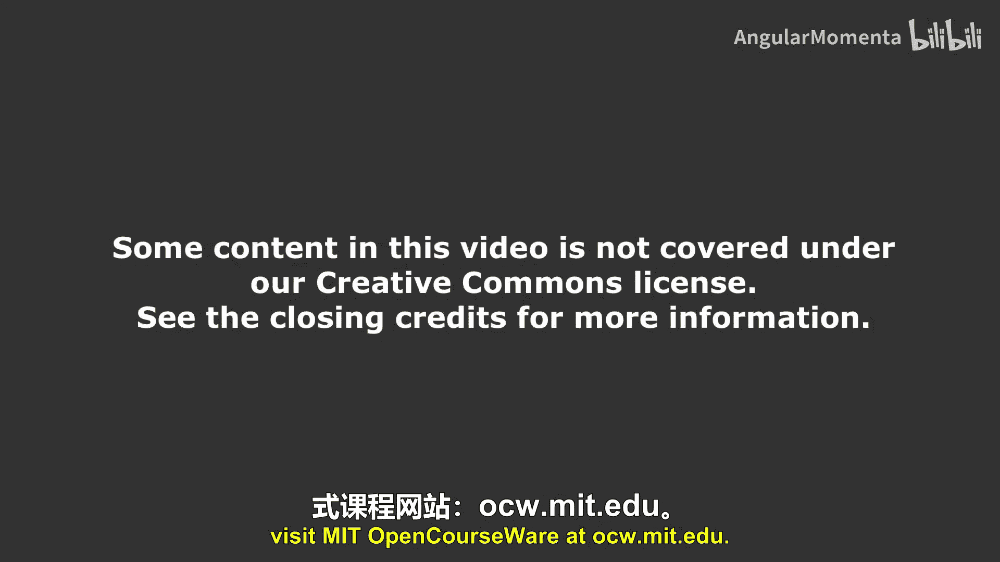
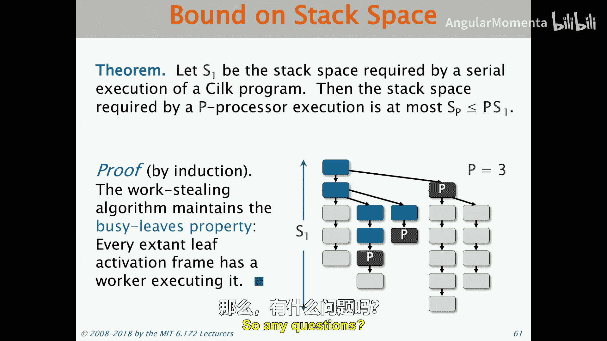

# 007：竞态与并行性



在本节课中，我们将要学习并行编程中的两个核心概念：竞态条件和并行性分析。我们将了解什么是竞态条件，为什么它们是有害的，以及如何使用工具来检测它们。同时，我们也会学习如何量化程序的并行性，理解工作、跨度等概念，并探讨调度理论如何影响并行程序的性能。

## 竞态条件

上一节我们介绍了并行编程的基本概念，本节中我们来看看并行编程中一个常见且棘手的问题：竞态条件。

竞态条件是并发编程的祸根，你肯定不希望代码中出现竞态条件。历史上，一些著名的竞态错误曾导致灾难性后果。例如，Therac-25放射治疗机中的软件竞态条件导致三人死亡，多人重伤。2003年北美大停电也是由软件中的竞态错误引起的，导致5000万人断电。这些错误非常难以通过常规测试发现，因为它们并不在每次程序执行时都出现。最难以发现的竞态错误是那些非常罕见的事件，这使得定位和修复它们变得极其困难。

### 什么是竞态？

确定性竞态是最基本的竞态形式。当两条逻辑上并行的指令访问同一个内存位置，且至少有一条指令执行写操作时，就会发生确定性竞态。

让我们看一个简单的例子。在以下代码中，首先将 `x` 设为0，然后执行一个包含两次迭代的 `cilk_for` 循环，每次迭代都递增变量 `x`，最后断言 `x` 等于2。

```c
x = 0;
cilk_for (int i = 0; i < 2; i++) {
    x++;
}
assert(x == 2);
```

这个程序中实际上存在竞态。为了理解竞态发生的位置，我们需要查看执行图。我们将每条语句标记为一个字母：语句A是 `x = 0`，之后由于 `cilk_for` 循环的两个迭代可以并行执行，我们将有两条并行路径B和C，每条路径都将 `x` 递增1，最后在D处断言 `x` 等于2。

这种图被称为依赖图，它指明了哪些指令必须在执行下一条指令之前完成。图中显示B和C必须在A执行后才能进行，但B和C可以并行发生，因为它们之间没有依赖关系，而D必须在B和C完成后才能发生。

为了理解为什么这里存在竞态错误，我们需要仔细查看这个依赖图。当你运行这段代码时，`x++` 实际上会被翻译成三个步骤：
1.  将 `x` 的值加载到某个处理器寄存器 `r1` 中。
2.  递增 `r1`。
3.  将 `r1` 的结果存回 `x`。

对于另一个迭代，同样会加载到 `r2`，递增 `r2`，然后存回 `x`。这里存在竞态，因为这两个存储操作 `x = r1` 和 `x = r2` 都在向同一个内存位置写入。

这个例子中一个棘手的地方在于，竞态错误并不总是发生。如果其中一个分支在开始另一个分支之前完整执行了它的三个指令，那么 `x` 的最终结果将是2，这是正确的。因此，竞态错误并不总是显现，这也是这类错误难以发现的原因之一。

### 竞态的类型

确定性竞态主要有两种类型，如下表所示。假设指令A和指令B都访问某个位置 `x`，并且A与B并行。

| 操作A | 操作B | 竞态类型 | 结果 |
| :--- | :--- | :--- | :--- |
| 读 | 读 | 无竞态 | 安全 |
| 读 | 写 | 读-写竞态 | 非确定性结果 |
| 写 | 读 | 读-写竞态 | 非确定性结果 |
| 写 | 写 | 写-写竞态 | 非确定性结果 |

如果两条指令都只是读取该位置，则没有问题。如果其中一条指令写入，而另一条读取，则会发生读-写竞态，程序可能产生非确定性结果，因为最终答案可能取决于读取操作发生在写入操作更新值之前还是之后。如果两条指令都写入同一共享位置，则会发生写-写竞态，同样会导致程序行为非确定性，因为最终答案可能取决于A先写还是B先写。

如果两段代码之间没有确定性竞态，我们就说它们是独立的。这意味着两段计算不能共享一个内存位置，其中一段计算写入，另一段计算读取，或者两段计算都写入该位置。

### 如何避免竞态

竞态非常糟糕，你应该避免在程序中出现竞态。以下是一些避免竞态的提示：

*   **`cilk_for` 循环的迭代应该是独立的**：你应该确保 `cilk_for` 循环的不同迭代不会写入相同的内存位置。
*   **在 `cilk_spawn` 语句和对应的 `cilk_sync` 之间**，被 spawn 的子函数的代码应该与父函数的代码独立，这包括被 spawn 子函数额外 spawn 或调用的子函数所执行的代码。你应该确保这些代码段之间没有读或写竞态。
*   **注意机器字长**：在读写打包数据结构时需要警惕竞态。

例如，考虑一个包含两个 `char` 类型成员 `a` 和 `b` 的结构体 `X`。并行更新 `x.a` 和 `x.b` 可能会引起竞态。这是一个棘手的竞态，因为它取决于编译器的优化级别。幸运的是，在本课程使用的 Intel 机器上，这个例子是安全的。但如果你使用非标准类型（例如 C 语言的位域功能，且字段大小不是标准大小），或者并行更新一个字内的各个位，则可能会遇到竞态。

### Cilksan 竞态检测器

幸运的是，Cilk 平台有一个非常好的工具叫做 Cilksan 竞态检测器。如果你使用 `-fsanitize=cilk` 标志编译代码，它将生成一个经过插桩的 Cilksan 程序。如果一个表面上确定性的 Cilk 程序在给定输入下可能表现出与串行执行不同的行为，那么 Cilksan 保证会报告并定位潜在的竞态。

Cilksan 采用回归测试方法，程序员提供不同的测试输入，对于每个测试输入，如果程序中可能存在竞态，它就会报告这些竞态。它会识别涉及竞态的文件名、行号、变量，包括堆栈跟踪，这在调试代码和查找程序中的竞态时非常有帮助。

需要注意的是，你应该确保所有程序文件都经过插桩，因为如果只插桩部分文件，可能会遗漏一些竞态错误。Cilksan 竞态检测器的一个优点是，只要存在潜在的竞态，它总是会报告，这与许多其他“尽力而为”的竞态检测器不同，后者可能只在竞态实际发生时部分时间报告。

Cilksan 是你最好的朋友，在调试作业和项目时请使用它。

## 并行性分析

上一节我们讨论了竞态条件及其危害，本节中我们来看看如何量化程序的并行性。

### 什么是并行性？

我们如何定量地定义并行性？当有人说他们的代码高度并行时，这意味着什么？为了形式化地定义并行性，我们首先需要了解 Cilk 执行模型。让我们回顾一下之前看到的计算斐波那契数的代码。

为了分析并行性，我们将程序执行过程建模为一个有向无环图，称为计算 DAG。在这个 DAG 中：
*   每个顶点对应一个**串**，串是指令序列，不包含 `spawn`、`sync` 或从 spawn 返回。
*   边分为四种类型：生成边、调用边、返回边和继续边。

假设每个串执行需要单位时间。我们定义：
*   **工作**：在单处理器上执行程序所需的时间，记作 **T₁**。它等于计算 DAG 中所有串的数量。
*   **跨度**：在无限多处理器上执行程序所需的时间，也称为关键路径长度或计算深度，记作 **T∞**。它等于计算 DAG 中最长路径的长度。

### 工作定律与跨度定律

有两个定律关联这些量：
1.  **工作定律**：**Tₚ ≥ T₁ / P**。这是因为在每一步，P 个处理器最多只能完成 P 个单位的工作。
2.  **跨度定律**：**Tₚ ≥ T∞**。这是因为即使有无限多处理器，程序也必须花费至少 T∞ 的时间来完成最长路径上的计算。

### 并行度

程序的**最大可能加速比**由 **T₁ / T∞** 给出，这个比值被称为程序的**并行度**。它表示程序平均每单位跨度可以完成多少工作。

例如，在一个计算 DAG 中，如果 T₁ = 18， T∞ = 9，那么并行度就是 18 / 9 = 2。这意味着无论使用多少个处理器，最大加速比不会超过 2。

### 并行松弛度

**并行松弛度**定义为 **(T₁ / T∞) / P**，即 **T₁ / (P * T∞)**。它衡量了程序具有的并行性相对于处理器数量的充裕程度。根据经验，通常希望程序的并行松弛度至少为 10，这样才能有效分摊调度机制的开销。

如果并行松弛度很高（远大于 1），那么根据贪婪调度定理，可以获得接近线性的加速比。贪婪调度定理指出，任何贪婪调度器实现的运行时间满足：**Tₚ ≤ T₁ / P + T∞**。

### Cilk 调度器

Cilk 使用**工作窃取调度器**。在该调度器中，每个处理器维护一个双端队列来存放就绪的串。处理器通常从队列底部操作，就像串行程序中的栈一样。当一个处理器的工作队列为空时，它会随机选择另一个处理器作为“受害者”，并从其队列顶部“窃取”工作。理论证明，工作窃取调度器可以达到期望运行时间：**Tₚ = T₁ / P + O(T∞)**。

在实践中，只要有足够的并行度（即 T₁ / T∞ >> P），工作窃取发生的频率就很低，从而能够实现接近线性的加速比。

### 栈空间边界

Cilk 支持 C 语言中关于指针的栈规则：指向栈空间的指针可以从父任务传递给子任务，但不能从子任务传递给父任务。Cilk 使用一种“仙人掌栈”来支持并行函数调用中的多栈视图。

可以证明，P 处理器执行所需的栈空间 **Sₚ** 满足：**Sₚ ≤ P * S₁**，其中 **S₁** 是串行执行所需的栈空间。这是一个宽松的上界，在实践中通常远小于此值。

## 总结

本节课中我们一起学习了并行编程中的两个关键主题：竞态条件和并行性分析。

我们首先了解了什么是确定性竞态，包括读-写竞态和写-写竞态，以及它们如何导致程序行为的非确定性。我们学习了如何使用 Cilksan 工具来检测程序中的潜在竞态，这是调试并行代码的宝贵工具。



接着，我们探讨了如何量化程序的并行性。我们引入了工作、跨度和并行度的概念，并使用计算 DAG 模型进行分析。我们了解了工作定律和跨度定律如何为并行程序的运行时间设定下限，以及贪婪调度定理如何提供上限。最后，我们简要介绍了 Cilk 所使用的工作窃取调度器的工作原理及其性能保证。


理解这些概念对于编写正确、高效的并行程序至关重要。在接下来的作业和项目中，请务必使用 Cilksan 来检查竞态，并思考你算法的并行度，以充分利用多核处理器的计算能力。