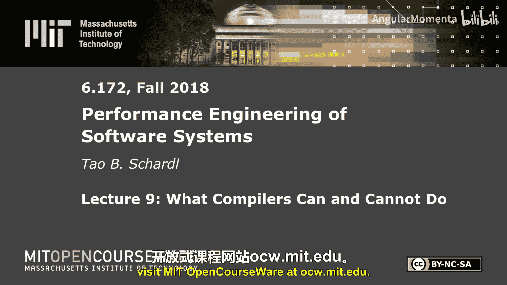
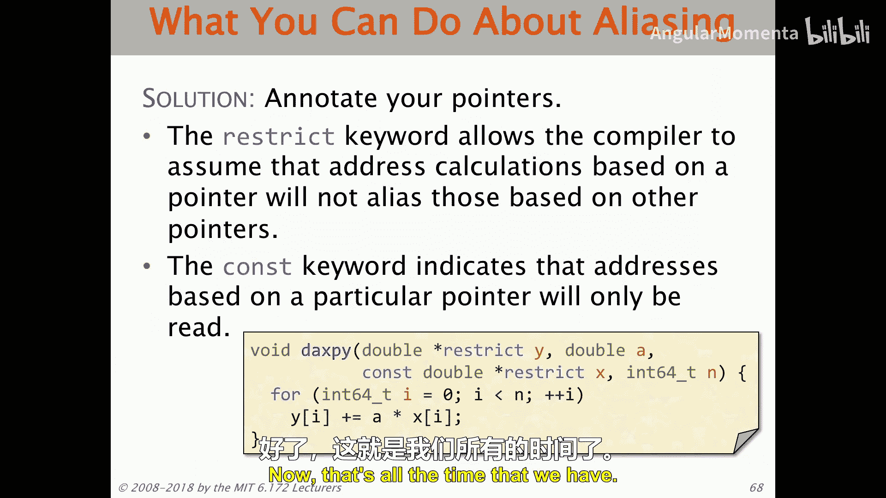

# 009：编译器能做与不能做的事 🛠️



在本节课中，我们将要学习编译器在优化代码时能做哪些事，以及它存在哪些局限性。我们将通过具体的例子来了解编译器如何分析并转换代码，以及作为程序员，我们如何编写代码来帮助编译器更好地进行优化。

## 概述

上一节我们介绍了多线程算法的理论分析。本节中，我们来看看编译器这个“沉默但极其聪明的队友”是如何工作的。编译器通过一系列转换过程来分析并编辑代码，以提升其性能。理解这些过程，能帮助我们写出更高效的代码，并理解为何有时编译器未能达到我们的预期。

## 编译器优化概述

编译器接收LLVM中间表示作为输入，通过一系列称为“转换过程”的步骤来分析和编辑代码，以优化性能。这些过程会按预定的顺序运行多次。

以下是获取编译器优化报告的方法：
*   使用编译器标志 `-Rpass=.*` 可以要求编译器报告它执行了哪些优化。
*   报告会详细说明哪些转换成功应用，并包含分析结论。

然而，这些报告通常非常冗长且包含大量编译器内部术语，对于初学者来说可能难以理解。此外，并非所有优化过程都会生成报告，因此报告无法展示完整的优化过程。

## 编译器优化示例

为了理解编译器如何工作，我们将通过几个简单的例子来展示其优化机制。

### 标量值优化

首先，我们来看编译器如何优化单个标量值。考虑一个简单的向量缩放函数：

```c
vec2 vec_scale(vec2 v, double a) {
    return (vec2){v.x * a, v.y * a};
}
```

在未优化（`-O0`）的LLVM IR中，标量参数 `a` 会被存储到栈内存中，然后在乘法操作前再加载出来。编译器可以识别出这种模式，并直接用原始的寄存器参数值替换那些内存加载操作，从而消除不必要的存储和加载指令。

### 结构体优化

接下来，我们看看编译器如何处理结构体。结构体比标量更复杂，因为它包含多个字段。编译器会尝试将结构体的各个字段也保存在寄存器中，而不是内存里。

对于同一个 `vec_scale` 函数，其输入结构体 `v` 的字段在未优化的IR中也会被存储到栈上。编译器会逐个字段进行分析：
1.  识别出存储到某个内存地址的值，与后续从同一地址加载的值是相同的。
2.  用原始的结构体字段值（已存在于寄存器中）替换掉加载指令。
3.  删除因此变得无用的存储、加载和地址计算指令，最终可能连最初的内存分配也一并消除。

这样，整个操作就完全在寄存器中完成，避免了缓慢的内存访问。

### 函数调用优化（内联）

函数调用会产生开销。编译器的一项重要优化是“函数内联”，即用被调用函数的函数体直接替换调用点。

例如，对于一连串的向量运算函数调用（如 `vec_add(vec_scale(..., a), ...)`），编译器可以：
1.  将 `vec_scale` 的函数体内联到调用处。
2.  内联后，可能会暴露出新的优化机会，例如消除仅为打包/解包数据而生的临时操作。
3.  继续内联其他函数（如 `vec_add`），最终将一系列函数调用转换为一连串直接的浮点运算指令。

这消除了函数调用的所有开销。然而，编译器不会无限制地内联所有函数，原因包括：
*   **递归调用**：通常无法内联自身。
*   **跨编译单元**：如果函数定义在另一个文件中，编译器可能无法访问其代码。
*   **代码膨胀**：过度内联会增加代码大小，可能损害性能（例如影响指令缓存命中率）。

编译器使用成本模型来猜测何时内联是划算的，但这个模型并不总是正确。作为程序员，你可以使用属性来指导编译器：
*   `__attribute__((always_inline))`：强制内联。
*   `__attribute__((noinline))`：禁止内联。
*   链接时优化（LTO）：允许跨文件进行更激进的内联和优化。

### 循环优化（代码提升）

循环是程序中最耗时的部分之一，因此编译器投入大量精力优化循环。一个常见的优化是“循环不变代码外提”。

考虑一个计算N体间引力的双重嵌套循环。在内部循环中，有些地址计算只依赖于外层循环的索引 `i`，而与内层循环索引 `j` 无关。

编译器可以分析并证明这些计算在每次内层循环迭代中结果不变，从而将它们“提升”到外层循环中执行。这样，这些指令的执行次数从 `O(N²)` 减少到 `O(N)`，显著节省了运行时间。

## 编译器不能做的事：案例研究

尽管编译器很强大，但它也有局限性。我们通过案例来了解编译器何时会“失手”。

### 案例：内存别名与向量化

编译器有时会因为无法确定内存访问模式而无法进行优化。例如，一个简单的向量-标量乘加循环：

```c
void daxpy(double *y, double *x, double a, int n) {
    for (int i = 0; i < n; i++) {
        y[i] += a * x[i];
    }
}
```

这里存在一个关键问题：数组 `x` 和 `y` 的内存区域可能重叠（别名）。如果重叠，以向量化方式并行操作多个元素可能会得到错误结果。

编译器无法在编译时静态地确定它们是否重叠。因此，现代编译器（如LLVM）会生成“版本化”的代码：
1.  在运行时动态检查 `x` 和 `y` 是否别名。
2.  根据检查结果，分支到**向量化版本**的循环（如果无别名）或**非向量化版本**的循环（如果有别名）。

所以，这个循环既被向量化了，也没有被向量化，这取决于运行时的具体数据。为了帮助编译器，程序员可以使用 `restrict` 关键字来明确告知编译器指针不会别名。

### 内存别名的普遍影响

内存别名问题会影响许多优化。例如，在一个矩阵乘法的朴素实现中，编译器可能因为无法确定指向不同矩阵的指针是否会在循环内相互影响，而不敢将某些计算移出循环（循环不变代码外提）。

编译器使用“别名分析”技术来静态推断指针关系，但这个问题在理论上是不可能的。在实践中，编译器会利用类型信息、作用域等元数据进行尽可能好的猜测。

作为程序员，帮助编译器的最佳方式是：
*   使用 `restrict` 关键字指明指针不会别名。
*   使用 `const` 关键字指明数据是只读的。
这些注解能为编译器提供关键信息，解锁更多优化可能。

## 总结

本节课中我们一起学习了编译器优化的内部机制。我们看到，编译器通过一系列机械的转换过程来优化代码，例如将值保留在寄存器中、内联函数以及提升循环不变代码。这些优化通常与你之前学过的Bentley规则优化有相似之处。

同时，我们也认识到编译器的局限性，尤其是在处理内存别名问题时。编译器必须做出保守假设，这可能导致其无法进行某些优化，或者生成额外的运行时检查代码。




理解编译器能做什么和不能做什么，是成为高效性能工程师的关键。它让你能够编写出既清晰可维护，又能充分发挥硬件潜力的代码。记住，你的“聪明队友”——编译器——需要你通过清晰的代码和恰当的注解来获得最好的发挥。