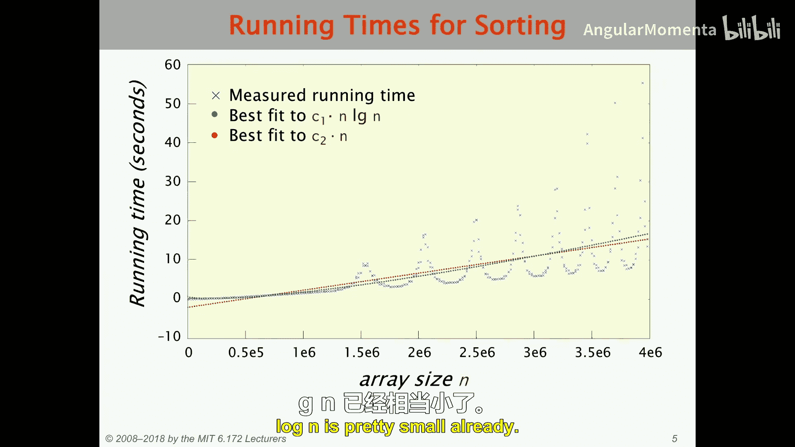
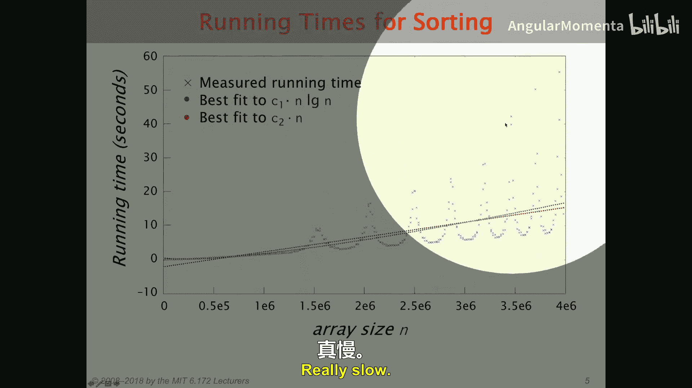
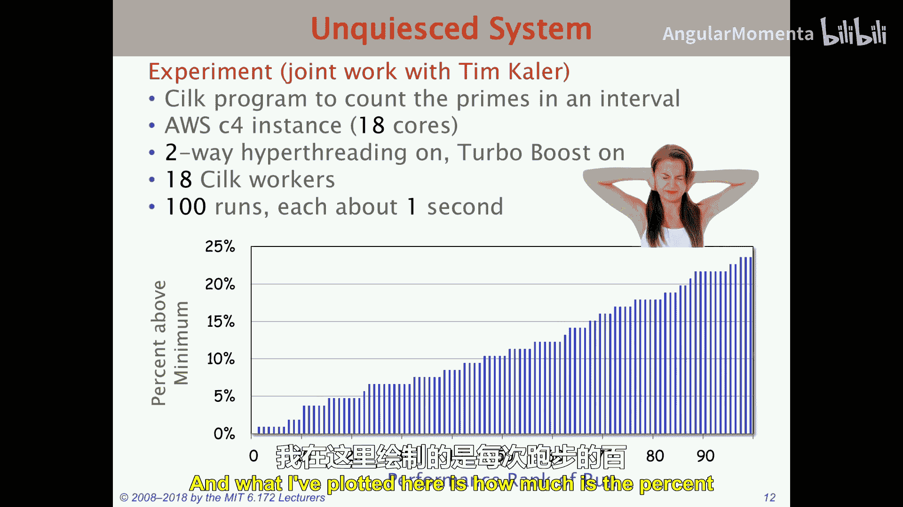
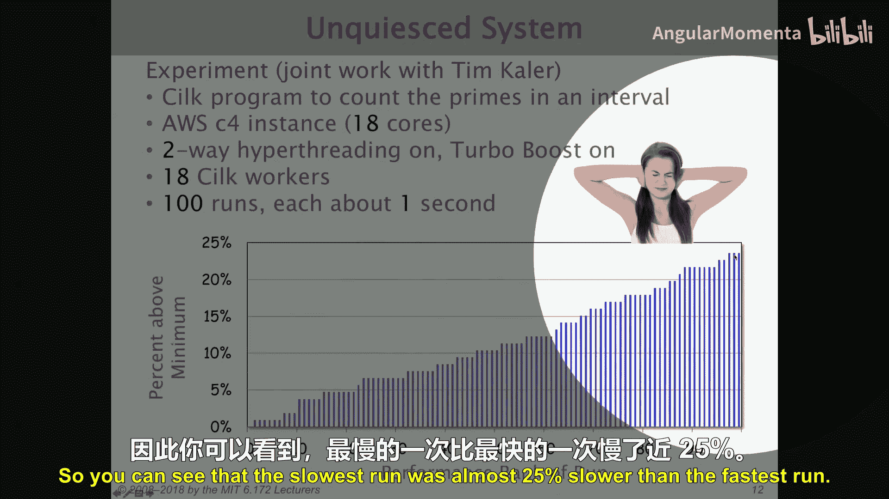
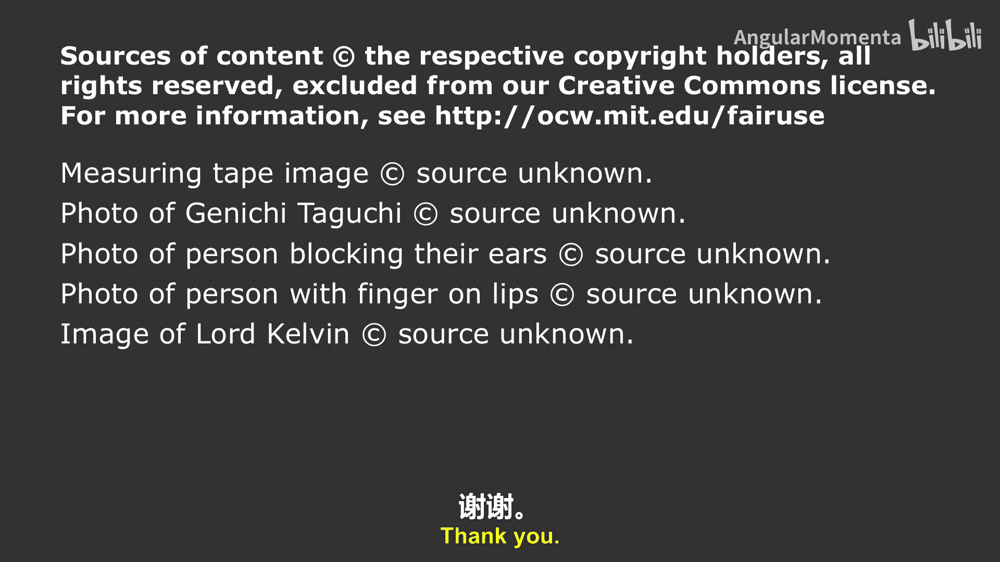

# 010：测量与计时 📏⏱️

在本节课中，我们将要学习如何可靠地测量软件性能。我们将探讨如何消除系统中的“噪音”以获得准确的测量结果，介绍几种测量工具，并讨论性能建模的基本概念。理解这些内容对于评估和优化代码至关重要。

## 系统静默化 🤫

上一节我们介绍了测量性能时可能遇到的挑战，本节中我们来看看如何通过“静默化”系统来减少测量误差。静默化指的是关闭或控制系统中可能干扰测量的各种因素，以获得更稳定、可重复的结果。

在计算机系统中，存在许多导致测量结果波动的因素。以下是一些常见的干扰源：

*   **守护进程和后台任务**：系统中运行的非必要服务或定时任务会占用资源。
*   **中断**：例如鼠标移动或网络活动产生的中断，会打断正在测量的程序。
*   **代码和数据对齐**：代码或数据在内存中的位置（例如是否跨越缓存行或页边界）会影响访问速度。
*   **线程放置**：在多核机器上，程序运行在哪个核心上会影响性能（例如，核心0通常被系统任务占用较多）。
*   **运行时调度器**：操作系统的调度策略，特别是带有随机性的调度器，会引入不确定性。
*   **超线程（同时多线程）**：一个物理核心模拟多个逻辑核心，共享功能单元，可能影响性能评估。
*   **多租户**：在云环境中，其他用户的任务可能与你竞争缓存、网络等资源。
*   **动态频率与电压调节**：系统为控制功耗和发热，动态调整CPU频率和电压，这会直接影响运行时间。
*   **睿频加速**：当只有少数核心活跃时，自动提升CPU频率。
*   **网络流量**：网络活动可能间接影响系统性能。

静默化系统可以显著降低测量结果的方差。例如，在一项实验中，关闭超线程、睿频加速和后台服务后，100次运行的时间差异从最高达25%降低到不足1%。这使得我们能够更可靠地检测出微小的性能改进（例如3%的提升）。

以下是实现系统静默化的一些实用技巧：

*   确保没有其他作业在运行，关闭不必要的守护进程和定时任务。
*   断开网络连接，避免外部干扰。
*   测量时不要移动鼠标等外设。
*   对于串行作业，避免在核心0上运行。
*   在BIOS或系统设置中关闭超线程、DVFS和睿频加速功能。
*   使用 `taskset` 命令将工作线程固定到特定的CPU核心上，防止操作系统调度器将其迁移。

需要注意的是，即使在高度静默化的系统上，由于硬件层面的因素（如DRAM内存的软错误纠正需要额外周期），完全确定性的结果在现代硬件上也是无法保证的。

## 代码对齐的影响 📐

代码在内存中的对齐方式可能对性能产生意想不到的影响，这种影响有时甚至比编译器优化级别的改变还要大。

一个常见的问题是，对代码的微小修改（例如增加一个字节）可能导致后续所有代码的地址偏移，从而改变其缓存行或页面对齐状态。这可能会显著影响缓存命中率和TLB效率，进而导致性能波动。

另一个更隐蔽的问题是，链接器命令行中目标文件（`.o` 文件）的顺序也可能影响最终可执行文件中代码段的布局，从而影响性能。

为了缓解代码对齐问题，现代编译器提供了一些支持。例如，可以强制所有函数或基本块在缓存行边界对齐。LLVM编译器就提供了相关选项：
*   `-align-all-functions`：强制所有函数在缓存行边界开始。
*   `-align-all-blocks`：强制所有基本块对齐（可能增加代码大小并引入空操作指令）。
*   `-align-blocks-without-fall-through`：仅对齐那些没有顺序执行前驱的基本块，这是一种更实用的折中方案。

此外，一些看似无关的因素也可能通过影响数据对齐来改变性能。例如，可执行文件的名称长度会影响环境变量在栈上的布局，进而可能改变关键数据的页面对齐情况。

## 性能测量工具 🛠️

上一节我们讨论了减少系统噪音的方法，本节中我们来看看几种测量软件性能的具体工具和技术。主要有五种基本方法：

1.  **外部测量**：使用如 `time` 这样的命令行工具来测量整个程序的运行时间。
    *   `time` 命令可以报告三种时间：
        *   **实际时间**：程序从开始到结束的墙上时钟时间。
        *   **用户时间**：程序在用户态消耗的CPU时间。
        *   **系统时间**：程序在内核态消耗的CPU时间（例如处理系统调用）。
    *   注意：用户时间与系统时间之和通常不等于实际时间，因为CPU可能被其他进程占用。

2.  **程序插桩**：在代码中手动插入计时函数调用。
    *   推荐使用 `clock_gettime(CLOCK_MONOTONIC, ...)`。它提供纳秒级精度，耗时约83纳秒，且保证时间值不会回退（这一点很重要，因为其他一些计时器在系统时间同步时可能发生回退）。
    *   避免使用 `gettimeofday`，其精度和准确性可能不足。
    *   避免直接使用 `RDTSC`（读取时间戳计数器）指令。虽然它更快（约32纳秒），但不同核心的计数器可能不同步，且在DVFS启用时，将周期数转换为实际时间很复杂。

3.  **程序中断**：通过周期性中断程序并检查其调用栈来了解时间花费在哪里。
    *   **穷人分析器**：手动使用调试器（如GDB）中断程序，多次采样后查看最常见的栈轨迹。
    *   **GProf** 等工具自动化了这个过程。但需要注意，如果采样频率不足（例如GProf默认每秒100次），对于短时间运行的程序，统计结果可能不准确。

4.  **硬件与操作系统支持**：利用CPU的性能监控计数器。
    *   **Perf** 工具集和 **libpfm4** 库可以访问大量硬件事件计数器（如缓存命中/失效、分支预测错误、指令执行数等）。
    *   需要注意：许多计数器的具体含义文档不全；同时监控过多计数器时，硬件可能会采用时间复用等统计方式，而非精确计数；某些优化（如硬件预取）可能不被特定计数器记录。

5.  **程序模拟**：使用模拟器（如 **Cachegrind**）运行程序。
    *   优点：可以获得完全可重复、详细的底层数据（如精确的缓存模拟结果），并且可以定制收集任何需要的统计信息而不干扰程序运行。
    *   缺点：运行速度远慢于真实硬件，且模拟器模型可能无法完全反映真实硬件的所有行为。

**三角测量法** 是一种最佳实践：永远不要只相信一种测量方式。应该结合多种不同的测量方法，确保它们讲述的是同一个“故事”。如果结果存在差异，就需要深入探究原因。

## 性能建模与统计 📊

上一节我们介绍了多种测量工具，本节中我们来看看如何解读和分析测量数据，这涉及到性能建模和统计方法。

性能工程的基本流程很简单：有一个程序A，修改后得到A‘，测量A’的性能，如果A‘比A快，则用A’替换A，如此循环。然而，如果无法可靠地测量，就很难判断A‘是否真的优于A。

### 选择合适的统计量

假设我们在一个有背景噪音的计算机上，对一个确定性程序测量了100次运行时间。哪个统计量最能代表该软件的“原始”性能？
*   算术平均值
*   几何平均值
*   中位数
*   最大值
*   最小值

**最小值** 通常是最佳选择，因为它最能抵抗噪音的影响。对于确定性程序，任何高于最小值的测量结果都可以被认为是噪音导致的。而中位数和平均值则会包含噪音成分。

然而，选择哪个统计量取决于你的目标：
*   **吞吐量**：关注算术平均值（如CPU利用率）。
*   **实时性**：关注最大值或高百分位数（如保证99%的请求在100毫秒内完成）。
*   **资源约束**：关注最大值（如内存使用峰值不能超过100MB）。
*   **能耗成本**：关注总和或平均值。

### 比较两个程序

要比较两个程序A和B哪个更快，一个有效的策略是进行多次“头对头”比较运行。记录A击败B的次数。然后可以使用统计假设检验（如符号检验）来计算p值。p值表示在“A和B性能无差异”（零假设）的前提下，观察到当前或更极端结果的概率。如果p值很小（例如小于0.05），我们就有理由拒绝零假设，认为A和B的性能存在显著差异。这种方法即使在有噪音的环境中也能很好地工作，但需要足够的运行次数。

### 处理比率数据

在汇总性能提升比率（如“B比A快多少倍”）时需要特别小心。**对多个比率直接求算术平均值是错误的**，因为它不具备良好的数学性质（例如，`mean(B/A)` 不等于 `1 / mean(A/B)`）。

正确的做法是使用**几何平均值**来处理比率。几何平均值通过对数转换，使得比率的聚合具有一致性，即 `geometric_mean(B/A) = 1 / geometric_mean(A/B)`。对于速率数据（如每秒操作数），则通常使用**调和平均值**。

### 模型拟合

有时我们希望通过测量数据来估计一些衍生参数，例如：总时间 = 指令数 × 每指令平均时间 + 缓存失效次数 × 每次失效代价。这可以通过**最小二乘法**拟合一个线性模型来实现。但需要注意**过拟合**问题：增加模型参数（基函数）总是可以更好地拟合现有数据，但可能降低模型对新数据的预测能力。判断过拟合的一个方法是检查移除某个参数是否对拟合质量影响不大。

---

**总结**：在本节课中，我们一起学习了软件性能测量的核心挑战与解决方案。我们了解到系统噪音（如DVFS、后台任务）会严重影响测量，并掌握了通过静默化系统（关闭干扰功能、固定线程等）来获得可靠数据的方法。我们介绍了几种主要的性能测量工具（外部计时、插桩、采样、硬件计数器、模拟器），并强调了“三角测量”的重要性。最后，我们探讨了如何运用统计学知识（选择合适统计量、假设检验、正确处理比率）来分析和比较性能数据，并提及了通过模型拟合来深入理解性能构成。记住开尔文勋爵的格言：“无法测量，则无法改进。” 可靠的测量是性能优化的基石。