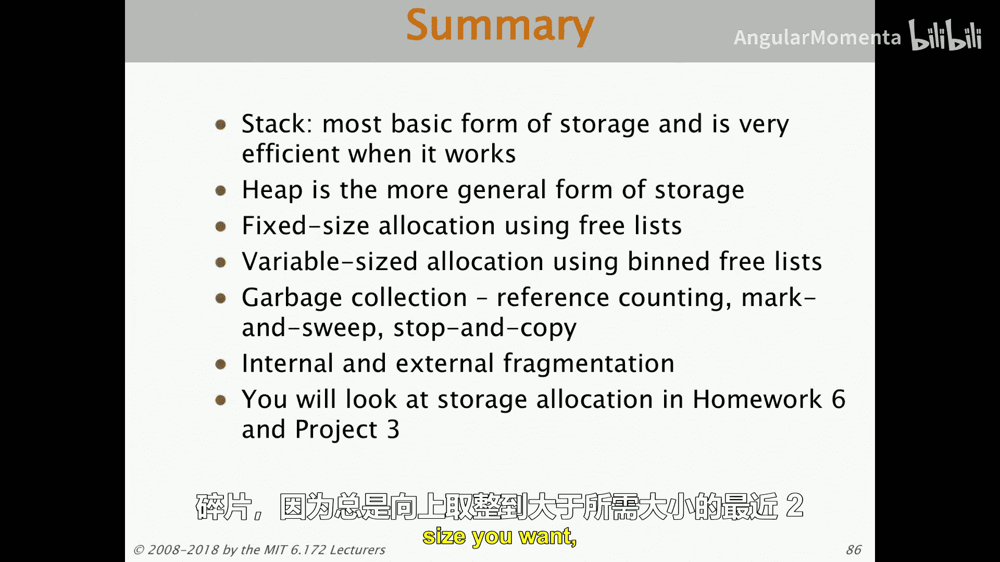

# 011：存储分配 💾


在本节课中，我们将要学习存储分配，即如何在程序运行时动态地管理内存。我们将从最简单的栈分配开始，逐步深入到更复杂的堆分配机制，包括固定大小和可变大小的分配策略，最后探讨自动内存管理的核心概念——垃圾回收。

## 栈分配 📚

上一节我们介绍了存储分配的基本概念，本节中我们来看看最简单的存储分配形式：栈。

栈使用一个数组和一个指针来管理内存。数组 `a` 代表整个内存区域，指针 `SP` 指向已使用区域的末尾。要分配 `X` 字节，只需将 `SP` 指针增加 `X`。这非常高效，因为所有操作都是常数时间，并且代码通常可以被内联。

然而，栈分配有一个根本性的限制：它遵循后进先出的原则。你只能释放最后分配的内存块，无法释放中间的内存。这限制了栈的适用性，但对于符合这种模式的操作（如函数调用栈）来说，它极其高效。

## 堆分配概述 🗑️

由于栈的局限性，我们需要更通用的内存管理方式，这就是堆。堆允许更灵活的内存分配和释放，但管理起来也复杂得多。

在C/C++中，我们使用 `malloc` 和 `free`（或C++的 `new` 和 `delete`）进行堆分配。与Java/Python等带有垃圾回收的语言不同，程序员需要手动管理内存，这带来了内存泄漏、悬垂指针和重复释放等风险。

以下是管理内存时需要注意的几种错误：
*   **内存泄漏**：分配了内存但忘记释放，导致程序内存占用不断增加。
*   **悬垂指针**：指向已被释放内存的指针，解引用它会导致未定义行为。
*   **重复释放**：对同一块内存多次调用 `free`，同样会导致未定义行为。

## 固定大小的堆分配 🔢

为了理解堆分配，我们先从简单情况开始：假设所有内存块大小相同。

一种常见的实现方式是使用**空闲链表**。所有未使用的内存块通过指针连接成一个链表。分配时，从链表头部取出一个块；释放时，将被释放的块放回链表头部。

分配操作的伪代码如下：
```c
x = free;          // free指向链表头
free = free->next; // 将free指针移向下一个空闲块
return x;          // 返回分配到的内存块
```

释放操作的伪代码如下：
```c
x->next = free; // 将被释放块指向当前空闲链表头
free = x;       // 将free指针指向被释放块
```

这种方法的分配和释放都是常数时间，并且具有时间局部性（最近释放的块会被优先分配）。但它可能导致**外部碎片化**，即已使用的内存块分散在虚拟内存空间中，这会增加页表大小、引起磁盘颠簸并降低TLB命中率。

为了缓解外部碎片化，可以将空闲链表按内存页组织，并优先从最满的页进行分配，这样有助于将内存使用集中到更少的页面上。

## 可变大小的堆分配 📦

实际程序中，我们需要分配不同大小的内存。**分箱空闲链表**是一种常见策略。

其思想是准备多个“箱子”，每个箱子存放特定大小的内存块。通常，箱子大小按2的幂次设置（如1、2、4、8字节……）。当请求分配 `X` 字节时：
1.  计算 `k = ceil(log2(X))`，找到对应大小 `2^k` 的箱子。
2.  如果该箱子非空，则从中分配一块。
3.  如果该箱子为空，则寻找下一个更大的非空箱子（如大小为 `2^(k')`），将其中的一块内存**分裂**成更小的块（`2^(k'-1)`, `2^(k'-2)`, ..., `2^k`），放入对应的箱子，并将其中一块 `2^k` 大小的内存返回。

这种方案最多浪费一倍的内存（内部碎片化），并且理论证明，其内存使用量在最坏情况下是 `M * log M`，其中 `M` 是程序任意时刻使用的最大堆内存。

## 程序存储布局 🗺️

了解程序在虚拟内存中的布局有助于理解内存管理。一个典型的64位地址空间布局如下（从高地址到低地址）：
*   **栈**：用于函数调用、局部变量，向低地址增长。
*   **堆**：用于动态内存分配（`malloc`/`free`），向高地址增长。
*   **BSS段**：存放未初始化的全局/静态变量，程序启动时初始化为零。
*   **数据段**：存放已初始化的全局/静态变量和常量。
*   **代码段**：存放程序的可执行代码。

栈和堆相向生长，但在64位地址空间中，它们几乎不可能相遇。

## 垃圾回收 ♻️

垃圾回收旨在自动回收程序不再使用的内存，减轻程序员的负担。其核心是区分**根对象**（直接可访问，如全局变量、栈变量）、**存活对象**（从根对象通过指针可达）和**死亡对象**（不可达，可安全回收）。

### 引用计数
每个对象维护一个引用计数，记录指向它的指针数量。当计数归零时，立即回收该对象及其引用的对象。
*   **优点**：简单，可及时回收。
*   **缺点**：无法处理**循环引用**，会导致内存泄漏。

### 标记-清除算法
该算法分为两个阶段：
1.  **标记阶段**：从所有根对象开始，进行图遍历（如广度优先搜索），标记所有可达的存活对象。
2.  **清除阶段**：线性扫描整个堆，回收所有未被标记的对象。
*   **缺点**：会产生外部碎片，并且需要扫描整个堆。

### 停止-复制算法
该算法使用两个内存空间：“来源空间”和“目标空间”。
1.  程序平时在“来源空间”中分配内存。
2.  当“来源空间”满时，暂停程序执行。
3.  从根对象开始，将**所有存活对象**复制到连续的“目标空间”中，并更新所有指向这些对象的指针（通过在每个被移动对象原位置留下“转发指针”）。
4.  交换两个空间的角色，程序在“目标空间”中继续运行。
*   **优点**：消除了外部碎片，只需遍历存活对象，效率更高。
*   **缺点**：需要双倍内存空间，并且复制存活对象有开销。

## 总结 📝

本节课中我们一起学习了存储分配的各个方面：
*   **栈分配**高效但受限，只能以LIFO顺序释放内存。
*   **堆分配**更灵活但复杂，我们探讨了固定大小（空闲链表）和可变大小（分箱空闲链表）的分配策略。
*   我们了解了**外部碎片化**（内存块分散）和**内部碎片化**（块内浪费）对性能的影响。
*   最后，我们介绍了**垃圾回收**的几种基本算法：**引用计数**（简单但无法处理循环引用）、**标记-清除**（可处理循环引用但产生碎片）和**停止-复制**（可处理循环引用且消除碎片，但需要额外空间）。




高效的内存管理是编写高性能软件系统的关键，理解这些底层机制将帮助你做出更明智的设计和实现选择。