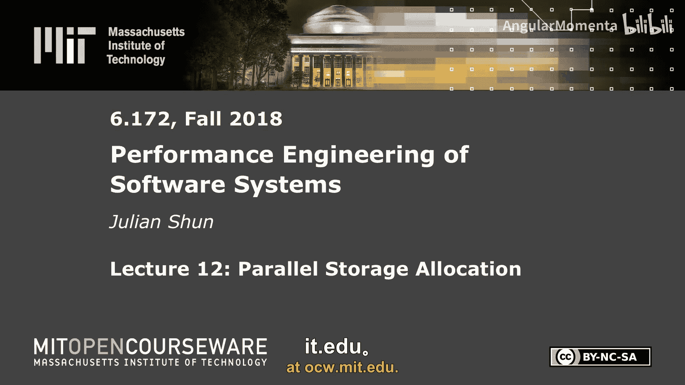

# 012：并行存储分配 🧠



在本节课中，我们将要学习并行环境下的存储分配。我们将回顾串行存储分配的基础知识，然后深入探讨并行分配策略、堆栈管理以及垃圾收集的相关概念。

## 概述

存储分配是软件系统性能的关键组成部分。在并行程序中，如何高效、安全地分配和释放内存，同时避免碎片化和锁竞争，是提升性能的重要课题。本节课程将介绍并行存储分配的基本原理、不同策略及其性能权衡。

## 内存分配原语回顾

首先，我们来回顾一些基本的内存分配原语。

*   **`malloc`**：用于从堆中分配内存。调用 `malloc(S)` 会分配并返回一个指向至少包含 `S` 字节内存块的指针。返回类型是 `void*`，但良好的编程实践是将其强制转换为所需类型的指针。
*   **`aligned_alloc`**：用于进行对齐内存分配。调用 `aligned_alloc(A, S)` 会分配并返回一个指向至少包含 `S` 字节内存块的指针，且该内存块的起始地址是 `A` 的倍数（`A` 必须是2的幂）。对齐分配有助于减少缓存未命中，并满足向量化指令的要求。
*   **`free`**：用于将内存释放回堆。传入指向内存块的指针 `P`，即可释放该块内存。
*   **内存泄漏**：指分配了内存但未能释放，导致程序内存使用量持续增长，最终可能耗尽内存并崩溃。
*   **双重释放**：指对同一块内存多次调用 `free`。其行为是未定义的，可能导致段错误或程序出现意外行为。

## `mmap` 系统调用

`mmap` 是一个系统调用，通常用于将磁盘文件映射到内存。但在存储分配的上下文中，它可以用来分配没有后备文件的虚拟内存。

```c
void* ptr = mmap(0, size, PROT_READ | PROT_WRITE, MAP_PRIVATE | MAP_ANON, -1, 0);
```

参数说明：
*   第一个参数为期望的起始地址（0表示由系统决定）。
*   `size` 为要分配的字节数。
*   `PROT_READ | PROT_WRITE` 表示内存区域可读可写。
*   `MAP_PRIVATE | MAP_ANON` 表示分配进程私有的匿名内存。
*   `-1` 表示没有后备文件。
*   最后一个参数为文件偏移量（无后备文件时为0）。

`mmap` 会在应用程序的地址空间中找到一个足够大的连续未使用区域，并更新页表，使得用户对该区域的访问合法。

### `mmap` 的特性

`mmap` 是惰性的。当你请求一定量的内存时，它不会立即分配物理内存，而只是在页表中创建指向特殊零页的条目，并将这些页标记为只读。首次写入此类页面时，会触发页错误，此时操作系统才会分配物理内存并建立映射。

这意味着，即使物理内存只有1GB，你也可以 `mmap` 1TB的虚拟内存。但需要注意，进程可能在调用 `mmap` 很久之后，因首次触及内存时物理内存耗尽而死亡。

### `malloc` 与 `mmap` 的区别

*   **`malloc`** 是库调用，是C库中堆管理代码的一部分。它使用 `mmap` 等系统设施从操作系统获取虚拟地址空间，并负责重用内存以减少碎片和提高局部性。
*   **`mmap`** 是系统调用，负责从操作系统获取内存。

通常，对于小内存分配，应使用 `malloc`，因为它更快且能更好地重用内存；对于大内存分配，直接使用 `mmap` 也是可以的。

## 地址转换回顾

访问内存时使用虚拟地址。虚拟地址可分为高位（虚拟页号）和低位（页内偏移）。硬件通过查询页表，将虚拟页号转换为物理帧号，再结合偏移得到物理地址。

如果所需虚拟页不在物理内存中，会发生页错误。操作系统会检查权限并可能建立映射，否则会引发段错误。

页表查询（页漫步）开销较大，因此引入了**转译后备缓冲器**。TLB 缓存最近的页表查询结果。具有局部性（空间或时间）的程序能从 TLB 中获益，减少页表查询次数。

现代机器通常可以并行执行 TLB 访问和 L1 缓存访问，以降低内存访问延迟。

## 堆栈管理

在串行 C/C++ 程序中，使用线性堆栈来跟踪函数调用和局部变量。

### 串行线性堆栈

函数调用时，新的栈帧被压入栈顶；函数返回时，栈帧被弹出。指针传递的规则是：父函数可以将指向其栈变量的指针传递给子函数，但子函数不能将指向其局部变量的指针传回给父函数，因为子函数的栈帧在其返回后可能被后续函数调用覆盖。

如果要从子函数传递内存给父函数，可以在父函数的栈上或堆上分配该内存。

### 并行仙人掌栈

在并行程序中（如使用 Cilk），需要支持堆栈的多个并行视图，这称为仙人掌栈。它允许并行执行的函数看到与串行执行时相同的堆栈视图。

一种简单的实现策略是**基于堆的仙人掌栈**：每个栈帧都在堆上分配，并包含指向父栈帧的指针。函数调用时从堆分配新帧，返回时释放。

#### 基于堆的仙人掌栈的空间界限

设 `S1` 为程序串行执行所需的堆栈空间，`Sp` 为使用 `P` 个工作线程执行时的堆栈空间。可以证明：`Sp ≤ P * S1`。

这个界限的推导利用了 Cilk 工作窃取算法的“繁忙叶子”属性：在调用树中，每个叶子节点都有一个工作线程正在处理。

#### 示例：分治矩阵乘法

考虑一个分治矩阵乘法代码，它在递归调用前分配临时空间（大小为 `O(n²)`），并在返回前释放。

*   **工作量**：`T1(n) = 8T1(n/2) + O(n²)`，结果为 `O(n³)`。
*   **跨度**：`T∞(n) = T∞(n/2) + O(log n)`，结果为 `O(log² n)`。
*   **空间**：`S(n) = S(n/2) + Θ(n²)`，结果为 `Θ(n²)`。

根据前述定理，在 `P` 个处理器上的空间上界为 `O(P * n²)`。通过分析算法递归树的结构，可以证明一个更紧的界：`O(P^(1/3) * n²)`。

#### 基于堆的栈的问题

主要问题在于**与遗留串行二进制代码的互操作性**。遗留代码可能假设使用传统线性堆栈并进行相关操作，与基于堆的栈不兼容。

Cilk 的实现采用了**线性栈池**的策略，维护一组线性栈供工作线程使用，这不需要修改操作系统，并能保持空间和时间界限。

## 堆分配器基础

现在，我们将重点转向堆分配器。

### 关键定义

*   **分配器速度**：分配器每秒能维持的分配和释放操作数量。
*   **用户足迹**：用户程序使用的字节数（已分配未释放）随时间变化的最大值，即峰值内存使用量。
*   **分配器足迹**：操作系统提供给分配器的字节数随时间变化的最大值。
*   **碎片化**：定义为 `A / U`。低碎片化意味着分配器足迹接近用户足迹。
*   **空间开销**：用于簿记（如存储块大小的头部信息）的空间。
*   **内部碎片**：由于分配比用户请求更大的块而造成的浪费（例如，请求9字节得到16字节）。
*   **外部碎片**：由于存储空间不连续而无法使用的浪费。
*   **膨胀**：并行分配器所需空间超出串行分配器的额外部分，即 `T / S`。

优化小内存块的分配速度更为重要，因为小内存分配请求更频繁，且分配器开销在总处理时间中的占比更高。

## 并行堆分配策略

以下是几种常见的并行堆分配策略。

### 1. 全局堆 🔒

所有线程共享一个受互斥锁保护的全局堆。

*   **优点**：膨胀为1（空间使用与串行相同）。
*   **缺点**：锁竞争严重，性能随处理器数量增加而下降。所有处理器争抢同一缓存行，导致缓存一致性流量大，可扩展性差。

### 2. 局部堆 🏠

每个线程维护自己的堆，分配和释放操作无需同步。

*   **优点**：分配速度快，无锁竞争。
*   **缺点**：可能导致**内存漂移**。如果一个线程分配内存，但由另一个线程释放，那么分配线程的堆可能因看不到其他堆的空闲内存而不断向操作系统申请新内存，导致内存使用量无限增长，膨胀可能无界。

### 3. 局部拥有权 🏷️

每个分配的内存块都标记有所有者（分配它的线程）。释放时，内存块返回给其所有者的堆。

*   **优点**：
    *   本地对象的分配和释放速度快。
    *   释放远程对象只需与所有者线程同步，开销小于全局锁。
    *   膨胀有界（≤ P）。
    *   有助于减少**伪共享**。
*   **伪共享**：多个处理器访问同一缓存行上的不同内存位置，导致缓存行无效并在处理器间“弹跳”，降低性能。局部拥有权使得对象最终会回到其所有者的堆，减少了伪共享的持久性。

### 4. Hoard 分配器 🧩

Hoard 分配器结合了局部堆和全局堆的思想。内存被组织成大小为 `S` 的超块（通常是页大小的倍数）。

*   **数据结构**：`P` 个局部堆 + 1 个全局堆。
*   **分配流程**：
    1.  线程 `i` 调用 `malloc`。
    2.  首先检查线程 `i` 的局部堆中是否有空闲对象。如果有，则从最满的非满超块中分配（以减少外部碎片）。
    3.  如果局部堆没有，则检查全局堆。
    4.  如果全局堆为空，则从操作系统获取新超块。
    5.  将获得的块的所有者设为 `i`，并返回对象。
*   **释放与平衡**：释放对象 `x`（所有者线程 `i`）时，将其放回堆 `i`。Hoard 维护一个不变式，确保每个局部堆的已使用存储 `U_i` 不低于某个阈值（与已分配存储 `A_i` 相关）。如果某个堆利用率过低（例如低于一半），则将其一个超块移至全局堆。
*   **膨胀界限**：可以证明，Hoard 的分配器足迹 `A` 满足 `A = O(U + S*P)`，因此膨胀率 `A/U = 1 + O(S*P / U)`。这是一个很好的界限。

### 现代分配器

*   **jemalloc**：广泛应用，对不同分配大小使用独立的全局锁，倾向于分配请求大小中地址最小的对象，并使用 `madvise` 释放空页。
*   **supermalloc**：较新的分配器，在某些基准测试中表现出比 jemalloc 和 Hoard 更快的速度，且代码相对简洁。

## 总结


本节课我们一起学习了并行存储分配的核心概念。我们从串行分配原语和 `mmap` 的回顾开始，理解了地址转换和堆栈管理在串行与并行环境下的区别。我们重点探讨了多种并行堆分配策略：全局堆（简单但扩展性差）、局部堆（快但可能内存漂移）、局部拥有权（平衡性能与空间）以及 Hoard 分配器（结合局部与全局堆，具有理论性能保证）。最后，我们简要介绍了现代分配器如 jemalloc 和 supermalloc。理解这些策略的权衡对于设计和实现高性能并行软件至关重要。