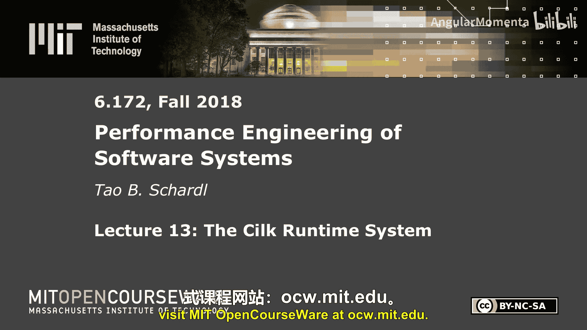
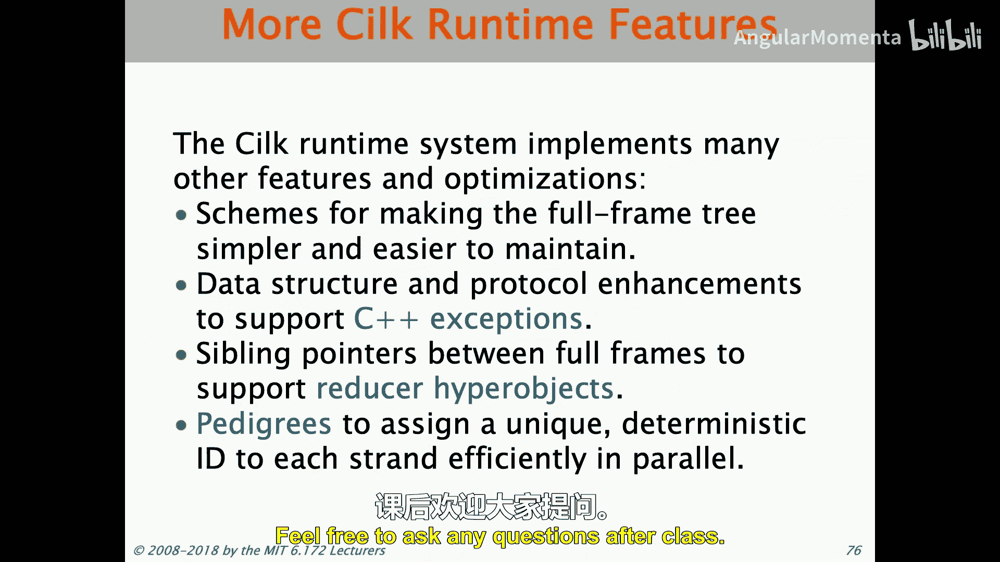

# 013：Cilk运行时系统



在本节课中，我们将深入探讨Cilk运行时系统的工作原理。Cilk是一种并行编程语言，它通过在代码中插入关键字（如`cilk_spawn`、`cilk_sync`、`cilk_for`）来指示并行性。运行时系统的核心任务是动态地将这些逻辑并行任务调度和负载均衡到多核系统的处理器上，其背后是一个随机工作窃取调度器，以确保执行的高效性。

## 🎯 核心功能与性能考量

上一节我们介绍了Cilk的基本概念。本节中，我们来看看实现Cilk运行时系统需要满足哪些核心功能要求，以及需要考虑哪些性能因素。

Cilk运行时系统需要处理几个关键问题：
1.  **串行执行**：单个工作线程必须能够像执行普通串行程序一样执行Cilk代码。
2.  **工作窃取**：当一个空闲处理器（“窃贼”）从另一个处理器（“受害者”）的队列中窃取任务时，它必须能够跳入一个正在执行的函数的中间，并从中断处继续执行。
3.  **同步**：`cilk_sync`语句必须能够实现细粒度的嵌套同步，即一个函数只等待其直接派生的子计算完成，而不是等待整个程序。
4.  **仙人掌栈**：Cilk遵循C的指针规则（子函数可以访问父函数栈帧的指针，反之则不行）。运行时系统需要为所有工作线程实现这种“仙人掌栈”视图，使得不同线程可以共享部分栈视图，同时拥有独立的栈空间。

除了功能，性能也至关重要。Cilk工作窃取调度器的期望运行时间公式为：
```
T_P = O(T_1 / P + T_∞)
```
其中，`T_1`是总工作量，`P`是处理器数量，`T_∞`是跨度（关键路径长度）。为了实现相对于原始串行运行时间`T_S`的线性加速（即`T_P ≈ T_S / P`），我们需要：
*   **充足的并行性**：`T_1 / T_∞ >> P`
*   **高工作效率**：`T_S / T_1`尽可能接近1

Cilk运行时系统遵循 **“工作优先”原则**：优化普通的串行执行路径，即使这可能会增加工作窃取时的开销。编译器负责处理快速路径（无窃取情况），而运行时系统库则处理并行执行和窃取等慢速路径。

## 🏗️ 工作线程队列与数据结构实现

了解了需求和目标后，本节我们来看看Cilk运行时系统如何具体实现工作线程的队列（Deque）和核心数据结构。

Cilk将工作线程的队列实现为一个独立于实际调用栈的数据结构。每个工作线程维护一个包含头尾指针的队列，队列中的条目是指向栈帧的指针。可被窃取的栈帧会额外存储一个本地结构，包含窃取所需的信息。

以下是核心数据结构：
*   **Cilk运行时栈帧**：每个可产生并行任务的函数实例化都有一个`CilkRTS-stack-frame`结构体，作为局部变量存储在栈上。它包含一个上下文缓冲区（用于保存函数在`cilk_spawn`或`cilk_sync`处的状态）、标志位字段和指向父栈帧的指针。
*   **工作线程结构**：包含指向其队列（头尾指针）的指针，以及指向当前栈帧的指针。

当一个函数（如`foo`）被编译时，编译器会生成额外的代码和辅助函数。例如，对于`cilk_spawn bar()`，编译器会：
1.  生成一个`spawn helper`函数（如`spawn_bar`），其中包含对`bar`的实际调用。
2.  在`foo`中插入对`setjmp`的调用，将其上下文（指令指针、栈指针、被调用者保存寄存器等）保存到其栈帧的缓冲区中，为可能的窃取做准备。
3.  调用`spawn_bar`辅助函数。

## 🔄 生成与串行执行路径

现在，让我们跟随一个工作线程，看看在典型的串行执行（无窃取）路径上，这些数据结构是如何运作的。

假设主函数调用了一个会产生并行任务的函数`foo`：
1.  `foo`开始执行，其`CilkRTS-stack-frame`被初始化，工作线程的当前栈帧指针指向它。
2.  执行到`setjmp`，将当前状态保存到缓冲区，并返回0。
3.  条件判断为真，调用`spawn_bar`辅助函数。
4.  `spawn_bar`的栈帧被压入调用栈，其父指针被设置为`foo`的栈帧，工作线程的当前栈帧指针更新为指向`spawn_bar`。
5.  调用`CilkRTS-detach`，这会将`foo`的栈帧（而非当前栈帧）推入工作线程队列的尾部，表示其“延续”部分（即`spawn`之后的代码）现在可以被窃取。
6.  然后执行被派生的函数`bar`。
7.  `bar`返回后，执行`spawn_bar`中的清理代码，将当前栈帧指针指回父帧`foo`。
8.  最后调用`CilkRTS-leaf-frame`。**这是关键步骤**：它尝试从队列底部弹出工作。在串行情况下，队列中有`foo`的延续，因此弹出成功，执行跳转到`foo`中`spawn`之后的延续部分，继续串行执行。

这个流程优化了无窃取时的普通执行路径。

## 🏃‍♂️ 工作窃取与状态恢复

上一节我们看了顺利的串行路径。本节中，我们来看看当有空闲处理器试图窃取工作时会发生什么。

当一个“窃贼”工作线程的队列为空时，它会随机选择另一个“受害者”工作线程，并试图从其队列的**顶部**窃取工作。这涉及到并发访问，因此需要同步协议（如THE协议）。窃贼会锁定受害者的队列，从顶部取出一个或多个栈帧。

窃贼现在拥有了代表某个函数延续的栈帧（例如`foo`的栈帧）。为了恢复执行，它使用`longjmp`函数。`longjmp`接收一个上下文缓冲区（来自刚窃取的栈帧）和一个值。它将缓冲区中保存的寄存器状态加载到窃贼处理器的寄存器中，包括指令指针。效果上，这导致当初在`foo`中调用的`setjmp`“再次返回”，但这次返回值为传递给`longjmp`的值（例如1）。这使得程序计数器跳过了对`spawn helper`的调用，直接开始执行`foo`中`spawn`之后的延续代码。

## 🌵 仙人掌栈的实现

窃贼现在可以执行代码了，但它和受害者共享着`foo`函数的部分栈帧状态。如果窃贼需要调用新函数（比如`foo`的延续中调用了`baz`），它不能污染受害者的栈。这就是“仙人掌栈”要解决的问题。

解决方案非常巧妙：
*   窃贼将**基指针（RBP）** 设置为指向受害者栈中共享函数（如`foo`）的栈帧。这样它就能以偏移量的方式访问`foo`的局部变量。
*   窃贼将**栈指针（RSP）** 设置为指向它自己独立的调用栈顶部。
*   当窃贼需要调用新函数`baz`时，它遵循标准调用约定：将当前RBP（指向`foo`）保存到自己的栈上，更新RBP和RSP以分配`baz`的新栈帧。这样，`baz`的调用完全发生在窃贼自己的栈上，不会干扰受害者。

通过这种RBP和RSP的分离使用，Cilk实现了栈视图的共享与独立扩展。需要注意的是，Cilk编译器会为可能被窃取延续的函数禁用“省略帧指针”的优化，以确保RBP可用。

## ⚙️ 同步的实现

最后，我们简要看看`cilk_sync`是如何实现的。当一个工作线程遇到`cilk_sync`时，它需要等待所有直接派生的子计算完成。

运行时系统维护一个**完整帧（full frame）树**结构来跟踪并行子计算的状态。每个并行活动都有一个完整帧，其中记录父帧、未完成的子计算数量等信息。

当工作线程到达`sync`时：
*   **快速路径（常见情况）**：如果没有未完成的子计算（标志位显示无需同步），则直接通过，几乎无开销。
*   **慢速路径**：如果存在未完成的子计算，当前工作线程不能干等。它会将当前完整帧**挂起**，然后自己转变为窃贼，去窃取其他工作。当最后一个子计算完成时，它会负责恢复其父帧的执行，使其能够通过`sync`继续。

这种设计确保了处理器资源在等待时不会被浪费，并且同步仅限于嵌套子计算。

## 📚 总结

本节课中我们一起学习了Cilk运行时系统的核心机制。我们了解到：
1.  系统通过分离的队列数据结构和“工作优先”原则来优化性能。
2.  编译器生成辅助函数并使用`setjmp`/`longjmp`来支持工作窃取和状态恢复。
3.  通过巧妙的基指针与栈指针管理，实现了共享与独立并存的“仙人掌栈”。
4.  同步机制利用完整帧树来高效处理嵌套等待，避免处理器闲置。



Cilk运行时系统是一个复杂的软件层，它优雅地处理了并行任务调度、负载均衡、栈管理和同步等挑战，使得程序员能够通过简单的关键字注释就能获得高效的并行执行。