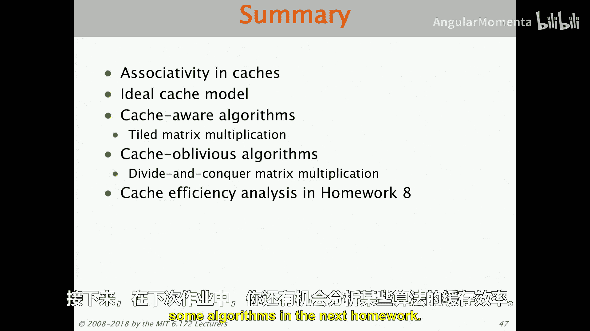

# 014：缓存与缓存高效算法 🚀


在本节课中，我们将深入学习缓存的工作原理以及如何设计能够高效利用缓存的算法。我们将从现代机器的缓存硬件架构开始，探讨不同类型的缓存组织方式（如直接映射、全相联和组相联），并分析算法中可能出现的各种缓存缺失。最后，我们将通过矩阵乘法的例子，对比缓存感知和缓存无关算法的设计思路与性能。

---

## 缓存硬件架构 🏗️

现代多核机器的缓存层次结构通常如下：每个处理器核心拥有私有的L1指令缓存和数据缓存，以及私有的L2缓存。所有核心共享一个最后一级缓存（LLC或L3缓存）。这些缓存通过内存控制器连接到DRAM，在多芯片系统中，芯片之间通过网络互连。

缓存层次结构的特点如下：
*   **大小递增**：L1缓存通常为32KB，L2缓存约为256KB，LLC可达数十MB，而DRAM则在GB到TB级别。
*   **访问延迟递增**：L1缓存访问最快（约2纳秒），L2稍慢（约4纳秒），LLC更慢（约6纳秒），访问DRAM则要慢一个数量级（约50纳秒）。
*   **相联度递增**：越靠近CPU的缓存，其相联度策略可能不同，这影响了数据在缓存中的存放位置。

由于更快的存储介质更昂贵，因此容量更小。如果我们的程序能充分利用**局部性**，就能更多地使用这些快速内存。

在并行环境中，由于每个核心有私有缓存，需要通过**缓存一致性协议**（如MESI协议）来确保所有核心对同一内存地址有一致的视图。设计正确的缓存一致性协议非常复杂。

---

## 缓存相联度 🔍

上一节我们概述了缓存层次。本节中，我们来看看数据在缓存中是如何组织和查找的，这主要取决于缓存的**相联度**。

### 全相联缓存

在全相联缓存中，一个缓存块可以存放在缓存中的任何位置。查找一个块时，需要搜索整个缓存，因为该块可能在任何地方。

地址被划分为两部分：
*   **标记**：使用地址中除偏移量外的几乎所有位，用于唯一标识内存块。
*   **偏移量**：用于定位缓存块内的具体字节。

当缓存已满时，需要根据**替换策略**（如最近最少使用-LRU）选择一个块进行替换。

**缺点**：查找速度慢，因为每次都需要搜索整个缓存。

### 直接映射缓存

在直接映射缓存中，每个内存块只能映射到缓存中一个特定的位置（称为“组”）。

地址被划分为三部分：
*   **标记**
*   **组索引**：用于确定块属于哪个组。
*   **偏移量**

**优点**：查找速度快，只需检查一个特定位置。
**缺点**：可能导致**冲突缺失**。即使缓存中有空闲位置，如果程序反复访问映射到同一组的不同内存块，它们也会相互驱逐，导致性能下降。

### 组相联缓存

组相联缓存是上述两种方案的折中。缓存被分为多个组，每个组内有多个缓存行（称为K路组相联）。一个内存块只能映射到一个特定的组，但在该组内可以存放在任何一行中。

地址划分与直接映射类似，但组索引的位数更少（因为组数更少）。

查找时，只需搜索一个组内的K个位置。随着K增大，缓存行为越接近全相联；当K=1时，即为直接映射缓存。

---

## 缓存缺失的类型 ⚠️

了解了缓存的组成方式后，我们来看看程序运行时可能发生的缓存缺失类型。

以下是四种主要的缓存缺失类型：

1.  **冷缺失**：首次访问某个缓存块时必然发生，因为缓存初始为空。
2.  **容量缺失**：发生因为缓存容量不足，无法容纳所有需要的工作集，即使使用全相联缓存也会发生。可通过提升程序的空间和时间局部性来减少。
3.  **冲突缺失**：在组相联或直接映射缓存中发生，因为太多块映射到同一组，导致相互驱逐，而这些块在全相联缓存中本可共存。可通过数据填充或使用临时空间来缓解。
4.  **共享缺失**：仅在并行环境下发生，当多核访问同一缓存行且至少有一个核进行写操作时触发。
    *   **真共享缺失**：多个核访问同一缓存行内的相同数据。
    *   **伪共享缺失**：多个核访问同一缓存行内的不同数据。

**冲突缺失示例**：访问大矩阵中一个32x32的子矩阵的某一列时，由于矩阵行字节数恰好是2的幂，导致该列所有元素地址的组索引相同，在组相联缓存中引发严重的冲突缺失。解决方法包括对矩阵进行**填充**，或在算法中使用**临时副本**来改变访问模式。

在分析算法缓存性能时，需要注意不同模型可能忽略某些缺失类型。

---

## 理想缓存模型 📐

为了理论分析算法的缓存效率，我们引入一个简化的**理想缓存模型**。

该模型假设：
*   两层存储结构：大小为`M`字节的缓存和主内存。
*   缓存块大小为`B`字节，因此可容纳 `M/B` 个缓存行。
*   缓存是**全相联**的。
*   使用**最优先知替换策略**：在需要替换时，能预知未来访问模式并做出最佳选择。
*   访问缓存中的数据成本为零，访问主存中的数据则产生一次缓存缺失。

我们关注两个性能指标：
1.  **工作量**：算法的总操作数，即传统时间复杂度。
2.  **缓存缺失数**：需要在缓存和主存之间传输的缓存行数量。

理想情况是设计出缓存缺失数低且不增加工作量的算法。

**LRU引理**：如果一个算法在大小为`M`的理想缓存上产生`Q`次缓存缺失，那么在一个大小为`2M`、使用LRU替换策略的全相联缓存上，它最多产生`2Q`次缺失。这意味着在渐近分析中，可以方便地使用最优替换或LRU替换策略进行分析。

**软件工程原则**：首先设计在理论上具有良好工作量和缓存复杂度的算法，然后再针对实际硬件细节进行工程优化。

---

## 缓存分析工具：缓存缺失引理与高缓存假设 🔧

在分析具体算法前，我们需要两个有用的分析工具。

### 缓存缺失引理

**引理**：假设程序需要读取`R`个数据段，第`i`个段大小为`s_i`字节，总大小 `N = Σs_i`。
若满足：
1.  `N < M/3` （总数据量小于缓存容量）
2.  `N/R ≥ B` （平均段长不小于缓存块大小）

则将所有段读入缓存所需的缓存缺失数最多为 `3N/B`。

**意义**：只要数据段平均足够大，即使数据不连续，访问它们的缓存开销也近似于访问一个单一大数组。

### 高缓存假设

**假设**：`B² ≤ cM`，其中`c ≤ 1`。即缓存能容纳的行数(`M/B`)大于缓存块大小(`B`)。这通常在实践中成立（例如，L1缓存：64²=4096 < 32768）。

**意义**：该假设确保了当子矩阵的字节数(`n²`)小于`M`时，我们也能有效地将其放入缓存，而不会因为缓存行太“宽”导致空间浪费。这对于递归处理子矩阵的算法至关重要。

**子矩阵缓存引理**：在满足高缓存假设的缓存中，若`n x n`矩阵满足 `cM ≤ n² < M/3`，则该矩阵可放入缓存，且读入所有元素最多需要 `3n²/B` 次缓存缺失。

---

## 案例研究：矩阵乘法 🧮

现在，我们运用前面的理论来分析一个经典算法——矩阵乘法的缓存效率。

标准的三重循环矩阵乘法代码如下：
```c
for (int i = 0; i < n; i++)
  for (int j = 0; j < n; j++)
    for (int k = 0; k < n; k++)
      C[i*n + j] += A[i*n + k] * B[k*n + j];
```
其工作量为 `Θ(n³)`。

我们分析最坏情况下的缓存缺失数（假设LRU替换，行主序存储，满足高缓存假设）。关键在于分析对矩阵`B`的访问，因为它通常主导缺失数。

**情况1：`n > cM/B`**
无法将矩阵`B`的每一行的一个块放入缓存。遍历`B`的每一列都会导致所有行被重新加载，每次内层循环（`k`循环）都对`B`产生`Θ(n)`次缺失。总缺失数为 `Θ(n³)`。

**情况2：`c√M ≤ n ≤ cM/B`**
可以将矩阵`B`的每一行的一个块放入缓存，但整个矩阵放不下。此时，只有第一次遍历`B`的某一列时会引发缺失，后续相邻列的访问可重用缓存。总缺失数约为 `Θ(n³/B)`。

**情况3：`n < c√M`**
整个矩阵可放入缓存。只需在第一次访问时将矩阵读入，后续访问均命中。总缺失数为 `Θ(n²/B)`。

**循环顺序的重要性**：交换内两层循环（`j`和`k`）的顺序，使对`B`的访问变为按行进行，能充分利用空间局部性，将情况1的缺失数从`Θ(n³)`降至`Θ(n³/B)`。

然而，`Θ(n³/B)` 是最优的吗？我们可以通过**分块**技术做得更好。

---

## 缓存感知算法：分块矩阵乘法 🧱

为了进一步提升局部性，我们引入**分块**技术。

分块矩阵乘法将大矩阵划分为大小为 `S x S` 的子矩阵（块），并在块上执行乘法。代码变为六层循环：外层三层循环遍历块，内层三层循环在块内计算。

*   **工作量**：仍为 `Θ(n³)`。
*   **缓存缺失数**：通过设置 `S = Θ(√M)`，使得三个块（两个输入块，一个输出块）能同时放入缓存。每个子问题需要 `Θ(S²/B)` 次缺失来加载数据。总缺失数为：
    `(n/S)³ * (S²/B) = n³/(B√M)`

这比普通循环版本优了一个 `Θ(√M)` 因子，来自时间局部性的提升（在驱逐一个块前完成其所有计算）。

**问题**：`S` 是一个需要针对特定机器缓存大小`M`进行调整的“魔术”参数，这导致代码**可移植性差**。在多级缓存和多任务环境下，参数调优变得复杂且容易失效。

---

## 缓存无关算法：递归矩阵乘法 ♻️

为了获得良好性能且无需参数调优，我们转向**分治**策略，设计**缓存无关算法**。

递归矩阵乘法将矩阵划分为四个象限，递归计算：
```
C11 = A11*B11 + A12*B21
C12 = A11*B12 + A12*B22
C21 = A21*B11 + A22*B21
C22 = A21*B12 + A22*B22
```
*   **工作量**：递归式 `W(n) = 8W(n/2) + Θ(1)`，解得 `Θ(n³)`。
*   **缓存缺失数分析**：递归基案变为子矩阵能完全放入缓存的时刻（`n² < cM`）。递归式：
    ```
    Q(n) = 8Q(n/2) + Θ(1)           if n² ≥ cM
    Q(n) = Θ(n²/B)                   if n² < cM
    ```
    通过递归树分析，得到总缺失数为 `Θ(n³/(B√M))`。

**关键**：该算法达到了与调优后的分块算法**相同的渐近缓存缺失数**，但**无需任何关于缓存大小`M`或块大小`B`的知识**。它能自动适应任何级别的缓存，并且在多程序环境中表现稳健。

**并行扩展**：递归算法易于并行化。理论表明，并行执行时的缓存缺失数界限为串行执行的缺失数加上一个与“窃取”次数相关的附加项。对于跨度低的算法，并行带来的额外缓存开销很小。

---

## 总结 📚

本节课我们一起深入探讨了缓存高效算法的设计与分析。

1.  **缓存基础**：了解了现代缓存层次结构、相联度（直接映射、组相联、全相联）及其对性能的影响。
2.  **缺失分类**：学习了冷缺失、容量缺失、冲突缺失和共享缺失，并了解了冲突缺失的成因与缓解方法。
3.  **分析模型**：引入了理想缓存模型、LRU引理、缓存缺失引理和高缓存假设，作为理论分析工具。
4.  **算法设计**：
    *   **缓存感知**：通过**分块**技术，可以显著提升矩阵乘法的缓存效率，但需要针对硬件调优。
    *   **缓存无关**：通过**递归分治**设计的矩阵乘法，无需参数调优即可自动适应各级缓存，达到近最优性能，且易于并行化。



核心在于，通过组织计算顺序和数据布局，最大化程序的**时间局部性**和**空间局部性**。缓存无关算法提供了一种优雅且可移植的高性能算法设计范式。