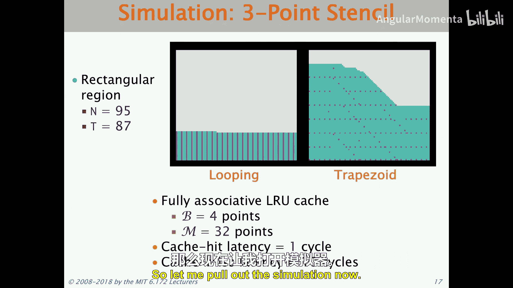
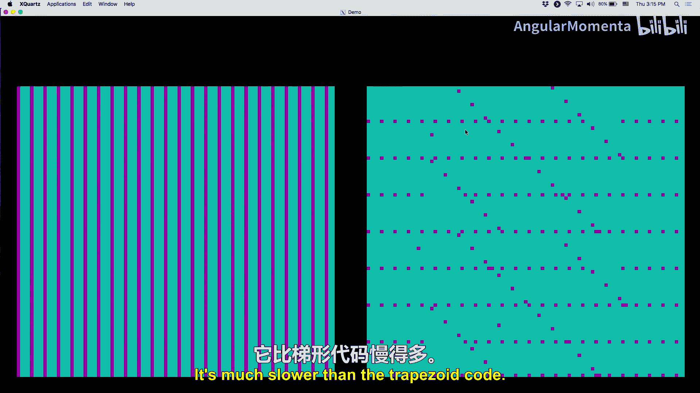
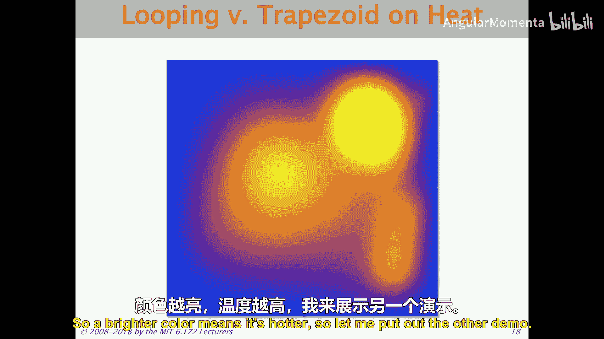
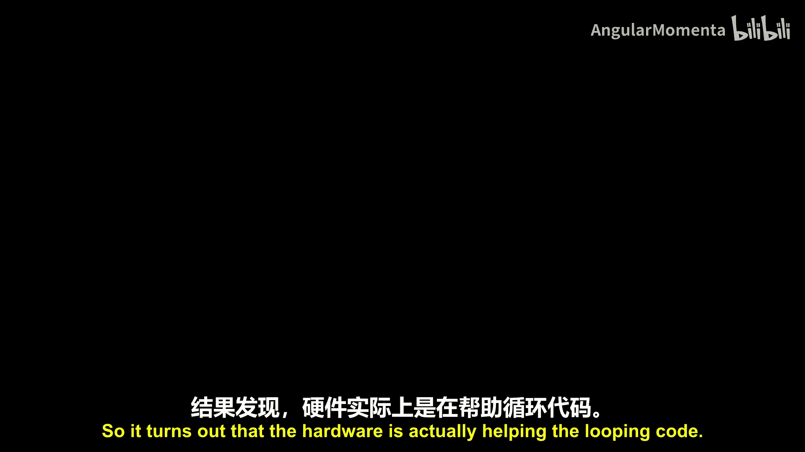
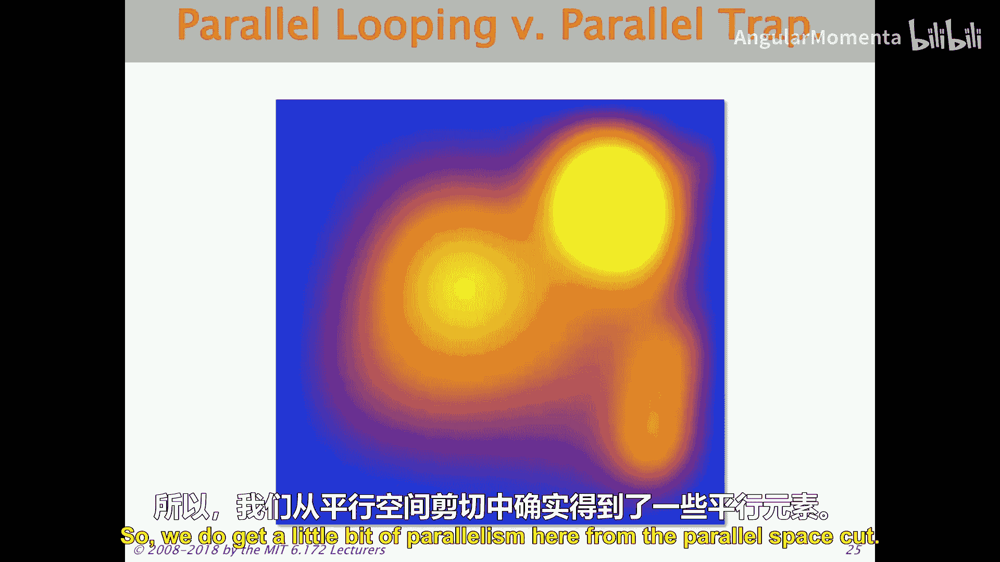
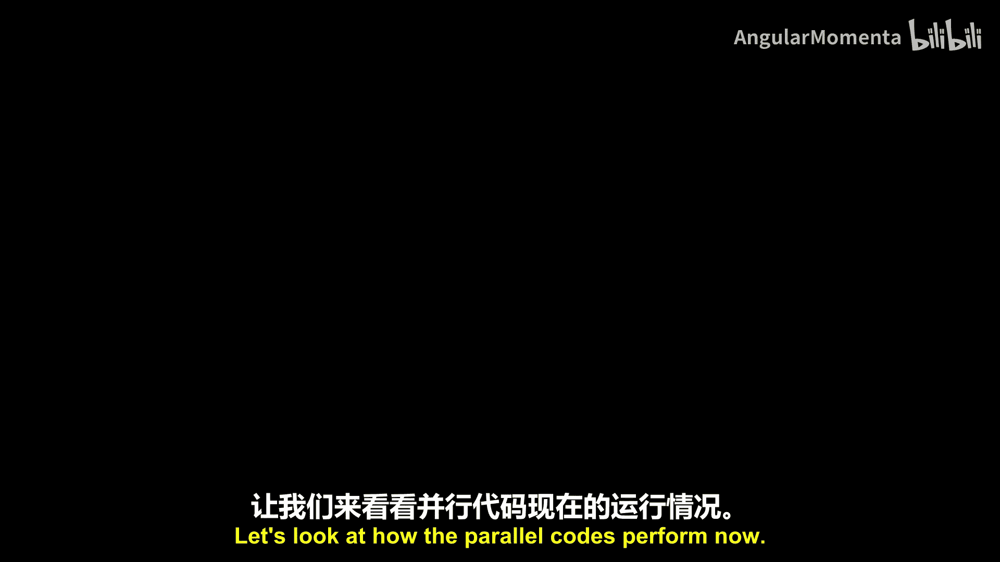
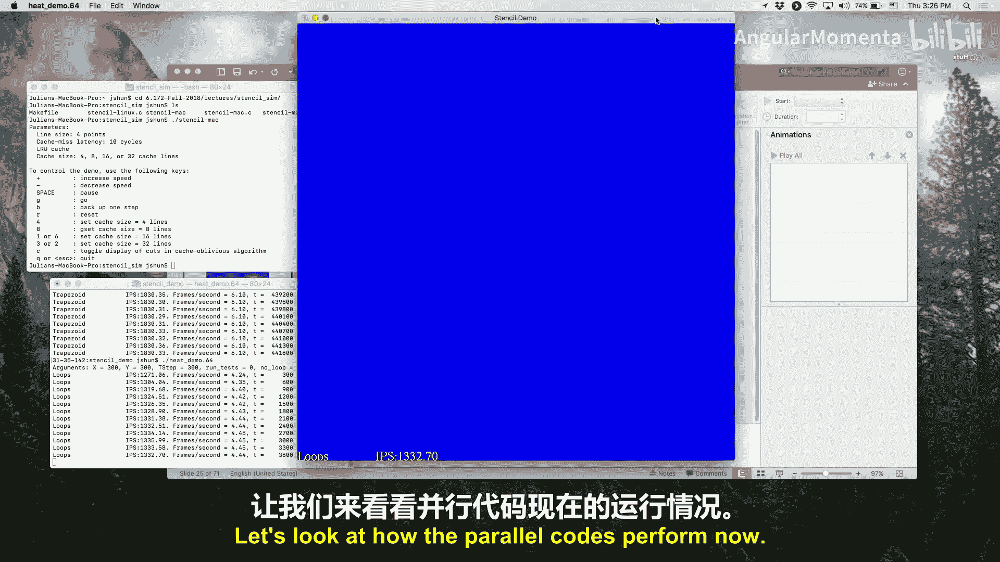
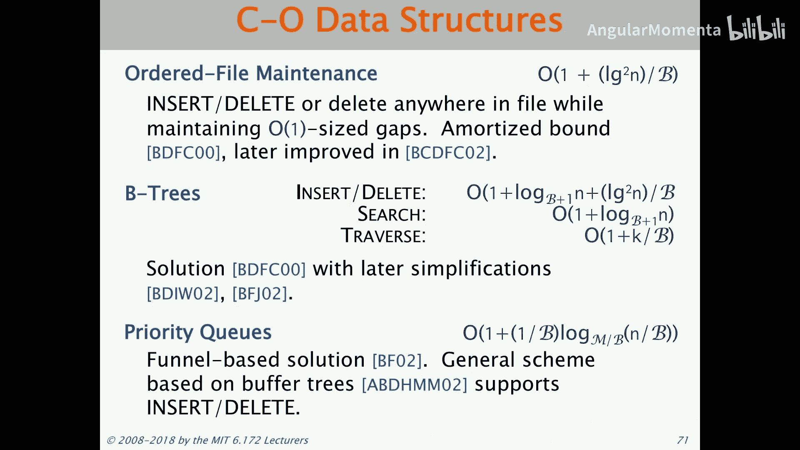

# 015：缓存无关算法


在本节课中，我们将要学习缓存无关算法的概念、原理及其应用。我们将通过具体的例子，如热扩散模拟和排序算法，来理解如何设计能够自动适应不同缓存大小、实现良好缓存效率的算法。

## 概述

缓存无关算法是一种无需知晓机器具体缓存参数（如缓存大小），就能自动调整以达到良好缓存效率的算法。这与缓存感知算法形成对比，后者需要将缓存大小等参数硬编码在代码中。上节课我们介绍了矩阵乘法的缓存无关算法，本节课我们将探讨其他例子。

## 热扩散模拟

首先，我们来看一个科学计算中常见的例子：热扩散模拟。这涉及到求解一个著名的偏微分方程——热方程。

### 热方程简介

二维热方程可以建模为一个微分方程。我们有一个函数 **U(t, x, y)**，其中 **t** 是时间步，**x** 和 **y** 是二维空间的坐标。我们想知道在任何时间点 **t**，每个 **(x, y)** 坐标的温度。

二维热方程公式如下：
```
∂U/∂t = α * (∂²U/∂x² + ∂²U/∂y²)
```
其中，**α** 是热扩散率常数。方程左边是 **U** 对时间 **t** 的一阶偏导，右边是 **U** 对空间 **x** 和 **y** 的二阶偏导之和。

### 有限差分近似法

为了用代码模拟这个微分方程，我们通常使用有限差分近似法来近似偏导数。

*   **时间偏导近似**：
    ```
    ∂U/∂t ≈ [U(t+Δt, x) - U(t, x)] / Δt
    ```
*   **空间一阶偏导近似**（采用中心差分，使数学推导更简洁）：
    ```
    ∂U/∂x ≈ [U(t, x+Δx/2) - U(t, x-Δx/2)] / Δx
    ```
*   **空间二阶偏导近似**（对一阶偏导再次应用近似）：
    ```
    ∂²U/∂x² ≈ [U(t, x+Δx) - 2*U(t, x) + U(t, x-Δx)] / (Δx)²
    ```

将上述近似代入一维热方程（为简化，先考虑一维情况），并令 **Δx = Δt = 1**，我们可以得到简化后的计算式：
```
U(t+1, x) = U(t, x) + α * [U(t, x+1) - 2*U(t, x) + U(t, x-1)]
```

### 模板计算

上述方程引导我们进行一种称为“模板计算”的操作。我们将时空网格化，用矩阵的行表示时间 **t**，列表示空间位置 **x**。

要计算 **U(t+1, x)** 的值，我们需要知道 **U(t, x)**（正下方）、**U(t, x+1)**（右下方）和 **U(t, x-1)**（左下方）这三个值。这种依赖模式称为“三点模板”。

一个直观的实现方式是使用两层循环：外层循环遍历时间步，内层循环遍历所有空间位置，逐行计算。这种方法的缓存效率如何呢？

### 基础循环代码的缓存分析

以下是基础循环实现的伪代码：
```c
for (t = 0; t < T; t++) {
    int cur = t % 2;
    int next = (t+1) % 2;
    for (x = 0; x < N; x++) {
        U[next][x] = kernel(&U[cur][x]); // kernel实现上述三点计算
    }
}
```
我们只保留两行数据（当前行和下一行），通过奇偶技巧交换角色。

假设空间大小 **N** 远大于缓存大小 **M**。分析其缓存复杂度：
*   计算每一行需要加载约 **N/B** 个缓存行（**B** 为缓存行大小）。
*   当计算下一行时，由于行数据太大，上一行所需的缓存块很可能已被逐出，导致再次发生缓存缺失。
*   因此，总缓存缺失次数约为 **Θ(N*T / B)**。

这种方法的缓存效率不高。虽然可以通过分块技术优化，但我们将直接介绍更简洁的缓存无关算法。

## 缓存无关的模板算法

我们将采用一种基于梯形区域的递归分治算法。该算法不依赖于任何缓存参数。



### 理想缓存模型回顾

在分析算法前，先回顾理想缓存模型：
*   两层存储层次：缓存和主存。
*   缓存容量为 **M** 字节，缓存行大小为 **B** 字节。
*   缓存是全相联的，采用最优或LRU替换策略。
*   性能指标：**工作量**（操作总数）和**缓存缺失次数**。
*   该模型捕获了容量缺失，但未捕获冲突缺失（因全相联假设）和共享缺失（因串行执行假设）。它鼓励我们优化时空局部性。





### 梯形分治算法

我们定义在时空网格上的一个梯形区域。该梯形具有上底（时间 **t1**）、下底（时间 **t0**）和高度 **H = t1 - t0**。梯形的“宽度”定义在时间中点处。



关键特性是：**梯形内部所有点的计算，只依赖于梯形下底边界上的值**。因此，我们可以独立地计算各个梯形。

算法采用递归分治：
1.  **基准情况**：当梯形高度为1时，直接使用简单循环计算该行所有点。
2.  **递归情况**：
    *   **空间切割**：如果梯形宽度 ≥ 2倍高度（太宽），则沿斜率为 -1 的线（逆斜率为1）从中间切开。先递归计算左梯形，再计算右梯形（因右梯形依赖左梯形结果）。
    *   **时间切割**：如果梯形宽度 < 2倍高度（太高），则沿水平线从中间切开。先递归计算下梯形，再计算上梯形（因上梯形依赖下梯形结果）。

以下是该算法的C代码框架：
```c
void trapezoid(int t0, int t1, int x0, int dx0, int x1, int dx1) {
    int ht = t1 - t0;
    if (ht == 1) {
        // 基准情况：计算单行
        for (int x = x0; x < x1; x++) {
            kernel(...);
        }
    } else if (/* 梯形太宽的条件 */) {
        // 空间切割
        int xmid = (x0 + x1) / 2;
        trapezoid(t0, t1, x0, dx0, xmid, -1);
        trapezoid(t0, t1, xmid, -1, x1, dx1);
    } else {
        // 时间切割
        int tmid = t0 + ht / 2;
        trapezoid(t0, tmid, x0, dx0, x1, dx1);
        trapezoid(tmid, t1, x0, dx0, x1, dx1);
    }
}
```
即使只保留两行数据，该算法也能正确工作，因为计算顺序保证了不会覆盖仍被依赖的数据。

### 缓存复杂度分析







我们使用递归树方法分析。由于算法在梯形太宽或太高时进行切割，保证了在到达基准情况时，梯形的高度和宽度为同一数量级，即 **H = Θ(W)**。


*   设叶子节点对应的梯形尺寸满足 **W = Θ(M)**（即能放入缓存）。每个叶子需要加载其下底数据，产生 **Θ(W/B) = Θ(M/B)** 次缓存缺失。
*   叶子节点数量为 **Θ(N*T / (H*W)) = Θ(N*T / M²)**（因为 H ≈ W ≈ M）。
*   因此，叶子节点的总缓存缺失为 **Θ((N*T / M²) * (M/B)) = Θ(N*T / (M*B))**。
*   内部节点仅产生常数级的缓存缺失，可忽略。
*   递归树的高度约为 **log M** 量级，但每层缺失次数总和与叶子层同阶，故总缓存缺失为 **Θ(N*T / (M*B))**。

与基础循环代码的 **Θ(N*T / B)** 相比，缓存无关算法节省了 **M** 倍的缓存缺失。对于 **D** 维问题，缓存复杂度为 **Θ(N*T / (M^{1/D} * B))**，此界限是最优的。

### 并行化考虑

将缓存无关算法并行化时，需要注意依赖关系。
*   **原始空间切割** 产生的两个梯形是串行依赖的，无法并行。
*   **并行空间切割**：可以修改为“V形切割”，产生三个梯形。左右两个黑色梯形可以并行计算，因为它们互不依赖且只依赖于自己的下底。计算完成后，再计算中间的灰色梯形。对于倒梯形，则先计算中间部分。
*   **时间切割** 仍然是串行的。

根据上节课的定理，在并行执行中，只要算法的跨度足够小，其缓存缺失次数主要取决于串行执行时的缓存缺失次数。因此，优化串行缓存效率至关重要。

## 排序算法的缓存效率

接下来，我们探讨如何使排序算法缓存高效。首先分析标准的归并排序。

### 标准归并排序的缓存分析

归并排序包括“合并”子程序和递归调用。
*   **合并两个有序数组**：工作量为 **Θ(n)**，缓存缺失为 **Θ(n/B)**（因为顺序访问）。
*   **归并排序递归**：`T(n) = 2T(n/2) + Θ(n)`，工作量为 **Θ(n log n)**。
*   **缓存复杂度**：递归树每层合并的缓存缺失总和为 **Θ(n/B)**，树高为 **Θ(log(n/M))**（当问题小于缓存大小时停止递归分析）。因此，总缓存缺失为 **Θ((n/B) * log(n/M))**。
    *   当 **n >> M** 时，`log(n/M) ≈ log n`，相比工作量只节省了 **B** 倍因子。
    *   当 **n ≈ M** 时，节省了 **B log n** 倍。

能否做得更好？答案是肯定的，通过使用多路归并。

### 多路归并排序

我们不只合并两个子数组，而是合并 **R** 个子数组（每个大小为 **n/R**）。这需要使用**锦标赛树**（或败者树）来高效找出当前最小元素。
*   **首次构建锦标赛树**：需要 **Θ(R)** 工作量。
*   **后续每次取出最小元素并更新**：只需更新从该元素所在叶子到根的路径，工作量 **Θ(log R)**。
*   **合并 n 个元素的总工作量**：**Θ(n log R)**。

在归并排序中使用 **R** 路归并：
*   **递归式**：`T(n) = R * T(n/R) + Θ(n log R)`。
*   **工作量**：经过计算，仍然是 **Θ(n log n)**，与二路归并相同。
*   **缓存复杂度**：关键在于，如果选择 **R = Θ(M/B)**（在满足“高缓存假设”下，即缓存能容纳锦标赛树和每个子数组的一个缓存块），那么合并 **n** 个元素的缓存缺失仅为 **Θ(n/B)**。
*   **最终缓存复杂度**：递归树每层缺失 **Θ(n/B)**，树高为 **log_R(n/M)**。代入 **R = Θ(M/B)**，并利用对数换底公式，可得总缓存缺失为 **Θ((n log n) / (B log M))**。

与二路归并的 **Θ((n log n) / B)** 相比，多路归并额外节省了 **log M** 倍。在典型机器上（如 L1 缓存 32KB，log M ≈ 15），这是一个显著的提升。

### 缓存无关排序

多路归并排序不是缓存无关的，因为它需要根据 **M** 和 **B** 来调优参数 **R**。是否存在缓存无关的排序算法呢？是的，例如 **漏斗排序**。

漏斗排序的核心思想是递归地将元素分组排序，然后使用一个称为 **K-漏斗** 的数据结构来合并 **K** 个有序列表。**K-漏斗** 本身也是递归构造的。分析表明，漏斗排序的缓存复杂度与调优后的多路归并排序相同，即 **Θ((n log n) / (B log M))**，并且是渐进最优的，同时它不需要知道任何缓存参数。

除了漏斗排序，还有许多其他的缓存无关算法和数据结构被开发出来，如用于矩阵乘法、快速傅里叶变换、B树维护、优先级队列等。

## 总结



本节课我们一起学习了缓存无关算法的核心思想。我们通过热扩散模拟的例子，深入探讨了如何将直观的循环算法转化为基于递归分治的缓存无关梯形算法，并分析了其优越的缓存复杂度。我们还分析了归并排序的缓存效率，并引出了通过多路归并以及漏斗排序来进一步优化缓存性能的方法。缓存无关算法的优势在于其可移植性和理论性能保证，是编写高性能、可扩展软件的重要工具。