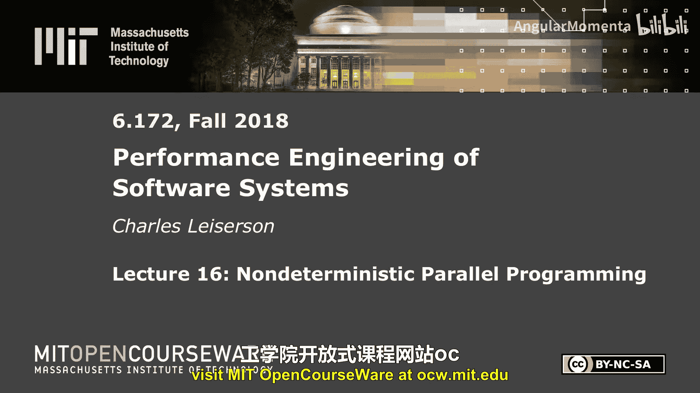
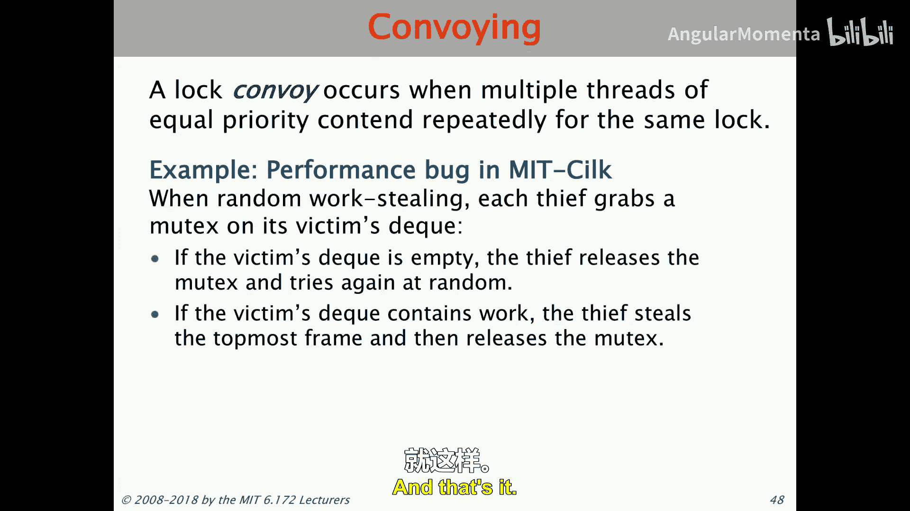

# 016：非确定性并行编程



在本节课中，我们将要学习非确定性并行编程。这是一个颇具挑战性的主题，因为非确定性本身非常棘手。我们将探讨什么是确定性、为什么应避免非确定性编程，以及当必须使用非确定性时，如何通过测试策略来管理它。我们还将深入探讨互斥锁、死锁以及事务内存等核心概念。

## 确定性 vs. 非确定性

上一节我们介绍了课程概述，本节中我们来看看什么是程序的确定性。

我们说，一个程序在给定输入下是确定性的，如果**在每次执行中，每个内存位置都以相同的值序列被更新**。这意味着程序的行为总是相同的。在并行程序中，不同内存位置的更新顺序可能不同，但每个单独的内存位置看到的更新序列必须一致。

确定性的主要优势在于其可重复性，这在调试时至关重要。如果程序每次运行都产生相同的结果，那么当出现错误时，你可以反复运行程序来定位问题。而非确定性程序的行为可能每次不同，这使得调试变得极其困难。

因此，并行编程的一条黄金法则是：**永远不要编写非确定性的并行程序**。它们可能表现出异常行为，并且难以调试。


然而，在实践中，有时我们可能不得不违反这条规则。原因可能包括追求更好的性能，或者问题本身的性质（例如处理异步输入）就决定了其非确定性。

于是，我们有了白银法则：**如果必须编写非确定性并行程序，务必设计一个测试策略来管理这种非确定性**。

以下是管理非确定性的一些典型测试策略：


*   **关闭非确定性源**：例如，在调试模式下，可以关闭内存地址随机化，或为随机数生成器使用固定的种子。
*   **封装非确定性**：将非确定性行为隐藏在平台或运行时系统内部，对外提供确定性的接口。
*   **使用确定性替代方案**：在调试时，用确定性的算法临时替换非确定性的实现。
*   **利用分析工具**：使用工具来检测和控制程序中的非确定性行为。
*   **进行单元测试**：隔离并单独测试可能受非确定性影响的部分代码。

在项目四中，管理非确定性将尤为重要，因为我们将编写一个游戏程序，其中处理器会共享游戏状态（如置换表）。能够关闭这种共享功能，对于调试搜索或评估代码至关重要。

## 互斥与原子性

上一节我们讨论了为何要避免非确定性，本节中我们来看看当需要共享数据时，如何通过互斥来保证正确性。

我们以一个哈希表为例。典型的哈希表通过链表法解决冲突。插入一个元素 `x` 时，我们计算其键的哈希值以找到对应的槽（slot），然后将 `x` 插入到该槽链表的头部。

现在考虑两个线程并行插入元素 `X` 和 `Y`，且它们哈希到同一个槽。如果两个插入操作交织进行，可能会导致链表损坏，例如 `Y` 被插入后又被 `X` 的后续操作覆盖，从而丢失。

标准解决方案是使一部分指令具有**原子性**。这意味着对于系统的其余部分而言，这些指令要么全部执行完毕，要么都未执行，永远不会看到部分执行的状态。包含原子指令的代码区域称为**临界区**。

实现原子性的典型方法是使用**互斥锁**。互斥锁是一个具有 `lock` 和 `unlock` 成员函数的对象。当一个线程试图锁定一个已被锁定的互斥锁时，该线程会被阻塞，直到锁被释放。

对于哈希表的例子，我们可以为每个槽关联一个互斥锁。在访问某个槽的链表之前，线程必须先锁定该槽的互斥锁，操作完成后再解锁。这样就确保了插入操作的原子性。

## 数据竞争与确定性竞争

上一节我们介绍了如何使用互斥锁，本节中我们需要区分两个重要概念：数据竞争和确定性竞争。

回顾一下，**确定性竞争**发生在两个逻辑上并行的指令访问同一内存位置，且至少有一个是写操作时。

互斥锁可以保证临界区的原子性，但使用锁的代码本身仍然是**非确定性**的。因为多个线程可能同时尝试获取同一个锁，这本身就是一个确定性竞争（访问锁变量）。然而，这是一个有意为之的、安全的竞争。

**数据竞争**的定义与确定性竞争类似，但附加了一个条件：两个并行指令**没有持有共同的锁**。如果它们访问同一内存位置且至少有一个是写操作，则存在数据竞争错误。如果它们持有至少一个相同的锁，则没有数据竞争。

关键区别在于：一个程序可能没有数据竞争，但仍然存在确定性竞争（例如，所有竞争都通过锁妥善管理了）。反之，如果存在数据竞争，则一定存在确定性竞争。

没有数据竞争是否意味着程序没有错误？不一定。例如，考虑以下有缺陷的哈希表插入代码：
1.  锁定槽。
2.  读取链表头。
3.  解锁槽。
4.  （执行其他操作...）
5.  再次锁定槽。
6.  将新节点插入链表头部。
7.  解锁槽。

这段代码没有数据竞争，因为所有共享访问都受锁保护。但它破坏了原子性：在第3步和第5步之间，链表可能被其他线程修改，导致第6步的插入基于过时的信息，从而出错。这被称为**原子性违例**。

## 良性竞争与架构影响

有时，程序中可能存在一些看似无害的竞争，称为**良性竞争**。例如，统计一个数组中数字0-9的出现次数：

```c
int digits[10] = {0};
parallel_for i from 0 to n-1:
    int val = A[i]; // 假设 A[i] 在 0-9 之间
    digits[val] = 1; // 标记该数字出现过
```

如果多个并行迭代都看到相同的数字（比如两个6），它们都会执行 `digits[6] = 1`。由于写入的是相同的值（1），无论顺序如何，结果看起来都是正确的。这似乎是一个良性竞争。

然而，这种“良性”依赖于架构。在某些架构（如MIPS）上，写入一个字节可能不是原子操作。处理器可能需要读取包含该字节的整个字（word），修改字节，再写回整个字。如果两个线程同时修改同一个字的不同字节，它们的非原子读写操作可能交织，导致最终结果错误。

因此，即使看起来良性的竞争，也可能在特定硬件上引发问题。这就是为什么应尽可能避免非确定性编程。

Cilk Sanitizer 等工具允许为有意为之的竞争关闭竞争检测，但这很危险，因为可能掩盖真正的错误。更好的解决方案（如Intel Cilk Plus中的“假锁”）正在开发中。

## 互斥锁的实现与性能

上一节我们讨论了竞争的概念，本节中我们深入一层，看看互斥锁是如何实现的，以及不同实现如何影响性能。

互斥锁有几个基本属性：

1.  **自旋 vs. 让出**：
    *   **自旋锁**：当线程尝试获取锁但被阻塞时，它会在一个循环中不断检查锁的状态（“自旋”），消耗CPU周期。
    *   **让出锁**：当线程无法获取锁时，它会主动让出CPU（`yield`），允许操作系统调度其他线程运行。这避免了空转，但引入了上下文切换的开销。

2.  **可重入 vs. 不可重入**：
    *   **可重入锁**：允许已经持有该锁的线程再次获取它而不会死锁。
    *   **不可重入锁**：如果线程试图再次获取它已持有的锁，会导致死锁。不可重入锁通常更轻量。

3.  **公平 vs. 非公平**：
    *   **公平锁**：按照线程请求锁的顺序（如FIFO）授予锁，防止饥饿。
    *   **非公平锁**：允许“插队”，刚释放锁时等待的线程可能与新来的线程竞争，可能导致某些线程长时间得不到锁。非公平锁通常吞吐量更高。

一个简单的自旋锁在x86汇编中的实现核心是 `lock xchg` 指令，这是一个原子交换操作。为了提高性能，代码通常会先以只读方式检查锁是否空闲（`cmp` 指令），这使缓存行处于共享状态，减少总线流量。只有当锁可能空闲时，才执行昂贵的原子交换操作。

将自旋锁改为让出锁，只需将自旋循环中的 `pause` 指令替换为对操作系统 `yield` 的调用。

**竞争性互斥锁**试图结合自旋和让出的优点。其策略是：先自旋一段时间（例如，一个上下文切换所需的时间，约10毫秒），如果在此期间锁被释放，则能立即获得，性能最优。如果超时后仍未获得锁，则让出CPU。这种策略在最坏情况下的等待时间不会超过最优情况的两倍。有趣的是，存在一种随机化算法，可以达到 **`e/(e-1)`** 的竞争比。

了解一些关键的性能数据很有帮助：
*   上下文切换开销：约 **10毫秒**。
*   DRAM访问延迟（未命中缓存）：约 **150纳秒**。
*   磁盘访问延迟：约 **5-10毫秒**。

## 死锁

当线程需要持有多个锁时，就可能发生**死锁**。死锁需要三个条件同时满足：
1.  **互斥**：资源（如锁）一次只能被一个线程持有。
2.  **不可抢占**：线程在完成操作前不会释放已持有的资源。
3.  **循环等待**：存在一个线程环路，每个线程都在等待下一个线程持有的资源。

经典的“哲学家就餐问题”说明了死锁。五位哲学家围坐，每两人之间有一根筷子。哲学家需要两根筷子才能吃饭。如果每位哲学家都先拿起左边的筷子，那么所有人都会拿着左筷等待右筷，导致死锁（饥饿）。

避免死锁的一个有效方法是**对锁进行线性排序**，并强制所有线程都按此顺序获取锁。例如，将筷子编号0到4，规定哲学家必须**先拿编号较小的筷子，再拿编号较大的筷子**。这样就不可能形成循环等待。

在Cilk中使用锁要特别小心。一个常见的错误是在Cilk `sync` 操作期间持有锁。考虑以下代码：
```c
lock(L);
spawn foo(); // foo 内部也尝试 lock(L)
// ... 其他工作 ...
sync;
unlock(L);
```
如果主线程先获得锁 `L`，然后派生子线程 `foo`，`foo` 会因无法获得锁而阻塞。主线程在执行到 `sync` 时必须等待 `foo` 完成，但 `foo` 又在等待主线程释放锁，这就导致了死锁。教训是：**尽量避免在Cilk同步点（sync）上持有锁**。一个好的策略是只在线程内部（strand内）持有锁，并尽量缩短持锁时间。

## 事务内存

最后，我们来看一个更高级的概念：**事务内存**。它借鉴了数据库事务的思想，允许程序员声明一个代码区域是原子的，而无需显式指定锁。系统会自动处理冲突，必要时中止并重启事务。

考虑一个并发图计算，比如在图上进行高斯消元。在消除一个顶点时，需要移除它，并将其所有邻居两两连接。如果两个相邻的顶点被并行消除，就会发生冲突。

使用事务内存，我们可以将整个消除操作包装在一个事务中。如果两个事务冲突（例如，试图修改相同的边），系统会中止其中一个，并在稍后重启它。重启后，由于图的状态可能已改变，事务可能走不同的代码路径。

事务内存涉及几个关键概念：
*   **冲突**：两个事务无法同时成功提交。
*   **中止与重启**：解决冲突的方式之一。
*   **冲突解决**：决定哪个事务等待、中止或重启的策略。
*   **向前进展**：避免死锁、活锁和饥饿。
*   **吞吐量**：最大化并发执行的事务数量。

一个有趣的无全局锁事务内存算法使用了“有限所有权数组”和“释放-排序-重获取”的思想。其核心是：
1.  通过一个哈希函数 `H`，将内存地址映射到一组互斥锁（所有权数组）上。
2.  事务尝试按需贪婪地获取锁。
3.  如果获取锁 `H(x)` 失败，则事务回滚（但保留已持有的锁）。
4.  释放所有索引大于 `H(x)` 的已持有锁。
5.  成功获取锁 `H(x)`。
6.  按索引顺序重新获取所有被释放的锁。
7.  重启事务。

每次重启，事务都确保自己只持有比当前欲获取锁索引更小的锁，从而避免了死锁，并逐步推进。

另一个需要注意的性能问题是**锁护送**：当一个持有锁的线程被操作系统调度出去时，其他所有等待该锁的线程都会被阻塞，即使锁很快被释放，它们也要等待被挂起的线程重新被调度。这曾是MIT Cilk早期的一个性能问题。

---



本节课中我们一起学习了非确定性并行编程的复杂性。我们明确了确定性的定义及其对调试的重要性，并给出了“永不编写非确定性程序，若必须则管理之”的准则。我们深入探讨了使用互斥锁实现原子性、数据竞争与确定性竞争的区别、以及“良性”竞争可能暗藏的风险。我们还剖析了互斥锁的不同实现（自旋/让出、可重入/不可重入、公平/非公平）及其性能影响，分析了死锁的条件和避免方法（如锁排序）。最后，我们简要介绍了事务内存这一高级概念，它提供了另一种管理并发的抽象。理解这些内容对于编写正确、高性能的并行程序至关重要。