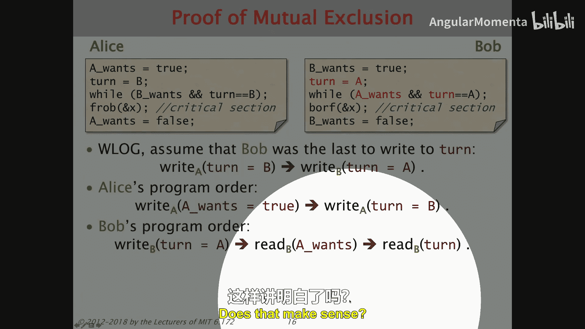
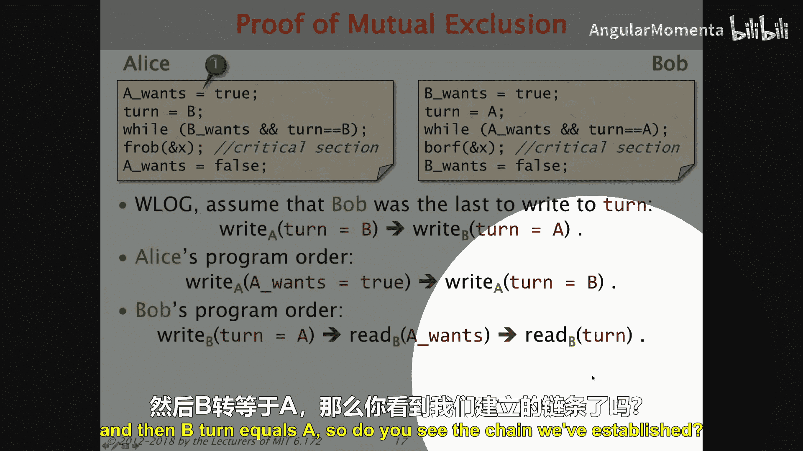
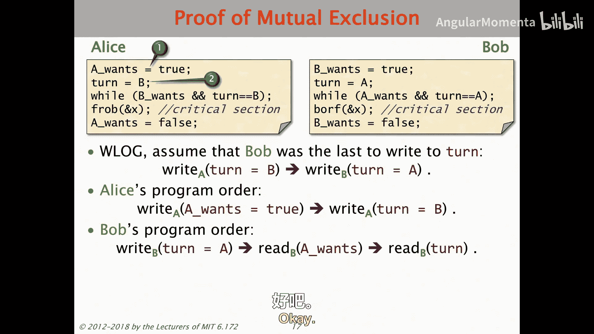
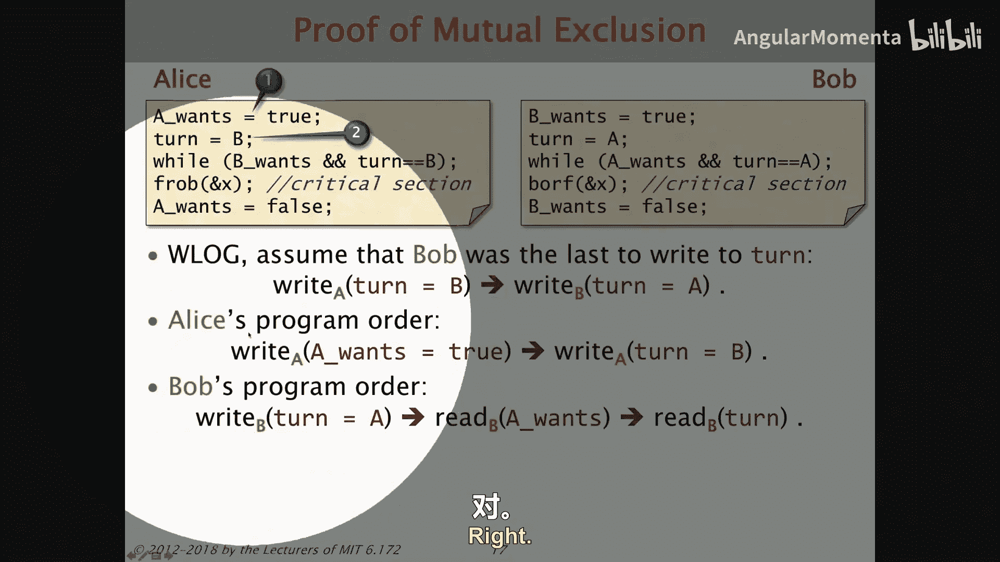

# 017：无锁同步 🔒


在本节课中，我们将学习无锁同步的概念。我们将探讨内存模型，特别是顺序一致性，并了解为什么现代计算机不实现它。我们还将学习如何使用Peterson算法仅通过加载和存储实现互斥，并探讨指令重排序如何破坏这些算法。最后，我们将介绍内存屏障和比较并交换指令，作为在弱内存模型下实现正确同步的工具。

## 内存模型与顺序一致性 🧠

上一节我们介绍了同步的基本概念。本节中，我们来看看一个关键的理论基础：内存模型。内存模型定义了处理器如何观察内存操作（加载和存储）的顺序。

为了引入这个概念，我们看一个例子。假设有两个变量 `A` 和 `B`，初始值都是0。它们存储在内存中。处理器0执行：
1.  将1存入 `A`。
2.  将 `B` 的值加载到寄存器 `EBX`。

同时，处理器1执行：
1.  将1存入 `B`。
2.  将 `A` 的值加载到寄存器 `EAX`。

问题是：两个处理器都执行完代码后，`EBX` 和 `EAX` 是否可能**都**包含值0？

直觉上，答案似乎是“不可能”。然而，这实际上取决于所谓的**内存模型**。你刚才的推理基于一个特定的模型：**顺序一致性**。

顺序一致性由Leslie Lamport定义，其核心思想是：
> 任何执行的结果，都等同于所有处理器的操作按某种顺序依次执行，并且每个独立处理器的操作在该序列中按照其程序指定的顺序出现。

换句话说，你可以将所有处理器的指令交错排列成一个全局的线性顺序。在这个顺序中，每个处理器的程序顺序得到保持，并且每次加载都读取该线性顺序中对该地址**最近一次**存储的值。

对于上面的例子，在顺序一致性下，确实不可能出现 `EBX` 和 `EAX` 同时为0的情况，因为所有可能的交错顺序都无法产生这个结果。

我们可以通过 **happens-before** 关系来形式化地推理顺序一致性。这个关系（记为 →）是线性的，意味着对于任意两条不同的指令，要么一条在另一条之前发生，要么反之。这个关系必须尊重处理器的程序顺序，并且加载读取的值必须是 happens-before 顺序中对该地址最近的存储值。

## Peterson互斥算法 ⚙️







在并发理论中，一个著名的早期成果是证明了可以在不使用锁或特殊原子指令（如测试并设置）的情况下实现互斥，前提是系统是顺序一致的。Peterson算法是其中最简洁优雅的实现之一。





假设Alice和Bob是两个线程，共享一个“小部件”。Alice想“frob”它，Bob想“bo”它，但这两个操作不能同时进行（互斥）。以下是Peterson算法的伪代码：

```c
// 共享变量
bool A_wants = false, B_wants = false;
int turn; // 可以是 A 或 B

// Alice的代码
A_wants = true;
turn = B;
while (B_wants && turn == B) {
    // 空循环，自旋等待
}
// 临界区：frob the widget
A_wants = false;

// Bob的代码
B_wants = true;
turn = A;
while (A_wants && turn == A) {
    // 空循环，自旋等待
}
// 临界区：bo the widget
B_wants = false;
```

**算法直觉**：如果Alice和Bob都想进入临界区，那么最后设置 `turn` 变量的那个线程将等待。同时，该算法也保证了**无饥饿**：一个线程不能连续进入临界区两次，因为每次进入后它都会将 `turn` 让给对方。

**形式化证明（简述）**：为了证明互斥性，我们假设Alice和Bob同时进入了临界区（反证法）。考虑他们进入前最后执行的指令序列，并假设Bob是最后一个写入 `turn` 的线程。通过建立 happens-before 关系链，我们可以推导出Bob在自旋循环中读取 `A_wants` 应为 `true` 且 `turn == A`，因此他应该继续等待，而不可能进入临界区，这与假设矛盾。因此，互斥性得证。

## 弱内存模型与指令重排序 🔄

上一节我们介绍了理想的顺序一致性模型。然而，本节中我们来看看现实：**没有现代处理器实现顺序一致性**。它们都实现了某种形式的**弱（宽松）内存一致性**模型。

为了提高性能，硬件（和编译器）会主动**重排序指令**。例如，考虑以下两条指令：
```c
Store A
Load B
```
硬件或编译器可能会将其重排序为：
```c
Load B
Store A
```
为什么？因为加载操作通常需要等待内存响应，会导致处理器流水线停顿。如果先将不依赖前面存储结果的加载提前执行，就可以掩盖部分内存访问延迟，从而提高性能。只要 `A` 和 `B` 是不同的内存地址，并且没有其他并发线程访问它们，这种重排序在单线程视角下是完全安全的。

**硬件如何实现重排序**：现代处理器使用**存储缓冲区**。存储指令可以快速进入缓冲区，而不必等待缓慢的内存系统。加载指令则通常绕过存储缓冲区直接访问内存（或缓存），以更快地获得数据。如果加载的地址恰好在存储缓冲区中有待处理的写入，则直接从缓冲区返回值。这种机制使得加载操作可能在逻辑上先于更早的存储操作完成。

**X86的总存储顺序模型**：X86实现了一种称为“总存储顺序”的弱内存模型，其规则包括：
*   加载与加载之间不会重排序。
*   存储与存储之间不会重排序。
*   存储不会与之前的加载重排序。
*   **但是，加载可以与之前对不同地址的存储进行重排序**。

正是最后这条规则，破坏了顺序一致性。

**重排序对同步的影响**：回到最初的双变量例子，在弱内存模型下，处理器0和1的指令可能被重排序，导致 `EBX` 和 `EAX` 都读到0的执行结果成为可能。同样，Peterson算法也可能因重排序而失效。例如，如果 `while` 循环中的加载 `B_wants` 被重排序到 `A_wants = true` 之前执行，那么Alice可能过早地看到 `B_wants` 为 `false`，从而错误地与Bob同时进入临界区。

## 内存屏障与原子操作 🛡️

既然指令重排序会破坏无锁同步，我们如何编写正确的并发代码呢？硬件提供了**内存屏障**指令作为“补丁”。

内存屏障是一种硬件操作，强制屏障前后的指令满足某种排序约束。在X86中，对应的指令是 `MFENCE`。编译器也提供了相应的函数，如 `atomic_thread_fence`。在屏障处，处理器会确保所有在屏障之前的加载和存储操作完成后，才执行屏障之后的加载和存储操作。

为了让Peterson算法在弱内存模型下工作，我们需要：
1.  **插入内存屏障**：例如，在设置 `turn` 变量之后和进入自旋循环之前插入屏障，防止循环中的加载被重排序到设置 `turn` 之前。
2.  **使用 `volatile` 关键字**：防止编译器将共享变量（如 `A_wants`, `B_wants`, `turn`）优化到寄存器中，导致线程看不到其他线程的修改。
3.  **可能需要编译器屏障**：防止临界区内的操作被移出临界区。

然而，仅使用加载/存储和屏障来实现多线程互斥算法，其空间复杂度是O(n)。为了更高效地实现通用互斥，现代处理器提供了**原子读-修改-写**指令。

## 比较并交换与无锁编程 ⚡

最常用的原子指令之一是**比较并交换**。其语义如下：
```c
bool CAS(int* addr, int oldval, int newval) {
    if (*addr == oldval) {
        *addr = newval;
        return true; // 成功
    } else {
        return false; // 失败
    }
}
```
整个操作是原子的，并且隐含了内存屏障。它检查内存位置 `addr` 的值是否等于 `oldval`，如果是，则自动将其替换为 `newval` 并返回成功；否则，不做任何修改并返回失败。

使用CAS，我们可以用常数空间实现一个简单的自旋锁：
```c
// 锁变量，false表示未上锁
std::atomic<bool> lock = false;

void acquire_lock() {
    bool expected = false;
    while (!lock.compare_exchange_strong(expected, true)) {
        // 交换失败，说明锁已被他人持有，继续重试
        expected = false; // 重置期望值
    }
    // 成功获取锁
}

void release_lock() {
    lock.store(false);
}
```

**无锁算法的优势**：考虑一个并行求和问题。使用锁保护累加变量时，如果一个线程在持有锁时被操作系统挂起，所有其他线程都会被阻塞。而使用CAS实现的无锁累加则没有这个问题：即使一个线程在更新时被挂起，其他线程仍然可以继续尝试更新，整个系统仍然有进展。

**CAS的ABA问题**：CAS存在一个经典陷阱——ABA问题。线程1读取共享变量值为A，准备将其CAS为C。在此期间，线程2将值从A改为B，然后又改回A。当线程1执行CAS时，发现当前值仍是A，于是成功更新为C。但这可能是不正确的，因为中间状态B可能代表某种重要的变化（例如，链表节点被释放并重新分配）。解决ABA问题通常需要引入版本号或使用更强大的原子指令。

---


本节课中我们一起学习了无锁同步的复杂世界。我们从理想的顺序一致性模型出发，理解了Peterson算法如何仅用加载/存储实现互斥。然后，我们直面现实，看到了现代处理器为性能而进行的指令重排序如何破坏这些算法，并学习了使用内存屏障和 `volatile` 关键字来恢复正确性。最后，我们介绍了强大的比较并交换原子指令，它是实现高效无锁数据结构的基石，但也需要警惕如ABA问题这样的陷阱。无锁编程是一个强大但危险的领域，需要严谨的推理和对硬件模型的深刻理解。